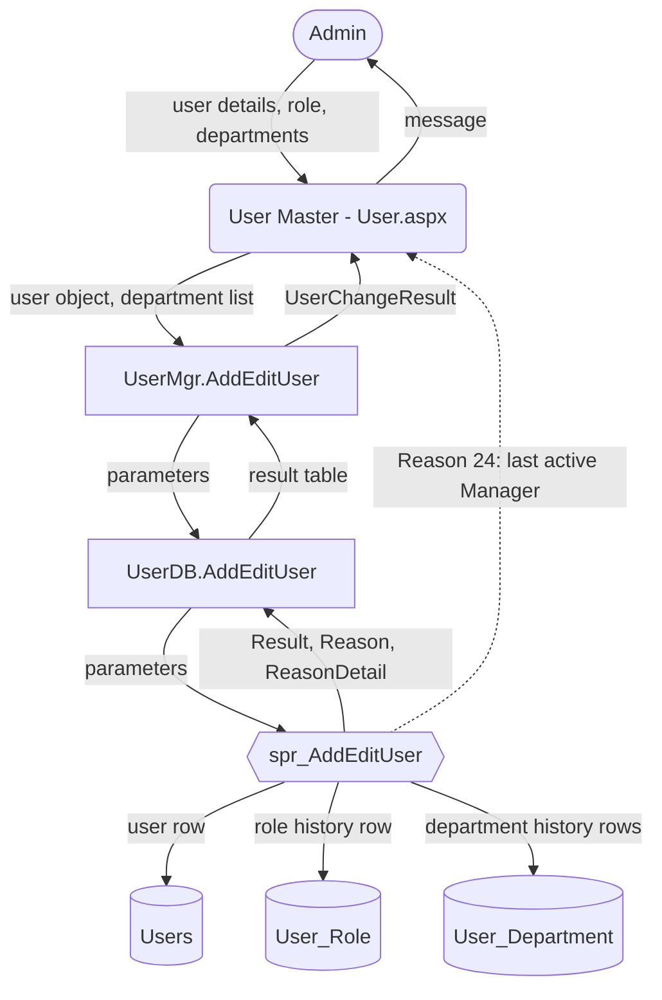

# Data-Flow Notation

- Title: Data-Flow Notation
- Audience: Developers, installers, Gashpy Software
- Shipped: No
- Applies to: user-ud1a
- Last updated by: WF2a, based on 021e946
- Status: Draft
- Verified against: the example below: BMMS/Master/User.aspx.cs (btnSave, UserMgr.AddEditUser),
  BMMSBAL/UserMgr.cs (AddEditUser, UserChangeResult), BMMSDAL/UserDB.cs (AddEditUser calls
  spr_AddEditUser), Database/BMMS-Fix-UserHistory-Step39.sql (spr_AddEditUser writes Users,
  User_Role and User_Department and returns Result, Reason, ReasonDetail)
- To confirm:

"Data flow" in these documents means the flow of data from one program to another: from a page
to a business-layer (BAL) method, to a data-layer (DAL) method, to a stored procedure, to a table,
and out again to a file or a mail. Every diagram is Mermaid, so it renders on GitHub and in the
Word and PDF exports.

## Shapes

| Element | Shape | Mermaid syntax | Example |
|---|---|---|---|
| Page (.aspx, user control) | Rounded box | `id("text")` | `pUser("User Master - User.aspx")` |
| BAL or DAL method | Rectangle | `id["text"]` | `bSave["UserMgr.AddEditUser"]` |
| Table | Cylinder | `id[("text")]` | `tUsers[("Users")]` |
| Stored procedure or function | Hexagon | `id{{"text"}}` | `sSave{{"spr_AddEditUser"}}` |
| File or mail | Parallelogram | `id[/"text"/]` | `fMail[/"Mail to the Manager"/]` |
| External actor (a person in a role, the mail server) | Stadium | `id(["text"])` | `aAdmin(["Admin"])` |

Rules:

- Node ids start with a letter for the kind: `a` actor, `p` page, `b` BAL, `d` DAL, `s` procedure
  or function, `t` table, `f` file or mail.
- Labels are always in double quotes, so brackets and dots in names do not break the diagram.
- Every arrow carries a label naming the data, in the direction the data moves:
  `pUser -->|"user details, departments"| bSave`.
  A read is drawn from the table to the procedure (`tUsers -->|"current role"| sSave`), a write
  from the procedure to the table.
- A refusal is a dashed arrow labelled with the Reason code and its meaning:
  `sSave -.->|"Reason 24: last active Manager"| pUser`.
- One diagram shows one main flow. Side flows go in their own diagram.
- Flowcharts run top-down (`flowchart TD`) so they stay readable on an A4 page in the exports;
  left-to-right only for short flows of four or five nodes.

## Table after each diagram

Every diagram is followed by a table with one row per arrow, then the list of files it was drawn
from:

| From | To | Data | Notes |
|---|---|---|---|

"Drawn from:" lists the files, procedures and Test scripts read, with the section or method name.

## Sequence diagrams

Program-to-program files show the main flow as a `sequenceDiagram`. Participants are named by
kind and name (`participant P as User.aspx`); refusal paths are `alt` blocks, each labelled with
its Reason code; the place where each rule lives (C# method and procedure) is listed in a table
after the diagram.

## Swim lanes

Mermaid has no swim-lane diagram. Workflows use `flowchart LR` with one `subgraph` per role (the
lane) and the steps of that role inside it. Decisions are diamonds `id{"question"}`. Every
workflow ends with a decision-points table:

| Decision | Who | Rule | Where it lives |
|---|---|---|---|

## Example: saving a user on User Master

| From | To | Data | Notes |
|---|---|---|---|
| Admin | User Master | User details, role, departments | Departments are offered for a Manager only |
| User Master | UserMgr.AddEditUser | User object and department list | Called from the Save button |
| UserMgr.AddEditUser | UserDB.AddEditUser | Parameters | |
| UserDB.AddEditUser | spr_AddEditUser | Parameters | One call, one result row |
| spr_AddEditUser | Users | The user row | Insert or update |
| spr_AddEditUser | User_Role | Role history row | Closes the old row, opens the new one on a role change |
| spr_AddEditUser | User_Department | Department history rows | Home department plus the extra departments of a Manager |
| spr_AddEditUser | UserDB.AddEditUser | Result, Reason, ReasonDetail | |
| UserMgr.AddEditUser | User Master | UserChangeResult | Turned into the message shown |
| spr_AddEditUser | User Master | Reason 24 | Refusal: the user is the last active Manager of a department with waiting items, or items are routed to the user |

Drawn from: BMMS/Master/User.aspx.cs (Save), BMMSBAL/UserMgr.cs (AddEditUser), BMMSDAL/UserDB.cs
(AddEditUser), Database/BMMS-Fix-UserHistory-Step39.sql (spr_AddEditUser, fn_ManagerReleaseRefusal).
