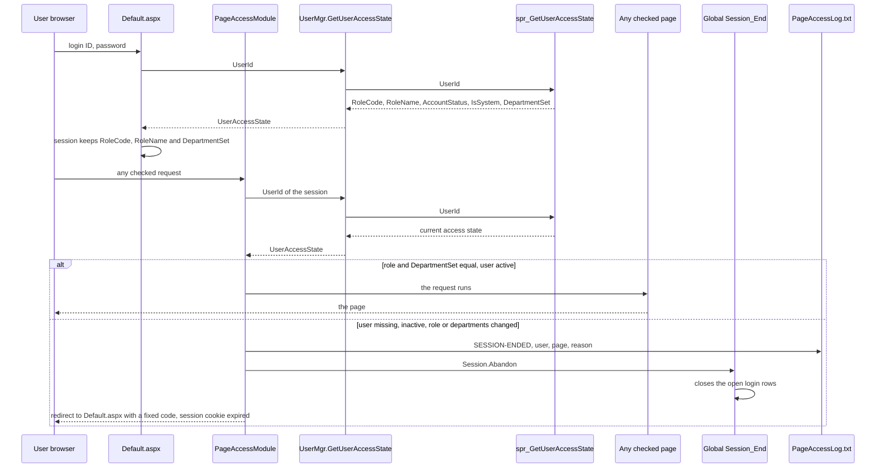

# Program to Program: Login and Session

- Title: Program to Program: Login and Session
- Audience: Developers and installers (internal)
- Shipped: No
- Applies to: RA1d (the session check: what the session keeps at sign-in and the check on every request); the rest user-ud1a
- Last updated by: RA1d, based on d642746
- Status: Draft
- Verified against: for RA1d: BMMS/PageAccessModule.cs, BMMS/Default.aspx.cs, BMMS/Global.asax.cs (diff), BMMSBAL/UserMgr.cs and BMMSDAL/UserDB.cs (diff), Database/BMMS-Fix-SessionCheck-Step51.sql (read in full), Database/README.md (section Step RA1d), Tests/packs/session-check/README.md
- To confirm: the password check, the first-login password change and the sign-out are not written yet (WF2c2); the table of the sign-in itself (spr_GetUserByLoginName, spr_RecordLoginByUserId) is only named here

## Scope

This file holds, so far, the part that step RA1d added: what the session keeps at sign-in and what happens to a
signed-in user on every later request. A signed-in request to a page is compared with the database before the
page runs; when the user is missing or inactive, or the role or the departments changed, the session ends and the
user is sent to the sign-in page. The check does not decide who may open which page (PageAccess.xml and the
role checks of the pages do that).

Checked: every .aspx request that PageAccess.xml does not open to visitors, with its postbacks and UpdatePanel
postbacks, Report/ViewReport.aspx (the pop-up, the PDF stream, the Word export) and ChangePasswordFirst.aspx.
Not checked: Default.aspx, Logout.aspx, Error/ErrorPage.aspx, WebResource.axd, ScriptResource.axd and static
files. The project has no .ashx or .asmx.

[[CONFIRM: the part of this file on the password check, the first-login password change and the sign-out is not written yet (WF2c2)]]

## Programs involved

| Program | Part in this flow |
|---|---|
| Default.aspx (Default.aspx.cs) | Reads the access state at sign-in, stores the role and the department stamp in the session, shows the fixed message for `?status=` |
| PageAccessModule (BMMS/PageAccessModule.cs) | Reads the access state once per request, compares it with the session, ends the session on a difference |
| UserMgr.GetUserAccessState, UserDB.GetUserAccessState | Business and data layer of the one read |
| spr_GetUserAccessState | The read-only procedure (step 51) |
| Global.asax.cs | `Session_End` closes the open login rows; `WriteSafeAnswer` is the safe error page |
| App_Data/PageAccessLog.txt | SESSION-ENDED and SESSION-CHECK-ERROR lines |

## Main flow

| From | To | Data | Notes |
|---|---|---|---|
| User | Default.aspx | Login ID and password | The password check is not described here |
| Default.aspx | UserMgr.GetUserAccessState | UserId | Made after the password is right and before the login is recorded; a missing or inactive user gets the inactive text |
| UserMgr.GetUserAccessState | spr_GetUserAccessState | UserId | Through UserDB.GetUserAccessState |
| spr_GetUserAccessState | Default.aspx | RoleCode, RoleName, AccountStatus, IsSystem, DepartmentSet | DepartmentSet is Users.DepartmentId, a vertical bar, the open department rows with the home one marked "h" |
| Default.aspx | Session | RoleCode, RoleName, DepartmentSet | The other session keys are unchanged |
| User | PageAccessModule | A checked request | On PostAcquireRequestState, before any page, master page or menu code |
| PageAccessModule | spr_GetUserAccessState | UserId | One call per request; the result is kept in HttpContext.Items and reused by RequireRole and HasRole |
| PageAccessModule | PageAccessLog.txt | SESSION-ENDED line | User, role, page without query string, "UserId [n]; [reason]" with the reason "missing", "inactive", "role X to Y" or "departments changed" |
| PageAccessModule | Session | Session.Abandon without Clear | So Session_End still finds the UserId |
| Global Session_End | Audit_Trial_Login | Close the open login rows of the user | Through the audit procedure; inside a try/catch with an error log line; the UserId is read with int.TryParse |
| PageAccessModule | User | Redirect to Default.aspx with `?status=inactive` or `?status=changed`; the session cookie expired | An UpdatePanel postback gets the AJAX pageRedirect answer, the pop-up and the exports no half page or file |
| Default.aspx | User | A fixed message | See the refusal paths |

## Refusal paths

This check has no Reason codes: the procedure only reads, and the module decides.

| Case | Session | Message and code | Log line |
|---|---|---|---|
| User not in View_Users | Ended | "Your account is inactive. Contact the administrator." (`status=inactive`) | SESSION-ENDED, reason "missing" |
| AccountStatus not 1 | Ended | "Your account is inactive. Contact the administrator." (`status=inactive`) | SESSION-ENDED, reason "inactive" |
| RoleCode differs from the session (trimmed, case ignored) | Ended | "Your access has changed. Please sign in again." (`status=changed`) | SESSION-ENDED, reason "role X to Y" |
| DepartmentSet differs from the session, or the session has none | Ended | "Your access has changed. Please sign in again." (`status=changed`) | SESSION-ENDED, reason "departments changed" (with the role reason when both differ) |
| Database error during the check | Kept | Safe error page (HTTP 500), or the error bar for an UpdatePanel postback; the next request checks again | SESSION-CHECK-ERROR, and the error log |
| Database error at sign-in | Not opened | "Database not connected" | The error log |

The sign-in page compares `status` with the two fixed codes and shows fixed text; any other value shows nothing.
Unsaved work in the ended session is lost.

## Where each rule lives

| Rule | C# | Procedure |
|---|---|---|
| What the session keeps at sign-in | Default.aspx.cs (btnLogin_Click) | spr_GetUserAccessState (read) |
| Which requests are checked | PageAccessModule (.aspx paths that are not public in PageAccess.xml) | none |
| The comparison | PageAccessModule.SessionMatches | none |
| Ending the session, the log line, the cookie | PageAccessModule.EndSession | none |
| The messages and the codes | Default.aspx.cs (InactiveMessage, AccessChangedMessage) and the constants StatusInactive and StatusChanged of PageAccessModule | none |
| Database error during the check | PageAccessModule (ReadAccessState, then Global.WriteSafeAnswer) | none |
| Closing the login rows | Global.asax.cs (Session_End) | spr_AddEditAuditTrialLogin |

## Tables read and written

| Table or file | Read | Written | By |
|---|---|---|---|
| View_Users (Users, Roles and others) | Yes | No | spr_GetUserAccessState |
| User_Department | Yes (open rows, EffectiveTo NULL) | No | spr_GetUserAccessState |
| Audit_Trial_Login | No | Yes (open rows closed) | spr_AddEditAuditTrialLogin, called by Session_End |
| App_Data/PageAccessLog.txt | No | Yes (SESSION-ENDED, SESSION-CHECK-ERROR) | PageAccessModule |

## Drawn from

BMMS/PageAccessModule.cs (ReadAccessState, SessionMatches, EndSession, the status constants, Log, Clean),
BMMS/Default.aspx.cs (btnLogin_Click, the `status` handling, the two message constants), BMMS/Global.asax.cs
(Session_End, WriteSafeAnswer), BMMSBAL/UserMgr.cs (UserAccessState, GetUserAccessState), BMMSDAL/UserDB.cs
(GetUserAccessState), Database/BMMS-Fix-SessionCheck-Step51.sql (spr_GetUserAccessState), Database/README.md
(section Step RA1d), Tests/packs/session-check/README.md.
