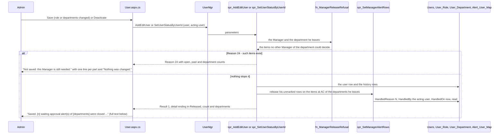
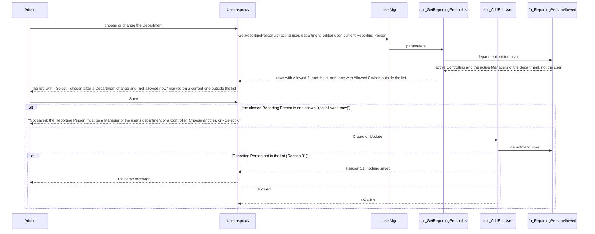

# Program to Program: User Master and History Tables

- Title: Program to Program: User Master and History Tables
- Audience: Developers and installers (internal)
- Shipped: No
- Applies to: GM1a (step 56: the new section "The governance change log (step GM1a)"); UD1c (step 54: the new section "The Reporting Person (step UD1c)"); UD1b (step 53: a Manager's role change, removed department or Deactivate, and the closed alerts); user-ud1a
- Commit: 32c619d
- Last updated by: GM1a, based on 32c619d (the new section only; the rest was last updated by UD1c, based on 42cb88c)
- Status: Draft
- Verified against: for GM1a: Database/BMMS-Fix-GovernanceLog-Step56.sql (comment blocks of the log writers and the replaced procedures), Database/README.md (section Step GM1a); for UD1c: BMMS/Master/User.aspx.cs (diff: LoadMgrController, NotAllowedManagerChosen, PageValidation, the Department change), BMMSBAL/UserMgr.cs (diff), Database/BMMS-Fix-ManagerScope-Step54.sql (fn_ReportingPersonAllowed and spr_GetReportingPersonList read in full; spr_AddEditUser read at its comment block and the two Reason 31 checks), Database/README.md (section Step UD1c); for UD1b: BMMS/Master/User.aspx.cs (diff: the save and the status messages), BMMSBAL/UserMgr.cs (diff: ReleasedMessage, SuccessDetail), BMMSDAL/UserDB.cs (the two procedure calls), Database/BMMS-Fix-DepartmentApprovers-Step53.sql (fn_ManagerReleaseRefusal, spr_SetManagerAlertRows and the comment blocks of spr_AddEditUser and spr_SetUserStatusByUserId read; the long procedure texts not read line by line), Database/README.md (section Step UD1b)
- To confirm: feature area written only for the release of a Manager since step UD1b (WF2c2); the rest of User Master (save, role history, department history, delete, reset password) is not written yet

## Scope

This file covers, since step UD1b (database step 53), what User Master does when the Admin changes a Manager: a role change away
from Manager, a department removed, a Deactivate, and (the other way) a new Manager, an added department, a role changed to
Manager and Activate. Rule 12 (step 39, changed in step 52) stops the change only when no other Manager of the department could
decide the items waiting for him; when it allows it, his waiting alert rows of the department are closed and the page says so.
The protected system account may make these changes (as an Admin).

[[CONFIRM: the rest of User Master and of the history tables is not written yet (WF2c2)]]

## Programs involved

| Program | Kind | Part in the flow |
|---|---|---|
| Master/User.aspx(.cs) | Page | `btnSave_Click` (edit), `grvUser_RowCommand` (Activate, Deactivate); shows the message |
| UserMgr.AddEditUser, UserMgr.SetUserStatusByUserId | BAL | Call the procedures; `UserChangeResult.ReleasedMessage()` builds the sentence, `SuccessDetail` reads the detail before the Released marker |
| UserDB.AddEditUser, UserDB.SetUserStatusByUserId | DAL | Call spr_AddEditUser and spr_SetUserStatusByUserId |
| spr_AddEditUser, spr_SetUserStatusByUserId | Procedures | Rule 12, the history rows, the alert rows |
| fn_ManagerReleaseRefusal | Inline table function | What stops a Manager from leaving a department |
| spr_SetManagerAlertRows | Internal procedure | Closes ('N') the waiting rows of the departments he leaves, or gives and re-opens rows |
| fn_DepartmentManagers | Inline table function | The active Managers of a department |

## Main flow

| From | To | Data | Notes |
|---|---|---|---|
| Admin | User.aspx | The edited Manager, or Deactivate | Only a Manager's role, departments or status are affected |
| User.aspx | UserMgr | User object and department list, or user id and status | |
| UserMgr / UserDB | spr_AddEditUser, spr_SetUserStatusByUserId | Parameters | One call, one result row |
| spr_AddEditUser, spr_SetUserStatusByUserId | fn_ManagerReleaseRefusal | The Manager, the department or all his departments | Under the lock the procedure takes first |
| fn_ManagerReleaseRefusal | the procedure | Kind P and Q (open and past items nobody else could decide), Kind D (the department's name and its count) | Since step 53 a Manager is stopped only by the items no other Manager of the department could decide |
| spr_AddEditUser, spr_SetUserStatusByUserId | Alert_User_Map | The Manager's unmarked rows on items at AC of the departments he leaves: HandledReason 'N' | Through spr_SetManagerAlertRows (@Release 1); the other Managers keep their rows |
| spr_AddEditUser, spr_SetUserStatusByUserId | Alert_User_Map | For a new Manager, an added department, a role changed to Manager and Activate: unread rows of the items waiting at AC of his departments | His own 'N' or 'M' row is opened again, an 'H' row never; items on open agendas whose meeting date is today or later |
| the procedure | User.aspx | ReasonDetail ending in `\|Released:[n]:[departments]` | `ReleasedMessage()` words it; a successful detail of step 39 or UD1a (MappingsClosed, NotRestored) comes before it |

Messages (BMMS/Master/User.aspx.cs and BMMSBAL/UserMgr.cs): after a save that closed alerts "Saved. [n] waiting approval alert(s)
of [departments] were closed; the other Managers of the department still have them." (with department mappings closed too: "Saved.
Their department mappings were closed today: [departments]." and then the same sentence); after a Deactivate "User deactivated.
[the same sentence]". The sentence reads in the singular for one alert ("1 waiting approval alert of [departments] was closed;
the other Managers of the department still have it."). Without closed alerts the messages are those of steps 39 and 52 ("Successfully
Saved", "User deactivated").

## Refusal paths

| Reason | Raised by | Meaning | Message the page shows |
|---|---|---|---|
| 24 | spr_AddEditUser, spr_SetUserStatusByUserId | A role change away from Manager, a removed department or a Deactivate while an item waiting for him could be decided by no other Manager of the department | "Not saved: this Manager is still needed." and one line per part (items still open for approval; items of past meetings whose agenda was never finalized; last active Manager of a department), then "Nothing was changed." |

## Where each rule lives

| Rule | C# | Procedure or function |
|---|---|---|
| Rule 12: a Manager is stopped only by items no other Manager of the department could decide | `UserMgr` (the Reason 24 message) | fn_ManagerReleaseRefusal, spr_AddEditUser, spr_SetUserStatusByUserId |
| The waiting rows he leaves are closed, the others keep theirs | `ReleasedMessage` (the words) | spr_SetManagerAlertRows (@Release 1) |
| A new, re-activated or newly mapped Manager gets his rows | none | spr_SetManagerAlertRows (@Release 0), called by both procedures |
| The system account may make these changes | none | spr_SetManagerAlertRows accepts it as the acting user (known and active) |
| A user who handled an alert row cannot be deleted | the delete message | FK_Alert_User_Map_HandledBy; spr_DeleteUserByUserId |

## Tables read and written

| Object | Reads | Writes |
|---|---|---|
| fn_ManagerReleaseRefusal | Users, Roles, Agenda, Meeting, Department, User_Department, and fn_AgendaWaitingFor, fn_DepartmentManagers | none |
| spr_AddEditUser | Users, Roles, Department, User_Role, User_Department, Agenda, Meeting, Alert_Master, Alert_User_Map | Users, User_Role, User_Department, Alert_User_Map |
| spr_SetUserStatusByUserId | the same | Users (AccountStatus); User_Role and User_Department (since step 39: Deactivate closes the open role and department rows with CloseReason 'D'; Activate opens a new row for the current role and the home department and, for a Manager, for the other departments closed at that deactivation); Alert_User_Map |
| spr_SetManagerAlertRows | Users, Roles, User_Department, Agenda, Meeting, Alert_Master, Alert_User_Map | Alert_User_Map |

## The Reporting Person (step UD1c)

Since step 54 the Reporting Person ("manager" of a user) must be an active Controller or an active Manager of the user's
department, never the user himself; "- Select -" (none) is always allowed.

| From | To | Data | Notes |
|---|---|---|---|
| User.aspx.cs (LoadMgrController) | UserMgr.GetReportingPersonList, spr_GetReportingPersonList | Acting user, department, edited user (0 for a new user), current Reporting Person | Admin only: Reason 8 (acting user missing or inactive), Reason 4 (another role), then no rows. Replaces spr_GetMgrControllerByDeptId, which stays in the database and is no longer called |
| spr_GetReportingPersonList | User.aspx.cs | UserId, UserName, LoginName, AccountStatus, RoleCode, Allowed | The page marks Allowed 0 rows " (not allowed now)" and enables the drop-down for every role while one is chosen |
| User.aspx.cs (ddlDepartment change) | the drop-down | "- Select -" | The list is read again for the new department |
| User.aspx.cs (PageValidation) | the Admin | The refusal message | The form stays open, Save does nothing |
| spr_AddEditUser | fn_ReportingPersonAllowed | The department, the user | Create: the user is not known yet; every Update, also when the Reporting Person is unchanged (strict); Reason 31 |

| Reason | Raised by | Meaning | Message the page shows |
|---|---|---|---|
| 31 | spr_AddEditUser | The Reporting Person is not an active Controller or an active Manager of the user's department, or is the user himself | "Not saved: the Reporting Person must be a Manager of the user's department or a Controller. Choose another, or - Select -." |

fn_ReportingPersonAllowed: the active Controllers other than the protected system account, and the rows of
fn_DepartmentManagers(department), each without the user himself. Tables read: Users, Roles, and those of
fn_DepartmentManagers (Users, Roles, User_Department). Nothing is written by the list or the function.

## The governance change log (step GM1a)

Since step GM1a (database step 56) spr_AddEditUser, spr_SetUserStatusByUserId and spr_DeleteUserByUserId write one row into
Governance_Change_Log for each thing that changed, in the same transaction as the change and through the internal procedures
spr_WriteGovernanceUserChanges and spr_WriteGovernanceChange: UA user added, RC role changed, HC home department changed, DA and DR
Manager department added and removed, RP Reporting Person changed, UV activated, UD deactivated, UX deleted (OldValue the role, the home
department and the Manager's departments held at the delete). A save that changes nothing writes no row. The rows are read on the Governance
Matrix page, view Change log. Nothing in User Master (the page, UserMgr, UserDB) changed: the page and the messages are as before.
A user who is ChangedBy of a log row cannot be deleted (Reason 6, group "user changes"). The full flow is in
Data-Flow/03-Program-to-Program/15-Governance-Matrix.md.

## Drawn from

Since step GM1a: Database/BMMS-Fix-GovernanceLog-Step56.sql (the comment blocks of the log writers and of the three replaced procedures
read; the long texts not read line by line), Database/README.md (section Step GM1a).

BMMS/Master/User.aspx.cs (btnSave_Click, grvUser_RowCommand), BMMSBAL/UserMgr.cs (UserChangeResult.ReleasedMessage,
SuccessDetail, UserChangeReason.ReleasedMarker), BMMSDAL/UserDB.cs, Database/BMMS-Fix-DepartmentApprovers-Step53.sql
(fn_ManagerReleaseRefusal, spr_SetManagerAlertRows, the comment blocks of spr_AddEditUser and spr_SetUserStatusByUserId), Database/BMMS-Fix-UserHistory-Step39.sql (the history part of spr_SetUserStatusByUserId),
Database/README.md (section Step UD1b).
