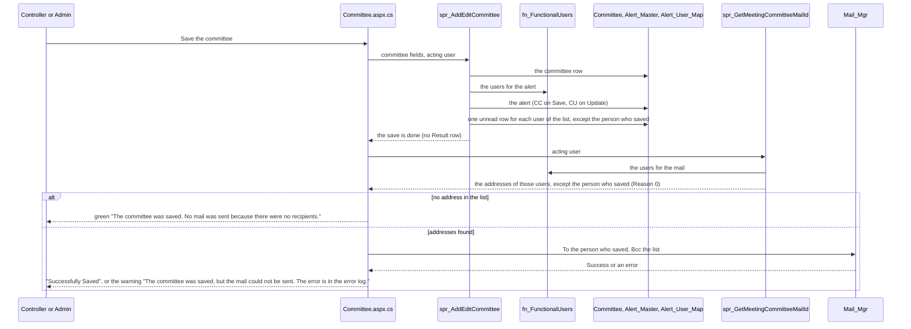

# Program to Program: Master Lists

- Title: Program to Program: Master Lists
- Audience: Developers and installers (internal)
- Shipped: No
- Applies to: IU1 (step 55: the Committee Created and Updated mail is sent again, to the same users as the alert rows; one shared rule); UD1b (step 53: no alert row for the Admin role on a committee save); user-ud1a
- Commit: 79f50ea
- Last updated by: IU1, based on 79f50ea
- Status: Draft
- Verified against: for IU1: the step's diff (BMMS/Master/Committee.aspx.cs, BMMSBAL/AlertMgr.cs, BMMSDAL/AlertDB.cs), Database/BMMS-Fix-InactiveUsers-Step55.sql, BMMS-Test-InactiveUsers-Step55.sql, Database/README.md (section Step IU1); for UD1b: Database/BMMS-Fix-DepartmentApprovers-Step53.sql (the alert insert of spr_AddEditCommittee and the comment), Database/README.md (section Step UD1b)
- To confirm: feature area written only for the committee alert and mail recipients (UD1b, IU1; WF2e3); the master lists themselves (department, designation, member, committee and the others) are not written yet

## Scope

This file covers who gets the alert and who gets the mail when a committee is created (CC, Created mail) or updated (CU,
Updated mail). Since step IU1 (database step 55) both follow one rule, fn_FunctionalUsers: every active user other than the
person who saved, the protected system account and the users of the Admin role. The Committee mail had been switched off in
Committee.aspx.cs since the baseline; since step IU1 it is sent after a successful save, by the path of the Meeting page.

[[CONFIRM: the master lists and their flows are not written yet (WF2e3)]]

## Programs involved

| Program | Kind | Part in the flow |
|---|---|---|
| Master/Committee.aspx(.cs) | Page | Saves the committee, then builds and sends the Created or Updated mail |
| CommitteeMgr, CommitteeDB | BAL, DAL | Call spr_AddEditCommittee |
| AlertMgr, AlertDB | BAL, DAL | Call spr_GetMeetingCommitteeMailId |
| Mail_Mgr | Mail | Sends the mail (the ML2c address checks) |
| spr_AddEditCommittee | Procedure | Saves the committee; writes the alert CC on Save and CU on Update and its rows, from fn_FunctionalUsers |
| fn_FunctionalUsers | Function | The one list of users for the alert rows and the mail (UserId, EmailId) |
| spr_GetMeetingCommitteeMailId | Procedure | Returns the addresses for the Bcc of the mail (the same procedure as for the meeting mail) |

## Main flow

| From | To | Data | Notes |
|---|---|---|---|
| Controller or Admin | Committee.aspx | The committee fields | |
| Committee.aspx | spr_AddEditCommittee | Committee fields, acting user | Through CommitteeMgr and CommitteeDB; the save comes first |
| spr_AddEditCommittee | Alert_Master, Alert_User_Map | The alert CC or CU and one unread row per recipient | Since step 53 the Admin role is not a recipient; older Admin rows stay and are not listed; since step 55 the users come from fn_FunctionalUsers |
| Committee.aspx | spr_GetMeetingCommitteeMailId | The acting user | After the save, through AlertMgr and AlertDB |
| spr_GetMeetingCommitteeMailId | Committee.aspx | The Bcc addresses, and the Reason | Reason 8: the acting user is missing, 0 or inactive; Reason 4: a role other than Admin and Controller; then no rows |
| Committee.aspx | Mail_Mgr | To: the address of the person who saved; Bcc: the list | The ML2c address checks apply |

A user without an address keeps the alert row and gets no mail. The mail is read again after the save; it is not taken from
the alert rows of the event.

## Refusal paths

| Case | Where | What the page does |
|---|---|---|
| The Bcc procedure refuses (Reason not 0) | Committee.aspx.cs GenerateMail | Logs "spr_GetMeetingCommitteeMailId refused the acting user" with the Reason; the committee stays saved; the page shows the warning "The committee was saved, but the mail could not be sent. The error is in the error log." |
| No address in the list | Committee.aspx.cs GenerateMail | No mail is sent; green "The committee was saved. No mail was sent because there were no recipients." |
| The mail fails (address check or send) | Mail_Mgr, Committee.aspx.cs | The committee stays saved; the warning above; the error is in the error log |
| The save itself fails | Committee.aspx.cs | The error page, as before; nothing is mailed. spr_AddEditCommittee returns no Result or Reason, so a refusal cannot be reported |

## Where each rule lives

| Rule | C# | Procedure or function |
|---|---|---|
| Users of the alert rows and of the mail: active, not the system account, not the Admin role | none | fn_FunctionalUsers, read by spr_AddEditCommittee and spr_GetMeetingCommitteeMailId |
| Not the person who saved | none | spr_AddEditCommittee (rows), spr_GetMeetingCommitteeMailId (Bcc) |
| The To of the mail is the person who saved | Committee.aspx.cs MailToActingUser | none |
| No recipients: no mail, green message | Committee.aspx.cs GenerateMail | none |
| A mail failure never undoes the save | Committee.aspx.cs | none |

## Tables read and written

| Object | Reads | Writes |
|---|---|---|
| spr_AddEditCommittee (alert part) | Users, Roles (through fn_FunctionalUsers) | Alert_Master, Alert_User_Map |
| spr_GetMeetingCommitteeMailId | Users, Roles (through fn_FunctionalUsers) | none |

## Drawn from

Database/BMMS-Fix-InactiveUsers-Step55.sql (fn_FunctionalUsers, spr_GetMeetingCommitteeMailId, spr_AddEditCommittee),
BMMS/Master/Committee.aspx.cs (GenerateMail, MailToActingUser, the messages), Database/BMMS-Fix-DepartmentApprovers-Step53.sql
(spr_AddEditCommittee, the alert insert and the comment), Database/README.md (sections Step IU1 and Step UD1b).
