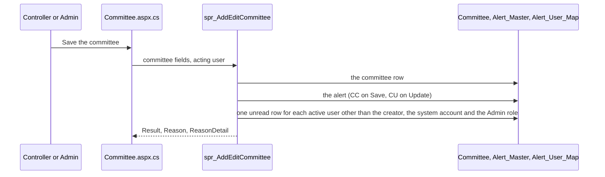

# Program to Program: Master Lists

- Title: Program to Program: Master Lists
- Audience: Developers and installers (internal)
- Shipped: No
- Applies to: UD1b (step 53: no alert row for the Admin role on a committee save); user-ud1a
- Commit: db1d641
- Last updated by: UD1b, based on db1d641
- Status: Draft
- Verified against: for UD1b: Database/BMMS-Fix-DepartmentApprovers-Step53.sql (the alert insert of spr_AddEditCommittee and the comment), Database/README.md (section Step UD1b)
- To confirm: feature area written only for the committee alert recipients of step UD1b (WF2c2); the master lists themselves (department, designation, member, committee and the others) are not written yet

## Scope

This file covers, since step UD1b (database step 53), who gets the alert when a committee is created (CC) or updated (CU):
every active user other than the creator and the protected system account, and no longer the users of the Admin role.

[[CONFIRM: the master lists and their flows are not written yet (WF2c2)]]

## Programs involved

| Program | Kind | Part in the flow |
|---|---|---|
| Master/Committee.aspx(.cs) | Page | Saves the committee |
| CommitteeMgr, CommitteeDB | BAL, DAL | Call spr_AddEditCommittee |
| spr_AddEditCommittee | Procedure | Saves the committee; writes the alert CC on Save and CU on Update and its rows |

## Main flow

| From | To | Data | Notes |
|---|---|---|---|
| Controller or Admin | Committee.aspx | The committee fields | |
| Committee.aspx | spr_AddEditCommittee | Committee fields, acting user | Through CommitteeMgr and CommitteeDB |
| spr_AddEditCommittee | Alert_Master, Alert_User_Map | The alert CC or CU and one unread row per recipient | Since step 53 the Admin role is not a recipient; older Admin rows stay and are not listed |

## Refusal paths

[[CONFIRM: not written yet (WF2c2)]]

## Where each rule lives

| Rule | C# | Procedure or function |
|---|---|---|
| Recipients of the committee alert: active users except the creator, the system account and the Admin role | none | spr_AddEditCommittee |

## Tables read and written

| Object | Reads | Writes |
|---|---|---|
| spr_AddEditCommittee (alert part) | Users, Roles | Alert_Master, Alert_User_Map |

## Drawn from

Database/BMMS-Fix-DepartmentApprovers-Step53.sql (spr_AddEditCommittee, the alert insert and the comment), Database/README.md
(section Step UD1b).
