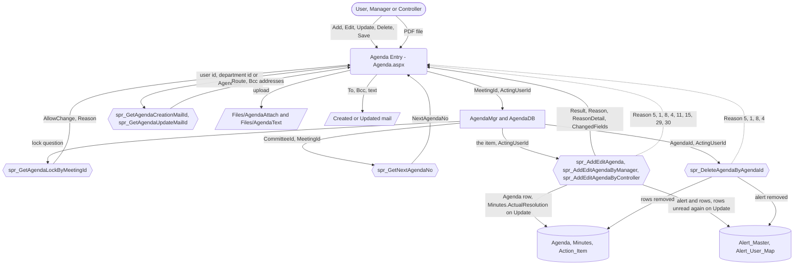
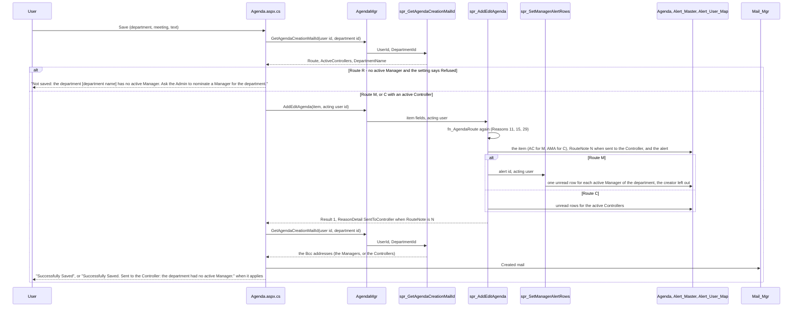
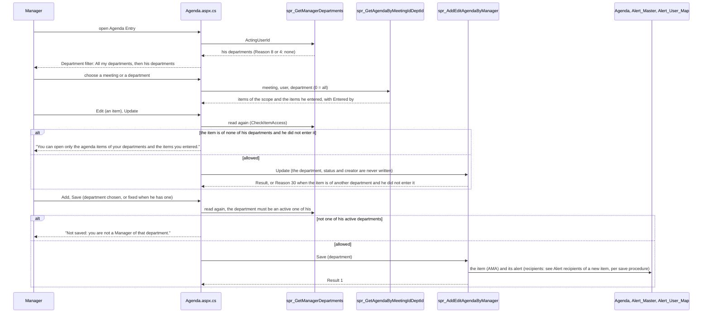
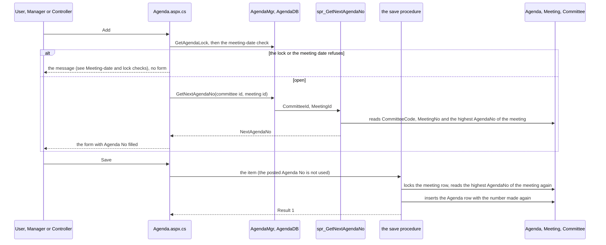
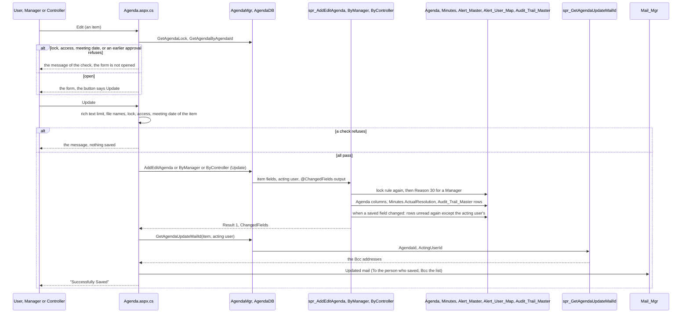
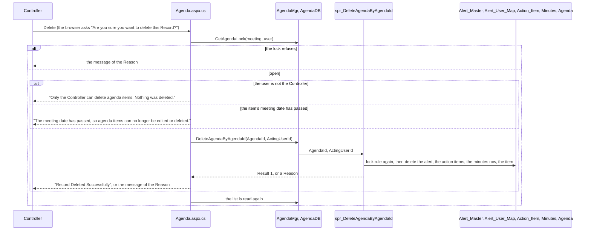
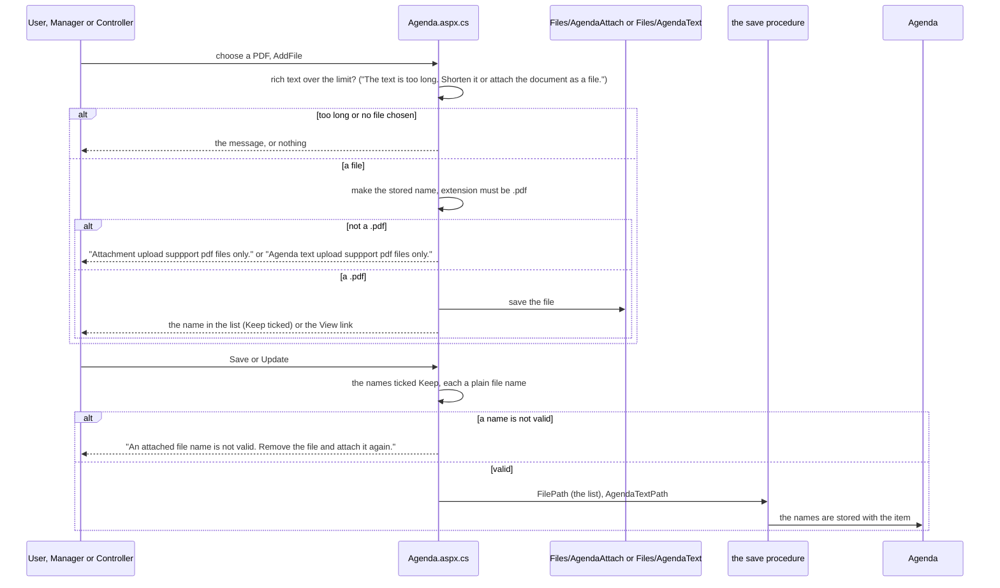

# Program to Program: Agenda Entry and Routing

- Title: Program to Program: Agenda Entry and Routing
- Audience: Developers and installers (internal)
- Shipped: No
- Applies to: WF2e1 (the rest of the Agenda Entry area: overview, item numbering, Update, Delete, the meeting-date and lock checks, attachments and the agenda text file, the alert recipients of a new item per save procedure, the refusal paths of the whole area; the step 54 recipient wording corrected); UD1c (step 54: the new section "A Manager's departments (step UD1c)": the list filter, Edit, Update and a Manager's new item, Reason 30, the alert to the other Managers); UD1b (step 53: the route of a new item, the Managers' alert rows and the Created mail); user-ud1a
- Commit: 31c81ab
- Last updated by: WF2e1, based on 31c81ab
- Status: Draft
- Verified against: for WF2e1: BMMS/Master/Agenda.aspx and Agenda.aspx.cs (grvAgenda_RowCommand, btnAdd_Click, btnSave_Click, CheckNewItemMeetingDate, IsItemMeetingOpen, CheckItemAccess, GetFilePathList, GenerateMail, GenerateUpdateMail, ChangeLine, btnAddFile_Click, btnAddAgentaText_Click, the message constants, the hint under the attachment box), BMMS/DashBoard/DashBoard.aspx.cs (the call of GenerateSubjectNoByMeetingId), BMMS/Web.config (appSettings, httpRuntime), BMMS/XML/AppSettings.xml (delete_reference), BMMS/Master/ResetDatabase.aspx.cs (the file folders), BMMSBAL/AgendaMgr.cs, MeetingMgr.cs (MeetingChangeResult.RefusalMessage, MeetingChangeReason, IsMeetingOpenForChange, IsAfterAgendaSubmissionDate), RichTextLimits.cs, SafeFileName.cs (its header), BMMSDAL/AgendaDB.cs (SaveAgendaRow, GetNextAgendaNo, DeleteAgendaByAgendaId, GetAgendaLockByMeetingId, GetAgendaUpdateMailId, GenerateSubjectNoByMeetingId), the BMMS_Test catalog of step 57 (modules spr_GetNextAgendaNo, spr_AddEditAgenda, spr_AddEditAgendaByManager, spr_AddEditAgendaByController, spr_DeleteAgendaByAgendaId, spr_GetAgendaLockByMeetingId, fn_AgendaChangeRefusal, spr_UpdateSubjectNoByAgendaId, spr_GenerateSubjectNoByMeetingId, spr_SetManagerAlertRows, fn_DepartmentManagers, fn_DashboardAlerts, spr_GetAgendaUpdateMailId; columns, indexes and foreign keys), Database/BMMS-Fix-DepartmentApprovers-Step53.sql (the Alert_User_Map insert of spr_AddEditAgendaByManager, line 1927; fn_DashboardAlerts, line 608), Database/BMMS-Fix-ManagerScope-Step54.sql (the same insert, line 690), Database/BMMS-Fix-ResetDatabase-Seeds.sql (lines 109-110 and the Roles insert, line 228; no Users row read) and Database/BMMS-Fix-GovernanceLog-Step56.sql (the Roles insert, line 2639), System-Manual 06, 07 and 08 (read for the links); for UD1c: BMMS/Master/Agenda.aspx and Agenda.aspx.cs (diff: ManagerDepartments, LoadListDepartments, ListDepartmentId, the new-item department of a Manager, the Save branch, CheckItemAccess, the Created mail's department), BMMSBAL/AgendaMgr.cs, DepartmentMgr.cs and MeetingMgr.cs (diff), BMMSDAL/AgendaDB.cs and DepartmentDB.cs (diff stat), Database/BMMS-Fix-ManagerScope-Step54.sql (fn_ManagerDepartments, spr_GetManagerDepartments, spr_GetAgendaByMeetingIdDeptId read in full; spr_AddEditAgendaByManager read to the Save insert and its comment block, the alert insert itself read at WF2e1), Database/README.md (section Step UD1c); for UD1b: BMMS/Master/Agenda.aspx.cs (diff: CheckNewItemRoute, GenerateMail, the save message), BMMSBAL/AgendaMgr.cs, MeetingMgr.cs and BMMSDAL/AgendaDB.cs (diff), Database/BMMS-Fix-DepartmentApprovers-Step53.sql (fn_DepartmentManagers, fn_AgendaRoute, spr_SetManagerAlertRows, spr_GetAgendaCreationMailId read; the comment blocks and the Save branch of spr_AddEditAgenda read; the other save procedures: their alert inserts), Database/README.md (section Step UD1b)
- To confirm: the length of the Agenda No prefix (the sequence is read from the 11th character, see "Item numbering"; WF2e1); what the user sees when a value that is not a number is typed in Subject No (WF2e1); an IIS request limit set outside the repository on an installed site (WF2e1); owner decision pending, not a verification point: the alert recipients of a Manager's new item (the line "Differs from the UD1c/UD1b requirement" in the section "Alert recipients of a new item, per save procedure")
- Change record: WF2e1, based on 31c81ab. WF2e1 security review: wording of the approval-status point made neutral. Corrected: (1) the step 54 recipients of a Manager's new item were taken from a comment block and written as "step 53 recipients, and the other active Managers of the department"; the Alert_User_Map statement was read and the recipients are now stated per save procedure (section "Alert recipients of a new item, per save procedure"), with the one line that says where they differ from the UD1c and UD1b requirement; (2) the rule row "One unread row for every Manager of the department" named "the alert inserts of the save procedures": that is true for route M only (spr_SetManagerAlertRows); the inserts of the Manager's and the Controller's save procedures give rows by the lists in the new section; (3) "Tables read and written": spr_AddEditAgenda also reads Roles, App_Setting (through fn_AgendaChangeRefusal), Agenda and View_Minute and writes Minutes on an Update; the step 54 sentence "not compared table by table" is replaced by the tables read. Added: the sections from "Overview of Agenda Entry" to "Limits seen in the code", the rows of "Programs involved", and the replacement of the line "the rest of the feature area is not written yet". The text of steps 53 and 54 is otherwise kept.
## Scope

This file covers the Agenda Entry feature area (Master/Agenda.aspx): since step UD1b (database step 53) what happens when a user saves a
new agenda item: the route (to the Managers of the item's department, straight to the Controllers, or refused), the alert rows and
the Created mail. Items entered by a Manager (they start at AMA) or by the Controller (they start at ACA) keep their route; only their
alert recipients lose the Admin role. Since WF2e1 it also covers the numbering of items, Update, Delete, the meeting-date and lock
checks, the attachments and the agenda text file, and the alert recipients of each save procedure. Approve and Reject on the
Dashboard are not in this file.

## Programs involved

| Program | Kind | Part in the flow |
|---|---|---|
| Master/Agenda.aspx(.cs) | Page | `btnSave_Click`; `CheckNewItemMeetingDate`, `CheckNewItemRoute(DepartmentId)` before the save; `GenerateMail(DepartmentId, SentToControllerNote)` after it |
| Master/Agenda.aspx(.cs) `btnAdd_Click` | Page | Opens the form for a new item: the lock, the meeting date, the next Agenda No, the department of the form |
| Master/Agenda.aspx(.cs) `grvAgenda_RowCommand` | Page | Edit (EditRec) and Delete (DeleteRec): the lock first, then the checks of each |
| Master/Agenda.aspx(.cs) `GenerateUpdateMail`, `ChangeLine` | Page | The "has been Updated" mail after an Update |
| Master/Agenda.aspx(.cs) `btnAddFile_Click`, `btnAddAgentaText_Click`, `GetFilePathList` | Page | Upload of an attachment and of the agenda text file; the list of names saved with the item |
| AgendaMgr.GetAgendaCreationMailId, AgendaDB.GetAgendaCreationMailId | BAL, DAL | Call spr_GetAgendaCreationMailId with the user and the department; the BAL throws when the result has no Route or no RouteNote column |
| AgendaMgr.AddEditAgenda, AgendaDB.AddEditAgenda | BAL, DAL | Call spr_AddEditAgenda for a new item or an Update of a User; return Result, Reason, ReasonDetail (and ChangedFields on an Update) |
| AgendaMgr.AddEditAgendaByManager, AgendaMgr.AddEditAgendaByController | BAL | The same for a Manager (spr_AddEditAgendaByManager) and for the Controller (spr_AddEditAgendaByController); the page chooses by the role in the session |
| AgendaMgr.GetNextAgendaNo, AgendaDB.GetNextAgendaNo | BAL, DAL | Call spr_GetNextAgendaNo: the Agenda No shown on a new form |
| AgendaMgr.GetAgendaLock, AgendaDB.GetAgendaLockByMeetingId | BAL, DAL | Call spr_GetAgendaLockByMeetingId: may this user add, edit or delete items of the meeting |
| AgendaMgr.DeleteAgendaByAgendaId, AgendaDB.DeleteAgendaByAgendaId | BAL, DAL | Call spr_DeleteAgendaByAgendaId |
| AgendaMgr.GetAgendaUpdateMailId, AgendaDB.GetAgendaUpdateMailId | BAL, DAL | Call spr_GetAgendaUpdateMailId: the addresses of the Update mail, joined with ", " |
| AgendaDB.SaveAgendaRow | DAL | For an Update asks the procedure for the output @ChangedFields when the procedure has it; the BAL gets it in MeetingChangeResult.ChangedFields |
| MeetingChangeResult, MeetingChangeReason (MeetingMgr.cs) | BAL | Turn Reason 29 into its message; hold the line "Sent to the Controller: the department had no active Manager."; turn every other Reason into the message in "Refusal paths of the whole area" |
| MeetingMgr.IsMeetingOpenForChange, IsAfterAgendaSubmissionDate | BAL | The meeting-date rule and the Agenda Submission Date notice |
| SafeFileName | BAL | Makes the stored name of an upload and tests a stored name again at Save |
| Mail_Mgr.SendWebEmail | BAL | Sends the "has been Created" and "has been Updated" mails |
| spr_GetAgendaCreationMailId | Procedure | Reads fn_AgendaRoute for the department; returns Route, ManagerName, ActiveControllers, EmailId rows (the Bcc), DepartmentManagers, RouteNote, DepartmentName |
| spr_AddEditAgenda | Procedure | Reads the route again, refuses or saves the item, writes the alert and its rows; the Update branch of a User |
| spr_AddEditAgendaByManager, spr_AddEditAgendaByController | Procedures | Save (AMA, ACA) and Update of a Manager and of the Controller, each with its own alert insert |
| spr_GetNextAgendaNo | Procedure | The next Agenda No of a meeting (read only) |
| spr_GetAgendaLockByMeetingId, fn_AgendaChangeRefusal | Procedure, inline function | The lock rule: one function, read by the lock query and by every procedure that changes an item |
| spr_DeleteAgendaByAgendaId | Procedure | Deletes the item with its alert, minutes row and action items |
| spr_UpdateSubjectNoByAgendaId, spr_GenerateSubjectNoByMeetingId | Procedures | Subject No (see "Item numbering": the first has no live caller) |
| spr_GetAgendaUpdateMailId | Procedure | The Bcc of the Update mail (read only) |
| spr_SetManagerAlertRows | Internal procedure | Gives every active Manager of the department an unread row on the item's alert |
| fn_AgendaRoute, fn_DepartmentManagers | Inline table functions | The route, and the one definition of the active Managers of a department |

## Overview of Agenda Entry

| From | To | Data | Notes |
|---|---|---|---|
| User, Manager or Controller | Agenda.aspx | Add, Edit, Update, Delete, Save | The Controller sees the Delete button; the page refuses a forged Delete of another role |
| User, Manager or Controller | Agenda.aspx | A PDF file | Attachment and agenda text file, see "Attachments and the agenda text file" |
| Agenda.aspx | AgendaMgr and AgendaDB | MeetingId, ActingUserId | The lock question comes first on Edit, Delete, Add and Save |
| spr_GetAgendaLockByMeetingId | Agenda.aspx | AllowChange, Reason | The page shows the message of the Reason |
| spr_GetNextAgendaNo | Agenda.aspx | NextAgendaNo | Shown on a new form; the save procedure makes the number again |
| AgendaMgr | The three save procedures | The item, ActingUserId | The role in the session chooses the procedure |
| The save procedures | Agenda, Minutes | The Agenda row; on an Update Minutes.ActualResolution of the item's minutes row | |
| The save procedures | Alert_Master, Alert_User_Map | A new item's alert and rows; on an Update the rows unread again | Recipients: "Alert recipients of a new item, per save procedure" |
| spr_DeleteAgendaByAgendaId | Alert_Master, Minutes, Action_Item, Agenda | Rows removed | The alert rows go with the alert |
| The save procedures | Agenda.aspx | Result, Reason, ReasonDetail, ChangedFields | ChangedFields only on an Update |
| Agenda.aspx | spr_GetAgendaCreationMailId, spr_GetAgendaUpdateMailId | User id and department id, or AgendaId and user id | The Bcc of the Created mail, the Bcc of the Updated mail |
| Agenda.aspx | Mail | To the person who saved, Bcc the list | Sent after the database accepted the item; a failed mail leaves the item saved |

Drawn from: BMMS/Master/Agenda.aspx.cs, BMMSBAL/AgendaMgr.cs, BMMSDAL/AgendaDB.cs, the catalog modules named under "Programs involved".

## Main flow

| From | To | Data | Notes |
|---|---|---|---|
| User | Agenda.aspx | The new item and its department | Saved by Save; a Manager or the Controller does not take the route check |
| Agenda.aspx | AgendaMgr.GetAgendaCreationMailId | Acting user id, the item's department id | Called twice: before the save (the refusals) and after it (the Bcc) |
| spr_GetAgendaCreationMailId | Agenda.aspx | Route (I, C, M or R), ActiveControllers, DepartmentName, RouteNote | Route I is the step 20 refusal, C with no active Controller the step 20 refusal; R is new |
| Agenda.aspx | spr_AddEditAgenda | The item, the acting user | The procedure decides again; the page's check is a first look |
| spr_AddEditAgenda | Agenda | The item with AgendaStatusCode AC (route M) or AMA (route C), RouteNote 'N' when the setting sent it to the Controller | |
| spr_AddEditAgenda | Alert_Master | One alert of the type of the status | |
| spr_SetManagerAlertRows | Alert_User_Map | One unread row for each active Manager of the department, the creator left out | Never for the Admin role; refused unless called by another procedure |
| spr_AddEditAgenda | Agenda.aspx | Result 1 and ReasonDetail 'SentToController' when it applies | The page adds the Controller line to its message, also when the mail then fails |
| Agenda.aspx | Mail_Mgr.SendWebEmail | To the creator, Bcc the department's Managers or the Controllers; the body adds the Controller line when it applies | Sent only after the database accepted the item |

The route, in this order (fn_AgendaRoute): the creator's Reporting Person is set but inactive: refused (Reason 11,
unchanged); the Reporting Person is an active Controller: straight to the Controllers (AMA); the department has an active
Manager other than the creator: waits at AC; otherwise the setting DeptNoManagerAction: Refused (Reason 29), or Sent to the
Controller (AMA with RouteNote 'N'). Route C with no active Controller is refused (Reason 15, unchanged).

In the procedure the lock rule (fn_AgendaChangeRefusal: Reasons 8, 4, 1, 5) is read before the route; see "Meeting-date and lock checks".

## Refusal paths

| Reason | Raised by | Meaning | Message the page shows |
|---|---|---|---|
| 29 | spr_AddEditAgenda (the page's own route check stops it first) | The department has no active Manager and the setting says Refused; nothing saved, no mail | "Not saved: the department [department name] has no active Manager. Ask the Admin to nominate a Manager for the department." |
| 11 | spr_AddEditAgenda | The creator's Reporting Person is inactive | "Your manager ([manager name]) is inactive, so this agenda item cannot be sent for approval. Ask the administrator to assign you an active manager." |
| 15 | spr_AddEditAgenda | The item would go to the Controllers and none is active | "No Controller is active, so this agenda item cannot be sent for approval. Ask the administrator to activate a Controller." |

The other Reasons of the area (5, 1, 8, 4, 30) and the page's own refusals are in "Refusal paths of the whole area".

## Where each rule lives

| Rule | C# | Procedure or function |
|---|---|---|
| The route of a new item of a User | `CheckNewItemRoute` (first look), `MeetingChangeReason.DepartmentHasNoManagerMessage` | fn_AgendaRoute, spr_AddEditAgenda (Reason 29, 11, 15) |
| Who the active Managers of a department are | none | fn_DepartmentManagers (role Manager, active, not the system account, an open department mapping; a user with no mapping rows counts by his home department) |
| One unread row for every Manager of the department; none for the Admin role | none | spr_SetManagerAlertRows (route M, the creator left out); the Manager's insert adds the users of fn_DepartmentManagers since step 54 (see "Alert recipients of a new item, per save procedure"); the Controller's insert gives rows to the users of the item's home department only |
| The Controller line in the message and the mail | `MeetingChangeReason.SentToControllerNoManagerNote`, `GenerateMail` | spr_AddEditAgenda (ReasonDetail 'SentToController') |
| The Bcc of the Created mail | `GenerateMail` | spr_GetAgendaCreationMailId; a Reporting Person of the Admin role is left out of the Bcc of a Manager's or the Controller's item in `GenerateMail` |
| Items entered by a Manager or the Controller | `btnSave_Click` | spr_AddEditAgendaByManager (AMA), spr_AddEditAgendaByController (ACA); alerts without the Admin role |

## Tables read and written

| Object | Reads | Writes |
|---|---|---|
| fn_AgendaRoute | Users, Roles, Department, App_Setting, and fn_DepartmentManagers | none |
| fn_DepartmentManagers | Users, Roles, User_Department | none |
| spr_GetAgendaCreationMailId | fn_AgendaRoute, Users, Roles | none |
| spr_AddEditAgenda | Users, Roles, Meeting, Committee, Subject_Type, Agenda, App_Setting (the lock, through fn_AgendaChangeRefusal), fn_AgendaRoute, View_Minute (Update) | Agenda (the new column RouteNote), Alert_Master, Alert_User_Map, Audit_Trail_Master, Minutes (Update: ActualResolution) |
| spr_SetManagerAlertRows | Users, Roles, User_Department, Agenda, Meeting, Alert_Master, Alert_User_Map | Alert_User_Map |

## A Manager's departments (step UD1c)

Since step 54 "a Manager's departments" are the departments of which he is an active Manager (fn_ManagerDepartments, one copy
of the rule: fn_DepartmentManagers of step 53). A User has his own department, the Controller every department. The page reads
them from the database each time it needs them (spr_GetManagerDepartments: home first; IsHome, IsActive), and the procedures
check them again; a posted department is never trusted.

| From | To | Data | Notes |
|---|---|---|---|
| Agenda.aspx.cs (LoadListDepartments) | spr_GetManagerDepartments | ActingUserId | The filter holds "All my departments" (value 0), then every row, marked " (home)" and " (inactive)". Reason 8 or 4: the message "Your session is no longer valid. Please log in again." or "Your departments could not be read: you may no longer be a Manager. Reload the page." and Add disabled |
| Agenda.aspx.cs (LoadAgenda) | AgendaMgr.GetAgendaByMeetingIdDeptId | MeetingId, UserId, the chosen department (0 = all) | A Manager only; the Controller's list is unchanged |
| spr_GetAgendaByMeetingIdDeptId | Agenda.aspx.cs | The items of the meeting entered by the user, or of one of fn_ManagerDepartments(user); with a department chosen, only that department's items | EnteredByName; the step 33 text is replaced, its marker kept |
| Agenda.aspx.cs (CheckItemAccess) | spr_GetManagerDepartments | ActingUserId | On Edit and Update; an inactive department of his counts, as the list shows it |
| Agenda.aspx.cs (new item) | spr_GetManagerDepartments | ActingUserId | Several active departments: the Department drop-down, home first; one: fixed; reads again at Save; only an active department passes; Reason 8 or 4: the form is not opened |
| Agenda.aspx.cs | spr_AddEditAgendaByManager | The item, the acting user | Reason 30 (nothing saved) for a new item outside his active departments and for an Update of an item that is of none of his departments and that he did not enter |
| spr_AddEditAgendaByManager | Alert_Master, Alert_User_Map | The new item's alert | Rows for the Controller role (RoleId 2), every active user whose home department is the item's department, and the users of fn_DepartmentManagers for the item's department (the step 54 group, whatever their home department); active, not the system account, never the Admin role; the creator is not left out. The recipients of all three save procedures are in "Alert recipients of a new item, per save procedure" |
| Agenda.aspx.cs (GenerateMail) | Mail_Mgr.SendWebEmail | The department name of the Manager's choice | In the Created mail |

| Reason | Raised by | Meaning | Message the page shows |
|---|---|---|---|
| 30 | spr_AddEditAgendaByManager (the page's own check stops it first) | A new item in a department of which he is not an active Manager, or an Update of an item of another department that he did not enter | "Not saved: you are not a Manager of that department." |

Where each rule lives:

| Rule | C# | Procedure or function |
|---|---|---|
| A Manager's departments | `Agenda.aspx.cs` ManagerDepartments, `DepartmentMgr.GetManagerDepartments` | fn_ManagerDepartments, spr_GetManagerDepartments |
| The list of a Manager and the filter | `LoadListDepartments`, `ListDepartmentId`, `LoadAgenda` | spr_GetAgendaByMeetingIdDeptId (optional @DepartmentId) |
| Edit and Update access | `CheckItemAccess`, `ItemNotInDepartmentMessage` | spr_AddEditAgendaByManager (Reason 30) |
| A Manager's new item department | btnAdd (the form), btnSave_Click (the Save branch), `MeetingChangeReason.NotManagerOfDepartmentMessage` | spr_AddEditAgendaByManager (Reason 30) |
| The alert rows of a Manager's new item (the step 54 group: the users of fn_DepartmentManagers) | none | spr_AddEditAgendaByManager (the Alert_User_Map insert of the Save branch) |

Tables read and written: fn_ManagerDepartments reads Department, Users, Roles, User_Department (through fn_DepartmentManagers);
spr_GetManagerDepartments reads Users, Roles, Department; spr_GetAgendaByMeetingIdDeptId reads View_Agenda and Users and writes
nothing; spr_AddEditAgendaByManager reads Users, Roles, Department, Meeting, Committee, Subject_Type, Agenda, App_Setting (the lock),
View_Minute (Update), fn_ManagerDepartments and fn_DepartmentManagers, and writes Agenda, Alert_Master, Alert_User_Map,
Audit_Trail_Master and, on an Update, Minutes (ActualResolution).

## Item numbering

An item has an Agenda No (one per item, made when the item is saved) and a Subject No (set later, and only meaningful for items the
Controller approved).

### Agenda No

| From | To | Data | Notes |
|---|---|---|---|
| Agenda.aspx.cs (btnAdd_Click) | AgendaMgr.GetNextAgendaNo | CommitteeId, MeetingId | Only when the lock and the meeting-date check pass |
| AgendaDB.GetNextAgendaNo | spr_GetNextAgendaNo | CommitteeId, MeetingId | One result column NextAgendaNo |
| spr_GetNextAgendaNo | Agenda.aspx.cs | NextAgendaNo | Shown in the Agenda No box; a preview only |
| Agenda.aspx.cs | The save procedure | The item | The three save procedures make the number again in their Save branch, by the same rule as spr_GetNextAgendaNo; a number posted by the page is overwritten |
| The save procedure | Agenda | AgendaNo | The meeting row is locked first (one save at a time for a meeting), so two saves cannot read the same highest number |

The rule, as the four procedures have it: the new number is the committee code, a hyphen, the meeting number, a hyphen and a
three-digit sequence. The sequence is the one after the highest AgendaNo of the meeting (a text maximum), starting at 001; it is read
from the 11th character of that highest number. A number is made again at each Save, so the number on the form can differ from the
saved one when another item of the meeting was saved in between. An item that is deleted gives its number back when it was the
highest of the meeting; a number in the middle stays a gap. An Update never changes the Agenda No. See "Limits seen in the code"
for the sequences of 100 and over.

[[CONFIRM: that the committee code and meeting number in use always make a 10-character prefix with the two hyphens, which the 11th character assumes; verify with the committee codes and meeting numbers of an installed database (WF2e1)]]

### Subject No

| Where it is set | Who | Rule |
|---|---|---|
| spr_AddEditAgendaByController, Save branch | The Controller's new item (saved as approved, ACA) | The highest SubjectNo of the Controller-approved items of the meeting plus 1, 1 when none; written to the new item only |
| DashBoard.aspx.cs (the approve handler) calling AgendaMgr.GenerateSubjectNoByMeetingId, after the approval was saved | Approve on the Dashboard | spr_GenerateSubjectNoByMeetingId sets the same number (highest of the Controller-approved items plus 1) on that item when its ControllerApprovedStatus is Approved, so after the Controller's approval; after a Manager's approval it sets no number. Either way it also sets Meeting.SubjectStatus to 'Close' for the meeting |
| spr_AddEditAgenda, spr_AddEditAgendaByManager and spr_AddEditAgendaByController, Update branch | Any role, from the Subject No box | The page decides what is posted (below); an empty box is written as NULL; the procedure writes the posted value |
| spr_UpdateSubjectNoByAgendaId | No page: the comment in the procedure says no page calls it, and the only call in Agenda.aspx.cs is commented out (in the Delete branch, under "Subject no auto regeneration") | Sets the given number under the lock rule of the Controller (Bypass 1) |

On the form: the User and the Manager see the box read-only. The Controller's box is editable on a new item (the Save procedure
ignores it and makes the number itself) and, on Edit, only when the item is not yet Controller-approved and already has a number. At Update, for every role: a Controller-approved item always keeps its saved
Subject No whatever was posted, and an empty box keeps the saved value (NULL stays NULL). A number typed by the Controller is passed
on; the page has no check that it is a number. [[CONFIRM: what the user sees when a value that is not a number is typed in Subject No; verify in the browser (WF2e1)]]

A change of Subject No on an Update counts as a change of the item: it marks the alert unread again and is a line ("Subject No - [number]",
or "Subject No - Removed") of the Update mail. A Delete does not renumber the other items (the renumbering in the page is commented out).

## Update

| From | To | Data | Notes |
|---|---|---|---|
| Agenda.aspx.cs (EditRec) | AgendaMgr.GetAgendaLock | The meeting chosen in the list, ActingUserId | First check; a refusal shows the message of its Reason and nothing opens |
| Agenda.aspx.cs (EditRec) | AgendaMgr.GetAgendaByAgendaId | AgendaId | Then CheckItemAccess (Controller: every item; Manager: his departments and his own items; other roles: their own items) and the meeting date of the item (IsMeetingOpenForChange on the item's own meeting date) |
| Agenda.aspx.cs (EditRec) | User, Manager | A message when the Controller decided | User or Manager: "This Agenda was [Approved or Rejected] by Controller"; when the Manager rejected it: "This Agenda was Rejected by Manager"; a User also: "This Agenda was [Approved or Rejected] by Manager". The Controller can open every item |
| Agenda.aspx.cs (btnSave_Click, Update) | AgendaMgr | The item with its fields | The Subject No, the comments and the department are set as in "Item numbering" and below |
| AgendaMgr | spr_AddEditAgenda, spr_AddEditAgendaByManager, spr_AddEditAgendaByController | The item, ActingUserId, output @ChangedFields | The page chooses by the role in the session: Controller, Manager, otherwise spr_AddEditAgenda |
| The save procedure | Agenda | SubjectTypeId, ShortText, AgendaType, AgendaText, AgendaTextPath, ProposedResolution, FilePath, MgrComments, ControllerComments, CurrentStatus, UpdatedOn, UpdatedBy, SubjectNo | Never the Agenda No, the status, the creator or (for a User and a Manager) the department; the Controller's procedure also writes DepartmentId |
| The save procedure | Minutes | ActualResolution = the Proposed Resolution | For the item's minutes row when it has one |
| The save procedure | Audit_Trail_Master | One 'UP' row for each of Subject Type name, Short Text, Agenda Type, Agenda Text, Agenda Text path, Proposed Resolution that changed | The attachments, the comments and the Subject No are not audited here |
| The save procedure | Alert_User_Map | ReadStatus 0, StatusId 1 on the rows of the item's alert | Only when a saved field changed; see the rules below |
| The Manager's and the Controller's procedure | Agenda | MgrApprovedBy and MgrApprovedDate (Manager), ControllerApprovedBy and ControllerApprovedDate (Controller) | Only when the text of the role's own comment changed |
| The save procedure | Agenda.aspx.cs | Result 1, Reason 0, ChangedFields | AgendaDB.SaveAgendaRow asks for @ChangedFields only when the procedure has it; null means step 37 is not installed |
| Agenda.aspx.cs (GenerateUpdateMail) | spr_GetAgendaUpdateMailId | AgendaId, ActingUserId | Called only when ChangedFields has a value |
| Agenda.aspx.cs (GenerateUpdateMail) | Mail_Mgr.SendWebEmail | To the person who saved, Bcc the addresses, one line for each changed field | Subject "Agenda ([Agenda No]) has been Updated"; the body repeats the item's details and never the text of a field or a file name |

The rules of the Update, in the order the code applies them:

1. Page, before the save: rich text over the limit refuses the whole post ("The text is too long. Shorten it or attach the document as a file."); a department drop-down left at no choice ("Department name is required field.", the Controller only on an Update); the saved names of the attachments and of the agenda text file must be plain file names ("An attached file name is not valid. Remove the file and attach it again."); then the lock (GetAgendaLock), then CheckItemAccessById (the item's saved creator and department, read again), then the item's own saved meeting date. The approval checks of the Edit button (the "This Agenda was ... by ..." messages) are made when the form opens. The approval status is checked at Edit only (page), not in the procedures.
2. Procedure: the meeting row is locked, fn_AgendaChangeRefusal is read (Reasons 8, 4, 1, 5; the Controller's procedure with the bypass allowed), and the Manager's procedure refuses with Reason 30 an item that is of none of his departments and that he did not enter.
3. The columns above are written. The comments: the page writes each comment only from the editor of the role that owns it (the Manager's comment by a Manager, the Controller's by the Controller); every other role posts the saved text back unchanged.
4. Alert rows made unread again: when any of Subject Type, Subject No, Short Text, Agenda Type, Agenda Text, the agenda text file name, Proposed Resolution, the attachment names, the Manager's comment or the Controller's comment changed (the Controller's procedure also the department), every row of the item's alert is set unread and shown again (a row the person had removed from his list comes back), except the row of the person who saved, rows marked as handled (HandledReason 'H', 'N' or 'M') and rows of inactive users. Text is compared exactly (case and trailing spaces count; NULL and empty are the same). No row is added and Alert_Master is not changed. An Update that changes nothing leaves the alert as it is and sends no mail.
5. A Controller's change of the department of an item waiting at AC also marks the other Managers' rows 'M' and gives the new department's Managers rows (spr_SetManagerAlertRows), see the workflow Alerts.
6. Mail: GenerateUpdateMail sends nothing when ChangedFields is empty or when the list of addresses is empty. The addresses are the users the refreshed alert is shown to (spr_GetAgendaUpdateMailId): rows of the item's alert except the acting user's, not marked as handled, active, not the system account, with an address, not the Admin role; a Controller is left out when the alert is ACA or ACR and a Manager when it is AMA or AMR. ChangedFields null (step 37 not installed) or any failure logs the error and the page says the mail was not sent.

Messages after an Update: success "Successfully Saved" (green). A mail that could not be sent: "The agenda item was updated, but the mail could not be sent. The error is in the error log." (warning; the Update stays saved). A refusal shows the message of its Reason and the list is read again. A bad stored address is skipped and logged by Mail_Mgr and does not stop the mail: see System Manual [07 Mail](../../System-Manual/07-Mail.md) (the address rules of step ML2c and "Mail failure after a save").

## Delete

| From | To | Data | Notes |
|---|---|---|---|
| Agenda.aspx (grvAgenda) | Agenda.aspx.cs (DeleteRec) | AgendaId | The Delete button is drawn for the Controller only; the browser asks for confirmation |
| Agenda.aspx.cs | AgendaMgr.GetAgendaLock | MeetingId, ActingUserId | First, for Edit and Delete alike |
| Agenda.aspx.cs | itself | The role, the item's meeting date | A forged Delete of another role is refused; the meeting date is the item's saved date (IsItemMeetingOpen) |
| AgendaMgr.DeleteAgendaByAgendaId | spr_DeleteAgendaByAgendaId | AgendaId, ActingUserId | |
| spr_DeleteAgendaByAgendaId | Alert_Master | The item's alert rows removed | The Alert_User_Map rows go with the alert (the foreign key cascades) |
| spr_DeleteAgendaByAgendaId | Action_Item, Minutes, Agenda | The action items of the item's minutes, the minutes row, the item | In that order, in one transaction |
| spr_DeleteAgendaByAgendaId | Agenda.aspx.cs | Result, Reason, ReasonDetail | Reasons 8, 4, 1, 5 from the lock rule with the bypass allowed |
| Agenda.aspx.cs | Controller | "Record Deleted Successfully" (green), or the message of the Reason (warning) | An exception (a row that refers to the item) is logged and shows "You cannot delete this record, because it has references." |

A Delete sends no mail, writes no Audit_Trail_Master row, does not renumber the Agenda No or the Subject No of the other items and does
not remove the item's files from the folders (no code of the area deletes an uploaded file; Reset Database leaves the folders on disk and only shows how many files each holds).

## Meeting-date and lock checks

Two rules decide whether an item can be added, edited or deleted. The lock rule is in the database (one function). The meeting-date
rule is in the page only: none of the four procedures that change an item reads the meeting date.

| Check | Where in C# | Where in the database | Refusal and message |
|---|---|---|---|
| Lock after finalisation | `AgendaMgr.GetAgendaLock` (Edit, Delete, Add, Save) | spr_GetAgendaLockByMeetingId (Bypass 1) for the page; fn_AgendaChangeRefusal inside spr_AddEditAgenda and spr_AddEditAgendaByManager (Bypass 0) and spr_AddEditAgendaByController, spr_DeleteAgendaByAgendaId, spr_UpdateSubjectNoByAgendaId (Bypass 1) | Reasons below |
| Meeting date, a new item | `btnAdd_Click` (the form) and `CheckNewItemMeetingDate` (Save), by `MeetingMgr.IsMeetingOpenForChange` | none | "The meeting date has passed, so agenda items can no longer be added to this meeting." The meeting is open for the whole of its date and closed from the next day; a meeting with no date stays open |
| Meeting date, Edit, Update, Delete | `grvAgenda_RowCommand` (Edit), `btnSave_Click` (Update), `IsItemMeetingOpen` (Delete) | none | "The meeting date has passed, so agenda items can no longer be edited or deleted." The date is the item's saved meeting date, for every role (the Controller too) |
| Agenda Submission Date | `CheckNewItemMeetingDate` (Save), by `MeetingMgr.IsAfterAgendaSubmissionDate` | none | Blocks nothing: from the day after that date the saved message gets " This item was added after the Agenda Submission Date ([dd-MMM-yyyy])." |
| Who may open an item | `CheckItemAccess` (Edit, and again at Update) | spr_AddEditAgendaByManager (Reason 30) | "You can open only the agenda items you entered." (User and other roles); "You can open only the agenda items of your departments and the items you entered." (Manager) |
| Who may delete | `grvAgenda_RowCommand` | the lock rule only | "Only the Controller can delete agenda items. Nothing was deleted." |

fn_AgendaChangeRefusal, in this order (the first that applies decides): Reason 8 when the acting user is not an active user; Reason 4
when the meeting does not exist; Reason 1 when the meeting's minutes are finalized or confirmed; no refusal when the agenda is Open;
no refusal for a Controller when the call allows the bypass and the setting AgendaControllerBypass is on (its default, also when the
row is missing); otherwise Reason 5, with ReasonDetail 'BypassOff' for a Controller when the setting is off, else 'Finalized'.
The setting is explained in System Manual [06 Configuration and Settings](../../System-Manual/06-Configuration-and-Settings.md).

| Reason | Message the page shows |
|---|---|
| 8 | "Your session is no longer valid. Please log in again." |
| 4 | "The meeting or member no longer exists. Reload the page." |
| 1 | "The minutes of this meeting are finalized. Members, attendance and chairman can no longer be changed." |
| 5 | "The agenda for this meeting is finalized, so agenda items can no longer be added, changed or deleted." and, when ReasonDetail is BypassOff, the added sentence " Controller changes after finalization are switched off in System Settings." |

The order of the page's checks at Save: file names, lock, department (Reason 30's message for a Manager, "The department does not match
your department. Nothing was saved." for the other roles), then for a new item the meeting date and the route, for an Update the access and the
item's meeting date. Because the procedures do not read the meeting date, a call that does not go through the page is not stopped by it.

## Attachments and the agenda text file

An item has two kinds of file. The attachments are PDF files kept in the folder Files/AgendaAttach; their names are stored with the
item as a comma-separated list. The agenda text file belongs to an item whose Agenda Type is Upload; it is kept in the folder
Files/AgendaText and its name is stored with the item. Both folders are inside the site, and a file in them can be fetched by anyone who knows
its address: see System Manual [08 Security](../../System-Manual/08-Security.md), section "Uploads".

| From | To | Data | Notes |
|---|---|---|---|
| User | Agenda.aspx.cs (btnAddFile_Click) | A file from the box "Choose a PDF to attach" | Saved at once to Files/AgendaAttach, before the item is saved |
| User | Agenda.aspx.cs (btnAddAgentaText_Click) | A file from the box "Agenda text file" (Agenda Type Upload) | Saved at once to Files/AgendaText |
| Agenda.aspx.cs | SafeFileName | The posted file name | The stored name is cleaned and made unique in the folder (BMMSBAL/SafeFileName.cs; the rules are in the Security chapter) |
| Agenda.aspx.cs | itself | The stored name | The extension of the stored name must be .pdf (case ignored); the content is not read |
| Agenda.aspx.cs | the page's server-side lists | The stored name | Attachments: the list kept for the form, bound to the grid "Files to be attached"; agenda text file: one name |
| Agenda.aspx.cs (btnSave_Click, GetFilePathList) | the save procedure | FilePath: the names whose Keep box is ticked, from the server's own list and not from the posted fields | A name that is not a plain file name refuses the Save or Update |
| Agenda.aspx.cs (btnSave_Click) | the save procedure | AgendaTextPath | Empty for an Entry item, whatever was uploaded before; otherwise the name the server set |
| the save procedure | Agenda | FilePath, AgendaTextPath | An Update that changes them marks the alert unread again; the Update mail says "Attachments - Updated ([n] files now)" or "Attachments - Removed", and for the text file "Agenda Text file - Attached", "- Removed" or "- Replaced" (never a file name) |

Size and type limits, settled from the repository:

- Type: only the extension .pdf is checked, and only on the stored name; there is no check of the content and no check of the size in the page code.
- Size: BMMS/Web.config sets no `maxRequestLength` in `httpRuntime` and has no `requestLimits` element, so the ASP.NET default of 4 MB for a whole request applies, the text of the form included (the page says so under the attachment box: "Limit 4 MB per upload, the text of this form included."). A request over it is refused before the page runs and shows the safe error page (Security chapter, "Uploads").
- Rich text: the appSettings RichTextMaxChars (200000) and RichTextMaxTotalChars (600000), in characters of HTML for one editor and for all editors of the page; a missing or invalid value gives these defaults. A post over either limit is refused by `btnSave_Click`, `btnAddFile_Click` and `btnAddAgentaText_Click` alike with "The text is too long. Shorten it or attach the document as a file." and no file is kept. The comment in Web.config (the A2a comment, lines 10-12) says to raise `maxRequestLength`, the IIS `maxAllowedContentLength` and the UpdatePanel timeout together with these limits.
- [[CONFIRM: an IIS request limit set outside the repository (for example in the server's own configuration) on an installed site; verify in the IIS settings of that site (WF2e1)]]

What stays on disk: a file is saved when it is added, and the item keeps it only when the item is then saved with its Keep box ticked (or, for the
agenda text file, as an Upload item). A file that was added and then left unsaved (Cancel, a refused Save), unticked, replaced or
made unused by switching the type to Entry, and the files of a deleted item, stay in the folder: no code of the area deletes a file, and Reset Database leaves the folders on disk (it only shows how many files each holds). The files are read by the
View links of Agenda Entry and the Dashboard and by the agenda reports. A mail failure after a save is described under "Update" and in System Manual [07 Mail](../../System-Manual/07-Mail.md).

## Alert recipients of a new item, per save procedure

The alert of a new item has one row for each recipient (unread, shown). Which users get a row depends on the procedure that saved it. In
all three the rows go only to active users who are not the protected system account, and never to a user of the Admin role. The
creator is left out only on route M of spr_AddEditAgenda.

| Save procedure | Alert type | Rows are given to | The creator | Source |
|---|---|---|---|---|
| spr_AddEditAgenda, route M (the department has an active Manager other than the creator) | AC | Every active Manager of the item's department (fn_DepartmentManagers), by spr_SetManagerAlertRows | Left out | catalog, Save branch, the call of spr_SetManagerAlertRows (lines 205-214) |
| spr_AddEditAgenda, route C (straight to the Controllers) | AMA | The active Controllers (role code 'controller'); no home-department group | Not looked at (the creator is not in this group) | catalog, the insert for route C (lines 205-214) |
| spr_AddEditAgendaByManager, Save, since step 54 (the text installed now) | AMA | The users of RoleId 2; every user whose home DepartmentId is the item's department; and the users of fn_DepartmentManagers for the item's department (the step 54 group, whatever their home department) | Not left out | catalog lines 185-191; Database/BMMS-Fix-ManagerScope-Step54.sql line 690 |
| spr_AddEditAgendaByManager, Save, step 53 text (replaced by step 54) | AMA | The users of RoleId 2 and every user whose home DepartmentId is the item's department; no fn_DepartmentManagers group | Not left out | Database/BMMS-Fix-DepartmentApprovers-Step53.sql line 1927 |
| spr_AddEditAgendaByController, Save | ACA | Only the users whose home DepartmentId is the item's department; no Controller group | Not left out (he gets a row only if his home department is the item's) | catalog lines 164-169 |

RoleId 2 is the Controller as the reset seed makes the roles: Database/BMMS-Fix-ResetDatabase-Seeds.sql deletes the Roles rows and
reseeds the counter at 0 (lines 109-110) and inserts the roles in the order admin, controller, manager, user, mgmt, md_sect (line 228);
Database/BMMS-Fix-GovernanceLog-Step56.sql does the same in its reset (the Roles insert, line 2639). On a database that was not made by the reset the
number comes from that database's own rows.

Differs from the UD1c/UD1b requirement: the creator is not left out of his own item's alert set, and the Controllers and every active user whose home department is the item's department get rows too, not only the other Managers of the department; owner decision pending.

What the rows do. A row is only a place on the person's alert list and in his count; two further filters decide what he sees and is mailed.
fn_DashboardAlerts (catalog line 85; Database/BMMS-Fix-DepartmentApprovers-Step53.sql line 608) does not list an AMA or AMR alert to a user of the
Manager role unless the row is marked as handled, and spr_GetAgendaUpdateMailId does not mail a Manager on an AMA or AMR alert. A Controller is not listed
ACA or ACR rows either. So the rows of the step 54 group (Managers of the department) and the creator's own row on a Manager's item exist in
Alert_User_Map but are not shown to the Manager role. The Created mail of a Manager's item goes to the creator with the Reporting Person in Bcc (not
to the other Managers). The workflow Alerts shows the same recipients per decision.

## Refusal paths of the whole area

| Reason | Raised by | Meaning | Message the page shows |
|---|---|---|---|
| 8 | fn_AgendaChangeRefusal (every save, delete and the lock query) | The acting user is not an active user | "Your session is no longer valid. Please log in again." |
| 4 | fn_AgendaChangeRefusal | The meeting does not exist | "The meeting or member no longer exists. Reload the page." |
| 1 | fn_AgendaChangeRefusal | The minutes of the meeting are finalized or confirmed | "The minutes of this meeting are finalized. Members, attendance and chairman can no longer be changed." |
| 5 | fn_AgendaChangeRefusal | The agenda is finalized (the Controller may pass it when AgendaControllerBypass is on) | "The agenda for this meeting is finalized, so agenda items can no longer be added, changed or deleted." and " Controller changes after finalization are switched off in System Settings." with ReasonDetail BypassOff |
| 11, 15, 29 | spr_AddEditAgenda, Save | The route (above) | The messages in "Refusal paths" |
| 30 | spr_AddEditAgendaByManager | A department that is not his, an Update of an item that is not his | "Not saved: you are not a Manager of that department." |
| none (page only) | Agenda.aspx.cs | Meeting date passed, new item | "The meeting date has passed, so agenda items can no longer be added to this meeting." |
| none (page only) | Agenda.aspx.cs | Meeting date passed, Edit, Update, Delete | "The meeting date has passed, so agenda items can no longer be edited or deleted." |
| none (page only) | Agenda.aspx.cs | Not the Controller, Delete | "Only the Controller can delete agenda items. Nothing was deleted." |
| none (page only) | Agenda.aspx.cs | Item not of his list, Edit or Update | "You can open only the agenda items you entered." or "You can open only the agenda items of your departments and the items you entered." |
| none (page only) | Agenda.aspx.cs | A User's department differs from the user master | "The department does not match your department. Nothing was saved." |
| none (page only) | Agenda.aspx.cs | A stored file name is not plain | "An attached file name is not valid. Remove the file and attach it again." |
| none (page only) | Agenda.aspx.cs | Rich text over the limit | "The text is too long. Shorten it or attach the document as a file." |
| none (page only) | Agenda.aspx.cs | A file that is not a PDF | "Attachment upload suppport pdf files only." (attachment), "Agenda text upload suppport pdf files only." (agenda text file); the spelling is the page's |
| none (page only) | Agenda.aspx.cs | A required Department is not chosen | "Department name is required field." |
| none (page only) | Agenda.aspx.cs | The mail failed after a new item or an Update | "The agenda item was saved, but the mail could not be sent. The error is in the error log." (new item, with the submission notice and the Controller line added when they apply), "The agenda item was updated, but the mail could not be sent. The error is in the error log." (Update) |
| none (database error) | Agenda.aspx.cs (Delete) | A row refers to the item | "You cannot delete this record, because it has references." |

## Where each rule lives (WF2e1)

| Rule | C# | Procedure or function |
|---|---|---|
| The Agenda No of a new item | `btnAdd_Click` (preview), `AgendaMgr.GetNextAgendaNo` | spr_GetNextAgendaNo; the Save branch of spr_AddEditAgenda, spr_AddEditAgendaByManager, spr_AddEditAgendaByController |
| The Subject No | `btnSave_Click` (what is posted), `AgendaMgr.GenerateSubjectNoByMeetingId` (DashBoard.aspx.cs) | spr_AddEditAgendaByController (Save), spr_GenerateSubjectNoByMeetingId, the Update branches; spr_UpdateSubjectNoByAgendaId (no live caller) |
| Update: what is written, what is audited | `btnSave_Click` | The Update branches of the three save procedures |
| Alert rows unread again after an Update | none | The Update branches of the three save procedures (the comparison and the update of Alert_User_Map) |
| The Update mail | `GenerateUpdateMail`, `ChangeLine`, `AgendaMgr.GetAgendaUpdateMailId` | spr_GetAgendaUpdateMailId; ChangedFields from the save procedures |
| Delete | `grvAgenda_RowCommand` (DeleteRec), `AgendaMgr.DeleteAgendaByAgendaId` | spr_DeleteAgendaByAgendaId |
| The lock after finalisation | `AgendaMgr.GetAgendaLock`, `MeetingChangeResult.RefusalMessage` | spr_GetAgendaLockByMeetingId, fn_AgendaChangeRefusal |
| The meeting date and the Agenda Submission Date | `btnAdd_Click`, `CheckNewItemMeetingDate`, `IsItemMeetingOpen`, `MeetingMgr.IsMeetingOpenForChange`, `MeetingMgr.IsAfterAgendaSubmissionDate` | none |
| Attachments and the agenda text file | `btnAddFile_Click`, `btnAddAgentaText_Click`, `GetFilePathList`, `SafeFileName`, `RichTextEditor.IsTooLong` | none (the procedures store the names) |
| Who may open or delete an item | `CheckItemAccess`, `CheckItemAccessById`, `grvAgenda_RowCommand` | spr_AddEditAgendaByManager (Reason 30 for a Manager) |
| The alert recipients of a new item | none | The Alert_User_Map insert of each save procedure; spr_SetManagerAlertRows (route M) |

## Tables read and written (WF2e1)

| Object | Reads | Writes |
|---|---|---|
| spr_GetNextAgendaNo | Committee, Meeting, Agenda | none |
| spr_GetAgendaLockByMeetingId, fn_AgendaChangeRefusal | Users, Roles, Meeting, App_Setting | none |
| spr_AddEditAgendaByController | Users, Roles, Meeting, Committee, Subject_Type, Agenda, App_Setting (the lock), View_Minute (Update), Alert_Master, Alert_User_Map and fn_DepartmentManagers (a move of an item at AC) | Agenda (the department on an Update), Alert_Master, Alert_User_Map, Audit_Trail_Master, Minutes (a row for an item added after the agenda was finalized; ActualResolution on an Update) |
| spr_DeleteAgendaByAgendaId | Agenda, Meeting, and what fn_AgendaChangeRefusal reads | Alert_Master (Alert_User_Map by cascade), Action_Item, Minutes, Agenda |
| spr_GenerateSubjectNoByMeetingId | Agenda | Agenda (SubjectNo), Meeting (SubjectStatus) |
| spr_UpdateSubjectNoByAgendaId | Agenda, Meeting, and what fn_AgendaChangeRefusal reads | Agenda (SubjectNo) |
| spr_GetAgendaUpdateMailId | Alert_Master, Alert_User_Map, Users, Roles | none |

## Limits seen in the code

These are facts of the code at 31c81ab, not requirements; the first two may need the owner's decision.

- Agenda No of 100 and over: the four procedures set the new number only for a sequence from 1 to 99. For a sequence of 100 or more none of the three branches sets it, and the value read from the highest AgendaNo of the meeting is used, so the new item would get the same Agenda No as the highest one. The catalog has no unique index or constraint on Agenda.AgendaNo (only the primary key of AgendaId and a check on RouteNote).
- The page reads AgendaId, CommitteeId, MeetingId and SubjectTypeId as 16-bit numbers (Convert.ToInt16 in `btnSave_Click` and `LoadAgenda`), so a value above 32767 raises an error on the page.
- The Delete does not remove uploaded files and does not renumber (see "Delete").

## Drawn from

BMMS/Master/Agenda.aspx.cs (btnSave_Click, btnAdd_Click, grvAgenda_RowCommand, CheckNewItemMeetingDate, IsItemMeetingOpen, CheckItemAccess,
CheckNewItemRoute, GetFilePathList, GenerateMail, GenerateUpdateMail, ChangeLine, btnAddFile_Click, btnAddAgentaText_Click), BMMS/Master/Agenda.aspx
(the Files to be attached card, the Delete button), BMMS/Web.config, BMMS/XML/AppSettings.xml, BMMS/DashBoard/DashBoard.aspx.cs (the approve handler),
BMMSBAL/AgendaMgr.cs and MeetingMgr.cs, BMMSDAL/AgendaDB.cs, the BMMS_Test catalog of step 57 (the modules named above),
Database/BMMS-Fix-DepartmentApprovers-Step53.sql (fn_DepartmentManagers, fn_AgendaRoute,
spr_SetManagerAlertRows, spr_GetAgendaCreationMailId, spr_AddEditAgenda Save branch, the Alert_User_Map insert of spr_AddEditAgendaByManager), Database/BMMS-Fix-ManagerScope-Step54.sql
(the Alert_User_Map insert of spr_AddEditAgendaByManager), Database/BMMS-Fix-ResetDatabase-Seeds.sql and BMMS-Fix-GovernanceLog-Step56.sql (the Roles inserts),
Database/README.md (section Step UD1b),
Database/BMMS-Test-DepartmentApprovers-Step53.sql (as described in Database/README.md, not read line by line).
