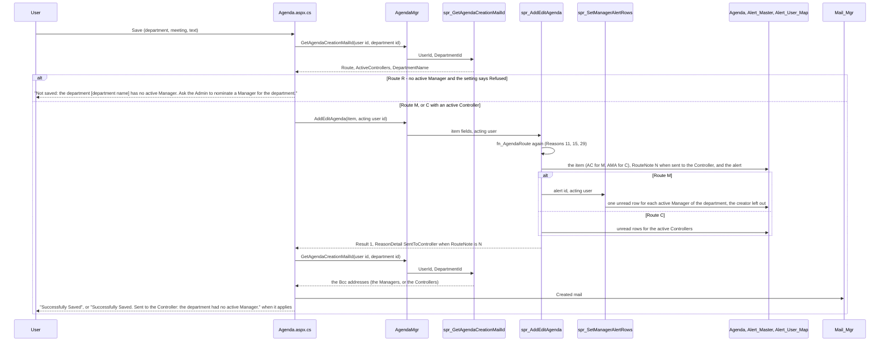

# Program to Program: Agenda Entry and Routing

- Title: Program to Program: Agenda Entry and Routing
- Audience: Developers and installers (internal)
- Shipped: No
- Applies to: UD1b (step 53: the route of a new item, the Managers' alert rows and the Created mail); user-ud1a
- Commit: db1d641
- Last updated by: UD1b, based on db1d641
- Status: Draft
- Verified against: for UD1b: BMMS/Master/Agenda.aspx.cs (diff: CheckNewItemRoute, GenerateMail, the save message), BMMSBAL/AgendaMgr.cs, MeetingMgr.cs and BMMSDAL/AgendaDB.cs (diff), Database/BMMS-Fix-DepartmentApprovers-Step53.sql (fn_DepartmentManagers, fn_AgendaRoute, spr_SetManagerAlertRows, spr_GetAgendaCreationMailId read; the comment blocks and the Save branch of spr_AddEditAgenda read; the other save procedures: their alert inserts), Database/README.md (section Step UD1b)
- To confirm: feature area written only for the route of a new item and its alerts and mail (step UD1b); the numbering of items, the update, the delete, the meeting-date and lock checks and the attachment handling are not written yet (WF2c2)

## Scope

This file covers, since step UD1b (database step 53), what happens when a user saves a new agenda item: the route (to the
Managers of the item's department, straight to the Controllers, or refused), the alert rows and the Created mail. Items
entered by a Manager (they start at AMA) or by the Controller (they start at ACA) keep their route; only their alert
recipients lose the Admin role.

[[CONFIRM: the rest of the feature area (numbering, update, delete, lock and date checks, attachments) is not written yet (WF2c2)]]

## Programs involved

| Program | Kind | Part in the flow |
|---|---|---|
| Master/Agenda.aspx(.cs) | Page | `btnSave_Click`; `CheckNewItemMeetingDate`, `CheckNewItemRoute(DepartmentId)` before the save; `GenerateMail(DepartmentId, SentToControllerNote)` after it |
| AgendaMgr.GetAgendaCreationMailId, AgendaDB.GetAgendaCreationMailId | BAL, DAL | Call spr_GetAgendaCreationMailId with the user and the department; the BAL throws when the result has no Route or no RouteNote column |
| AgendaMgr.AddEditAgenda, AgendaDB.AddEditAgenda | BAL, DAL | Call spr_AddEditAgenda for a new item of a User; return Result, Reason, ReasonDetail |
| MeetingChangeResult, MeetingChangeReason (MeetingMgr.cs) | BAL | Turn Reason 29 into its message; hold the line "Sent to the Controller: the department had no active Manager." |
| Mail_Mgr.SendWebEmail | BAL | Sends the "has been Created" mail |
| spr_GetAgendaCreationMailId | Procedure | Reads fn_AgendaRoute for the department; returns Route, ManagerName, ActiveControllers, EmailId rows (the Bcc), DepartmentManagers, RouteNote, DepartmentName |
| spr_AddEditAgenda | Procedure | Reads the route again, refuses or saves the item, writes the alert and its rows |
| spr_SetManagerAlertRows | Internal procedure | Gives every active Manager of the department an unread row on the item's alert |
| fn_AgendaRoute, fn_DepartmentManagers | Inline table functions | The route, and the one definition of the active Managers of a department |

## Main flow

| From | To | Data | Notes |
|---|---|---|---|
| User | Agenda.aspx | The new item and its department | Saved by Save; a Manager or the Controller does not take the route check |
| Agenda.aspx | AgendaMgr.GetAgendaCreationMailId | Acting user id, the item's department id | Called twice: before the save (the refusals) and after it (the Bcc) |
| spr_GetAgendaCreationMailId | Agenda.aspx | Route (I, C, M or R), ActiveControllers, DepartmentName, RouteNote | Route I is the step 20 refusal, C with no active Controller the step 20 refusal; R is new |
| Agenda.aspx | spr_AddEditAgenda | The item, the acting user | The procedure decides again; the page's check is a first look |
| spr_AddEditAgenda | Agenda | The item with AgendaStatusCode AC (route M) or AMA (route C), RouteNote 'N' when the setting sent it to the Controller | |
| spr_AddEditAgenda | Alert_Master | One alert of the type of the status | |
| spr_SetManagerAlertRows | Alert_User_Map | One unread row for each active Manager of the department, the creator left out | Never for the Admin role; refused unless called by another procedure |
| spr_AddEditAgenda | Agenda.aspx | Result 1 and ReasonDetail 'SentToController' when it applies | The page adds the Controller line to its message, also when the mail then fails |
| Agenda.aspx | Mail_Mgr.SendWebEmail | To the creator, Bcc the department's Managers or the Controllers; the body adds the Controller line when it applies | Sent only after the database accepted the item |

The route, in this order (fn_AgendaRoute): the creator's Reporting Person is set but inactive: refused (Reason 11,
unchanged); the Reporting Person is an active Controller: straight to the Controllers (AMA); the department has an active
Manager other than the creator: waits at AC; otherwise the setting DeptNoManagerAction: Refused (Reason 29), or Sent to the
Controller (AMA with RouteNote 'N'). Route C with no active Controller is refused (Reason 15, unchanged).

## Refusal paths

| Reason | Raised by | Meaning | Message the page shows |
|---|---|---|---|
| 29 | spr_AddEditAgenda (the page's own route check stops it first) | The department has no active Manager and the setting says Refused; nothing saved, no mail | "Not saved: the department [department name] has no active Manager. Ask the Admin to nominate a Manager for the department." |
| 11 | spr_AddEditAgenda | The creator's Reporting Person is inactive | "Your manager ([manager name]) is inactive, so this agenda item cannot be sent for approval. Ask the administrator to assign you an active manager." |
| 15 | spr_AddEditAgenda | The item would go to the Controllers and none is active | "No Controller is active, so this agenda item cannot be sent for approval. Ask the administrator to activate a Controller." |

## Where each rule lives

| Rule | C# | Procedure or function |
|---|---|---|
| The route of a new item of a User | `CheckNewItemRoute` (first look), `MeetingChangeReason.DepartmentHasNoManagerMessage` | fn_AgendaRoute, spr_AddEditAgenda (Reason 29, 11, 15) |
| Who the active Managers of a department are | none | fn_DepartmentManagers (role Manager, active, not the system account, an open department mapping; a user with no mapping rows counts by his home department) |
| One unread row for every Manager of the department; none for the Admin role | none | spr_SetManagerAlertRows (route M); the alert inserts of the save procedures |
| The Controller line in the message and the mail | `MeetingChangeReason.SentToControllerNoManagerNote`, `GenerateMail` | spr_AddEditAgenda (ReasonDetail 'SentToController') |
| The Bcc of the Created mail | `GenerateMail` | spr_GetAgendaCreationMailId; a Reporting Person of the Admin role is left out of the Bcc of a Manager's or the Controller's item in `GenerateMail` |
| Items entered by a Manager or the Controller | `btnSave_Click` | spr_AddEditAgendaByManager (AMA), spr_AddEditAgendaByController (ACA); alerts without the Admin role |

## Tables read and written

| Object | Reads | Writes |
|---|---|---|
| fn_AgendaRoute | Users, Roles, Department, App_Setting, and fn_DepartmentManagers | none |
| fn_DepartmentManagers | Users, Roles, User_Department | none |
| spr_GetAgendaCreationMailId | fn_AgendaRoute, Users, Roles | none |
| spr_AddEditAgenda | Users, Meeting, Committee, Subject_Type, and fn_AgendaRoute | Agenda (the new column RouteNote), Alert_Master, Alert_User_Map, Audit_Trail_Master |
| spr_SetManagerAlertRows | Users, Roles, User_Department, Agenda, Meeting, Alert_Master, Alert_User_Map | Alert_User_Map |

## Drawn from

BMMS/Master/Agenda.aspx.cs (btnSave_Click, CheckNewItemRoute, GenerateMail), BMMSBAL/AgendaMgr.cs and MeetingMgr.cs,
BMMSDAL/AgendaDB.cs, Database/BMMS-Fix-DepartmentApprovers-Step53.sql (fn_DepartmentManagers, fn_AgendaRoute,
spr_SetManagerAlertRows, spr_GetAgendaCreationMailId, spr_AddEditAgenda Save branch), Database/README.md (section Step UD1b),
Database/BMMS-Test-DepartmentApprovers-Step53.sql (as described in Database/README.md, not read line by line).
