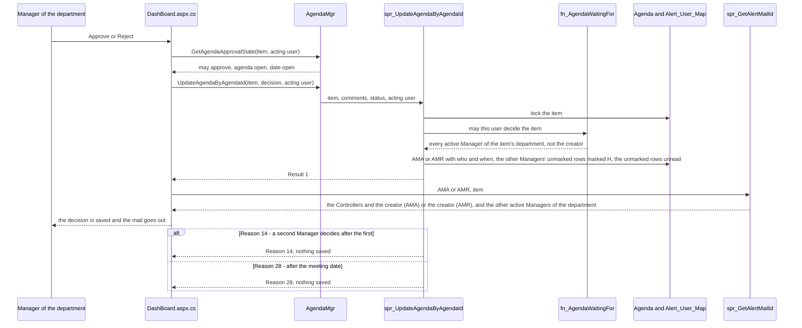

# Program to Program: Approval

- Title: Program to Program: Approval
- Audience: Developers and installers (internal)
- Shipped: No
- Applies to: UD1b (step 53: who may approve or reject an item at AC, the first decision wins, the other Managers' alert rows, the mail); user-ud1a
- Commit: db1d641
- Last updated by: UD1b, based on db1d641
- Status: Draft
- Verified against: for UD1b: BMMS/DashBoard/DashBoard.aspx.cs (the calls of the approval; the diff of the alert panel), Database/BMMS-Fix-DepartmentApprovers-Step53.sql (fn_AgendaWaitingFor, fn_DepartmentManagers, fn_ManagerReleaseRefusal, spr_GetAlertMailId read; the comment block of spr_UpdateAgendaByAgendaId and its alert statements read), Database/README.md (section Step UD1b); the Controller's approval and the finalisation are described in 09-Dashboard-and-Alerts, not here
- To confirm: feature area written only for the Manager's decision at AC since step UD1b (WF2c2); the Controller's approve at AMA and the finalisation are not written here yet

## Scope

This file covers, since step UD1b (database step 53), the Manager's approval of an item at AC: who may decide, what the first
decision does to the other Managers, and who gets the mail. Where the Dashboard shows the approval (My approvals, Waiting for
me, the Agenda Alert panel, the Approve and Reject buttons) is in 09-Dashboard-and-Alerts.

[[CONFIRM: the Controller's approval at AMA, Agenda Finalization and the whole feature area are not written yet (WF2c2)]]

## Programs involved

| Program | Kind | Part in the flow |
|---|---|---|
| DashBoard/DashBoard.aspx(.cs) | Page | `btnApprove_Click`, `btnReject_Click`: ask the state, save the decision, send the mail |
| AgendaMgr.GetAgendaApprovalState | BAL | What the acting user may do with the item (spr_GetAgendaApprovalState) |
| AgendaMgr.UpdateAgendaByAgendaId | BAL | Saves the decision (spr_UpdateAgendaByAgendaId) |
| AlertMgr.GetAlertMailId, Mail_Mgr.SendWebEmail | BAL | The recipients of the mail (spr_GetAlertMailId), the mail |
| spr_UpdateAgendaByAgendaId | Procedure | The checks, the decision, the alert rows |
| fn_AgendaWaitingFor, fn_DepartmentManagers | Inline table functions | Who may decide: the one rule |

## Main flow

| From | To | Data | Notes |
|---|---|---|---|
| Manager | DashBoard.aspx | Approve or Reject in the Agenda Alert panel | The buttons are shown when spr_GetAgendaApprovalState says he may |
| DashBoard.aspx | spr_UpdateAgendaByAgendaId | The item, the decision, the comments, the acting user | Through AgendaMgr and AgendaDB |
| spr_UpdateAgendaByAgendaId | fn_AgendaWaitingFor | The acting user, the database server's date | A Manager: an item at AC of a department of which he is an active Manager (fn_DepartmentManagers), not the creator; a Controller as before |
| spr_UpdateAgendaByAgendaId | Agenda | Status AMA or AMR, comments, who decided and when | The item was locked first, so the first decision wins |
| spr_UpdateAgendaByAgendaId | Alert_User_Map | The other Managers' unmarked rows: HandledReason 'H', HandledBy, HandledOn, read; the unmarked rows of the alert unread again; the creator's row | A marked row ('H', 'N', 'M') is never made unread again; no row for the Admin role |
| DashBoard.aspx | spr_GetAlertMailId | AMA or AMR, the acting user, the item | After Result 1 only |
| spr_GetAlertMailId | DashBoard.aspx | The e-mail addresses | AMA: the Controllers and the creator; AMR: the creator; both also every other active Manager of the item's department (the one who decided is left out); the Admin role never |

## Refusal paths

| Reason | Raised by | Meaning | Message the page shows |
|---|---|---|---|
| 14 | spr_UpdateAgendaByAgendaId | The acting user may not decide the item at its stage: also the second Manager after the first has decided (the item is then at AMA or AMR) | "You cannot approve or reject this agenda item at its current stage ([status name]). Reload the Dashboard to see its current state." |
| 28 | spr_UpdateAgendaByAgendaId | A Manager decides after the meeting date (step 52); checked after Reason 14 | "The meeting date has passed, so this item can no longer be approved or rejected. It will be rejected when the agenda is finalized." |
| 12, 8, 4, 5 | spr_UpdateAgendaByAgendaId | System account, acting user missing or inactive, item not found, agenda finalized | Unchanged; the order of the checks is 12, 8, 4, 5, 14, 28 |

## Where each rule lives

| Rule | C# | Procedure or function |
|---|---|---|
| Who may decide an item at AC: every active Manager of its department, never the creator; the Reporting Person and the alert rows do not decide | none | fn_AgendaWaitingFor, fn_DepartmentManagers |
| The first decision wins | none | spr_UpdateAgendaByAgendaId (the lock on the item, then Reason 14) |
| The other Managers' rows become handled | none | spr_UpdateAgendaByAgendaId |
| The mail of the decision to the other Managers; a handled Manager gets no later mail | `btnApprove_Click`, `btnReject_Click` (send after Result 1) | spr_GetAlertMailId (AMA, AMR; ACA, ACR leave out marked rows) |
| A Manager leaves a department only when another Manager could decide the waiting items | `UserMgr` (messages) | fn_ManagerReleaseRefusal (Reason 24), called by spr_AddEditUser and spr_SetUserStatusByUserId |

## Tables read and written

| Object | Reads | Writes |
|---|---|---|
| fn_AgendaWaitingFor | Users, Roles, Agenda, Meeting, and fn_DepartmentManagers | none |
| fn_DepartmentManagers | Users, Roles, User_Department | none |
| spr_UpdateAgendaByAgendaId | Users, Roles, Agenda, Meeting, Alert_Master, Alert_User_Map | Agenda, Alert_Master (type), Alert_User_Map, Audit_Trail_Master |
| spr_GetAlertMailId | Users, Roles, Agenda, Alert_Master, Alert_User_Map, and fn_DepartmentManagers | none |

## Drawn from

BMMS/DashBoard/DashBoard.aspx.cs (btnApprove_Click, btnReject_Click and the calls named above),
Database/BMMS-Fix-DepartmentApprovers-Step53.sql (fn_AgendaWaitingFor, fn_DepartmentManagers, spr_GetAlertMailId, the comment
block and alert statements of spr_UpdateAgendaByAgendaId), Database/README.md (section Step UD1b),
Database/BMMS-Test-DepartmentApprovers-Step53.sql (as described in Database/README.md, not read line by line).
