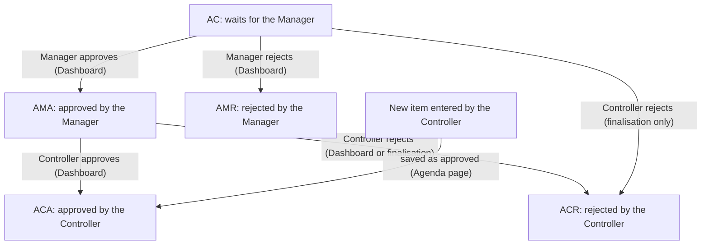
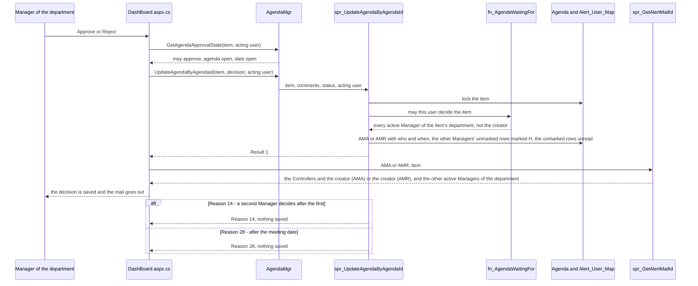
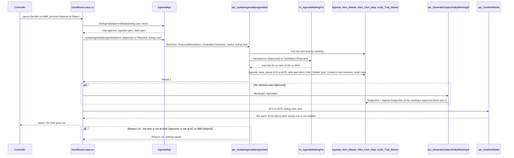

# Program to Program: Approval

- Title: Program to Program: Approval
- Audience: Developers and installers (internal)
- Shipped: No
- Applies to: WF2e1 (the Controller's approve and reject at AMA and his reject at AC, the Reason order, the exact messages, the subject number, the Controller's own new item; two corrections, see the change record); UD1b (step 53: who may approve or reject an item at AC, the first decision wins, the other Managers' alert rows, the mail); user-ud1a
- Commit: 31c81ab
- Last updated by: WF2e1, based on 31c81ab (earlier: UD1b, based on db1d641)
- Status: Draft
- Verified against: for WF2e1: BMMS/DashBoard/DashBoard.aspx.cs (btnApprove_Click, btnReject_Click, TryGetAgenda, GenerateMail, BindAgendaDetails, ShowAlert, ShowItemGone), BMMS/DashBoard/DashBoard.aspx (Agenda Alert panel buttons), BMMS/Master/Agenda.aspx.cs (the Controller's Save and Update call AddEditAgendaByController), BMMS/Master/AgendaFinalization.aspx.cs (RejectAgenda), BMMSBAL/AgendaMgr.cs (UpdateAgendaByAgendaId, GetAgendaApprovalState, GenerateSubjectNoByMeetingId, AddEditAgendaByController), BMMSBAL/MeetingMgr.cs (MeetingChangeResult.RefusalMessage, MeetingChangeReason, IsAgendaOpen), BMMSBAL/AlertMgr.cs and BMMSDAL/AlertDB.cs (GetAlertMailId), BMMSDAL/AgendaDB.cs (GetAgendaApprovalState), the catalog of BMMS_Test at step 57 (catalog-20261128-3172059: spr_UpdateAgendaByAgendaId, fn_AgendaWaitingFor, spr_GetAgendaApprovalState, spr_GetAlertMailId, spr_GenerateSubjectNoByMeetingId, spr_AddEditAgendaByController, spr_GetMeetingStatusByMeetingId); the Test script of step 53 was not read; for UD1b: BMMS/DashBoard/DashBoard.aspx.cs (the calls of the approval; the diff of the alert panel), Database/BMMS-Fix-DepartmentApprovers-Step53.sql (fn_AgendaWaitingFor, fn_DepartmentManagers, fn_ManagerReleaseRefusal, spr_GetAlertMailId read; the comment block of spr_UpdateAgendaByAgendaId and its alert statements read), Database/README.md (section Step UD1b)
- To confirm:
- Change record (WF2e1): (1) the Controller's decisions, the Reason order with the exact messages and the subject number are new; the open CONFIRM point and the To confirm line for them are closed. (2) Corrected: the table "Tables read and written" listed no Agenda_Status for spr_UpdateAgendaByAgendaId, which reads it for the status name of Reason 14; added. (3) Corrected: the table of refusals gave one column "Message the page shows" for all Reasons; the page shows the refusal messages of the procedure in a browser alert box, and the item-not-found and the page's own checks in the page's message box; both are now said. The rest of the text is unchanged.

## Scope

This file covers the approval of an agenda item: the Manager's approval or rejection of an item at AC (since step UD1b, database step 53:
who may decide, what the first decision does to the other Managers, who gets the mail), and the Controller's decisions: his approve
and reject at AMA on the Dashboard, and his reject at AC, which only the finalisation of the agenda makes (see 06-Finalisation-and-Mail).
It also says where a subject number comes from and what happens when the Controller enters an item himself. Where the Dashboard shows
the approval (My approvals, Waiting for me, the Agenda Alert panel, the Approve and Reject buttons) is in 09-Dashboard-and-Alerts; the
finalisation itself is in 06-Finalisation-and-Mail.

The statuses used here are codes of Agenda.AgendaStatusCode; their names are in Agenda_Status (not listed here).

| From | To | Data | Notes |
|---|---|---|---|
| AC | AMA | Manager approves | spr_UpdateAgendaByAgendaId, MgrApprovedStatus Approved |
| AC | AMR | Manager rejects | MgrApprovedStatus Rejected |
| AMA | ACA | Controller approves | ControllerApprovedStatus Approved; only from AMA |
| AMA | ACR | Controller rejects | ControllerApprovedStatus Rejected; from the Dashboard, or by the finalisation |
| AC | ACR | Controller rejects | The Dashboard shows the Controller no button at AC; the finalisation rejects the item |
| New item | ACA | The Controller saves a new item on the Agenda page | spr_AddEditAgendaByController inserts it as ACA with ControllerApprovedStatus Approved |

An item at AMR, ACA or ACR is not decided again by this procedure: no row of fn_AgendaWaitingFor exists for it (a Manager only at AC, a
Controller only at AC and AMA), so a call gives Reason 14.

## Programs involved

| Program | Kind | Part in the flow |
|---|---|---|
| DashBoard/DashBoard.aspx(.cs) | Page | `btnApprove_Click`, `btnReject_Click`: ask the state, save the decision, send the mail |
| AgendaMgr.GetAgendaApprovalState | BAL | What the acting user may do with the item (spr_GetAgendaApprovalState) |
| AgendaMgr.UpdateAgendaByAgendaId | BAL | Saves the decision (spr_UpdateAgendaByAgendaId); the answer is a MeetingChangeResult (Result, Reason, ReasonDetail) |
| MeetingMgr.IsAgendaOpen | BAL | The page's own check that the meeting's agenda is Open, before the save (spr_GetMeetingStatusByMeetingId) |
| MeetingChangeResult.RefusalMessage | BAL | The text of a refusal by Reason |
| AgendaMgr.GenerateSubjectNoByMeetingId | BAL | After an approval with Result 1, gives the item its subject number (spr_GenerateSubjectNoByMeetingId) |
| AlertMgr.GetAlertMailId, Mail_Mgr.SendWebEmail | BAL | The recipients of the mail (spr_GetAlertMailId), the mail |
| Master/AgendaFinalization.aspx(.cs) | Page | `RejectAgenda`: the Controller's reject of every item still at AC or AMA, by the same procedure (06-Finalisation-and-Mail) |
| Master/Agenda.aspx(.cs) and AgendaMgr.AddEditAgendaByController | Page, BAL | The Controller's own new item: spr_AddEditAgendaByController |
| spr_UpdateAgendaByAgendaId | Procedure | The checks, the decision, the alert rows, the audit rows |
| fn_AgendaWaitingFor, fn_DepartmentManagers | Inline table functions | Who may decide: the one rule |

## Main flow

| From | To | Data | Notes |
|---|---|---|---|
| Manager | DashBoard.aspx | Approve or Reject in the Agenda Alert panel | The buttons are shown when spr_GetAgendaApprovalState says he may |
| DashBoard.aspx | spr_UpdateAgendaByAgendaId | The item, the decision, the comments, the acting user | Through AgendaMgr and AgendaDB |
| spr_UpdateAgendaByAgendaId | fn_AgendaWaitingFor | The acting user, the database server's date | A Manager: an item at AC of a department of which he is an active Manager (fn_DepartmentManagers), not the creator; a Controller as before |
| spr_UpdateAgendaByAgendaId | Agenda | Status AMA or AMR, comments, who decided and when | The item was locked first, so the first decision wins |
| spr_UpdateAgendaByAgendaId | Alert_User_Map | The other Managers' unmarked rows: HandledReason 'H', HandledBy, HandledOn, read; the unmarked rows of the alert unread again; the creator's row | A marked row ('H', 'N', 'M') is never made unread again; no row for the Admin role |
| DashBoard.aspx | spr_GetAlertMailId | AMA or AMR, the acting user, the item | After Result 1 only |
| spr_GetAlertMailId | DashBoard.aspx | The e-mail addresses | AMA: the Controllers and the creator; AMR: the creator; both also every other active Manager of the item's department (the one who decided is left out); the Admin role never |

## The Controller's decisions

The Controller decides an item in two places: the Agenda Alert panel of the Dashboard (Approve and Reject, only at AMA) and Agenda
Finalization (Reject, every item still at AC or AMA). Both call spr_UpdateAgendaByAgendaId with ControllerApprovedStatus Approved or
Rejected and a MgrApprovedStatus that is empty, so the procedure takes its Controller branch.

| From | To | Data | Notes |
|---|---|---|---|
| Controller | DashBoard.aspx | Approve or Reject | Both buttons show only when CanApprove and AgendaOpen are 1 for the Controller, which is the case at AMA only (BindAgendaDetails: `mayApprove`). At AC the Controller sees the item without buttons, because CanApprove is 0 there |
| DashBoard.aspx | spr_GetAgendaApprovalState | Acting user, item | Before the save the page asks again; with DateOpen 0 it stops, for the Controller too (see "Refusal paths") |
| DashBoard.aspx | spr_UpdateAgendaByAgendaId | The item, Short Text, Proposed Resolution, the comments, ControllerApprovedStatus | The Controller branch writes Short Text, Proposed Resolution, Controller's comment, the decision, ControllerApprovedBy and ControllerApprovedDate; the Manager's columns are not touched |
| spr_UpdateAgendaByAgendaId | fn_AgendaWaitingFor | Acting user, database server's date | Approved needs CanApprove (the Controller at AMA); Rejected needs CanReject (the Controller at AC or AMA) |
| spr_UpdateAgendaByAgendaId | Agenda | Status ACA or ACR | AgendaStatusCode set with the decision |
| spr_UpdateAgendaByAgendaId | Alert_Master | AlertTypeCode ACA or ACR | The alert of the item (SourceType Agenda) |
| spr_UpdateAgendaByAgendaId | Alert_User_Map | The creator's row is deleted and created again unread (only while the creator is active, not the system account, not Admin). Every unmarked row is made unread. The acting user's own row is read | No row is marked 'H' by a Controller's decision; a marked row is never made unread |
| spr_UpdateAgendaByAgendaId | Audit_Trail_Master | Two rows 'UP' on Agenda keyed by AgendaNo: ControllerApprovedStatus and ControllerComments | Old value empty, new value as saved, Update_By the acting user |
| DashBoard.aspx | spr_GenerateSubjectNoByMeetingId | Meeting id, item id | Called after Result 1 of an approval (for a Manager's approval too, where it changes no SubjectNo). See "Subject numbers" |
| DashBoard.aspx | spr_GetAlertMailId | ACA or ACR, acting user, item | The users of the item's alert whose HandledReason is empty, active, not the system account, not the Admin role. The To of the mail is the Controller |

The check of the acting user's role is made by the procedure from the database (Users and Roles); the page's Approve and Reject send
`ControllerApprovedStatus` only when the session role code is controller, and `MgrApprovedStatus` only when it is manager. A call with
both or neither set gets Reason 14.

## Reject at AC and the reject rules

The Controller's reject of an item at AC is not offered on the Dashboard (no button at AC). It is made in Agenda Finalization:
`RejectAgenda` rereads the item, sends its Short Text and Proposed Resolution unchanged, MgrApprovedStatus empty,
ControllerApprovedStatus Rejected, and the Controller's comment "Agenda rejected by Controller on agenda finalized." (this text
replaces the saved Controller's comment of the item; the procedure writes the parameter as it is). The rules:

| Rule | Where it lives |
|---|---|
| Reject by the Controller: allowed for an item at AC or AMA, for an active user of role controller who is not the system account; no other status | fn_AgendaWaitingFor (CanReject; the function has a row for a Controller only at AC and AMA), spr_UpdateAgendaByAgendaId (Reason 14 otherwise) |
| The meeting date is not checked by the procedure for the Controller (it is for a Manager, Reason 28). On the Dashboard the page checks it for every role (DateOpen 0 stops Approve and Reject, also for the Controller). The finalisation does not read the date, so it rejects items after the meeting date too | spr_UpdateAgendaByAgendaId (the Reason 28 test applies when MgrApprovedStatus is set), DashBoard.aspx.cs (`stateDateOpen`), AgendaFinalization.aspx.cs |
| The meeting's agenda must be Open | spr_UpdateAgendaByAgendaId (Reason 5), MeetingMgr.IsAgendaOpen (page check on the Dashboard) |
| An item at AMR, ACA or ACR is not rejected again | fn_AgendaWaitingFor (no row), Reason 14 |
| The Controller may approve or reject an item he entered himself | The header comment of spr_UpdateAgendaByAgendaId says a Controller may approve an item he created; the function has no creator test for the Controller branch |
| Mail of the reject: the users of the item's alert whose row is not marked | spr_GetAlertMailId (ACR) |

## Refusal paths

The procedure checks in this order, and the first check that fails sets the Reason (nothing is saved for any Reason but 0): 12, 8, 4, 5,
14, 28. The item and then its meeting are locked first (the item, then the meeting row, UPDLOCK and HOLDLOCK), so the first decision wins.

| Reason | Raised by | Meaning | What the page shows |
|---|---|---|---|
| 12 | spr_UpdateAgendaByAgendaId | The acting user is the protected system account | Browser alert box: "The system account takes no part in the agenda workflow and cannot approve or reject agenda items." |
| 8 | spr_UpdateAgendaByAgendaId | The acting user is missing or not active | Browser alert box: "Your session is no longer valid. Please log in again." |
| 4 | spr_UpdateAgendaByAgendaId | The item or its meeting is not found (the lock finds no meeting) | The page's message box (warning) and the panels closed: "This item no longer exists." The page also shows this text when it cannot read the item before the call |
| 5 | spr_UpdateAgendaByAgendaId | The meeting's agenda is not Open (ReasonDetail "Finalized") | Browser alert box: "The agenda for this meeting is finalized, so agenda items can no longer be added, changed or deleted." The page tests this first (MeetingMgr.IsAgendaOpen) and shows the same text, so a finalised agenda stops before the state check and before any mail |
| 14 | spr_UpdateAgendaByAgendaId | The acting user may not decide the item at its stage: the role is not manager or controller, both or neither status is set, the function has no row for the user and item, a Controller approves an item not at AMA, also the second Manager after the first has decided (the item is then at AMA or AMR). ReasonDetail is the status name | Browser alert box: "You cannot approve or reject this agenda item at its current stage ([status name]). Reload the Dashboard to see its current state." |
| 28 | spr_UpdateAgendaByAgendaId | A Manager decides after the meeting date (step 52); checked after Reason 14 | Browser alert box: "The meeting date has passed, so this item can no longer be approved or rejected. It will be rejected when the agenda is finalized." |

The page makes these checks of its own before the call, in this order, and stops at the first that fails: no session user (back to
sign-in), the rich text over the limit ("The text is too long. Shorten it or attach the document as a file."), the item not readable
("This item no longer exists."), the agenda not Open (Reason 5 text, above), the state cannot be read ("The item could not be checked,
so nothing was changed. Try again."), DateOpen 0 ("The meeting date has passed, so this item can no longer be approved or rejected.
It will be rejected when the agenda is finalized."). The rich-text text is in the page's message box and the panel stays open. The
other refusals of the page's own checks close the panel and read the lists again: the agenda-not-Open text is an alert box, the rest
are in the page's message box (warning). After Result 1 the panel closes, the Meetings card counts are read again
(`MeetingSummary1.Reload()`), and a failed mail shows "The item was approved, but the mail could not be sent. The error is in the error
log." or "The item was rejected, but the mail could not be sent. The error is in the error log." (a failed address is described in
System-Manual/07-Mail, "How Mail_Mgr connects and sends").

## Subject numbers

A subject number is given in two places, never by the finalisation:

| Where | Rule | Procedure |
|---|---|---|
| The Dashboard, after an approval with Result 1 (the call is made for a Manager's approval and a Controller's approval alike) | The item gets the highest SubjectNo among the meeting's items with ControllerApprovedStatus Approved, plus 1 (1 when there is none). Only an item with ControllerApprovedStatus Approved is updated, so a Manager's approval changes no SubjectNo. The procedure also sets Meeting.SubjectStatus to 'Close' every time it runs. It takes no lock and starts no transaction of its own | spr_GenerateSubjectNoByMeetingId, called by `btnApprove_Click` before the mail |
| The Agenda page, a new item saved by the Controller | The same maximum plus 1, set in the same save | spr_AddEditAgendaByController (Code Save) |

The Agenda page's Update keeps the saved SubjectNo of an item approved by the Controller (Agenda.aspx.cs, step N5).

## The Controller's own new item (Agenda page)

On Agenda.aspx.cs a Controller's Save or Update calls AddEditAgendaByController, not the decision procedure. It is not an approve or a
reject of someone else's item:

- Save inserts the item with AgendaStatusCode ACA and ControllerApprovedStatus Approved, ControllerApprovedBy and
  ControllerApprovedDate the acting user and now, writes an Alert_Master row of type ACA and Alert_User_Map rows for the active users of
  the item's department (home department; not the system account, not the Admin role), sets the SubjectNo (see above), and, when the
  meeting's agenda is already finalised ('Close') and the change is allowed, also inserts the item's Minutes row. It writes Audit_Trail_Master
  rows 'IN' for seven fields.
- Update changes the texts and the department and writes audit rows for the fields that changed; it does not change the status or the
  approval. When it changes the Controller's comment it sets ControllerApprovedBy and ControllerApprovedDate; a change of the department
  of an item at AC hands the item to the Managers of the new department (the unmarked rows of other Managers become 'M').
- The lock on the meeting and the refusals of the save come from fn_AgendaChangeRefusal (called with the meeting, the acting user and 1; its
  text was not read for this file); they are the refusals of the Agenda page and are not drawn here.

## Where each rule lives

| Rule | C# | Procedure or function |
|---|---|---|
| Who may decide an item at AC: every active Manager of its department, never the creator; the Reporting Person and the alert rows do not decide | none | fn_AgendaWaitingFor, fn_DepartmentManagers |
| Who may decide as Controller: approve at AMA; reject at AC or AMA | none | fn_AgendaWaitingFor (CanApprove, CanReject) |
| The first decision wins | none | spr_UpdateAgendaByAgendaId (the lock on the item, then Reason 14) |
| The order of the refusals: 12, 8, 4, 5, 14, 28 | none | spr_UpdateAgendaByAgendaId |
| The Dashboard's checks before the save (agenda Open, state, date) | `btnApprove_Click`, `btnReject_Click`, `MeetingMgr.IsAgendaOpen`, `TryGetApprovalState` | spr_GetMeetingStatusByMeetingId, spr_GetAgendaApprovalState |
| The texts of the refusals | `MeetingChangeResult.RefusalMessage`, `MeetingChangeReason` (BMMSBAL/MeetingMgr.cs); the page's constants | none |
| The other Managers' rows become handled | none | spr_UpdateAgendaByAgendaId |
| The Controller's decision renews the creator's alert row and writes two audit rows | none | spr_UpdateAgendaByAgendaId |
| The subject number | `btnApprove_Click` calls `AgendaMgr.GenerateSubjectNoByMeetingId` | spr_GenerateSubjectNoByMeetingId, spr_AddEditAgendaByController |
| The mail of the decision to the other Managers; a handled Manager gets no later mail | `btnApprove_Click`, `btnReject_Click` (send after Result 1) | spr_GetAlertMailId (AMA, AMR; ACA, ACR leave out marked rows) |
| A Manager leaves a department only when another Manager could decide the waiting items | `UserMgr` (messages) | fn_ManagerReleaseRefusal (Reason 24), called by spr_AddEditUser and spr_SetUserStatusByUserId |

## Tables read and written

| Object | Reads | Writes |
|---|---|---|
| fn_AgendaWaitingFor | Users, Roles, Agenda, Meeting, and fn_DepartmentManagers | none |
| fn_DepartmentManagers | Users, Roles, User_Department | none |
| spr_UpdateAgendaByAgendaId | Users, Roles, Agenda, Agenda_Status, Meeting, Alert_Master, Alert_User_Map | Agenda, Alert_Master (type), Alert_User_Map, Audit_Trail_Master |
| spr_GetAgendaApprovalState | Users, Agenda, Meeting, and fn_AgendaWaitingFor | none |
| spr_GenerateSubjectNoByMeetingId | Agenda | Agenda (SubjectNo), Meeting (SubjectStatus) |
| spr_AddEditAgendaByController | Committee, Meeting, Agenda, Subject_Type, Users, View_Minute, and fn_AgendaChangeRefusal (not read here) | Agenda, Alert_Master, Alert_User_Map (also through spr_SetManagerAlertRows on a department change), Minutes (agenda already finalised, or the Update of the resolution), Audit_Trail_Master |
| spr_GetAlertMailId | Users, Roles, Agenda, Alert_Master, Alert_User_Map, and fn_DepartmentManagers | none |

## Drawn from

BMMS/DashBoard/DashBoard.aspx.cs (btnApprove_Click, btnReject_Click, TryGetAgenda, GenerateMail, BindAgendaDetails and the calls named
above), BMMS/Master/AgendaFinalization.aspx.cs (RejectAgenda), BMMS/Master/Agenda.aspx.cs (the call of AddEditAgendaByController),
BMMSBAL/AgendaMgr.cs, BMMSBAL/MeetingMgr.cs (MeetingChangeResult, MeetingChangeReason, IsAgendaOpen), the catalog of BMMS_Test at step
57 (spr_UpdateAgendaByAgendaId, fn_AgendaWaitingFor, spr_GetAgendaApprovalState, spr_GetAlertMailId, spr_GenerateSubjectNoByMeetingId,
spr_AddEditAgendaByController, spr_GetMeetingStatusByMeetingId), Database/BMMS-Fix-DepartmentApprovers-Step53.sql (fn_AgendaWaitingFor,
fn_DepartmentManagers, spr_GetAlertMailId, the comment block and alert statements of spr_UpdateAgendaByAgendaId), Database/README.md
(section Step UD1b), Database/BMMS-Test-DepartmentApprovers-Step53.sql (as described in Database/README.md, not read line by line).
