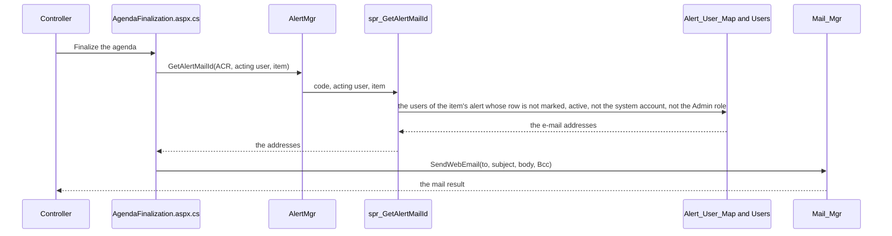
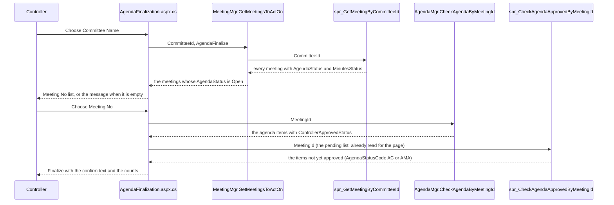

# Program to Program: Agenda Finalisation and Mail

- Title: Program to Program: Agenda Finalisation and Mail
- Audience: Developers and installers (internal)
- Shipped: No
- Applies to: AF1 (the new section "The meeting list and the confirm of Agenda Finalize (step AF1)"); UD1b (step 53: the recipients of the Controller's rejection mail at finalisation); user-ud1a
- Commit: be23b24
- Last updated by: AF1, based on be23b24 (the new AF1 section); UD1b, based on db1d641
- Status: Draft
- Verified against: for AF1: BMMS/Master/AgendaFinalization.aspx.cs and BMMSBAL/MeetingMgr.cs (GetMeetingsToActOn) read in the diff, Database/README.md (section Step AF1); for UD1b: BMMS/Master/AgendaFinalization.aspx.cs (the mail code ACR and the call of AlertMgr.GetAlertMailId), Database/BMMS-Fix-DepartmentApprovers-Step53.sql (spr_GetAlertMailId, the ACA and ACR branch), Database/README.md (section Step UD1b)
- To confirm: feature area written only for the mail recipients of step UD1b (WF2c2); the finalisation itself (spr_AgendaFinalizeByMeetingId, the subject numbers, the Minutes rows) is not written yet

## Scope

This file covers, since step UD1b (database step 53), who gets the mail when the Controller's finalisation rejects an item
(code ACR) and when the Controller approves (ACA): the users of the item's alert, except the rows marked as handled and the
Admin role. A Manager whose row another Manager of the department handled ('H'), or whose row was closed ('N' no longer Manager
of the department, 'M' the item was moved to another department), gets no mail of the item.

[[CONFIRM: the finalisation flow and the rest of the mail of this area are not written yet (WF2c2)]]

## Programs involved

| Program | Kind | Part in the flow |
|---|---|---|
| Master/AgendaFinalization.aspx(.cs) | Page | Finalises the agenda; for each item it rejects it sends the mail (`GenerateMail`, code ACR) |
| AlertMgr.GetAlertMailId | BAL | Calls spr_GetAlertMailId with the mail code, the acting user and the item |
| Mail_Mgr.SendWebEmail | BAL | Sends the mail, the recipients in Bcc |
| spr_GetAlertMailId | Procedure | The addresses by code (AMR, AMA, ACA, ACR) |

## Main flow

| From | To | Data | Notes |
|---|---|---|---|
| Controller | AgendaFinalization.aspx | Finalize the agenda | Items not yet approved are rejected |
| AgendaFinalization.aspx | spr_GetAlertMailId | Code ACR (rejected by the Controller on finalisation) or ACA, the item | Through AlertMgr and AlertDB |
| spr_GetAlertMailId | Alert_User_Map, Users | The alert of the item, the rows with HandledReason NULL | Since step 53; the Admin role was already left out in step 43 |
| AgendaFinalization.aspx | Mail_Mgr.SendWebEmail | Addresses in Bcc, subject, body | A failed mail leaves the finalisation as it is |

## The meeting list and the confirm of Agenda Finalize (step AF1)

Code only; no procedure changed and nothing is written. When the Controller chooses a committee, AgendaFinalization.aspx lists
only the meetings whose agenda is still Open. When a meeting is chosen, the page builds the text of the Finalize confirm
on the server, with counts.

| From | To | Data | Notes |
|---|---|---|---|
| Controller | AgendaFinalization.aspx | Committee Name | The meeting list is read again |
| AgendaFinalization.aspx | MeetingMgr.GetMeetingsToActOn | CommitteeId, MeetingAction.AgendaFinalize | Filter in code on the rows of spr_GetMeetingByCommitteeId, same order |
| MeetingMgr.GetMeetingsToActOn | AgendaFinalization.aspx | The meetings whose AgendaStatus is Open | Trimmed, ignoring case; NULL is not listed (the page's own check refuses it) |
| AgendaFinalization.aspx | AgendaMgr.CheckAgendaByMeetingId | MeetingId | The meeting's agenda items, as btnFinalize_Click reads them |
| AgendaFinalization.aspx | Controller | Confirm text with [A] and [R] | [A] = items with ControllerApprovedStatus Approved (the items spr_AgendaFinalizeByMeetingId copies to the minutes); [R] = rows of the pending list from spr_CheckAgendaApprovedByMeetingId (the items btnFinalize_Click rejects, a mail each) |

The confirm is `return confirm('...')` on the button, the text passed through HttpUtility.JavaScriptStringEncode. Five cases: all
approved ([R] = 0); some to be rejected; none approved with items to reject; none approved and nothing to reject; no items. With
Committee Name or Meeting No at "- Select -" the markup's text "Do you want to Finalize this Meeting Agenda?" is used. The counts
are read when the meeting is chosen, not when Finalize is pressed (the server still decides).

After a successful Finalize (also the no-items branch and a finalize with rejection mails) the page reads the meeting list again
(the meeting is no longer Open and drops out), Meeting No is "- Select -", the pending list is hidden and the success message
stays. After a refusal nothing is reloaded and the meeting stays chosen. A committee with no Open meeting shows "- Select -" only
and the message "This committee has no meeting with its agenda still to finalize." (not shown after a success).

The refusals, Reasons, locks, audit rows and mails of the finalisation are unchanged. The other pages that read
spr_GetMeetingByCommitteeId keep every meeting.

| Rule | C# | Procedure |
|---|---|---|
| Only an Open agenda is listed | MeetingMgr.GetMeetingsToActOn | none (the page's check is spr_CheckAgendaFinalizeByMeetingId, unchanged, still decides) |
| Confirm text and counts | AgendaFinalization.SetFinalizeConfirm | none (counts from AgendaMgr.CheckAgendaByMeetingId and the pending list of spr_CheckAgendaApprovedByMeetingId) |
| Drop-out after a success | AgendaFinalization.ReloadAfterFinalize | none |

Tables read: View_Meeting (through spr_GetMeetingByCommitteeId), the Agenda rows (through AgendaMgr.CheckAgendaByMeetingId and
spr_CheckAgendaApprovedByMeetingId). Tables written: none.

Drawn from: BMMS/Master/AgendaFinalization.aspx.cs (LoadMeetings, SetFinalizeConfirm, ReloadAfterFinalize), BMMSBAL/MeetingMgr.cs
(MeetingAction, GetMeetingsToActOn), Database/README.md (section Step AF1).

## Refusal paths

[[CONFIRM: not written yet (WF2c2)]]

## Where each rule lives

| Rule | C# | Procedure or function |
|---|---|---|
| Recipients of ACA and ACR: the users of the item's alert, rows not marked, never the Admin role, active, not the system account | `GenerateMail` of the page | spr_GetAlertMailId |
| A handled Manager gets no later mail of the item | none | spr_GetAlertMailId, spr_GetAgendaUpdateMailId |

## Tables read and written

| Object | Reads | Writes |
|---|---|---|
| spr_GetAlertMailId | Users, Roles, Agenda, Alert_Master, Alert_User_Map (HandledReason), and fn_DepartmentManagers (the AMA and AMR branches) | none |

## Drawn from

BMMS/Master/AgendaFinalization.aspx.cs (GenerateMail, the call of AlertMgr.GetAlertMailId), Database/BMMS-Fix-DepartmentApprovers-Step53.sql
(spr_GetAlertMailId), Database/README.md (section Step UD1b).
