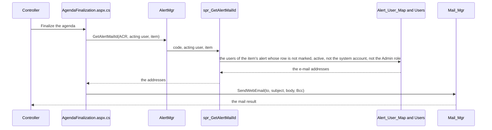

# Program to Program: Agenda Finalisation and Mail

- Title: Program to Program: Agenda Finalisation and Mail
- Audience: Developers and installers (internal)
- Shipped: No
- Applies to: UD1b (step 53: the recipients of the Controller's rejection mail at finalisation); user-ud1a
- Commit: db1d641
- Last updated by: UD1b, based on db1d641
- Status: Draft
- Verified against: for UD1b: BMMS/Master/AgendaFinalization.aspx.cs (the mail code ACR and the call of AlertMgr.GetAlertMailId), Database/BMMS-Fix-DepartmentApprovers-Step53.sql (spr_GetAlertMailId, the ACA and ACR branch), Database/README.md (section Step UD1b)
- To confirm: feature area written only for the mail recipients of step UD1b (WF2c2); the finalisation itself (spr_AgendaFinalizeByMeetingId, the subject numbers, the Minutes rows) is not written yet

## Scope

This file covers, since step UD1b (database step 53), who gets the mail when the Controller's finalisation rejects an item
(code ACR) and when the Controller approves (ACA): the users of the item's alert, except the rows marked as handled and the
Admin role. A Manager whose row another Manager of the department handled ('H'), or whose row was closed ('N' no longer Manager
of the department, 'M' the item was moved to another department), gets no mail of the item.

[[CONFIRM: the finalisation flow and the rest of the mail of this area are not written yet (WF2c2)]]

## Programs involved

| Program | Kind | Part in the flow |
|---|---|---|
| Master/AgendaFinalization.aspx(.cs) | Page | Finalises the agenda; for each item it rejects it sends the mail (`GenerateMail`, code ACR) |
| AlertMgr.GetAlertMailId | BAL | Calls spr_GetAlertMailId with the mail code, the acting user and the item |
| Mail_Mgr.SendWebEmail | BAL | Sends the mail, the recipients in Bcc |
| spr_GetAlertMailId | Procedure | The addresses by code (AMR, AMA, ACA, ACR) |

## Main flow

| From | To | Data | Notes |
|---|---|---|---|
| Controller | AgendaFinalization.aspx | Finalize the agenda | Items not yet approved are rejected |
| AgendaFinalization.aspx | spr_GetAlertMailId | Code ACR (rejected by the Controller on finalisation) or ACA, the item | Through AlertMgr and AlertDB |
| spr_GetAlertMailId | Alert_User_Map, Users | The alert of the item, the rows with HandledReason NULL | Since step 53; the Admin role was already left out in step 43 |
| AgendaFinalization.aspx | Mail_Mgr.SendWebEmail | Addresses in Bcc, subject, body | A failed mail leaves the finalisation as it is |

## Refusal paths

[[CONFIRM: not written yet (WF2c2)]]

## Where each rule lives

| Rule | C# | Procedure or function |
|---|---|---|
| Recipients of ACA and ACR: the users of the item's alert, rows not marked, never the Admin role, active, not the system account | `GenerateMail` of the page | spr_GetAlertMailId |
| A handled Manager gets no later mail of the item | none | spr_GetAlertMailId, spr_GetAgendaUpdateMailId |

## Tables read and written

| Object | Reads | Writes |
|---|---|---|
| spr_GetAlertMailId | Users, Roles, Agenda, Alert_Master, Alert_User_Map (HandledReason), and fn_DepartmentManagers (the AMA and AMR branches) | none |

## Drawn from

BMMS/Master/AgendaFinalization.aspx.cs (GenerateMail, the call of AlertMgr.GetAlertMailId), Database/BMMS-Fix-DepartmentApprovers-Step53.sql
(spr_GetAlertMailId), Database/README.md (section Step UD1b).
