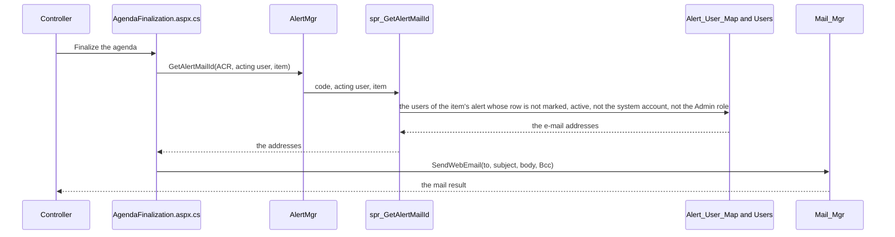
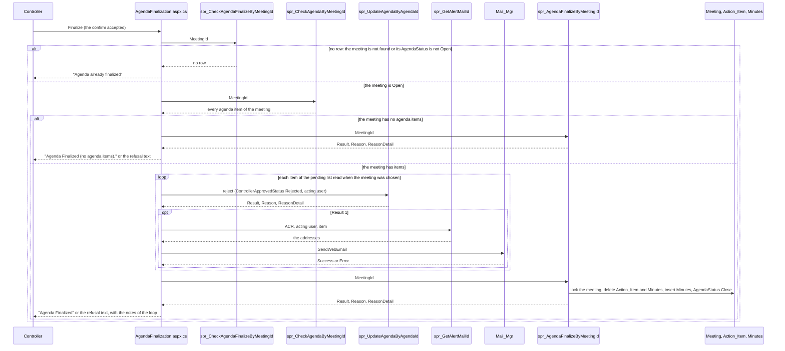
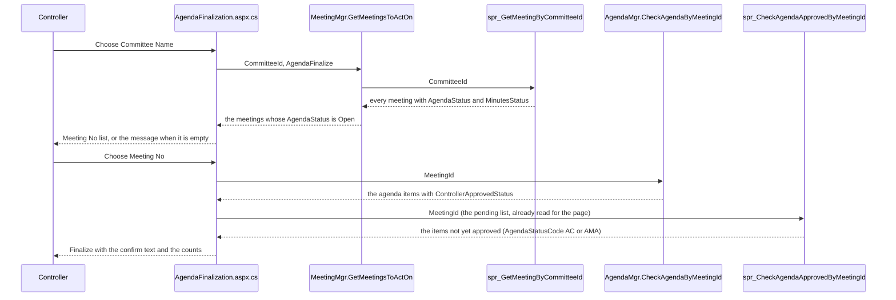

# Program to Program: Agenda Finalisation and Mail

- Title: Program to Program: Agenda Finalisation and Mail
- Audience: Developers and installers (internal)
- Shipped: No
- Applies to: WF2e1 (the finalisation flow: checks, rejection loop with the ACR mails, finalize; the refusal paths; spr_AgendaFinalizeByMeetingId; where the subject numbers come from; one correction, see the change record); AF1 (the new section "The meeting list and the confirm of Agenda Finalize (step AF1)"); UD1b (step 53: the recipients of the Controller's rejection mail at finalisation); user-ud1a
- Commit: 31c81ab
- Last updated by: WF2e1, based on 31c81ab (earlier: AF1, based on be23b24; UD1b, based on db1d641)
- Status: Draft
- Verified against: for WF2e1: BMMS/Master/AgendaFinalization.aspx.cs (read in full: btnFinalize_Click, PageValidation, RejectAgenda, GenerateMail, LoadAgenda, SetFinalizeConfirm, ReloadAfterFinalize), BMMSBAL/AgendaMgr.cs and BMMSDAL/AgendaDB.cs (AgendaFinalizeByMeetingId, CheckAgendaFinalizeByMeetingId, CheckAgendaApprovedByMeetingId, CheckAgendaByMeetingId, UpdateAgendaByAgendaId), BMMSBAL/MeetingMgr.cs (MeetingChangeResult.RefusalMessage, MeetingChangeReason), BMMSBAL/AlertMgr.cs and BMMSDAL/AlertDB.cs (GetAlertMailId), the catalog of BMMS_Test at step 57 (catalog-20261128-3172059: spr_AgendaFinalizeByMeetingId, spr_CheckAgendaFinalizeByMeetingId, spr_CheckAgendaApprovedByMeetingId, spr_CheckAgendaByMeetingId, spr_UpdateAgendaByAgendaId, spr_GetAlertMailId, spr_GenerateSubjectNoByMeetingId, spr_AddEditAgendaByController), System-Manual/08-Security.md (section Procedures that rely on page access only), System-Manual/07-Mail.md (How Mail_Mgr connects and sends); no Test script was read; for AF1: BMMS/Master/AgendaFinalization.aspx.cs and BMMSBAL/MeetingMgr.cs (GetMeetingsToActOn) read in the diff, Database/README.md (section Step AF1); for UD1b: BMMS/Master/AgendaFinalization.aspx.cs (the mail code ACR and the call of AlertMgr.GetAlertMailId), Database/BMMS-Fix-DepartmentApprovers-Step53.sql (spr_GetAlertMailId, the ACA and ACR branch), Database/README.md (section Step UD1b)
- To confirm:
- Change record (WF2e1; WF2e1 security review: wording of the lock and of the Minutes values made neutral): (1) the finalisation flow, the refusal paths and spr_AgendaFinalizeByMeetingId are new; the two open CONFIRM points (the finalisation flow, and "Refusal paths") and the To confirm line for them are closed. (2) Corrected: the table row "AgendaFinalization.aspx to spr_GetAlertMailId" said "Code ACR ... or ACA"; AgendaFinalization.aspx.cs sends only ACR (the ACA mail is sent by the Dashboard, btnApprove_Click); and the Scope sentence that said the finalisation sends ACA is reworded the same way. The rest of the text is unchanged.

## Scope

This file covers Agenda Finalization (Master/AgendaFinalization.aspx): the order of what one press of Finalize does, its refusal paths,
the procedure that closes the agenda, and, since step UD1b (database step 53), who gets the mail when the Controller's finalisation
rejects an item (code ACR). The same recipient rule serves the Dashboard's ACA and ACR mails (05-Approval): the users of the item's
alert, except the rows marked as handled and the Admin role. A Manager whose row another Manager of the department handled ('H'), or
whose row was closed ('N' no longer Manager of the department, 'M' the item was moved to another department), gets no mail of the item.
The finalisation itself sends ACR mails only; an ACA mail is sent when the Controller approves an item on the Dashboard.

The order, as `btnFinalize_Click` does it: the checks of the page, then the rejection of every item still at AC or AMA (one save and
one mail each), then the finalize. The Controller's reject (the rules, the Reasons) is described in 05-Approval; the meeting list and
the confirm text in the AF1 section below.

## Programs involved

| Program | Kind | Part in the flow |
|---|---|---|
| Master/AgendaFinalization.aspx(.cs) | Page | `btnFinalize_Click`: the checks, the loop of `RejectAgenda`, the finalize; for each item it rejects it sends the mail (`GenerateMail`, code ACR) |
| AgendaMgr.CheckAgendaFinalizeByMeetingId | BAL | Calls spr_CheckAgendaFinalizeByMeetingId: the meeting, only when its AgendaStatus is Open |
| AgendaMgr.CheckAgendaByMeetingId | BAL | Calls spr_CheckAgendaByMeetingId: every agenda item of the meeting |
| AgendaMgr.CheckAgendaApprovedByMeetingId | BAL | Calls spr_CheckAgendaApprovedByMeetingId: the items still at AC or AMA (the pending list; the name says "approved", the list is of the items not yet approved) |
| AgendaMgr.UpdateAgendaByAgendaId | BAL | The rejection of one item (spr_UpdateAgendaByAgendaId), the same procedure as the Dashboard's decision |
| AgendaMgr.AgendaFinalizeByMeetingId | BAL | Calls spr_AgendaFinalizeByMeetingId; the answer is a MeetingChangeResult |
| AlertMgr.GetAlertMailId | BAL | Calls spr_GetAlertMailId with the mail code, the acting user and the item |
| Mail_Mgr.SendWebEmail | BAL | Sends the mail, the recipients in Bcc |
| spr_AgendaFinalizeByMeetingId | Procedure | Closes the agenda and creates the Minutes rows |
| spr_GetAlertMailId | Procedure | The addresses by code (AMR, AMA, ACA, ACR) |

## Main flow

| From | To | Data | Notes |
|---|---|---|---|
| Controller | AgendaFinalization.aspx | Finalize the agenda | Items not yet approved are rejected |
| AgendaFinalization.aspx | spr_GetAlertMailId | Code ACR (rejected by the Controller on finalisation), the item | Through AlertMgr and AlertDB; one call for each rejected item. The finalisation never sends ACA |
| spr_GetAlertMailId | Alert_User_Map, Users | The alert of the item, the rows with HandledReason NULL | Since step 53; the Admin role was already left out in step 43 |
| AgendaFinalization.aspx | Mail_Mgr.SendWebEmail | Addresses in Bcc, subject, body | A failed mail leaves the finalisation as it is |

## The finalisation: checks, rejection loop, finalize

One press of Finalize runs these parts in this order.

| From | To | Data | Notes |
|---|---|---|---|
| Controller | AgendaFinalization.aspx | Finalize | The client check `AgendaFinalizeValidation` and the confirm text come first (AF1 section) |
| AgendaFinalization.aspx | spr_CheckAgendaFinalizeByMeetingId | MeetingId | Returns the Meeting row only when AgendaStatus is exactly Open (a NULL AgendaStatus gives no row) |
| AgendaFinalization.aspx | spr_CheckAgendaByMeetingId | MeetingId | All the meeting's agenda items; only the count is used to choose between the two branches |
| AgendaFinalization.aspx | spr_AgendaFinalizeByMeetingId | MeetingId | The no-items branch: a meeting without agenda items is finalised too, so its attendance can be entered |
| AgendaFinalization.aspx | spr_UpdateAgendaByAgendaId | One item of the pending list: Short Text and Proposed Resolution as saved, MgrApprovedStatus empty, ControllerApprovedStatus Rejected, Controller's comment "Agenda rejected by Controller on agenda finalized.", the acting user | The item is read again first (spr_GetAgendaByAgendaId); an item that is gone is counted as not rejected. A Result other than 1 is counted as not rejected, whatever the Reason, and sends no mail. Each call is its own transaction |
| spr_UpdateAgendaByAgendaId | Agenda, Alert_Master, Alert_User_Map, Audit_Trail_Master | The item to ACR, the alert to ACR, the creator's row renewed, two audit rows | As the Controller's reject in 05-Approval |
| AgendaFinalization.aspx | spr_GetAlertMailId, Mail_Mgr.SendWebEmail | ACR, acting user, item. Subject "Agenda ([agenda no]) has been rejected by Controller on agenda finalized" | After the item's own Result 1. A mail that fails (an exception, or the result of SendWebEmail other than Success) is counted and logged, the item stays rejected. A bad address is skipped by Mail_Mgr: see [System-Manual/07-Mail.md](../../System-Manual/07-Mail.md), "How Mail_Mgr connects and sends" (Addresses, step ML2c) |
| AgendaFinalization.aspx | spr_AgendaFinalizeByMeetingId | MeetingId only | After the whole loop, whatever the notes of the loop |
| spr_AgendaFinalizeByMeetingId | Meeting, Action_Item, Minutes | See below | One transaction |

The pending list is the list read when the meeting was chosen (spr_CheckAgendaApprovedByMeetingId, kept in the page's view state), not read
again when Finalize is pressed. The procedure that rejects checks every item again, so an item that has moved on since (for example
approved by the Controller on the Dashboard) is refused with Reason 14 and counted as not rejected. An item that reached AC or AMA after the
list was read is not in the loop.

### The procedure spr_AgendaFinalizeByMeetingId

Takes @MeetingId only: no acting user, and no role check (see "Procedures that rely on page access only" in
[System-Manual/08-Security.md](../../System-Manual/08-Security.md), which lists this procedure and the missing acting-user check).
In its own words:

1. It starts a transaction, or a savepoint when the caller already has one.
2. It reads the Meeting row under an update lock held to the end of the transaction, so a second Finalize of the same meeting waits and then finds the agenda closed. A
   NULL AgendaStatus counts as Open here (the page's check in step 1 of the flow is stricter).
3. Meeting not found: Reason 4. AgendaStatus not Open: Reason 3, ReasonDetail the AgendaStatus found. Nothing is written for either.
4. Otherwise it deletes the Action_Item rows of the Minutes of the meeting's agenda items, deletes those Minutes rows, and inserts a new
   Minutes row for every item of the meeting whose ControllerApprovedStatus is Approved, with ActualResolution the item's ProposedResolution and CreatedOn and UpdatedOn now; the Minutes rows are written with a fixed
   user id, not the acting user. An item that is not Approved (rejected by the Manager or the Controller, or just rejected by the loop) has no Minutes row.
5. It sets Meeting.AgendaStatus to 'Close' and returns Result 1.
6. A database error rolls the transaction back (or to the savepoint) and is raised again, so the page's catch sends the user to the error page.

It returns one row: Result, Reason, ReasonDetail. It writes no Audit_Trail_Master row. The rejections of the loop do: spr_UpdateAgendaByAgendaId
writes two audit rows for each rejected item (05-Approval).

Subject numbers do not come from this procedure. It copies the items that are Approved and does not read or write Agenda.SubjectNo. The
numbers are given when the Controller approves an item on the Dashboard (spr_GenerateSubjectNoByMeetingId) and when the Controller saves
a new item (spr_AddEditAgendaByController); see 05-Approval, "Subject numbers".

## The meeting list and the confirm of Agenda Finalize (step AF1)

Code only; no procedure changed and nothing is written. When the Controller chooses a committee, AgendaFinalization.aspx lists
only the meetings whose agenda is still Open. When a meeting is chosen, the page builds the text of the Finalize confirm
on the server, with counts.

| From | To | Data | Notes |
|---|---|---|---|
| Controller | AgendaFinalization.aspx | Committee Name | The meeting list is read again |
| AgendaFinalization.aspx | MeetingMgr.GetMeetingsToActOn | CommitteeId, MeetingAction.AgendaFinalize | Filter in code on the rows of spr_GetMeetingByCommitteeId, same order |
| MeetingMgr.GetMeetingsToActOn | AgendaFinalization.aspx | The meetings whose AgendaStatus is Open | Trimmed, ignoring case; NULL is not listed (the page's own check refuses it) |
| AgendaFinalization.aspx | AgendaMgr.CheckAgendaByMeetingId | MeetingId | The meeting's agenda items, as btnFinalize_Click reads them |
| AgendaFinalization.aspx | Controller | Confirm text with [A] and [R] | [A] = items with ControllerApprovedStatus Approved (the items spr_AgendaFinalizeByMeetingId copies to the minutes); [R] = rows of the pending list from spr_CheckAgendaApprovedByMeetingId (the items btnFinalize_Click rejects, a mail each) |

The confirm is `return confirm('...')` on the button, the text passed through HttpUtility.JavaScriptStringEncode. Five cases: all
approved ([R] = 0); some to be rejected; none approved with items to reject; none approved and nothing to reject; no items. With
Committee Name or Meeting No at "- Select -" the markup's text "Do you want to Finalize this Meeting Agenda?" is used. The counts
are read when the meeting is chosen, not when Finalize is pressed (the server still decides).

After a successful Finalize (also the no-items branch and a finalize with rejection mails) the page reads the meeting list again
(the meeting is no longer Open and drops out), Meeting No is "- Select -", the pending list is hidden and the success message
stays. After a refusal nothing is reloaded and the meeting stays chosen. A committee with no Open meeting shows "- Select -" only
and the message "This committee has no meeting with its agenda still to finalize." (not shown after a success).

The refusals, Reasons, locks, audit rows and mails of the finalisation are unchanged. The other pages that read
spr_GetMeetingByCommitteeId keep every meeting.

| Rule | C# | Procedure |
|---|---|---|
| Only an Open agenda is listed | MeetingMgr.GetMeetingsToActOn | none (the page's check is spr_CheckAgendaFinalizeByMeetingId, unchanged, still decides) |
| Confirm text and counts | AgendaFinalization.SetFinalizeConfirm | none (counts from AgendaMgr.CheckAgendaByMeetingId and the pending list of spr_CheckAgendaApprovedByMeetingId) |
| Drop-out after a success | AgendaFinalization.ReloadAfterFinalize | none |

Tables read: View_Meeting (through spr_GetMeetingByCommitteeId), the Agenda rows (through AgendaMgr.CheckAgendaByMeetingId and
spr_CheckAgendaApprovedByMeetingId). Tables written: none.

Drawn from: BMMS/Master/AgendaFinalization.aspx.cs (LoadMeetings, SetFinalizeConfirm, ReloadAfterFinalize), BMMSBAL/MeetingMgr.cs
(MeetingAction, GetMeetingsToActOn), Database/README.md (section Step AF1).

## Refusal paths

The page checks first, then the loop, then the procedure. Messages are shown in the page's message box (warning unless noted).

| Where | Reason | Meaning | What the page shows |
|---|---|---|---|
| PageValidation | (none) | Committee Name at "- Select -" | "Please Select Committee Name" |
| PageValidation | (none) | Meeting No at "- Select -" | "Please Select Meeting No" |
| PageValidation (spr_CheckAgendaFinalizeByMeetingId) | (none) | No Meeting row with AgendaStatus Open: the meeting is gone, its agenda is finalised, or its AgendaStatus is NULL | "Agenda already finalized" |
| Loop (spr_UpdateAgendaByAgendaId) | 12, 8, 4, 5, 14 (28 is not raised for the Controller) | One item is not rejected: the acting user is the system account or not active, the item or its meeting is gone, the agenda was finalised meanwhile, the item is no longer at AC or AMA | No message for the single item; the item is counted. The final message ends " [n] item(s) could not be rejected." The Reasons are in 05-Approval. Nothing is saved for that item and no mail is sent |
| Loop (the item cannot be read) | (none) | spr_GetAgendaByAgendaId returns no row | Counted as not rejected, as above |
| Loop (the mail) | (none) | The mail of a rejected item failed: an exception in the page's GenerateMail, or a SendWebEmail result other than Success | The rejection stays saved. The final message ends " [n] rejection mail(s) could not be sent. The error is in the error log." |
| spr_AgendaFinalizeByMeetingId | 4 | The meeting is not found | "The meeting or member no longer exists. Reload the page." |
| spr_AgendaFinalizeByMeetingId | 3 | The meeting's agenda is not Open (ReasonDetail the status found, for example another tab finalised it first) | "This step has already been done for this meeting (status: [status]). Reload the page to see the current state." |
| The page | (none) | A database error in any call (also the error raised again by a procedure) | The error page (Utilities.GoToErrPage); items already rejected stay rejected, and their mails have gone out |

The messages when the finalize succeeds: "Agenda Finalized" (green); for a meeting without items "Agenda Finalized (no agenda items)."
(green). When the loop had notes: a warning "Agenda Finalized." (when the finalize was done) or the refusal text of the procedure, followed
by the notes " [n] item(s) could not be rejected." and " [n] rejection mail(s) could not be sent. The error is in the error log.". The
rejections and their mails are made before the finalize and are not undone when the finalize is refused (they are separate transactions);
this is why the two kinds of text can appear together.

## Where each rule lives

| Rule | C# | Procedure or function |
|---|---|---|
| Recipients of ACA and ACR: the users of the item's alert, rows not marked, never the Admin role, active, not the system account | `GenerateMail` of the page | spr_GetAlertMailId |
| A handled Manager gets no later mail of the item | none | spr_GetAlertMailId, spr_GetAgendaUpdateMailId |
| The order: checks, reject loop with the ACR mails, finalize | `btnFinalize_Click` | none |
| Which items are rejected: those at AC or AMA when the meeting was chosen | `LoadAgenda`, the loop in `btnFinalize_Click`, `RejectAgenda` | spr_CheckAgendaApprovedByMeetingId |
| Whether the Controller may reject the item | none | spr_UpdateAgendaByAgendaId, fn_AgendaWaitingFor (05-Approval) |
| A meeting that is Open is required; the first Finalize wins | `PageValidation` | spr_CheckAgendaFinalizeByMeetingId (the page's check), spr_AgendaFinalizeByMeetingId (Reasons 4 and 3, the lock on the Meeting row) |
| The Minutes of the approved items; Action_Item rows of the old Minutes deleted | none | spr_AgendaFinalizeByMeetingId |
| No acting-user or role check at finalize; the Minutes rows are written with a fixed user id, not the acting user | none | spr_AgendaFinalizeByMeetingId (System-Manual/08-Security.md, "Procedures that rely on page access only") |
| Subject numbers | none | spr_GenerateSubjectNoByMeetingId, spr_AddEditAgendaByController (05-Approval) |
| The finalisation writes no Audit_Trail_Master row; each rejection writes two | none | spr_AgendaFinalizeByMeetingId (none), spr_UpdateAgendaByAgendaId |

## Tables read and written

| Object | Reads | Writes |
|---|---|---|
| spr_CheckAgendaFinalizeByMeetingId | Meeting | none |
| spr_CheckAgendaByMeetingId | Agenda | none |
| spr_CheckAgendaApprovedByMeetingId | View_Agenda | none |
| spr_UpdateAgendaByAgendaId (the rejection of an item) | Users, Roles, Agenda, Agenda_Status, Meeting, Alert_Master, Alert_User_Map | Agenda, Alert_Master (type), Alert_User_Map, Audit_Trail_Master |
| spr_AgendaFinalizeByMeetingId | Meeting, Agenda, Minutes | Action_Item (delete), Minutes (delete, insert), Meeting (AgendaStatus) |
| spr_GetAlertMailId | Users, Roles, Agenda, Alert_Master, Alert_User_Map (HandledReason), and fn_DepartmentManagers (the AMA and AMR branches) | none |

## Drawn from

BMMS/Master/AgendaFinalization.aspx.cs (btnFinalize_Click, PageValidation, RejectAgenda, GenerateMail, LoadAgenda), BMMSBAL/AgendaMgr.cs and
BMMSDAL/AgendaDB.cs, BMMSBAL/MeetingMgr.cs (MeetingChangeResult.RefusalMessage), the catalog of BMMS_Test at step 57
(spr_AgendaFinalizeByMeetingId, spr_CheckAgendaFinalizeByMeetingId, spr_CheckAgendaApprovedByMeetingId, spr_CheckAgendaByMeetingId,
spr_UpdateAgendaByAgendaId, spr_GetAlertMailId), Database/BMMS-Fix-DepartmentApprovers-Step53.sql (spr_GetAlertMailId), Database/README.md
(section Step UD1b), System-Manual/08-Security.md, System-Manual/07-Mail.md.
