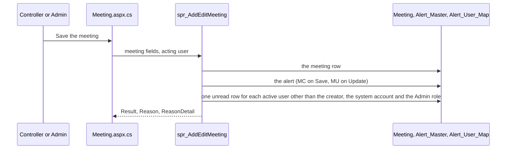

# Program to Program: Meeting Create, Update and Notice

- Title: Program to Program: Meeting Create, Update and Notice
- Audience: Developers and installers (internal)
- Shipped: No
- Applies to: UD1b (step 53: no alert row for the Admin role on a meeting save); user-ud1a
- Commit: db1d641
- Last updated by: UD1b, based on db1d641
- Status: Draft
- Verified against: for UD1b: Database/BMMS-Fix-DepartmentApprovers-Step53.sql (the alert insert of spr_AddEditMeeting, MC branch, and the comment), Database/README.md (section Step UD1b)
- To confirm: feature area written only for the meeting alert recipients of step UD1b (WF2c2); the meeting create and update flow, the date rules and the notice are not written yet

## Scope

This file covers, since step UD1b (database step 53), who gets the alert when a meeting is created (MC) or updated (MU): every
active user other than the creator and the protected system account, and no longer the users of the Admin role. The existing
Admin rows stay in the table and are not listed.

[[CONFIRM: the rest of the meeting flow (create, update, delete, the date rules, the notice) is not written yet (WF2c2)]]

## Programs involved

| Program | Kind | Part in the flow |
|---|---|---|
| Master/Meeting.aspx(.cs) | Page | Saves the meeting |
| MeetingMgr, MeetingDB | BAL, DAL | Call spr_AddEditMeeting |
| spr_AddEditMeeting | Procedure | Saves the meeting; on Save writes the alert MC and its rows, on Update the alert MU |

## Main flow

| From | To | Data | Notes |
|---|---|---|---|
| Controller or Admin | Meeting.aspx | The meeting fields | Meeting is open to both roles in PageAccess.xml |
| Meeting.aspx | spr_AddEditMeeting | Meeting fields, acting user | Through MeetingMgr and MeetingDB |
| spr_AddEditMeeting | Alert_Master, Alert_User_Map | The alert MC or MU and one unread row per recipient | Since step 53 the Admin role is not a recipient |

## Refusal paths

[[CONFIRM: not written yet (WF2c2)]]

## Where each rule lives

| Rule | C# | Procedure or function |
|---|---|---|
| Recipients of the meeting alert: active users except the creator, the system account and the Admin role | none | spr_AddEditMeeting |

## Tables read and written

| Object | Reads | Writes |
|---|---|---|
| spr_AddEditMeeting (alert part) | Users, Roles | Alert_Master, Alert_User_Map |

## Drawn from

Database/BMMS-Fix-DepartmentApprovers-Step53.sql (spr_AddEditMeeting, the alert insert and the comment), Database/README.md
(section Step UD1b), System-Manual/06-Configuration-and-Settings (the roles of the Meeting page: admin and controller).
