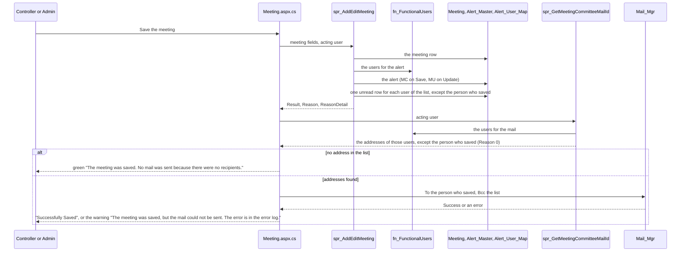

# Program to Program: Meeting Create, Update and Notice

- Title: Program to Program: Meeting Create, Update and Notice
- Audience: Developers and installers (internal)
- Shipped: No
- Applies to: IU1 (step 55: the Created and Updated mail goes to the same users as the alert rows; one shared rule; no recipients, no mail); UD1b (step 53: no alert row for the Admin role on a meeting save); user-ud1a
- Commit: 79f50ea
- Last updated by: IU1, based on 79f50ea
- Status: Draft
- Verified against: for IU1: the step's diff (BMMS/Master/Meeting.aspx.cs, BMMSBAL/AlertMgr.cs, BMMSDAL/AlertDB.cs), Database/BMMS-Fix-InactiveUsers-Step55.sql, BMMS-Test-InactiveUsers-Step55.sql, Database/README.md (section Step IU1); for UD1b: Database/BMMS-Fix-DepartmentApprovers-Step53.sql (the alert insert of spr_AddEditMeeting, MC branch, and the comment), Database/README.md (section Step UD1b)
- To confirm: feature area written only for the meeting alert and mail recipients (UD1b, IU1; WF2e2); the meeting create and update flow, the date rules and the notice are not written yet

## Scope

This file covers who gets the alert and who gets the mail when a meeting is created (MC, Created mail) or updated (MU,
Updated mail). Since step IU1 (database step 55) both follow one rule, fn_FunctionalUsers: every active user other than the
person who saved, the protected system account and the users of the Admin role (since step UD1b the Admin role gets no alert
row). The existing Admin rows stay in the table and are not listed.

[[CONFIRM: the rest of the meeting flow (create, update, delete, the date rules, the notice) is not written yet (WF2e2)]]

## Programs involved

| Program | Kind | Part in the flow |
|---|---|---|
| Master/Meeting.aspx(.cs) | Page | Saves the meeting, then builds and sends the Created or Updated mail |
| MeetingMgr, MeetingDB | BAL, DAL | Call spr_AddEditMeeting |
| AlertMgr, AlertDB | BAL, DAL | Call spr_GetMeetingCommitteeMailId |
| Mail_Mgr | Mail | Sends the mail (the ML2c address checks) |
| spr_AddEditMeeting | Procedure | Saves the meeting; on Save writes the alert MC and its rows, on Update the alert MU; the rows come from fn_FunctionalUsers |
| fn_FunctionalUsers | Function | The one list of users for the alert rows and the mail (UserId, EmailId) |
| spr_GetMeetingCommitteeMailId | Procedure | Returns the addresses for the Bcc of the mail |

## Main flow

| From | To | Data | Notes |
|---|---|---|---|
| Controller or Admin | Meeting.aspx | The meeting fields | Meeting is open to both roles in PageAccess.xml |
| Meeting.aspx | spr_AddEditMeeting | Meeting fields, acting user | Through MeetingMgr and MeetingDB |
| spr_AddEditMeeting | Alert_Master, Alert_User_Map | The alert MC or MU and one unread row per recipient | Since step 53 the Admin role is not a recipient; since step 55 the users come from fn_FunctionalUsers |
| Meeting.aspx | spr_GetMeetingCommitteeMailId | The acting user | After a successful save, through AlertMgr and AlertDB |
| spr_GetMeetingCommitteeMailId | Meeting.aspx | The Bcc addresses, and the Reason | Reason 8: the acting user is missing, 0 or inactive; Reason 4: a role other than Admin and Controller; then no rows |
| Meeting.aspx | Mail_Mgr | To: the address of the person who saved; Bcc: the list | The To is unchanged by step 55; the ML2c address checks are unchanged |

A user without an address keeps the alert row and gets no mail. The mail is read again after the save; it is not taken from
the alert rows of the event.

## Refusal paths

| Case | Where | What the page does |
|---|---|---|
| The Bcc procedure refuses (Reason not 0) | Meeting.aspx.cs GenerateMail | Logs "spr_GetMeetingCommitteeMailId refused the acting user" with the Reason; the meeting stays saved; the page shows the warning "The meeting was saved, but the mail could not be sent. The error is in the error log." |
| No address in the list | Meeting.aspx.cs GenerateMail | No mail is sent; green "The meeting was saved. No mail was sent because there were no recipients." |
| The mail fails (address check or send) | Mail_Mgr, Meeting.aspx.cs | The meeting stays saved; the warning above; the error is in the error log |

[[CONFIRM: the refusal paths of the save itself (the date rules, the locks) are not written yet (WF2e2)]]

## Where each rule lives

| Rule | C# | Procedure or function |
|---|---|---|
| Users of the alert rows and of the mail: active, not the system account, not the Admin role | none | fn_FunctionalUsers, read by spr_AddEditMeeting and spr_GetMeetingCommitteeMailId |
| Not the person who saved | none | spr_AddEditMeeting (rows), spr_GetMeetingCommitteeMailId (Bcc) |
| The To of the mail is the person who saved | Meeting.aspx.cs MailToActingUser | none |
| No recipients: no mail, green message | Meeting.aspx.cs GenerateMail | none |
| A mail failure never undoes the save | Meeting.aspx.cs | none |

## Tables read and written

| Object | Reads | Writes |
|---|---|---|
| spr_AddEditMeeting (alert part) | Users, Roles (through fn_FunctionalUsers) | Alert_Master, Alert_User_Map |
| spr_GetMeetingCommitteeMailId | Users, Roles (through fn_FunctionalUsers) | none |

## Drawn from

Database/BMMS-Fix-InactiveUsers-Step55.sql (fn_FunctionalUsers, spr_GetMeetingCommitteeMailId, spr_AddEditMeeting),
BMMS/Master/Meeting.aspx.cs (GenerateMail, MailToActingUser, the messages), Database/BMMS-Fix-DepartmentApprovers-Step53.sql
(spr_AddEditMeeting, the alert insert and the comment), Database/README.md (sections Step IU1 and Step UD1b),
System-Manual/06-Configuration-and-Settings (the roles of the Meeting page: admin and controller).
