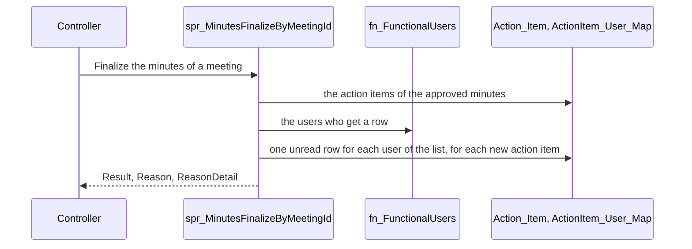
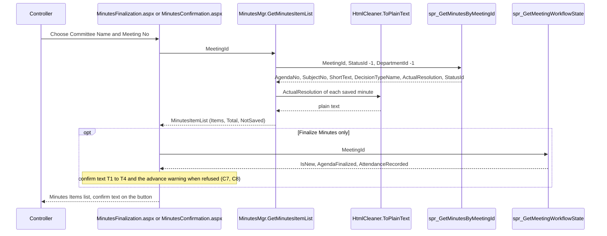
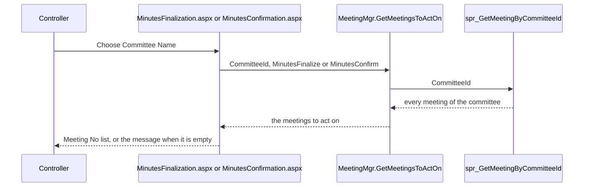

# Program to Program: Minutes Update and Confirmation

- Title: Program to Program: Minutes Update and Confirmation
- Audience: Developers and installers (internal)
- Shipped: No
- Applies to: AF1 (the new section "The meeting lists of Finalize Minutes and Minutes Confirmation (step AF1)"; the Programs table row); MF1 (the new section "The Minutes Items list (step MF1)"; the Programs table and the Tables table: Finalize Minutes and Minutes Confirmation read spr_GetMinutesByMeetingId); IU1 (step 55: the action item rows at minutes finalisation); user-ud1a
- Commit: be23b24
- Last updated by: AF1, based on be23b24 (the AF1 section and the Programs row); MF1, based on 00b6062 (the MF1 section and rows); IU1, based on 79f50ea
- Status: Draft
- Verified against: for AF1: BMMS/Master/MinutesFinalization.aspx.cs and MinutesConfirmation.aspx.cs and BMMSBAL/MeetingMgr.cs (GetMeetingsToActOn) read in the diff, Database/README.md (section Step AF1); for MF1: BMMS/Master/MinutesFinalization.aspx.cs and MinutesConfirmation.aspx.cs (the new code read in full), BMMSBAL/MinutesMgr.cs (GetMinutesItemList), BMMSBAL/HtmlCleaner.cs (ToPlainText), BMMSDAL/MinutesDB.cs and MeetingDB.cs (the two calls), Database/README.md (section Step MF1); for IU1: Database/BMMS-Fix-InactiveUsers-Step55.sql (spr_MinutesFinalizeByMeetingId, fn_FunctionalUsers), BMMS-Test-InactiveUsers-Step55.sql (part 2, R2 and R3), Database/README.md (section Step IU1)
- To confirm: feature area written only for the action item rows at finalisation (IU1) and the Minutes Items list (MF1); the rest is not written yet (WF2e2)

## Scope

This file covers, since step IU1 (database step 55), which users get an action item row (ActionItem_User_Map) when the minutes
of a meeting are finalised, and, since step MF1, the Minutes Items list that Finalize Minutes and Minutes Confirmation show. The
rest of the minutes flow (update, finalise, confirm) is not written yet.

[[CONFIRM: not written yet (WF2e2): the minutes update and confirmation flows; only the action item rows at finalisation (IU1) and the Minutes Items list (MF1) are written]]

## Programs involved

| Program | Kind | Part in the flow |
|---|---|---|
| spr_MinutesFinalizeByMeetingId | Procedure | Finalises the minutes; writes the action item rows of the new action items |
| fn_FunctionalUsers | Function | The users who get a row: active, not the protected system account, not the Admin role |
| spr_UpdateMinutes | Procedure | The late action item of an inactive creator goes to the active Controllers (unchanged by step 55) |
| spr_GetMinutesByMeetingId | Procedure | Since step MF1 read by Finalize Minutes and Minutes Confirmation for the Minutes Items list (see below) |
| MeetingMgr.GetMeetingsToActOn | BAL | Since step AF1 filters the meetings of a committee for Finalize Minutes and Minutes Confirmation (see below) |

## Main flow

| From | To | Data | Notes |
|---|---|---|---|
| Controller | spr_MinutesFinalizeByMeetingId | The meeting | Through the Minutes finalisation page |
| spr_MinutesFinalizeByMeetingId | ActionItem_User_Map | One row per user of fn_FunctionalUsers and new action item | Since step 55 no row for the Admin role; before: every active user other than the system account |
| fn_FunctionalUsers | spr_MinutesFinalizeByMeetingId | UserId, EmailId | The same rule as the alert rows and the Meeting and Committee mails |

No row is added later for a user who is made active after the finalisation. Existing rows of the Admin role and of users who
are now inactive are kept; no page or count shows them: the Action Items card reads fn_DashboardActionItemScope, and the
mapping gives only the read state.

## The Minutes Items list (step MF1)

Finalize Minutes (MinutesFinalization.aspx) and Minutes Confirmation (MinutesConfirmation.aspx) show the items of the chosen
meeting before the Controller presses Finalize or Confirm. Code only: both pages read the existing
spr_GetMinutesByMeetingId (@MeetingId, -1, -1); no procedure changed and nothing is written.

| From | To | Data | Notes |
|---|---|---|---|
| Controller | Finalize Minutes, Minutes Confirmation | Committee Name, Meeting No | Meeting No has the new handler ddlMeeting_SelectedIndexChanged; the list is read again after a refused Finalize or Confirm; since step AF1 a successful one hides it (the meeting drops out of Meeting No) |
| Finalize Minutes, Minutes Confirmation | MinutesMgr.GetMinutesItemList | MeetingId | Not called while Committee Name or Meeting No is -Select-: the list is hidden |
| MinutesMgr.GetMinutesItemList | spr_GetMinutesByMeetingId | MeetingId, StatusId -1, DepartmentId -1 | Through MinutesDB.GetMinutesByMeetingId; all departments, as Update Minutes reads them |
| spr_GetMinutesByMeetingId | MinutesMgr.GetMinutesItemList | One row per minute | Columns AgendaNo, SubjectNo, ShortText, DecisionTypeName, ActualResolution, StatusId |
| MinutesMgr.GetMinutesItemList | HtmlCleaner.ToPlainText | ActualResolution | Only for a saved minute (StatusId 1); tags removed, entities decoded, white space collapsed |
| MinutesMgr.GetMinutesItemList | Finalize Minutes, Minutes Confirmation | Items, Total, NotSaved | Sorted by AgendaNo; a minute not saved shows "Not yet recorded" in Decision and Actual Resolution |
| Finalize Minutes | spr_GetMeetingWorkflowState | MeetingId | Through MeetingMgr.GetMeetingWorkflowState; IsNew, AgendaFinalized and AttendanceRecorded decide the confirm text and the advance warning |

The page encodes every cell once with HttpUtility.HtmlEncode. The confirm text holds fixed words and the counts only and is
passed through HttpUtility.JavaScriptStringEncode.

Confirm texts of Finalize Minutes (n items, m not saved): T1 n > 0 and m = 0; T2 m > 0 and the meeting is older (created
before step 23): finalized anyway; T3 m > 0 and the meeting is new (created after step 23): refused; T4 n = 0: refused. Minutes
Confirmation has one text, with the count. The texts are in System-Manual/05-Application-Code, "The Minutes Items list on
Finalize Minutes and Minutes Confirmation (step MF1)".

Drawn from: BMMS/Master/MinutesFinalization.aspx.cs and MinutesConfirmation.aspx.cs (LoadMinutesItems, HideMinutesItems,
ddlMeeting_SelectedIndexChanged), BMMSBAL/MinutesMgr.cs (GetMinutesItemList), BMMSBAL/HtmlCleaner.cs (ToPlainText),
BMMSDAL/MinutesDB.cs (GetMinutesByMeetingId), BMMSDAL/MeetingDB.cs (GetMeetingWorkflowState), Database/README.md (section
Step MF1).

## The meeting lists of Finalize Minutes and Minutes Confirmation (step AF1)

Code only; no procedure changed. When Committee Name is chosen, both pages call MeetingMgr.GetMeetingsToActOn(CommitteeId,
action). It reads the rows of the existing spr_GetMeetingByCommitteeId (View_Meeting, with AgendaStatus and MinutesStatus) and
keeps, in the same order, the meetings the page can act on. The values are those of the pages' own checks, trimmed and ignoring case.

| From | To | Data | Notes |
|---|---|---|---|
| Controller | Finalize Minutes, Minutes Confirmation | Committee Name | The meeting list is read again; the Minutes Items list is hidden |
| Finalize Minutes | MeetingMgr.GetMeetingsToActOn | CommitteeId, MeetingAction.MinutesFinalize | Keeps MinutesStatus other than 'F' and 'C' (status only: a meeting not ready stays, the MF1 messages say why); NULL is listed |
| Minutes Confirmation | MeetingMgr.GetMeetingsToActOn | CommitteeId, MeetingAction.MinutesConfirm | Keeps MinutesStatus 'F' |
| MeetingMgr.GetMeetingsToActOn | Finalize Minutes, Minutes Confirmation | The kept rows | An empty list: "- Select -" only and a message (below) |

Messages of an empty list (shown when a committee is chosen, not after a success): Finalize Minutes "This committee has no meeting
with minutes still to finalize."; Minutes Confirmation "This committee has no meeting with finalized minutes waiting for
confirmation." After a successful Finalize or Confirm the page reads the list again (the meeting drops out), Meeting No is "- Select -", the
Minutes Items list is hidden and the success message stays. After a refusal the meeting stays chosen and the Minutes Items list is
read again (MF1). The procedures, refusals, Reasons, locks, audit rows and mails are unchanged; the procedures still decide. The
other pages that read spr_GetMeetingByCommitteeId keep every meeting.

| Rule | C# | Procedure |
|---|---|---|
| Finalize Minutes lists meetings not 'F' and not 'C' | MeetingMgr.GetMeetingsToActOn | none (the checks are spr_CheckMinutesFinalizeByMeetingId and spr_CheckMinutesConfirmByMeetingId, unchanged) |
| Minutes Confirmation lists meetings 'F' | MeetingMgr.GetMeetingsToActOn | none (the check is spr_CheckMinutesConfirmByMeetingId, unchanged) |
| Drop-out after a success | LoadMeetings(false) and HideMinutesItems in the Finalize and Confirm handlers | none |

Tables read: View_Meeting (through spr_GetMeetingByCommitteeId). Tables written: none.

Drawn from: BMMS/Master/MinutesFinalization.aspx.cs and MinutesConfirmation.aspx.cs (LoadMeetings, ReloadAfterFinalize, the Finalize
and Confirm handlers), BMMSBAL/MeetingMgr.cs (MeetingAction, GetMeetingsToActOn), Database/README.md (section Step AF1).

## Refusal paths

[[CONFIRM: not written yet (WF2e2)]]

The advance warning of Finalize Minutes (step MF1) is shown when the meeting is chosen, with the counts of the list; the
server still decides at Finalize. Reason 19 (a meeting created after step 23 with no minutes, or a minute not saved) is
forecast only when the agenda is finalized and the attendance recorded: otherwise spr_MinutesFinalizeByMeetingId
refuses first with Reason 17 or 18, which the page does not forecast. An older meeting without minutes is refused by the
page itself ("No Minutes For the selected Committee/Meeting").

## Where each rule lives

| Rule | C# | Procedure or function |
|---|---|---|
| A minute counts as saved when StatusId is 1 | MinutesMgr.GetMinutesItemList | The rule of fn_WorkflowState.MinutesUpdated (View_Minute.StatusId, read by spr_GetMinutesByMeetingId) |
| Actual Resolution as plain text | HtmlCleaner.ToPlainText | none |
| Confirm texts T1 to T4 and the advance warning | MinutesFinalization.LoadMinutesItems | none (counts from the list; IsNew, AgendaFinalized, AttendanceRecorded from spr_GetMeetingWorkflowState) |
| Refusal of Finalize for a meeting created after step 23 (Reason 19) | none (the page shows the server's text) | spr_MinutesFinalizeByMeetingId |
| Users who get an action item row at finalisation | none | fn_FunctionalUsers, read by spr_MinutesFinalizeByMeetingId |
| The late action item of an inactive creator goes to the active Controllers | none | spr_UpdateMinutes (unchanged) |
| Who sees an action item on the Dashboard | none | fn_DashboardActionItemScope (unchanged) |

## Tables read and written

| Object | Reads | Writes |
|---|---|---|
| spr_MinutesFinalizeByMeetingId (action item rows) | Users, Roles (through fn_FunctionalUsers), Action_Item | ActionItem_User_Map |
| spr_GetMinutesByMeetingId (Minutes Items list, step MF1) | View_Minute | none |
| spr_GetMeetingWorkflowState (Finalize Minutes, step MF1) | Meeting state of the workflow (fn_WorkflowState) | none |

## Drawn from

Database/BMMS-Fix-InactiveUsers-Step55.sql (spr_MinutesFinalizeByMeetingId, fn_FunctionalUsers), BMMS-Test-InactiveUsers-Step55.sql
(R2 and R3), Database/README.md (section Step IU1).
