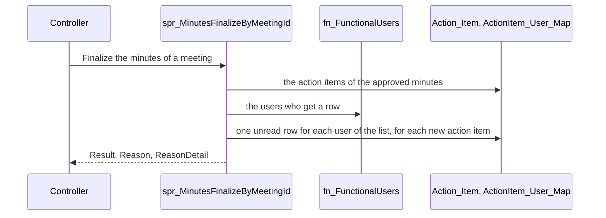

# Program to Program: Minutes Update and Confirmation

- Title: Program to Program: Minutes Update and Confirmation
- Audience: Developers and installers (internal)
- Shipped: No
- Applies to: IU1 (step 55: the action item rows at minutes finalisation); user-ud1a
- Commit: 79f50ea
- Last updated by: IU1, based on 79f50ea
- Status: Draft
- Verified against: for IU1: Database/BMMS-Fix-InactiveUsers-Step55.sql (spr_MinutesFinalizeByMeetingId, fn_FunctionalUsers), BMMS-Test-InactiveUsers-Step55.sql (part 2, R2 and R3), Database/README.md (section Step IU1)
- To confirm: feature area written only for the action item rows at finalisation (IU1); the rest is not written yet (WF2c3)

## Scope

This file covers, since step IU1 (database step 55), which users get an action item row (ActionItem_User_Map) when the minutes
of a meeting are finalised. The rest of the minutes flow (update, finalise, confirm) is not written yet.

[[CONFIRM: not written yet (WF2c3): the minutes update and confirmation flows; only the action item rows at finalisation are written (IU1)]]

## Programs involved

| Program | Kind | Part in the flow |
|---|---|---|
| spr_MinutesFinalizeByMeetingId | Procedure | Finalises the minutes; writes the action item rows of the new action items |
| fn_FunctionalUsers | Function | The users who get a row: active, not the protected system account, not the Admin role |
| spr_UpdateMinutes | Procedure | The late action item of an inactive creator goes to the active Controllers (unchanged by step 55) |

## Main flow

| From | To | Data | Notes |
|---|---|---|---|
| Controller | spr_MinutesFinalizeByMeetingId | The meeting | Through the Minutes finalisation page |
| spr_MinutesFinalizeByMeetingId | ActionItem_User_Map | One row per user of fn_FunctionalUsers and new action item | Since step 55 no row for the Admin role; before: every active user other than the system account |
| fn_FunctionalUsers | spr_MinutesFinalizeByMeetingId | UserId, EmailId | The same rule as the alert rows and the Meeting and Committee mails |

No row is added later for a user who is made active after the finalisation. Existing rows of the Admin role and of users who
are now inactive are kept; no page or count shows them: the Action Items card reads fn_DashboardActionItemScope, and the
mapping gives only the read state.

## Refusal paths

[[CONFIRM: not written yet (WF2c3)]]

## Where each rule lives

| Rule | C# | Procedure or function |
|---|---|---|
| Users who get an action item row at finalisation | none | fn_FunctionalUsers, read by spr_MinutesFinalizeByMeetingId |
| The late action item of an inactive creator goes to the active Controllers | none | spr_UpdateMinutes (unchanged) |
| Who sees an action item on the Dashboard | none | fn_DashboardActionItemScope (unchanged) |

## Tables read and written

| Object | Reads | Writes |
|---|---|---|
| spr_MinutesFinalizeByMeetingId (action item rows) | Users, Roles (through fn_FunctionalUsers), Action_Item | ActionItem_User_Map |

## Drawn from

Database/BMMS-Fix-InactiveUsers-Step55.sql (spr_MinutesFinalizeByMeetingId, fn_FunctionalUsers), BMMS-Test-InactiveUsers-Step55.sql
(R2 and R3), Database/README.md (section Step IU1).
