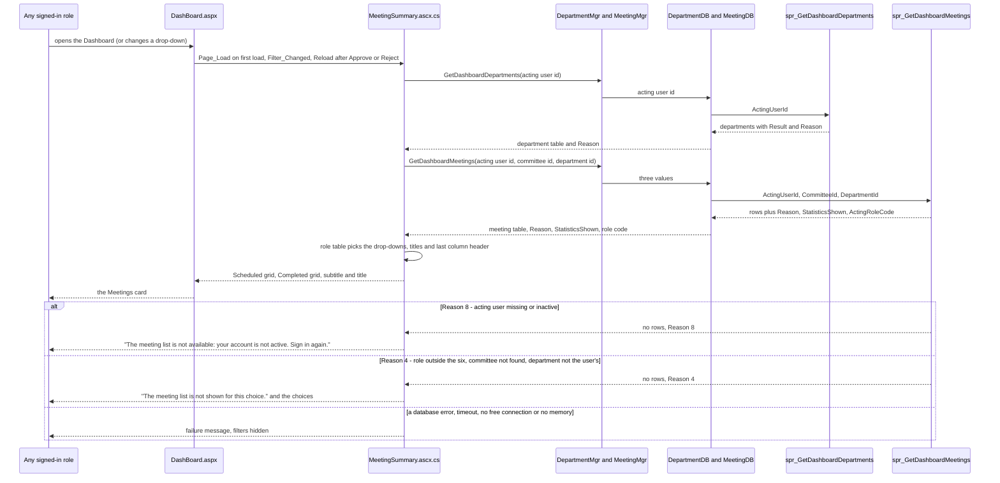
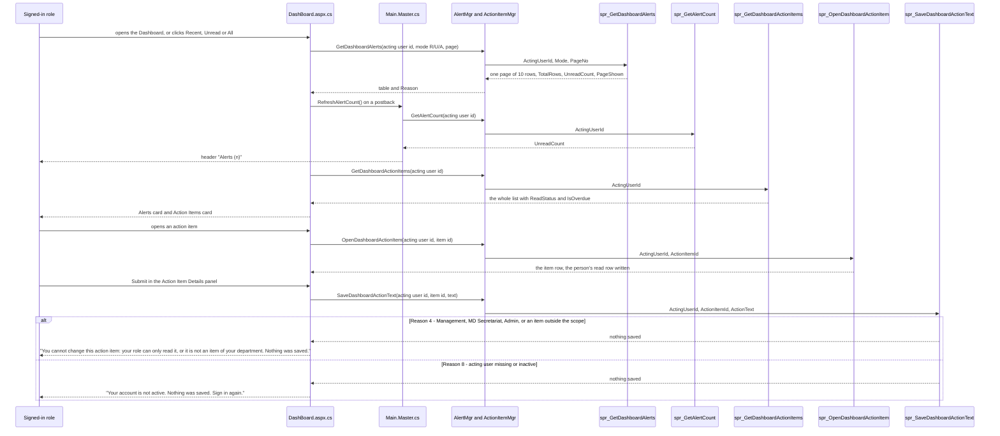
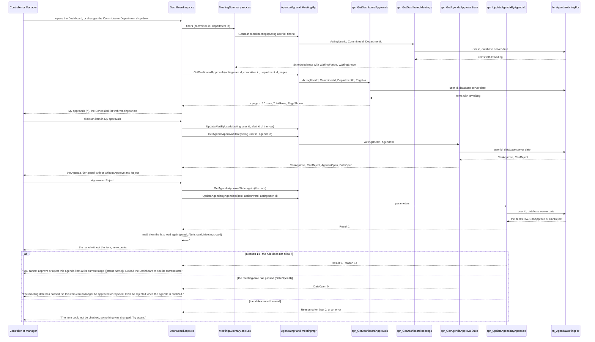

# Program to Program: Dashboard and Alerts

- Title: Program to Program: Dashboard and Alerts
- Audience: Developers and installers (internal)
- Shipped: No
- Applies to: UN6c2a (step 44): the My approvals panel, the Waiting for me column and the Approve and Reject buttons; UN6c1 (step 43): the Alerts card, the header count and the Action Items card; UN6b (step 42): the Meetings card; the rest not written yet
- Last updated by: UN6c2a, based on 493cb45
- Status: Draft
- Verified against: for the step UN6c2a section: BMMS/DashBoard/DashBoard.aspx, .aspx.cs and .aspx.designer.cs (diff; BindAgendaDetails, btnApprove_Click and btnReject_Click read in full),
  BMMS/UserControl/MeetingSummary.ascx and .ascx.cs (diff), BMMSBAL/AgendaMgr.cs and MeetingMgr.cs (diff), BMMSDAL/AgendaDB.cs and MeetingDB.cs (diff),
  Database/BMMS-Fix-AgendaWaitingFor-Step44.sql (all five objects), BMMS-Rollback-AgendaWaitingFor-Step44.sql, BMMS-Test-AgendaWaitingFor-Step44.sql (header, comparison),
  Database/README.md (section Step UN6c2a, Known items), the tester run of 2026-11-14 and the owner's tests as given;
  for the Alerts card, the header count and the Action Items card (step UN6c1): BMMS/DashBoard/DashBoard.aspx and
  DashBoard.aspx.cs (the Alerts and Action Items regions, message constants, lnkActionItem_Click, lnkSource_Click),
  BMMS/MasterPage/Main.Master.cs (alert count), BMMSBAL/AlertMgr.cs and ActionItemMgr.cs, BMMSDAL/AlertDB.cs and
  ActionItemDB.cs (diff), Database/BMMS-Fix-DashboardAlerts-Step43.sql (all objects), BMMS-Rollback-DashboardAlerts-Step43.sql,
  BMMS-Test-DashboardAlerts-Step43.sql (header), Database/README.md (section Step UN6c1), the owner's test result as given;
  for the Meetings card (step UN6b): BMMS/UserControl/MeetingSummary.ascx, .ascx.cs, BMMS/DashBoard/DashBoard.aspx
  (card titles, grid headings), DashBoard.aspx.cs (diff: MeetingSummary1.Reload after Approve and Reject, FormatDate,
  FormatTimeOfDay, AlertDetails), BMMSBAL/MeetingMgr.cs and DepartmentMgr.cs (diff), BMMSDAL/MeetingDB.cs and
  DepartmentDB.cs (diff), Database/BMMS-Fix-DashboardMeetings-Step42.sql (all five objects),
  BMMS-Rollback-DashboardMeetings-Step42.sql, BMMS-Test-DashboardMeetings-Step42.sql (header), Database/README.md
  (section Step UN6b), the owner's test result as given for the step (71 of 71, not re-run)
- To confirm: feature area not written yet except the Meetings card and, since UN6c1, the Alerts card, the header count and the
  Action Items card (WF2c3): the Agenda Alert and Action Item Details panels and the approval flow of the Dashboard
  are still to be drawn

## Scope

This file covers the flow of the Dashboard's Meetings card (step UN6b): how the page asks the database for the
meeting list and the department list, what the procedures decide, and what happens when they refuse. The card
shows the Scheduled and the Completed (last 10) meetings with a status label and, for four roles, four counts
(Items, Approved, Rejected and Pending or In progress). Everything is read only: the card writes nothing.

The Alerts card, the header count and the Action Items card (step UN6c1) are in the section "Alerts card, header
count and Action Items card (step UN6c1)" below.

The My approvals panel, the Waiting for me column and the Approve and Reject buttons (step UN6c2a) are in the
section "My approvals, Waiting for me and the Approve and Reject buttons (step UN6c2a)" below.

[[CONFIRM: the Action Item Details panel and the rest of the Agenda Alert panel and the Approve and Reject flow of the
Dashboard (mail, the finalised agenda) are not written yet (WF2c3)]]

## Programs involved

| Program | Kind | Part in the flow |
|---|---|---|
| DashBoard/DashBoard.aspx(.cs) | Page | Hosts the user control; after a successful Approve or Reject it calls `MeetingSummary1.Reload()` |
| UserControl/MeetingSummary.ascx(.cs) | User control | Reads the acting user id from `Session["UserId"]`, calls the two BAL methods, builds the filters, titles, columns and messages from the answers |
| CommitteeMgr.GetCommitteeList(1) | BAL | The active committees for the Committee drop-down |
| DepartmentMgr.GetDashboardDepartments, DepartmentDB.GetDashboardDepartments | BAL, DAL | Call spr_GetDashboardDepartments; return the table and the refusal Reason |
| MeetingMgr.GetDashboardMeetings, MeetingDB.GetDashboardMeetings | BAL, DAL | Call spr_GetDashboardMeetings; return the table, the Reason, StatisticsShown and ActingRoleCode |
| spr_GetDashboardMeetings | Procedure | Reads role and departments of the acting user, checks the two filters, lists the meetings and counts the items |
| spr_GetDashboardDepartments | Procedure | Lists the departments of a Manager or a User |
| fn_MeetingDashboardState, fn_UserDepartmentScope, fn_AgendaStatusGroup | Inline table functions | The one definition of the status colour, of a user's departments and of the item groups |

## Main flow

| From | To | Data | Notes |
|---|---|---|---|
| Role (any) | DashBoard.aspx | Opens the page, or picks a committee or department | The two drop-downs post back on every change |
| DashBoard.aspx | MeetingSummary | Page_Load on the first load; Reload() after Approve or Reject | Reload() is called after the approval is saved and the mail result is shown |
| MeetingSummary | DepartmentMgr.GetDashboardDepartments | Acting user id | Read again on every load; Reason 4 for the roles that have no department list is not an error here, the list is simply not used |
| DepartmentMgr / DepartmentDB | spr_GetDashboardDepartments | @ActingUserId | OUTPUT @Result and @Reason are turned into one Reason number |
| spr_GetDashboardDepartments | DepartmentDB | DepartmentId, DepartmentName, IsHome | Home department first, then by name; only for Manager and User |
| MeetingSummary | MeetingMgr.GetDashboardMeetings | Acting user id, committee id (0 = all), department id (0 = all of the user's) | A chosen department that is no longer in the user's list falls back to 0 before the call |
| MeetingMgr / MeetingDB | spr_GetDashboardMeetings | @ActingUserId, @CommitteeId, @DepartmentId | Four OUTPUT values (five since step 44: @WaitingShown) |
| spr_GetDashboardMeetings | MeetingDB | Rows with MeetingId, CommitteeName, MeetingNo, MeetingDate, MeetingTime, AgendaSubmissionDate, ListCode, StateCode, StateLabel, Items, Approved, Rejected, Pending (and, since step 44, WaitingForMe); @Reason, @StatisticsShown, @ActingRoleCode (and, since step 44, @WaitingShown) | ListCode S or C; the counts are NULL when the statistics are not shown |
| MeetingDB | MeetingSummary | Table, Reason, StatisticsShown, ActingRoleCode | StatisticsShown is true only when the Reason is 0 and the procedure said 1 |
| MeetingSummary | DashBoard.aspx (the card) | The two grids, the subtitle, the card title, the messages | The role code from the procedure picks the view in the role table, not the session role |
| spr_GetDashboardMeetings | MeetingSummary | Reason 8 | Refusal: acting user missing, 0 or inactive |
| spr_GetDashboardMeetings | MeetingSummary | Reason 4 | Refusal: a role outside admin, controller, manager, user, mgmt, md_sect; a committee that does not exist; a department that is not one of a Manager's or a User's, or any department for another role |

## Refusal paths

| Reason | Raised by | Meaning | Message the card shows |
|---|---|---|---|
| 8 | spr_GetDashboardMeetings, spr_GetDashboardDepartments | The acting user is missing, 0 or not active | "The meeting list is not available: your account is not active. Sign in again." |
| 4 | spr_GetDashboardMeetings | Role outside the six; committee id that does not exist (or below 0); department id for a role other than Manager and User, not one of the user's departments, or below 0 | "The meeting list is not shown for this choice." followed by the filters that are shown: "Choose All committees or All my departments." (both filters), "Choose All committees." (committee only), "Choose All my departments." (department only), or with no filter shown "The meeting list is not shown for your role." (this last text replaces the first sentence) |
| 4 | spr_GetDashboardDepartments | The role is not Manager or User | None: the page does not use the list, the Committee drop-down and the titles follow the role table |
| (none) | The page | A database error (written to the error log), or SqlException -2, 8645 or 701, no free connection in the pool in time, or an OutOfMemoryException on the web server | "The meeting list could not be loaded. Reload the page to try again." For the timeout and memory cases: "The server is busy and the meeting list could not be loaded. Wait a moment, then reload the page." After any failure no filter, no subtitle and the title "Meetings" are shown; the alerts still load |
| (none) | The page | Session["UserId"] missing or not a number | The Reason 8 text, no filters |

A refused call returns the same columns with no rows. The role code of an active user is returned even when a
filter is refused, so the page can word its message by the role.

## Where each rule lives

| Rule | C# | Procedure or function |
|---|---|---|
| Who may call, and which role gets which statistics (Controller, Management, Manager, User: yes; MD Secretariat, Admin: no) | MeetingSummary.ascx.cs reads StatisticsShown from the answer | spr_GetDashboardMeetings (role read from Users and Roles for an active user; @StatisticsShown) |
| Scheduled means the meeting date is today or later, or there is no date (today is the database server's date) | none | fn_MeetingDashboardState (IsScheduled) |
| Status colour and label, the first rule that fits: grey (minutes F or C), red (date before today), green (agenda not Open), orange (submission date before today), blue | MeetingSummary.StateCssClass turns the colour name into the chip class | fn_MeetingDashboardState (StateCode, StateLabel) |
| A user's departments: open User_Department rows and the home department | none | fn_UserDepartmentScope |
| The groups: approved ACA, rejected AMR and ACR, in progress AC and AMA, other (AF and any other code, counted in Items only) | none | fn_AgendaStatusGroup |
| Every scheduled meeting, no cap; the last 10 completed meetings, newest first, for every role | Rows() splits the table by ListCode | spr_GetDashboardMeetings (TOP 10, ORDER BY date, time, id) |
| Manager and User: a completed meeting only with an item of their department(s); counts over those items | none | spr_GetDashboardMeetings (@Dept from fn_UserDepartmentScope) |
| Filters checked against the user's scope | Department fallback to 0 when no longer listed (LoadMeetings) | spr_GetDashboardMeetings (Reason 4) |
| What each role sees: Committee drop-down, Department drop-down (Manager with two or more departments), subtitle, card titles, last column header ("In progress" for the User, "Pending" for the others) | MeetingSummary.ascx.cs: RoleViews (one place), ShowTitles, BindCommittees, BindDepartments | spr_GetDashboardDepartments gives the departments |
| Counts follow an Approve or Reject | DashBoard.aspx.cs calls MeetingSummary1.Reload() after a successful approve and reject | none |
| Messages and the server-busy test | MeetingSummary.ascx.cs: the five message constants, IsServerBusy, ShowFailure | none |

## Tables read and written

Read only; the card writes nothing.

| Object | Reads |
|---|---|
| spr_GetDashboardMeetings | Users and Roles (the acting user's role), Committee, Meeting, Agenda, and User_Department and Users again through fn_UserDepartmentScope |
| spr_GetDashboardDepartments | Users, Roles, User_Department (through fn_UserDepartmentScope), Department |
| fn_MeetingDashboardState | Meeting |
| fn_UserDepartmentScope | User_Department, Users |
| fn_AgendaStatusGroup | Agenda |
| CommitteeMgr.GetCommitteeList(1) | The active committees for the drop-down (its own procedure, not read for this file) |

Measured on BMMS_Test on 2026-11-12 (17 meetings, 66 items, warm runs): 373 logical reads for the Controller, 405
for a Manager with one department, 613 for a Manager with two, 404 for a User, no physical reads, 7 to 33 ms
elapsed. The Agenda table has only its primary key, so the counts scan it once per listed meeting; an index is a
later step (UN6e; Database/README.md, "Known items for later steps").

## Alerts card, header count and Action Items card (step UN6c1)

Added in step UN6c1 (database step 43). Both cards and the header count read through the acting user id
(`Session["UserId"]`); the page never sends a role. The procedures read the role from Users and Roles, so a changed
page or a forged post-back cannot widen what a person sees.

### Programs involved

| Program | Kind | Part in the flow |
|---|---|---|
| DashBoard/DashBoard.aspx(.cs) | Page | Alerts card (`LoadAlertGRV`, the three links, paging, `lnkSource_Click`, Remove from my list), Action Items card (`LoadActionItemGRV`, open, Submit), `RefreshHeaderCount` |
| MasterPage/Main.Master(.cs) | Master page | The header "Alerts (n)": `OnPreRender` on a full page load, `RefreshAlertCount()` when the Dashboard asks |
| AlertMgr, AlertDB | BAL, DAL | GetDashboardAlerts, GetAlertCount, RemoveAlertForUser; UpdateAlertByUserId (marks an opened alert read, unchanged) |
| ActionItemMgr, ActionItemDB | BAL, DAL | GetDashboardActionItems, OpenDashboardActionItem, SaveDashboardActionText |
| spr_GetDashboardAlerts, spr_GetAlertCount, spr_RemoveAlertForUser | Procedures | One page of the alert list; the unread count; the removal of one row of the acting user |
| spr_GetDashboardActionItems, spr_OpenDashboardActionItem, spr_SaveDashboardActionText | Procedures | The list, the opening (read row) and the save of the action text, each by the scope rule |
| fn_DashboardAlerts, fn_DashboardActionItems | Inline table functions | The one listing rule of the alerts and the one scope rule of the action items |

### Main flow

| From | To | Data | Notes |
|---|---|---|---|
| Role (any) | DashBoard.aspx | Opens the page, or clicks Recent, Unread, All, a page number, an alert, an item, Remove from my list or Submit | The mode and the page number are kept in ViewState; the procedure checks both |
| DashBoard.aspx | AlertMgr.GetDashboardAlerts | Acting user id, mode (R, U or A), page number | Only the page shown is read; Recent is the default |
| AlertMgr / AlertDB | spr_GetDashboardAlerts | @ActingUserId, @Mode, @PageNo | Six OUTPUT values: @Result, @Reason, @TotalRows, @UnreadCount, @PageShown |
| spr_GetDashboardAlerts | AlertDB | Rows with AlertUserId, AlertId, ReadStatus, SourceType, SourceTypeId, AlertTypeName, CommitteeName, DepartmentName, DisplayText, EventOn, ActorName, ActorLogin | Newest event first, 10 to a page (ROW_NUMBER, compatibility level 100) |
| DashBoard.aspx | Main.Master.RefreshAlertCount | A call, after the alert list is reloaded on a postback (Approve, Reject, Remove, the links, paging) and after an alert was opened | Not on the first load of the page: the master reads the count in `OnPreRender` |
| Main.Master | AlertMgr.GetAlertCount | Acting user id | A Reason other than 0 or an exception: the header shows "Alerts" without a number, and the error log holds the cause |
| AlertMgr / AlertDB | spr_GetAlertCount | @ActingUserId | OUTPUT @Result, @Reason, @UnreadCount, by fn_DashboardAlerts |
| DashBoard.aspx | AlertMgr.UpdateAlertByUserId | Acting user id, alert id | Marks the opened alert read; only the row of that user |
| DashBoard.aspx | AlertMgr.RemoveAlertForUser | Acting user id, the alert row id from the hidden field | StatusId 0 on the person's own row, nothing deleted |
| DashBoard.aspx | ActionItemMgr.GetDashboardActionItems | Acting user id | The whole list comes back and is kept in ViewState; the links Show All, Read and Unread filter it in the page |
| ActionItemMgr / ActionItemDB | spr_GetDashboardActionItems | @ActingUserId | OUTPUT @Result, @Reason; rows newest meeting first |
| DashBoard.aspx | ActionItemMgr.OpenDashboardActionItem | Acting user id, action item id | Writes the person's own read row (creates it when missing, never a second); nothing of the item changes |
| DashBoard.aspx | ActionItemMgr.SaveDashboardActionText | Acting user id, action item id, the action text | Writes Action_Item.ActionText only, inside the scope |

### Refusal paths

| Reason | Raised by | Meaning | Message the page shows |
|---|---|---|---|
| 8 | spr_GetDashboardAlerts, spr_GetAlertCount, spr_RemoveAlertForUser, spr_GetDashboardActionItems, spr_OpenDashboardActionItem, spr_SaveDashboardActionText | The acting user is missing, 0 or inactive; no rows, nothing changes | Alerts: "The alerts are not available: your account is not active. Sign in again."; Action Items: "The action items are not available: your account is not active. Sign in again."; Submit: "Your account is not active. Nothing was saved. Sign in again."; the header: "Alerts" without a number |
| 4 | spr_GetDashboardAlerts | A mode other than R, U or A, or a page number below 1 | "The alerts could not be loaded. Reload the page to try again." (the page only sends R, U or A) |
| 4 | spr_RemoveAlertForUser | The alert row is another user's, or does not exist | "This alert is not in your list." |
| 4 | spr_GetDashboardActionItems | A role without the card (MD Secretariat, Admin, the system account) | None: the page hides the Action Items card; the Alerts card, the Meetings card and the header are not touched |
| 4 | spr_OpenDashboardActionItem | Such a role, or an item outside the acting user's scope, confirmed or unknown; no row, nothing written | "This item no longer exists." (`ShowItemGone`) |
| 4 | spr_SaveDashboardActionText | Management, MD Secretariat or Admin, or an item outside the scope, confirmed or unknown; nothing saved | "You cannot change this action item: your role can only read it, or it is not an item of your department. Nothing was saved." |
| (none) | The page | A database error, a timeout, no free connection or no memory | Alerts: "The alerts could not be loaded. Reload the page to try again." or, when the server is busy, "The server is busy and the alerts could not be loaded. Wait a moment, then reload the page."; the same two for the Action Items card ("The action items ..."); a failed Remove: "The alert could not be removed from your list. Try again."; a failed save: "The action text could not be saved. Nothing was saved. Try again." (busy: "The server is busy and the action text could not be saved. Nothing was saved. Wait a moment, then try again."). The grid and its pager are hidden |

### Where each rule lives

| Rule | C# | Procedure or function |
|---|---|---|
| Who sees which alert: the Admin role none of the eleven functional types; a Controller not ACA and ACR; a Manager not AMA and AMR; removed rows (StatusId 0) never | DashBoard.aspx.cs only displays | fn_DashboardAlerts |
| Recent: every unread alert and the read ones whose event date is today or in the seven days before (database server date); Unread; All | AlertMode in ViewState (R by default), `AlertMode_Click` | spr_GetDashboardAlerts (@Mode, @From) |
| Event date and person of an alert (entry, decision, edit more than one minute after a decision, or no recorded approver: a dash) | `ActorName` shows a dash when empty | fn_DashboardAlerts (EventOn, ActorUserId) |
| A page of 10, the page after the last gives the last | `AllowCustomPaging`, `VirtualItemCount` | spr_GetDashboardAlerts (ROW_NUMBER, @PageShown) |
| The header count | Main.Master.cs `ShowAlertCount`, `RefreshAlertCount`; DashBoard.aspx.cs `RefreshHeaderCount` | spr_GetAlertCount |
| Remove from my list: only the person's own row | `hdnAlertUserId` carries the row id | spr_RemoveAlertForUser |
| Action Items scope: not confirmed; Controller and Management every item; Manager and User the items of their departments whose minutes are finalised or confirmed; MD Secretariat and Admin none | `cardActionItems` hidden on Reason 4 | fn_DashboardActionItems, spr_GetDashboardActionItems |
| Unread for a person without a read row; opening creates the row | `LoadActionItemGRV`, bold row | spr_OpenDashboardActionItem, fn_DashboardActionItems (ReadStatus) |
| Overdue: due date before the database server's date and the item neither complied nor confirmed | `IsOverdue` shows the red chip | fn_DashboardActionItems (IsOverdue) |
| Who may change the action text: Controller, Manager and User, inside the scope | `ActionItemNotSavedMessage` and the other save messages | spr_SaveDashboardActionText |
| No functional mail for the Admin role | none | spr_GetAlertMailId, spr_GetAgendaUpdateMailId |

### Tables read and written

| Object | Reads | Writes |
|---|---|---|
| fn_DashboardAlerts | Alert_User_Map, Alert_Master, Users, Roles, Alert_Type, Committee, Department, Agenda | none |
| spr_GetDashboardAlerts, spr_GetAlertCount | Users, and the rows of fn_DashboardAlerts | none |
| spr_RemoveAlertForUser | Users, Alert_User_Map | Alert_User_Map (StatusId 0) |
| fn_DashboardActionItems | Users, Roles, Action_Item, Minutes, Agenda, Decision_Type, Meeting, Committee, Department, ActionItem_User_Map, and User_Department through fn_UserDepartmentScope | none |
| spr_GetDashboardActionItems | Users, Roles, and the rows of fn_DashboardActionItems | none |
| spr_OpenDashboardActionItem | Users, Roles, and fn_DashboardActionItems | ActionItem_User_Map (the person's own row: ReadStatus 1, row created when missing) |
| spr_SaveDashboardActionText | Users, Roles, and fn_DashboardActionItems | Action_Item (ActionText) |
| spr_GetAlertMailId, spr_GetAgendaUpdateMailId | as before (the Admin role is left out of the addresses) | none |

Drawn from (UN6c1): BMMS/DashBoard/DashBoard.aspx and .aspx.cs, BMMS/MasterPage/Main.Master.cs, BMMSBAL/AlertMgr.cs
and ActionItemMgr.cs (diff), BMMSDAL/AlertDB.cs and ActionItemDB.cs (diff), Database/BMMS-Fix-DashboardAlerts-Step43.sql
(all objects), BMMS-Rollback-DashboardAlerts-Step43.sql, BMMS-Test-DashboardAlerts-Step43.sql (header), Database/README.md
(section Step UN6c1), the owner's test result as given (128 numbered checks passed; owner's tests passed).

## My approvals, Waiting for me and the Approve and Reject buttons (step UN6c2a)

Added in step UN6c2a (database step 44). One database function, fn_AgendaWaitingFor, is the only rule for who may
approve or reject an agenda item; four things read it, so they always agree: the My approvals panel
(spr_GetDashboardApprovals), the Waiting for me column of the Scheduled list (spr_GetDashboardMeetings), the
Approve and Reject buttons and the check before a decision (spr_GetAgendaApprovalState) and the approval itself
(spr_UpdateAgendaByAgendaId). The page sends the acting user id (`Session["UserId"]`), the committee and department
last chosen at the top, and a page number; the role is read from the database. Every caller passes the database
server's date to the function.

### Programs involved

| Program | Kind | Part in the flow |
|---|---|---|
| DashBoard/DashBoard.aspx(.cs) | Page | The panel (`LoadApprovals`, paging, `lnkApproval_Click`), the buttons (`BindAgendaDetails`, `TryGetApprovalState`), the checks in `btnApprove_Click` and `btnReject_Click`, the panel message (`ShowAgendaPanelMessage`) |
| UserControl/MeetingSummary.ascx(.cs) | User control | Gives the page the filters (`CommitteeId`, `DepartmentId`, event `FiltersChanged`); the Waiting for me column from the answer of `GetDashboardMeetings` |
| AgendaMgr, AgendaDB | BAL, DAL | `GetDashboardApprovals`, `GetAgendaApprovalState` (the flags are true only when the Reason is 0); `UpdateAgendaByAgendaId` (as before) |
| MeetingMgr, MeetingDB | BAL, DAL | `GetDashboardMeetings` with the extra output `WaitingShown` |
| spr_GetDashboardApprovals, spr_GetAgendaApprovalState | Procedures | The panel rows (a page of 10); the four flags of one item |
| spr_GetDashboardMeetings | Procedure | The column WaitingForMe (last) and `@WaitingShown` |
| spr_UpdateAgendaByAgendaId | Procedure | Approve and Reject; its test "may this user act" reads the function |
| fn_AgendaWaitingFor | Inline table function | The one rule (CanApprove, CanReject, AgendaOpen, DateOpen, IsWaiting) |

### Main flow

| From | To | Data | Notes |
|---|---|---|---|
| Controller or Manager | DashBoard.aspx | Opens the page, changes a drop-down, clicks a row, Approve, Reject, a page number | A change of the drop-downs reloads the panel from page 1 (`FiltersChanged`) |
| MeetingSummary | DashBoard.aspx | Committee id and department id as the last load of the Meetings card used them | Kept in the control's ViewState; the procedures check them again |
| DashBoard.aspx | AgendaMgr.GetDashboardApprovals | Acting user id, committee id, department id, page number | Called on the first load, on paging, after a filter change and after every Approve, Reject and row click |
| AgendaMgr / AgendaDB | spr_GetDashboardApprovals | @ActingUserId, @CommitteeId, @DepartmentId, @PageNo | OUTPUT @Result, @Reason, @TotalRows, @PageShown |
| spr_GetDashboardApprovals | fn_AgendaWaitingFor | User id, database server date | Rows with IsWaiting = 1 only, then the committee and department filters; newest meeting first |
| spr_GetDashboardApprovals | DashBoard.aspx | RowNo, AgendaId, AgendaNo, SubjectNo, ShortText, AgendaStatusCode, CommitteeId, CommitteeCode, CommitteeName, MeetingId, MeetingNo, MeetingDate, DepartmentId, DepartmentName, AlertId | The title shows "My approvals ([n])" from TotalRows; the page number shown is the one the server answers with |
| DashBoard.aspx | AlertMgr.UpdateAlertByUserId | Acting user id, the alert id of the row | Only when the row has an alert; marks the acting user's own row read; the Alerts card and the header count follow |
| DashBoard.aspx | AgendaMgr.GetAgendaApprovalState | Acting user id, agenda id | Read when an item is opened and again before Approve and Reject |
| spr_GetAgendaApprovalState | fn_AgendaWaitingFor | User id, database server date | CanApprove and CanReject; AgendaOpen and DateOpen are worked out in the procedure from the item's meeting |
| spr_GetAgendaApprovalState | DashBoard.aspx | CanApprove, CanReject, AgendaOpen, DateOpen | The page shows Approve and Reject only when CanApprove and AgendaOpen are both 1, and, if DateOpen is 0, the meeting-date message instead |
| DashBoard.aspx | AgendaMgr.UpdateAgendaByAgendaId | The item, the action word (Manager or Controller), acting user id | Called only after the state says the date is open; the procedure decides who may act |
| spr_UpdateAgendaByAgendaId | fn_AgendaWaitingFor | User id, database server date | A Manager's row must allow CanApprove; a Controller's row CanApprove for Approved and CanReject for Rejected |
| MeetingSummary | DashBoard.aspx | Scheduled rows with WaitingForMe, WaitingShown | The column shows the count and is empty where it is 0; it is shown only when WaitingShown is 1 |

### Refusal paths

| Reason | Raised by | Meaning | What the page shows |
|---|---|---|---|
| 12 | spr_GetDashboardApprovals, spr_GetAgendaApprovalState | The acting user is the protected system account (checked as a system account, before the role) | The panel is hidden; the item opens read-only with no message for the system account |
| 8 | spr_GetDashboardApprovals, spr_GetAgendaApprovalState | The acting user is missing, 0 or inactive | Panel: "The approvals are not available: your account is not active. Sign in again."; item: read-only with "Whether you may approve this item could not be checked, so it is shown read-only. Close it and open it again." (Controller or Manager) |
| 4 | spr_GetDashboardApprovals | A role other than Controller and Manager; an unknown or negative committee; a department for a Controller or one that is not the Manager's; a page below 1 | A role without the panel: the panel is hidden. A person who has the panel and a refused filter: "The approvals cannot be shown for this choice. Choose All committees or All my departments." |
| 4 | spr_GetAgendaApprovalState | The item does not exist | The item is gone ("This item no longer exists." as for the other opens) |
| 14 | spr_UpdateAgendaByAgendaId | The acting user may not approve or reject the item by the function (ReasonDetail the status name) | "You cannot approve or reject this agenda item at its current stage ([status name]). Reload the Dashboard to see its current state." |
| 5 | spr_UpdateAgendaByAgendaId | The agenda is finalised | The existing finalised-agenda message |
| (none) | The page | DateOpen is 0 | In the panel: "The meeting date has passed, so this item can no longer be approved or rejected. It will be rejected when the agenda is finalized." above the buttons; before a decision, the same text in the page's message box and nothing is saved |
| (none) | The page | The state cannot be read before a decision | "The item could not be checked, so nothing was changed. Try again." |
| (none) | The page | The panel cannot be loaded (error, timeout, no memory) | "The approvals could not be loaded. Reload the page to try again." or "The server is busy and the approvals could not be loaded. Wait a moment, then reload the page."; the count is not shown |

A refused call returns the same columns with no rows and changes nothing.

### Where each rule lives

| Rule | C# | Procedure or function |
|---|---|---|
| Who may decide an item: a Manager an item at AC routed to him (creator's manager or an alert row of the item, also one he removed from his list); a Controller approves at AMA and rejects at AC or AMA; no one else; not the system account or an inactive user | none | fn_AgendaWaitingFor (CanApprove, CanReject) |
| What waits for a person: CanApprove, agenda Open, meeting date today or later (or no date) | none | fn_AgendaWaitingFor (IsWaiting, AgendaOpen, DateOpen) |
| The date is the database server's | none | `CAST(GETDATE() AS DATE)` in spr_GetDashboardApprovals, spr_GetAgendaApprovalState and spr_GetDashboardMeetings, passed to the function |
| The My approvals rows: IsWaiting, committee, department, newest meeting first, 10 to a page | `LoadApprovals`, `OnPagingApprovals` | spr_GetDashboardApprovals |
| Which roles have the panel: Controller and Manager | `cardApprovals.Visible` from the Reason | spr_GetDashboardApprovals (Reason 4 for the rest) |
| Waiting for me: Scheduled meetings only, Controller and Manager; for a Manager within the chosen department | `grvScheduled.Columns[WaitingColumn].Visible` from WaitingShown; `WaitingText` | spr_GetDashboardMeetings (WaitingForMe, @WaitingShown) |
| Approve and Reject shown: CanApprove and the agenda Open | `BindAgendaDetails` (controller and manager cases) | spr_GetAgendaApprovalState |
| Meeting date passed: read-only item and the message inside the panel; no decision | `BindAgendaDetails`, `ShowAgendaPanelMessage`, `btnApprove_Click`, `btnReject_Click` | spr_GetAgendaApprovalState (DateOpen). The approval procedure does not check the date (known item) |
| Opening a row marks only the person's own alert read | `lnkApproval_Click` | spr_UpdateAlertByUserId (the acting user's row) |
| Panel, lists and header follow a decision | `LoadApprovals`, `LoadAlertGRV`, `MeetingSummary1.Reload()` | none |

### Tables read and written

| Object | Reads | Writes |
|---|---|---|
| fn_AgendaWaitingFor | Users, Roles, Agenda, Meeting, Alert_User_Map, Alert_Master | none |
| spr_GetDashboardApprovals | Users, Roles, Committee, Agenda, Meeting, Department, Alert_Master, and fn_AgendaWaitingFor and fn_UserDepartmentScope | none |
| spr_GetAgendaApprovalState | Users, Agenda, Meeting, and fn_AgendaWaitingFor | none |
| spr_GetDashboardMeetings | as in step 42, and fn_AgendaWaitingFor | none |
| spr_UpdateAgendaByAgendaId | as before (Agenda, Meeting, Users, Roles, Agenda_Status, Alert_Master, Alert_User_Map), and fn_AgendaWaitingFor | as before: Agenda (comments, approved status, who and when, AgendaStatusCode), Alert_Master (AlertTypeCode), Alert_User_Map, Audit_Trail_Master |

Drawn from (UN6c2a): BMMS/DashBoard/DashBoard.aspx, .aspx.cs and .aspx.designer.cs (diff, BindAgendaDetails,
btnApprove_Click, btnReject_Click read in full), BMMS/UserControl/MeetingSummary.ascx and .ascx.cs (diff),
BMMSBAL/AgendaMgr.cs and MeetingMgr.cs (diff), BMMSDAL/AgendaDB.cs and MeetingDB.cs (diff),
Database/BMMS-Fix-AgendaWaitingFor-Step44.sql (all five objects), BMMS-Rollback-AgendaWaitingFor-Step44.sql,
BMMS-Test-AgendaWaitingFor-Step44.sql (header, the 1352-case comparison), Database/README.md (section Step UN6c2a,
Known items), the tester run of 2026-11-14 as given.

## Drawn from

BMMS/UserControl/MeetingSummary.ascx and .ascx.cs; BMMS/DashBoard/DashBoard.aspx.cs (the two Reload calls);
BMMSBAL/MeetingMgr.cs (GetDashboardMeetings) and DepartmentMgr.cs (GetDashboardDepartments); BMMSDAL/MeetingDB.cs
(GetDashboardMeetings) and DepartmentDB.cs (GetDashboardDepartments); Database/BMMS-Fix-DashboardMeetings-Step42.sql
(fn_MeetingDashboardState, fn_UserDepartmentScope, fn_AgendaStatusGroup, spr_GetDashboardMeetings,
spr_GetDashboardDepartments); Database/BMMS-Test-DashboardMeetings-Step42.sql (header: what it checks);
Database/README.md (section Step UN6b).
