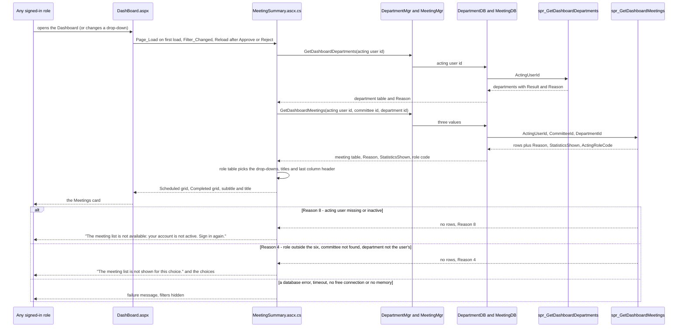
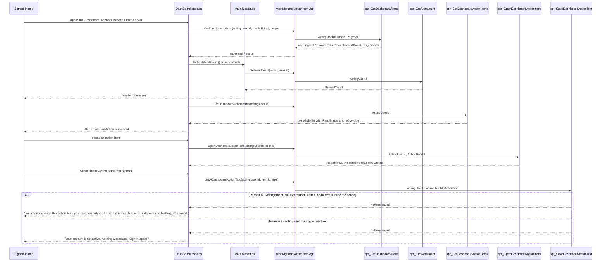
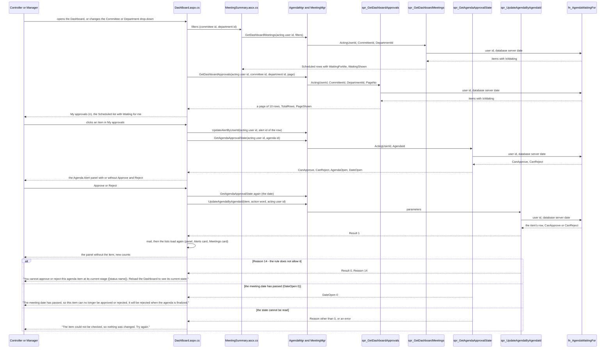
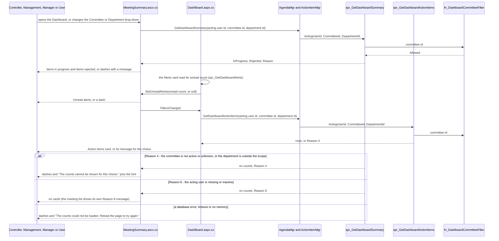
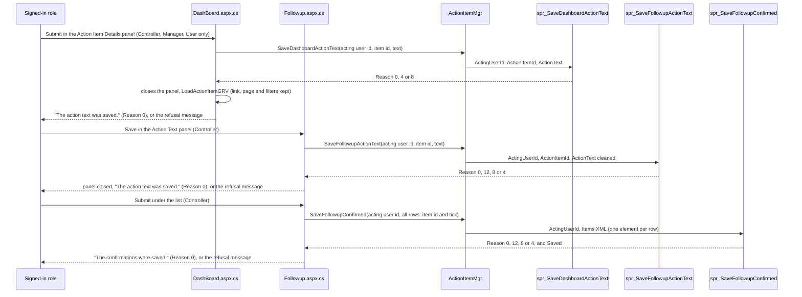

# Program to Program: Dashboard and Alerts

- Title: Program to Program: Dashboard and Alerts
- Audience: Developers and installers (internal)
- Shipped: No
- Applies to: UN6d (step 46): the Action Item Details panel Submit and the Followup page saves; UN6c2b (step 45): the summary cards, the Committee filter on every card, the Action Items filters; UN6c2a (step 44): the My approvals panel, the Waiting for me column and the Approve and Reject buttons; UN6c1 (step 43): the Alerts card, the header count and the Action Items card; UN6b (step 42): the Meetings card; the rest not written yet
- Last updated by: UN6d, based on ce7358a
- Status: Draft
- Verified against: for the step UN6d section: git diff ce7358a 276e402 of BMMS/DashBoard/DashBoard.aspx and .aspx.cs, BMMS/Master/Followup.aspx and .aspx.cs, BMMSBAL/ActionItemMgr.cs, BMMSDAL/ActionItemDB.cs, Database/BMMS-Fix-FollowupSave-Step46.sql (read in full), Database/README.md (section Step UN6d and its Known items), the Test script result of step 46 (56 of 56) and the tester runs of 2026-11-15 as given;
  for the step UN6c2b section: git diff f3cbd7e~1 f3cbd7e of BMMS/DashBoard/DashBoard.aspx and .aspx.cs, BMMS/UserControl/MeetingSummary.ascx and .ascx.cs, BMMSBAL/AgendaMgr.cs and ActionItemMgr.cs, BMMSDAL/AgendaDB.cs,
  Database/BMMS-Fix-DashboardSummary-Step45.sql (read), Database/README.md (section Step UN6c2b and its Known items), the tester run of 2026-11-15 and the owner's tests as given;
  for the step UN6c2a section: BMMS/DashBoard/DashBoard.aspx, .aspx.cs and .aspx.designer.cs (diff; BindAgendaDetails, btnApprove_Click and btnReject_Click read in full),
  BMMS/UserControl/MeetingSummary.ascx and .ascx.cs (diff), BMMSBAL/AgendaMgr.cs and MeetingMgr.cs (diff), BMMSDAL/AgendaDB.cs and MeetingDB.cs (diff),
  Database/BMMS-Fix-AgendaWaitingFor-Step44.sql (all five objects), BMMS-Rollback-AgendaWaitingFor-Step44.sql, BMMS-Test-AgendaWaitingFor-Step44.sql (header, comparison),
  Database/README.md (section Step UN6c2a, Known items), the tester run of 2026-11-14 and the owner's tests as given;
  for the Alerts card, the header count and the Action Items card (step UN6c1): BMMS/DashBoard/DashBoard.aspx and
  DashBoard.aspx.cs (the Alerts and Action Items regions, message constants, lnkActionItem_Click, lnkSource_Click),
  BMMS/MasterPage/Main.Master.cs (alert count), BMMSBAL/AlertMgr.cs and ActionItemMgr.cs, BMMSDAL/AlertDB.cs and
  ActionItemDB.cs (diff), Database/BMMS-Fix-DashboardAlerts-Step43.sql (all objects), BMMS-Rollback-DashboardAlerts-Step43.sql,
  BMMS-Test-DashboardAlerts-Step43.sql (header), Database/README.md (section Step UN6c1), the owner's test result as given;
  for the Meetings card (step UN6b): BMMS/UserControl/MeetingSummary.ascx, .ascx.cs, BMMS/DashBoard/DashBoard.aspx
  (card titles, grid headings), DashBoard.aspx.cs (diff: MeetingSummary1.Reload after Approve and Reject, FormatDate,
  FormatTimeOfDay, AlertDetails), BMMSBAL/MeetingMgr.cs and DepartmentMgr.cs (diff), BMMSDAL/MeetingDB.cs and
  DepartmentDB.cs (diff), Database/BMMS-Fix-DashboardMeetings-Step42.sql (all five objects),
  BMMS-Rollback-DashboardMeetings-Step42.sql, BMMS-Test-DashboardMeetings-Step42.sql (header), Database/README.md
  (section Step UN6b), the owner's test result as given for the step (71 of 71, not re-run)
- To confirm: feature area not written yet except the Meetings card and, since UN6c1, the Alerts card, the header count and the
  Action Items card (WF2c3): the Agenda Alert panel and the approval flow of the Dashboard are still to be drawn (the
  Submit of the Action Item Details panel is drawn since UN6d)

## Scope

This file covers the flow of the Dashboard's Meetings card (step UN6b): how the page asks the database for the
meeting list and the department list, what the procedures decide, and what happens when they refuse. The card
shows the Scheduled and the Completed (last 10) meetings with a status label and, for four roles, four counts
(Items, Approved, Rejected and In progress; before step 45 "Pending" for some roles). Everything is read only: the card writes nothing.

The Alerts card, the header count and the Action Items card (step UN6c1) are in the section "Alerts card, header
count and Action Items card (step UN6c1)" below.

The My approvals panel, the Waiting for me column and the Approve and Reject buttons (step UN6c2a) are in the
section "My approvals, Waiting for me and the Approve and Reject buttons (step UN6c2a)" below.

The summary cards and the Committee filter on every card (step UN6c2b) are in the section "Summary cards and the
Committee filter on every card (step UN6c2b)" below.

The Submit of the Action Item Details panel and the saves of the Followup page (Master/Followup.aspx) (step UN6d) are
in the section "Action Item Details panel and the Followup page saves (step UN6d)" below.

[[CONFIRM: the rest of the Agenda Alert panel and the Approve and Reject flow of the
Dashboard (mail, the finalised agenda) are not written yet (WF2c3)]]

## Programs involved

| Program | Kind | Part in the flow |
|---|---|---|
| DashBoard/DashBoard.aspx(.cs) | Page | Hosts the user control; after a successful Approve or Reject it calls `MeetingSummary1.Reload()` |
| UserControl/MeetingSummary.ascx(.cs) | User control | Reads the acting user id from `Session["UserId"]`, calls the two BAL methods, builds the filters, titles, columns and messages from the answers |
| CommitteeMgr.GetCommitteeList(1) | BAL | The active committees for the Committee drop-down |
| DepartmentMgr.GetDashboardDepartments, DepartmentDB.GetDashboardDepartments | BAL, DAL | Call spr_GetDashboardDepartments; return the table and the refusal Reason |
| MeetingMgr.GetDashboardMeetings, MeetingDB.GetDashboardMeetings | BAL, DAL | Call spr_GetDashboardMeetings; return the table, the Reason, StatisticsShown and ActingRoleCode |
| spr_GetDashboardMeetings | Procedure | Reads role and departments of the acting user, checks the two filters, lists the meetings and counts the items |
| spr_GetDashboardDepartments | Procedure | Lists the departments of a Manager or a User |
| fn_MeetingDashboardState, fn_UserDepartmentScope, fn_AgendaStatusGroup | Inline table functions | The one definition of the status colour, of a user's departments and of the item groups |

## Main flow

| From | To | Data | Notes |
|---|---|---|---|
| Role (any) | DashBoard.aspx | Opens the page, or picks a committee or department | The two drop-downs post back on every change |
| DashBoard.aspx | MeetingSummary | Page_Load on the first load; Reload() after Approve or Reject | Reload() is called after the approval is saved and the mail result is shown |
| MeetingSummary | DepartmentMgr.GetDashboardDepartments | Acting user id | Read again on every load; Reason 4 for the roles that have no department list is not an error here, the list is simply not used |
| DepartmentMgr / DepartmentDB | spr_GetDashboardDepartments | @ActingUserId | OUTPUT @Result and @Reason are turned into one Reason number |
| spr_GetDashboardDepartments | DepartmentDB | DepartmentId, DepartmentName, IsHome | Home department first, then by name; only for Manager and User |
| MeetingSummary | MeetingMgr.GetDashboardMeetings | Acting user id, committee id (0 = all), department id (0 = all of the user's) | A chosen department that is no longer in the user's list falls back to 0 before the call |
| MeetingMgr / MeetingDB | spr_GetDashboardMeetings | @ActingUserId, @CommitteeId, @DepartmentId | Four OUTPUT values (five since step 44: @WaitingShown) |
| spr_GetDashboardMeetings | MeetingDB | Rows with MeetingId, CommitteeName, MeetingNo, MeetingDate, MeetingTime, AgendaSubmissionDate, ListCode, StateCode, StateLabel, Items, Approved, Rejected, Pending (and, since step 44, WaitingForMe); @Reason, @StatisticsShown, @ActingRoleCode (and, since step 44, @WaitingShown) | ListCode S or C; the counts are NULL when the statistics are not shown |
| MeetingDB | MeetingSummary | Table, Reason, StatisticsShown, ActingRoleCode | StatisticsShown is true only when the Reason is 0 and the procedure said 1 |
| MeetingSummary | DashBoard.aspx (the card) | The two grids, the subtitle, the card title, the messages | The role code from the procedure picks the view in the role table, not the session role |
| spr_GetDashboardMeetings | MeetingSummary | Reason 8 | Refusal: acting user missing, 0 or inactive |
| spr_GetDashboardMeetings | MeetingSummary | Reason 4 | Refusal: a role outside admin, controller, manager, user, mgmt, md_sect; a committee that does not exist; a department that is not one of a Manager's or a User's, or any department for another role |

## Refusal paths

| Reason | Raised by | Meaning | Message the card shows |
|---|---|---|---|
| 8 | spr_GetDashboardMeetings, spr_GetDashboardDepartments | The acting user is missing, 0 or not active | "The meeting list is not available: your account is not active. Sign in again." |
| 4 | spr_GetDashboardMeetings | Role outside the six; committee id that does not exist (or below 0); department id for a role other than Manager and User, not one of the user's departments, or below 0 | "The meeting list is not shown for this choice." followed by the filters that are shown: "Choose All committees or All my departments." (both filters), "Choose All committees." (committee only), "Choose All my departments." (department only), or with no filter shown "The meeting list is not shown for your role." (this last text replaces the first sentence) |
| 4 | spr_GetDashboardDepartments | The role is not Manager or User | None: the page does not use the list, the Committee drop-down and the titles follow the role table |
| (none) | The page | A database error (written to the error log), or SqlException -2, 8645 or 701, no free connection in the pool in time, or an OutOfMemoryException on the web server | "The meeting list could not be loaded. Reload the page to try again." For the timeout and memory cases: "The server is busy and the meeting list could not be loaded. Wait a moment, then reload the page." After any failure no filter, no subtitle and the title "Meetings" are shown; the alerts still load |
| (none) | The page | Session["UserId"] missing or not a number | The Reason 8 text, no filters |

A refused call returns the same columns with no rows. The role code of an active user is returned even when a
filter is refused, so the page can word its message by the role.

## Where each rule lives

| Rule | C# | Procedure or function |
|---|---|---|
| Who may call, and which role gets which statistics (Controller, Management, Manager, User: yes; MD Secretariat: yes since step 45, read-only; Admin: no) | MeetingSummary.ascx.cs reads StatisticsShown from the answer | spr_GetDashboardMeetings (role read from Users and Roles for an active user; @StatisticsShown) |
| Scheduled means the meeting date is today or later, or there is no date (today is the database server's date) | none | fn_MeetingDashboardState (IsScheduled) |
| Status colour and label, the first rule that fits: grey (minutes F or C), red (date before today), green (agenda not Open), orange (submission date before today), blue | MeetingSummary.StateCssClass turns the colour name into the chip class | fn_MeetingDashboardState (StateCode, StateLabel) |
| A user's departments: open User_Department rows and the home department | none | fn_UserDepartmentScope |
| The groups: approved ACA, rejected AMR and ACR, in progress AC and AMA, other (AF and any other code, counted in Items only) | none | fn_AgendaStatusGroup |
| Every scheduled meeting, no cap; the last 10 completed meetings, newest first, for every role | Rows() splits the table by ListCode | spr_GetDashboardMeetings (TOP 10, ORDER BY date, time, id) |
| Manager and User: a completed meeting only with an item of their department(s); counts over those items | none | spr_GetDashboardMeetings (@Dept from fn_UserDepartmentScope) |
| Filters checked against the user's scope | Department fallback to 0 when no longer listed (LoadMeetings) | spr_GetDashboardMeetings (Reason 4) |
| What each role sees: Committee drop-down, Department drop-down (Manager with two or more departments), subtitle, card titles, last column header ("In progress" for every role since step 45; before, "In progress" for the User and "Pending" for the others; the User has the Committee drop-down since step 45) | MeetingSummary.ascx.cs: RoleViews (one place), ShowTitles, BindCommittees, BindDepartments | spr_GetDashboardDepartments gives the departments |
| Counts follow an Approve or Reject | DashBoard.aspx.cs calls MeetingSummary1.Reload() after a successful approve and reject | none |
| Messages and the server-busy test | MeetingSummary.ascx.cs: the five message constants, IsServerBusy, ShowFailure | none |

## Tables read and written

Read only; the card writes nothing.

| Object | Reads |
|---|---|
| spr_GetDashboardMeetings | Users and Roles (the acting user's role), Committee, Meeting, Agenda, and User_Department and Users again through fn_UserDepartmentScope |
| spr_GetDashboardDepartments | Users, Roles, User_Department (through fn_UserDepartmentScope), Department |
| fn_MeetingDashboardState | Meeting |
| fn_UserDepartmentScope | User_Department, Users |
| fn_AgendaStatusGroup | Agenda |
| CommitteeMgr.GetCommitteeList(1) | The active committees for the drop-down (its own procedure, not read for this file) |

Measured on BMMS_Test on 2026-11-12 (17 meetings, 66 items, warm runs): 373 logical reads for the Controller, 405
for a Manager with one department, 613 for a Manager with two, 404 for a User, no physical reads, 7 to 33 ms
elapsed. The Agenda table has only its primary key, so the counts scan it once per listed meeting; an index is a
later step (UN6e; Database/README.md, "Known items for later steps").

## Alerts card, header count and Action Items card (step UN6c1)

Added in step UN6c1 (database step 43). Both cards and the header count read through the acting user id
(`Session["UserId"]`); the page never sends a role. The procedures read the role from Users and Roles, so a changed
page or a forged post-back cannot widen what a person sees.

### Programs involved

| Program | Kind | Part in the flow |
|---|---|---|
| DashBoard/DashBoard.aspx(.cs) | Page | Alerts card (`LoadAlertGRV`, the three links, paging, `lnkSource_Click`, Remove from my list), Action Items card (`LoadActionItemGRV`, open, Submit), `RefreshHeaderCount` |
| MasterPage/Main.Master(.cs) | Master page | The header "Alerts (n)": `OnPreRender` on a full page load, `RefreshAlertCount()` when the Dashboard asks |
| AlertMgr, AlertDB | BAL, DAL | GetDashboardAlerts, GetAlertCount, RemoveAlertForUser; UpdateAlertByUserId (marks an opened alert read, unchanged) |
| ActionItemMgr, ActionItemDB | BAL, DAL | GetDashboardActionItems, OpenDashboardActionItem, SaveDashboardActionText |
| spr_GetDashboardAlerts, spr_GetAlertCount, spr_RemoveAlertForUser | Procedures | One page of the alert list; the unread count; the removal of one row of the acting user |
| spr_GetDashboardActionItems, spr_OpenDashboardActionItem, spr_SaveDashboardActionText | Procedures | The list, the opening (read row) and the save of the action text, each by the scope rule |
| fn_DashboardAlerts, fn_DashboardActionItems | Inline table functions | The one listing rule of the alerts and the one scope rule of the action items |

### Main flow

| From | To | Data | Notes |
|---|---|---|---|
| Role (any) | DashBoard.aspx | Opens the page, or clicks Recent, Unread, All, a page number, an alert, an item, Remove from my list or Submit | The mode and the page number are kept in ViewState; the procedure checks both |
| DashBoard.aspx | AlertMgr.GetDashboardAlerts | Acting user id, mode (R, U or A), page number | Only the page shown is read; Recent is the default |
| AlertMgr / AlertDB | spr_GetDashboardAlerts | @ActingUserId, @Mode, @PageNo | Six OUTPUT values: @Result, @Reason, @TotalRows, @UnreadCount, @PageShown |
| spr_GetDashboardAlerts | AlertDB | Rows with AlertUserId, AlertId, ReadStatus, SourceType, SourceTypeId, AlertTypeName, CommitteeName, DepartmentName, DisplayText, EventOn, ActorName, ActorLogin | Newest event first, 10 to a page (ROW_NUMBER, compatibility level 100) |
| DashBoard.aspx | Main.Master.RefreshAlertCount | A call, after the alert list is reloaded on a postback (Approve, Reject, Remove, the links, paging) and after an alert was opened | Not on the first load of the page: the master reads the count in `OnPreRender` |
| Main.Master | AlertMgr.GetAlertCount | Acting user id | A Reason other than 0 or an exception: the header shows "Alerts" without a number, and the error log holds the cause |
| AlertMgr / AlertDB | spr_GetAlertCount | @ActingUserId | OUTPUT @Result, @Reason, @UnreadCount, by fn_DashboardAlerts |
| DashBoard.aspx | AlertMgr.UpdateAlertByUserId | Acting user id, alert id | Marks the opened alert read; only the row of that user |
| DashBoard.aspx | AlertMgr.RemoveAlertForUser | Acting user id, the alert row id from the hidden field | StatusId 0 on the person's own row, nothing deleted |
| DashBoard.aspx | ActionItemMgr.GetDashboardActionItems | Acting user id | The whole list comes back and is kept in ViewState; the links Show All, Read and Unread filter it in the page |
| ActionItemMgr / ActionItemDB | spr_GetDashboardActionItems | @ActingUserId | OUTPUT @Result, @Reason; rows newest meeting first |
| DashBoard.aspx | ActionItemMgr.OpenDashboardActionItem | Acting user id, action item id | Writes the person's own read row (creates it when missing, never a second); nothing of the item changes |
| DashBoard.aspx | ActionItemMgr.SaveDashboardActionText | Acting user id, action item id, the action text | Writes Action_Item.ActionText only, inside the scope |

### Refusal paths

| Reason | Raised by | Meaning | Message the page shows |
|---|---|---|---|
| 8 | spr_GetDashboardAlerts, spr_GetAlertCount, spr_RemoveAlertForUser, spr_GetDashboardActionItems, spr_OpenDashboardActionItem, spr_SaveDashboardActionText | The acting user is missing, 0 or inactive; no rows, nothing changes | Alerts: "The alerts are not available: your account is not active. Sign in again."; Action Items: "The action items are not available: your account is not active. Sign in again."; Submit: "Your account is not active. Nothing was saved. Sign in again."; the header: "Alerts" without a number |
| 4 | spr_GetDashboardAlerts | A mode other than R, U or A, or a page number below 1 | "The alerts could not be loaded. Reload the page to try again." (the page only sends R, U or A) |
| 4 | spr_RemoveAlertForUser | The alert row is another user's, or does not exist | "This alert is not in your list." |
| 4 | spr_GetDashboardActionItems | A role without the card (MD Secretariat, Admin, the system account) | None: the page hides the Action Items card; the Alerts card, the Meetings card and the header are not touched |
| 4 | spr_OpenDashboardActionItem | Such a role, or an item outside the acting user's scope, confirmed or unknown; no row, nothing written | "This item no longer exists." (`ShowItemGone`) |
| 4 | spr_SaveDashboardActionText | Management, MD Secretariat or Admin, or an item outside the scope, confirmed or unknown; nothing saved | "You cannot change this action item: your role can only read it, or it is not an item of your department. Nothing was saved." |
| (none) | The page | A database error, a timeout, no free connection or no memory | Alerts: "The alerts could not be loaded. Reload the page to try again." or, when the server is busy, "The server is busy and the alerts could not be loaded. Wait a moment, then reload the page."; the same two for the Action Items card ("The action items ..."); a failed Remove: "The alert could not be removed from your list. Try again."; a failed save: "The action text could not be saved. Nothing was saved. Try again." (busy: "The server is busy and the action text could not be saved. Nothing was saved. Wait a moment, then try again."). The grid and its pager are hidden |

### Where each rule lives

| Rule | C# | Procedure or function |
|---|---|---|
| Who sees which alert: the Admin role none of the eleven functional types; a Controller not ACA and ACR; a Manager not AMA and AMR; removed rows (StatusId 0) never | DashBoard.aspx.cs only displays | fn_DashboardAlerts |
| Recent: every unread alert and the read ones whose event date is today or in the seven days before (database server date); Unread; All | AlertMode in ViewState (R by default), `AlertMode_Click` | spr_GetDashboardAlerts (@Mode, @From) |
| Event date and person of an alert (entry, decision, edit more than one minute after a decision, or no recorded approver: a dash) | `ActorName` shows a dash when empty | fn_DashboardAlerts (EventOn, ActorUserId) |
| A page of 10, the page after the last gives the last | `AllowCustomPaging`, `VirtualItemCount` | spr_GetDashboardAlerts (ROW_NUMBER, @PageShown) |
| The header count | Main.Master.cs `ShowAlertCount`, `RefreshAlertCount`; DashBoard.aspx.cs `RefreshHeaderCount` | spr_GetAlertCount |
| Remove from my list: only the person's own row | `hdnAlertUserId` carries the row id | spr_RemoveAlertForUser |
| Action Items scope: not confirmed; Controller and Management every item; Manager and User the items of their departments whose minutes are finalised or confirmed; MD Secretariat and Admin none | `cardActionItems` hidden on Reason 4 | fn_DashboardActionItems, spr_GetDashboardActionItems |
| Unread for a person without a read row; opening creates the row | `LoadActionItemGRV`, bold row | spr_OpenDashboardActionItem, fn_DashboardActionItems (ReadStatus) |
| Overdue: due date before the database server's date and the item neither complied nor confirmed | `IsOverdue` shows the red chip | fn_DashboardActionItems (IsOverdue) |
| Who may change the action text: Controller, Manager and User, inside the scope | `ActionItemNotSavedMessage` and the other save messages | spr_SaveDashboardActionText |
| No functional mail for the Admin role | none | spr_GetAlertMailId, spr_GetAgendaUpdateMailId |

### Tables read and written

| Object | Reads | Writes |
|---|---|---|
| fn_DashboardAlerts | Alert_User_Map, Alert_Master, Users, Roles, Alert_Type, Committee, Department, Agenda | none |
| spr_GetDashboardAlerts, spr_GetAlertCount | Users, and the rows of fn_DashboardAlerts | none |
| spr_RemoveAlertForUser | Users, Alert_User_Map | Alert_User_Map (StatusId 0) |
| fn_DashboardActionItems | Users, Roles, Action_Item, Minutes, Agenda, Decision_Type, Meeting, Committee, Department, ActionItem_User_Map, and User_Department through fn_UserDepartmentScope | none |
| spr_GetDashboardActionItems | Users, Roles, and the rows of fn_DashboardActionItems | none |
| spr_OpenDashboardActionItem | Users, Roles, and fn_DashboardActionItems | ActionItem_User_Map (the person's own row: ReadStatus 1, row created when missing) |
| spr_SaveDashboardActionText | Users, Roles, and fn_DashboardActionItems | Action_Item (ActionText) |
| spr_GetAlertMailId, spr_GetAgendaUpdateMailId | as before (the Admin role is left out of the addresses) | none |

Drawn from (UN6c1): BMMS/DashBoard/DashBoard.aspx and .aspx.cs, BMMS/MasterPage/Main.Master.cs, BMMSBAL/AlertMgr.cs
and ActionItemMgr.cs (diff), BMMSDAL/AlertDB.cs and ActionItemDB.cs (diff), Database/BMMS-Fix-DashboardAlerts-Step43.sql
(all objects), BMMS-Rollback-DashboardAlerts-Step43.sql, BMMS-Test-DashboardAlerts-Step43.sql (header), Database/README.md
(section Step UN6c1), the owner's test result as given (128 numbered checks passed; owner's tests passed).

## My approvals, Waiting for me and the Approve and Reject buttons (step UN6c2a)

Added in step UN6c2a (database step 44). One database function, fn_AgendaWaitingFor, is the only rule for who may
approve or reject an agenda item; four things read it, so they always agree: the My approvals panel
(spr_GetDashboardApprovals), the Waiting for me column of the Scheduled list (spr_GetDashboardMeetings), the
Approve and Reject buttons and the check before a decision (spr_GetAgendaApprovalState) and the approval itself
(spr_UpdateAgendaByAgendaId). The page sends the acting user id (`Session["UserId"]`), the committee and department
last chosen at the top, and a page number; the role is read from the database. Every caller passes the database
server's date to the function.

### Programs involved

| Program | Kind | Part in the flow |
|---|---|---|
| DashBoard/DashBoard.aspx(.cs) | Page | The panel (`LoadApprovals`, paging, `lnkApproval_Click`), the buttons (`BindAgendaDetails`, `TryGetApprovalState`), the checks in `btnApprove_Click` and `btnReject_Click`, the panel message (`ShowAgendaPanelMessage`) |
| UserControl/MeetingSummary.ascx(.cs) | User control | Gives the page the filters (`CommitteeId`, `DepartmentId`, event `FiltersChanged`); the Waiting for me column from the answer of `GetDashboardMeetings` |
| AgendaMgr, AgendaDB | BAL, DAL | `GetDashboardApprovals`, `GetAgendaApprovalState` (the flags are true only when the Reason is 0); `UpdateAgendaByAgendaId` (as before) |
| MeetingMgr, MeetingDB | BAL, DAL | `GetDashboardMeetings` with the extra output `WaitingShown` |
| spr_GetDashboardApprovals, spr_GetAgendaApprovalState | Procedures | The panel rows (a page of 10); the four flags of one item |
| spr_GetDashboardMeetings | Procedure | The column WaitingForMe (last) and `@WaitingShown` |
| spr_UpdateAgendaByAgendaId | Procedure | Approve and Reject; its test "may this user act" reads the function |
| fn_AgendaWaitingFor | Inline table function | The one rule (CanApprove, CanReject, AgendaOpen, DateOpen, IsWaiting) |

### Main flow

| From | To | Data | Notes |
|---|---|---|---|
| Controller or Manager | DashBoard.aspx | Opens the page, changes a drop-down, clicks a row, Approve, Reject, a page number | A change of the drop-downs reloads the panel from page 1 (`FiltersChanged`) |
| MeetingSummary | DashBoard.aspx | Committee id and department id as the last load of the Meetings card used them | Kept in the control's ViewState; the procedures check them again |
| DashBoard.aspx | AgendaMgr.GetDashboardApprovals | Acting user id, committee id, department id, page number | Called on the first load, on paging, after a filter change and after every Approve, Reject and row click |
| AgendaMgr / AgendaDB | spr_GetDashboardApprovals | @ActingUserId, @CommitteeId, @DepartmentId, @PageNo | OUTPUT @Result, @Reason, @TotalRows, @PageShown |
| spr_GetDashboardApprovals | fn_AgendaWaitingFor | User id, database server date | Rows with IsWaiting = 1 only, then the committee and department filters; newest meeting first |
| spr_GetDashboardApprovals | DashBoard.aspx | RowNo, AgendaId, AgendaNo, SubjectNo, ShortText, AgendaStatusCode, CommitteeId, CommitteeCode, CommitteeName, MeetingId, MeetingNo, MeetingDate, DepartmentId, DepartmentName, AlertId | The title shows "My approvals ([n])" from TotalRows; the page number shown is the one the server answers with |
| DashBoard.aspx | AlertMgr.UpdateAlertByUserId | Acting user id, the alert id of the row | Only when the row has an alert; marks the acting user's own row read; the Alerts card and the header count follow |
| DashBoard.aspx | AgendaMgr.GetAgendaApprovalState | Acting user id, agenda id | Read when an item is opened and again before Approve and Reject |
| spr_GetAgendaApprovalState | fn_AgendaWaitingFor | User id, database server date | CanApprove and CanReject; AgendaOpen and DateOpen are worked out in the procedure from the item's meeting |
| spr_GetAgendaApprovalState | DashBoard.aspx | CanApprove, CanReject, AgendaOpen, DateOpen | The page shows Approve and Reject only when CanApprove and AgendaOpen are both 1, and, if DateOpen is 0, the meeting-date message instead |
| DashBoard.aspx | AgendaMgr.UpdateAgendaByAgendaId | The item, the action word (Manager or Controller), acting user id | Called only after the state says the date is open; the procedure decides who may act |
| spr_UpdateAgendaByAgendaId | fn_AgendaWaitingFor | User id, database server date | A Manager's row must allow CanApprove; a Controller's row CanApprove for Approved and CanReject for Rejected |
| MeetingSummary | DashBoard.aspx | Scheduled rows with WaitingForMe, WaitingShown | The column shows the count and is empty where it is 0; it is shown only when WaitingShown is 1 |

### Refusal paths

| Reason | Raised by | Meaning | What the page shows |
|---|---|---|---|
| 12 | spr_GetDashboardApprovals, spr_GetAgendaApprovalState | The acting user is the protected system account (checked as a system account, before the role) | The panel is hidden; the item opens read-only with no message for the system account |
| 8 | spr_GetDashboardApprovals, spr_GetAgendaApprovalState | The acting user is missing, 0 or inactive | Panel: "The approvals are not available: your account is not active. Sign in again."; item: read-only with "Whether you may approve this item could not be checked, so it is shown read-only. Close it and open it again." (Controller or Manager) |
| 4 | spr_GetDashboardApprovals | A role other than Controller and Manager; an unknown or negative committee; a department for a Controller or one that is not the Manager's; a page below 1 | A role without the panel: the panel is hidden. A person who has the panel and a refused filter: "The approvals cannot be shown for this choice." followed by the hint of the page (since step 45: " Choose All committees." or, where the Department drop-down is shown, " Choose All committees or All my departments."; an inactive committee is refused too) |
| 4 | spr_GetAgendaApprovalState | The item does not exist | The item is gone ("This item no longer exists." as for the other opens) |
| 14 | spr_UpdateAgendaByAgendaId | The acting user may not approve or reject the item by the function (ReasonDetail the status name) | "You cannot approve or reject this agenda item at its current stage ([status name]). Reload the Dashboard to see its current state." |
| 5 | spr_UpdateAgendaByAgendaId | The agenda is finalised | The existing finalised-agenda message |
| (none) | The page | DateOpen is 0 | In the panel: "The meeting date has passed, so this item can no longer be approved or rejected. It will be rejected when the agenda is finalized." above the buttons; before a decision, the same text in the page's message box and nothing is saved |
| (none) | The page | The state cannot be read before a decision | "The item could not be checked, so nothing was changed. Try again." |
| (none) | The page | The panel cannot be loaded (error, timeout, no memory) | "The approvals could not be loaded. Reload the page to try again." or "The server is busy and the approvals could not be loaded. Wait a moment, then reload the page."; since step 45 the heading reads "My approvals (-)" with a dash and the hidden text "count not available" (before, no count) |

A refused call returns the same columns with no rows and changes nothing.

### Where each rule lives

| Rule | C# | Procedure or function |
|---|---|---|
| Who may decide an item: a Manager an item at AC routed to him (creator's manager or an alert row of the item, also one he removed from his list); a Controller approves at AMA and rejects at AC or AMA; no one else; not the system account or an inactive user | none | fn_AgendaWaitingFor (CanApprove, CanReject) |
| What waits for a person: CanApprove, agenda Open, meeting date today or later (or no date) | none | fn_AgendaWaitingFor (IsWaiting, AgendaOpen, DateOpen) |
| The date is the database server's | none | `CAST(GETDATE() AS DATE)` in spr_GetDashboardApprovals, spr_GetAgendaApprovalState and spr_GetDashboardMeetings, passed to the function |
| The My approvals rows: IsWaiting, committee, department, newest meeting first, 10 to a page | `LoadApprovals`, `OnPagingApprovals` | spr_GetDashboardApprovals |
| Which roles have the panel: Controller and Manager | `cardApprovals.Visible` from the Reason | spr_GetDashboardApprovals (Reason 4 for the rest) |
| Waiting for me: Scheduled meetings only, Controller and Manager; for a Manager within the chosen department | `grvScheduled.Columns[WaitingColumn].Visible` from WaitingShown; `WaitingText` | spr_GetDashboardMeetings (WaitingForMe, @WaitingShown) |
| Approve and Reject shown: CanApprove and the agenda Open | `BindAgendaDetails` (controller and manager cases) | spr_GetAgendaApprovalState |
| Meeting date passed: read-only item and the message inside the panel; no decision | `BindAgendaDetails`, `ShowAgendaPanelMessage`, `btnApprove_Click`, `btnReject_Click` | spr_GetAgendaApprovalState (DateOpen). The approval procedure does not check the date (known item) |
| Opening a row marks only the person's own alert read | `lnkApproval_Click` | spr_UpdateAlertByUserId (the acting user's row) |
| Panel, lists and header follow a decision | `LoadApprovals`, `LoadAlertGRV`, `MeetingSummary1.Reload()` | none |

### Tables read and written

| Object | Reads | Writes |
|---|---|---|
| fn_AgendaWaitingFor | Users, Roles, Agenda, Meeting, Alert_User_Map, Alert_Master | none |
| spr_GetDashboardApprovals | Users, Roles, Committee, Agenda, Meeting, Department, Alert_Master, and fn_AgendaWaitingFor and fn_UserDepartmentScope | none |
| spr_GetAgendaApprovalState | Users, Agenda, Meeting, and fn_AgendaWaitingFor | none |
| spr_GetDashboardMeetings | as in step 42, and fn_AgendaWaitingFor | none |
| spr_UpdateAgendaByAgendaId | as before (Agenda, Meeting, Users, Roles, Agenda_Status, Alert_Master, Alert_User_Map), and fn_AgendaWaitingFor | as before: Agenda (comments, approved status, who and when, AgendaStatusCode), Alert_Master (AlertTypeCode), Alert_User_Map, Audit_Trail_Master |

Drawn from (UN6c2a): BMMS/DashBoard/DashBoard.aspx, .aspx.cs and .aspx.designer.cs (diff, BindAgendaDetails,
btnApprove_Click, btnReject_Click read in full), BMMS/UserControl/MeetingSummary.ascx and .ascx.cs (diff),
BMMSBAL/AgendaMgr.cs and MeetingMgr.cs (diff), BMMSDAL/AgendaDB.cs and MeetingDB.cs (diff),
Database/BMMS-Fix-AgendaWaitingFor-Step44.sql (all five objects), BMMS-Rollback-AgendaWaitingFor-Step44.sql,
BMMS-Test-AgendaWaitingFor-Step44.sql (header, the 1352-case comparison), Database/README.md (section Step UN6c2a,
Known items), the tester run of 2026-11-14 as given.

## Summary cards and the Committee filter on every card (step UN6c2b)

Added in step UN6c2b (database step 45). The Meetings card (MeetingSummary) also asks for the two item cards, and
hands the Unread alerts card the count the Alerts card read. One function, fn_DashboardCommitteeFilter, is the only
rule for the Committee filter (0, or an active committee); the four Dashboard procedures read it: the meeting list,
the summary, My approvals and the Action Items card. The Action Items card now also takes the Committee and the
Department filter. The page sends the acting user id; the role and the departments are read from the database.

### Programs involved

| Program | Kind | Part in the flow |
|---|---|---|
| UserControl/MeetingSummary.ascx(.cs) | User control | `LoadSummary` (after the department list, before the meeting list), `SetUnreadAlerts`, `ShowSummaryDashes`, `ChoiceHint`, `InProgressMeaningFor`; the role table (`RoleViews`) |
| DashBoard/DashBoard.aspx(.cs) | Page | `LoadAlertGRV` gives the unread count to `SetUnreadAlerts` (null on a failed load); `LoadActionItemGRV` sends both filters and shows its own refusal message; `MeetingSummary1_FiltersChanged` reloads My approvals and the Action Items card from page 1; `ShowApprovalsMessage` |
| AgendaMgr.GetDashboardSummary, AgendaDB.GetDashboardSummary | BAL, DAL | Call spr_GetDashboardSummary; return the Reason and two nullable counts (null unless the Reason is 0) |
| ActionItemMgr.GetDashboardActionItems, ActionItemDB.GetDashboardActionItems | BAL, DAL | The new overload with committee id and department id; the old one sends 0 and 0 |
| spr_GetDashboardSummary | Procedure | The counts of items in progress and rejected of scheduled meetings |
| spr_GetDashboardMeetings, spr_GetDashboardApprovals, spr_GetDashboardActionItems | Procedures | Replaced: they read the committee rule; the meeting list also gives the MD Secretariat the statistics; the Action Items procedure has the two new filters |
| fn_DashboardCommitteeFilter | Inline table function | Allowed 1 for committee 0 or an active committee |
| fn_AgendaStatusGroup, fn_MeetingDashboardState, fn_UserDepartmentScope | Inline table functions | As in step 42: the item groups, the Scheduled rule, a user's departments |

### Main flow

| From | To | Data | Notes |
|---|---|---|---|
| Role | MeetingSummary | Opens the page, picks a committee or department | The User now has the Committee drop-down (all active committees) |
| MeetingSummary | AgendaMgr.GetDashboardSummary | Acting user id, committee id, department id | Called from `LoadSummary`, on every load of the Meetings card, with the same filters as the meeting list |
| AgendaMgr / AgendaDB | spr_GetDashboardSummary | @ActingUserId, @CommitteeId, @DepartmentId | OUTPUT @Result, @Reason, @InProgress, @Rejected; both counts are null unless the Reason is 0 |
| spr_GetDashboardSummary | MeetingSummary | InProgress, Rejected | Items of Scheduled meetings (today or later, or no date) by fn_AgendaStatusGroup: in progress AC and AMA, rejected AMR and ACR; equal to the totals of the In progress and Rejected columns of the Scheduled list for the same filters |
| DashBoard.aspx | MeetingSummary.SetUnreadAlerts | The unread count of the Alerts card's load, or null | The Unread alerts card follows no filter: the rule of the Alerts card and the header count. A dash when no load ran or it failed |
| MeetingSummary | DashBoard.aspx | Event `FiltersChanged` | The page reloads My approvals from page 1 and the Action Items card from its first page |
| DashBoard.aspx | ActionItemMgr.GetDashboardActionItems | Acting user id, committee id, department id | The old call without filters gave the rows of step 43; with 0 and 0 the new call gives the same rows |
| ActionItemMgr / ActionItemDB | spr_GetDashboardActionItems | @ActingUserId, @CommitteeId, @DepartmentId | The two new parameters are last and optional (default 0) |
| spr_GetDashboardMeetings | MeetingSummary | The statistics also for the MD Secretariat | StatisticsShown 1, no WaitingForMe; the page shows a line "In progress: ..." under the lists where no card carries the meaning |

### Refusal paths

| Reason | Raised by | Meaning | What the page shows |
|---|---|---|---|
| 12 | spr_GetDashboardSummary | The protected system account | No cards |
| 8 | spr_GetDashboardSummary | The acting user is missing, 0 or inactive | No cards; the meeting list shows its Reason 8 message |
| 4 | spr_GetDashboardSummary | A role without the cards (MD Secretariat, Admin); a committee that is not active, unknown or below 0; a department below 0, for a Controller or Management, or not one of the user's | A role without cards: none (hidden). Where the cards were already shown (`HasSummaryCards`): dashes and "The counts cannot be shown for this choice." followed by the hint |
| 4 | spr_GetDashboardMeetings, spr_GetDashboardApprovals | A committee that is not active (since step 45; before, any existing committee) | The meeting list: "The meeting list is not shown for this choice." and the hint; My approvals: "The approvals cannot be shown for this choice." and the hint |
| 4 | spr_GetDashboardActionItems | A role without the card (MD Secretariat, Admin, the system account); since step 45 also a committee that is not active, or a department outside the scope | A role without the card: the card is hidden. A person who has it (`HasActionItemsCard`): "The action items cannot be shown for this choice." followed by the hint |
| (none) | The page | The summary cannot be loaded (error, timeout, no memory) | Dashes and "The counts could not be loaded. Reload the page to try again." or "The server is busy and the counts could not be loaded. Wait a moment, then reload the page."; the cards keep their place for the four roles that have them |

The hint (`ChoiceHint`) is " Choose All committees." for every role, and " Choose All committees or All my
departments." only where the Department drop-down is shown (a Manager with two or more departments). A count that
cannot be read shows a dash (en dash) with the hidden text "count not available", never 0.

### Where each rule lives

| Rule | C# | Procedure or function |
|---|---|---|
| The Committee filter: 0, or an active committee | none (the page offers the active committees; the server checks again) | fn_DashboardCommitteeFilter, read by spr_GetDashboardMeetings, spr_GetDashboardSummary, spr_GetDashboardApprovals and spr_GetDashboardActionItems. "All committees" still lists meetings of inactive committees |
| Who has the summary cards: Controller, Management, Manager, User | `SummaryRoles` (only to show dashes when no answer came), `divSummaryCards.Visible` from the Reason | spr_GetDashboardSummary (Reason 4 for the rest) |
| What the cards count: items of Scheduled meetings, in progress AC and AMA, rejected AMR and ACR; a Manager and a User over the chosen department(s) | none | spr_GetDashboardSummary with fn_AgendaStatusGroup, fn_MeetingDashboardState, fn_UserDepartmentScope |
| The Unread alerts value: the unread count of the Alerts card's list, no filter | `SetUnreadAlerts`, called by `LoadAlertGRV` | spr_GetDashboardAlerts (@UnreadCount) |
| Card labels and scope line: "Items", "[department] items", "Items of my departments" + " in progress" or " rejected"; "Scheduled meetings, all committees" or the committee name | `ItemsOf`, `LoadSummary` | none |
| The meaning of "In progress": the second sentence only for the Controller and the Manager | `InProgressMeaningFor` (by the role code the server returned): tooltip of the header, the In progress card, and the line under the lists when no card is shown | none |
| The hint of a refused choice | `ChoiceHint` (is the Department drop-down shown) | none |
| The Action Items card follows both filters and shows a message for a refused choice | `LoadActionItemGRV`, `HasActionItemsCard`, `ActionItemsFilterMessage` | spr_GetDashboardActionItems (@CommitteeId, @DepartmentId) |
| "My approvals (n)" keeps its count through every postback; a dash on a failed or refused load | `litApprovalCount` keeps its text in ViewState; `ShowApprovalsMessage` | none |
| The role table: "In progress" for every role; the Committee drop-down for the User | `RoleViews` | none |
| Narrow windows: at 1240 px and below the Meetings grid is one column and the cells are tighter; below 960 px the table scrolls inside its box with the Meeting column fixed; the page never scrolls sideways | none | none (bmms-workbench.css) |

### Tables read and written

Read only; nothing is written.

| Object | Reads |
|---|---|
| fn_DashboardCommitteeFilter | Committee |
| spr_GetDashboardSummary | Users, Roles, Meeting, Committee, and fn_AgendaStatusGroup, fn_MeetingDashboardState, fn_UserDepartmentScope, fn_DashboardCommitteeFilter |
| spr_GetDashboardMeetings, spr_GetDashboardApprovals | as before, and fn_DashboardCommitteeFilter |
| spr_GetDashboardActionItems | as in step 43, and fn_DashboardCommitteeFilter, fn_UserDepartmentScope |

Drawn from (UN6c2b): BMMS/DashBoard/DashBoard.aspx and .aspx.cs (diff), BMMS/UserControl/MeetingSummary.ascx and
.ascx.cs (diff), BMMSBAL/AgendaMgr.cs and ActionItemMgr.cs (diff), BMMSDAL/AgendaDB.cs (diff),
Database/BMMS-Fix-DashboardSummary-Step45.sql (fn_DashboardCommitteeFilter, spr_GetDashboardSummary, and the header
comments and Reason checks of the three replaced procedures), BMMS-Rollback-DashboardSummary-Step45.sql,
Database/README.md (section Step UN6c2b and its Known items), the tester run of 2026-11-15 (dashboard pack, 388
checks) and the owner's tests as given.

## Action Item Details panel and the Followup page saves (step UN6d)

Added in step UN6d (database step 46). Two flows that write Action_Item: the Submit of the Dashboard's Action Item
Details panel (the save of step 43, with a new reaction of the page) and the two saves of the Followup page
(Master/Followup.aspx, the page where the Controller records the follow-up decisions and the Confirmed ticks).
The Followup page is not a report: Data-Flow/03-Program-to-Program/10-Reports.md covers Report/Followup.aspx (the
read-only reports) and has no section for Master/Followup.aspx, so the page is described here, next to the other
save of Action_Item. Both flows send the acting user id (`Session["UserId"]`); the role is read from the database.

### Programs involved

| Program | Kind | Part in the flow |
|---|---|---|
| DashBoard/DashBoard.aspx(.cs) | Page | Action Item Details panel: buttons by session role (`canSave`), the line `pActionItemPanelMessage`, `btnActionItemApprove_Click`, `LoadActionItemGRV` after a done or refused Submit |
| Master/Followup.aspx(.cs) | Page | The Followup list, the Action Text panel, the Is Confirmed ticks and Submit; `CanSave` (session role, for what is shown), `btnActionTextSave_Click`, `btnSubmit_Click`, `HasSessionUser` |
| ActionItemMgr, ActionItemDB | BAL, DAL | SaveDashboardActionText (step 43); SaveFollowupActionText and SaveFollowupConfirmed (new; the list built with XmlWriter, the text cleaned with HtmlCleaner.Clean); the UpdateActionItem wrappers are removed |
| spr_SaveDashboardActionText | Procedure | Step 43, not changed |
| spr_SaveFollowupActionText, spr_SaveFollowupConfirmed | Procedures | New in step 46: only an active Controller, not the system account |
| spr_UpdateActionItem | Procedure | Step 31, not changed; no caller since step UN6d |

### Main flow

| From | To | Data | Notes |
|---|---|---|---|
| Role | DashBoard.aspx | Submit | The page shows Submit and Cancel to the session roles controller, manager and user; every other role sees Close and the line "You can read this action item. Your role cannot change it." The server decides the save |
| DashBoard.aspx | ActionItemMgr.SaveDashboardActionText | Acting user id, item id, text | As in step 43; after a done or refused save the panel closes, the list is read again and the message is shown |
| Role | Followup.aspx | Save (Action Text panel), Submit | The page shows Save and Submit only when the session role is controller; a role that only reads sees "View", disabled ticks and the line "You can read the followups. Your role cannot change them." The server decides the save |
| Followup.aspx | ActionItemMgr.SaveFollowupActionText | Acting user id, item id (int.TryParse), the text | HtmlCleaner.Clean before the call; writes Action_Item.ActionText only |
| Followup.aspx | ActionItemMgr.SaveFollowupConfirmed | Acting user id, the item id and tick of every row of the list | One call; a row whose id cannot be read stops the Submit before anything is sent |
| ActionItemMgr / ActionItemDB | spr_SaveFollowupActionText | @ActingUserId, @ActionItemId, @ActionText | OUTPUT @Result, @Reason |
| ActionItemMgr / ActionItemDB | spr_SaveFollowupConfirmed | @ActingUserId, @Items XML `<items><i id=".." c="0|1"/>...</items>` | OUTPUT @Result, @Reason, @Saved; one transaction, all rows or none |

### Refusal paths

| Reason | Raised by | Meaning | Message the page shows |
|---|---|---|---|
| 4 | spr_SaveFollowupActionText | A role other than Controller, or an item that does not exist; nothing saved | Followup: "You cannot change the followups: your role can only read them, or an item on the list no longer exists. Nothing was saved. Click View to read the list again." (the same text for every role) |
| 4 | spr_SaveFollowupConfirmed | A role other than Controller; or a list that cannot be read (another root, an element other than i, an id that is not a whole number of at most 10 digits that fits an INT, an id given twice, a tick other than 0 or 1, no list); or one row whose item does not exist: the whole Submit is refused, no row is written | The same text |
| 12 | both | The protected system account | The same text as Reason 4 |
| 8 | both | The acting user is missing, 0 or inactive | "Your account is not active. Nothing was saved. Sign in again." |
| (none) | The page | A database error, a timeout, or a busy server | Action Text: "The action text could not be saved. Nothing was saved. Try again." or "The server is busy and the action text could not be saved. Nothing was saved. Wait a moment, then try again." on a line inside the open panel; Submit: "The confirmations could not be saved. Nothing was saved. Try again." or "The server is busy and the confirmations could not be saved. Nothing was saved. Wait a moment, then try again."; the cause goes to the error log and there is no error page. The Dashboard panel shows its own failure texts on the line inside the panel |
| (none) | The page | A text over the limit | "The text is too long. Shorten it or attach the document as a file." on the line inside the panel |
| (none) | The page | No usable user id in the session | The page redirects to the sign-in page (`HasSessionUser`) |

### Where each rule lives

| Rule | C# | Procedure or function |
|---|---|---|
| Only an active Controller saves on Followup; the role is read from the database | `HasSessionUser`; `CanSave` decides only what is shown | spr_SaveFollowupActionText, spr_SaveFollowupConfirmed |
| Submit is all or nothing | One call with every row (`SaveFollowupConfirmed`) | spr_SaveFollowupConfirmed (own transaction when the caller has none; UPDLOCK, HOLDLOCK on the rows) |
| What a save writes: the Action Text writes ActionText only; the Submit writes IsComplied 0 and IsConfirmed = the tick, and for a ticked row StatusId 0 on every mapping row of the item | none | spr_SaveFollowupActionText, spr_SaveFollowupConfirmed |
| Submit and Cancel on the Dashboard panel only for Controller, Manager and User | `canSave` in the open-item handler | spr_SaveDashboardActionText decides every save (step 43) |
| The read-only look of the Followup page (View, disabled ticks, the lines, ":: View Action Text" with Close) | `CanSave`, `grvFollowup_RowDataBound`, `grvFollowup_RowCommand` | none |

### Tables read and written

| Object | Reads | Writes |
|---|---|---|
| spr_SaveFollowupActionText | Users, Roles, Action_Item | Action_Item (ActionText) |
| spr_SaveFollowupConfirmed | Users, Roles, Action_Item | Action_Item (IsComplied, IsConfirmed), ActionItem_User_Map (StatusId 0 for a ticked row) |

Drawn from (UN6d): BMMS/DashBoard/DashBoard.aspx and .aspx.cs (diff), BMMS/Master/Followup.aspx and .aspx.cs (diff),
BMMSBAL/ActionItemMgr.cs and BMMSDAL/ActionItemDB.cs (diff), Database/BMMS-Fix-FollowupSave-Step46.sql (both
procedures, read in full), Database/README.md (section Step UN6d and its Known items), the Database Test script
of step 46 (56 of 56 PASS on BMMS_Test), the tester runs of 2026-11-15 and the owner's tests as given.

## Drawn from

BMMS/UserControl/MeetingSummary.ascx and .ascx.cs; BMMS/DashBoard/DashBoard.aspx.cs (the two Reload calls);
BMMSBAL/MeetingMgr.cs (GetDashboardMeetings) and DepartmentMgr.cs (GetDashboardDepartments); BMMSDAL/MeetingDB.cs
(GetDashboardMeetings) and DepartmentDB.cs (GetDashboardDepartments); Database/BMMS-Fix-DashboardMeetings-Step42.sql
(fn_MeetingDashboardState, fn_UserDepartmentScope, fn_AgendaStatusGroup, spr_GetDashboardMeetings,
spr_GetDashboardDepartments); Database/BMMS-Test-DashboardMeetings-Step42.sql (header: what it checks);
Database/README.md (section Step UN6b).
