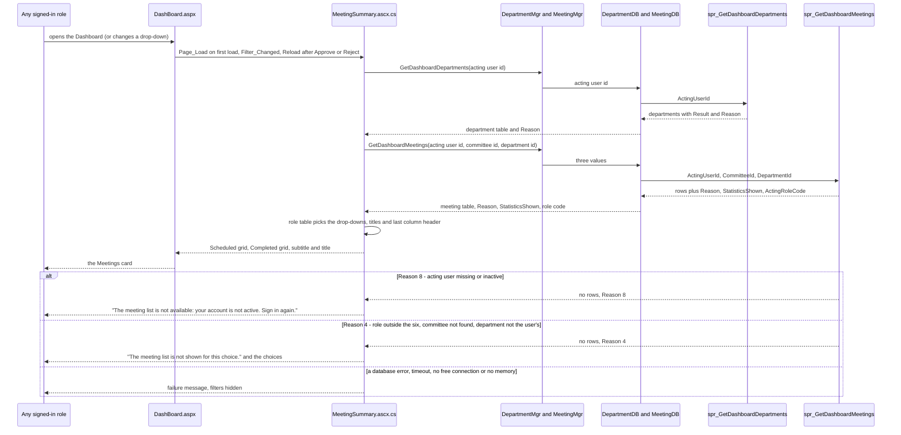

# Program to Program: Dashboard and Alerts

- Title: Program to Program: Dashboard and Alerts
- Audience: Developers and installers (internal)
- Shipped: No
- Applies to: UN6b (step 42): the Meetings card; the rest not written yet
- Last updated by: UN6b, based on 0736c7f
- Status: Draft
- Verified against: for the Meetings card (step UN6b): BMMS/UserControl/MeetingSummary.ascx, .ascx.cs, BMMS/DashBoard/DashBoard.aspx
  (card titles, grid headings), DashBoard.aspx.cs (diff: MeetingSummary1.Reload after Approve and Reject, FormatDate,
  FormatTimeOfDay, AlertDetails), BMMSBAL/MeetingMgr.cs and DepartmentMgr.cs (diff), BMMSDAL/MeetingDB.cs and
  DepartmentDB.cs (diff), Database/BMMS-Fix-DashboardMeetings-Step42.sql (all five objects),
  BMMS-Rollback-DashboardMeetings-Step42.sql, BMMS-Test-DashboardMeetings-Step42.sql (header), Database/README.md
  (section Step UN6b), the owner's test result as given for the step (71 of 71, not re-run)
- To confirm: feature area not written yet except the Meetings card (WF2c3): the Alerts card, the Action Items card, the
  panels and the approval flow of the Dashboard are still to be drawn; the BMMSBAL and BMMSDAL methods of the
  Alerts card were not read for this file

## Scope

This file covers the flow of the Dashboard's Meetings card (step UN6b): how the page asks the database for the
meeting list and the department list, what the procedures decide, and what happens when they refuse. The card
shows the Scheduled and the Completed (last 10) meetings with a status label and, for four roles, four counts
(Items, Approved, Rejected and Pending or In progress). Everything is read only: the card writes nothing.

[[CONFIRM: the Alerts card, the Action Items card, the Agenda Alert and Action Item Details panels and the Approve
and Reject flow of the Dashboard are not written yet (WF2c3)]]

## Programs involved

| Program | Kind | Part in the flow |
|---|---|---|
| DashBoard/DashBoard.aspx(.cs) | Page | Hosts the user control; after a successful Approve or Reject it calls `MeetingSummary1.Reload()` |
| UserControl/MeetingSummary.ascx(.cs) | User control | Reads the acting user id from `Session["UserId"]`, calls the two BAL methods, builds the filters, titles, columns and messages from the answers |
| CommitteeMgr.GetCommitteeList(1) | BAL | The active committees for the Committee drop-down |
| DepartmentMgr.GetDashboardDepartments, DepartmentDB.GetDashboardDepartments | BAL, DAL | Call spr_GetDashboardDepartments; return the table and the refusal Reason |
| MeetingMgr.GetDashboardMeetings, MeetingDB.GetDashboardMeetings | BAL, DAL | Call spr_GetDashboardMeetings; return the table, the Reason, StatisticsShown and ActingRoleCode |
| spr_GetDashboardMeetings | Procedure | Reads role and departments of the acting user, checks the two filters, lists the meetings and counts the items |
| spr_GetDashboardDepartments | Procedure | Lists the departments of a Manager or a User |
| fn_MeetingDashboardState, fn_UserDepartmentScope, fn_AgendaStatusGroup | Inline table functions | The one definition of the status colour, of a user's departments and of the item groups |

## Main flow

| From | To | Data | Notes |
|---|---|---|---|
| Role (any) | DashBoard.aspx | Opens the page, or picks a committee or department | The two drop-downs post back on every change |
| DashBoard.aspx | MeetingSummary | Page_Load on the first load; Reload() after Approve or Reject | Reload() is called after the approval is saved and the mail result is shown |
| MeetingSummary | DepartmentMgr.GetDashboardDepartments | Acting user id | Read again on every load; Reason 4 for the roles that have no department list is not an error here, the list is simply not used |
| DepartmentMgr / DepartmentDB | spr_GetDashboardDepartments | @ActingUserId | OUTPUT @Result and @Reason are turned into one Reason number |
| spr_GetDashboardDepartments | DepartmentDB | DepartmentId, DepartmentName, IsHome | Home department first, then by name; only for Manager and User |
| MeetingSummary | MeetingMgr.GetDashboardMeetings | Acting user id, committee id (0 = all), department id (0 = all of the user's) | A chosen department that is no longer in the user's list falls back to 0 before the call |
| MeetingMgr / MeetingDB | spr_GetDashboardMeetings | @ActingUserId, @CommitteeId, @DepartmentId | Four OUTPUT values |
| spr_GetDashboardMeetings | MeetingDB | Rows with MeetingId, CommitteeName, MeetingNo, MeetingDate, MeetingTime, AgendaSubmissionDate, ListCode, StateCode, StateLabel, Items, Approved, Rejected, Pending; @Reason, @StatisticsShown, @ActingRoleCode | ListCode S or C; the counts are NULL when the statistics are not shown |
| MeetingDB | MeetingSummary | Table, Reason, StatisticsShown, ActingRoleCode | StatisticsShown is true only when the Reason is 0 and the procedure said 1 |
| MeetingSummary | DashBoard.aspx (the card) | The two grids, the subtitle, the card title, the messages | The role code from the procedure picks the view in the role table, not the session role |
| spr_GetDashboardMeetings | MeetingSummary | Reason 8 | Refusal: acting user missing, 0 or inactive |
| spr_GetDashboardMeetings | MeetingSummary | Reason 4 | Refusal: a role outside admin, controller, manager, user, mgmt, md_sect; a committee that does not exist; a department that is not one of a Manager's or a User's, or any department for another role |

## Refusal paths

| Reason | Raised by | Meaning | Message the card shows |
|---|---|---|---|
| 8 | spr_GetDashboardMeetings, spr_GetDashboardDepartments | The acting user is missing, 0 or not active | "The meeting list is not available: your account is not active. Sign in again." |
| 4 | spr_GetDashboardMeetings | Role outside the six; committee id that does not exist (or below 0); department id for a role other than Manager and User, not one of the user's departments, or below 0 | "The meeting list is not shown for this choice." followed by the filters that are shown: "Choose All committees or All my departments." (both filters), "Choose All committees." (committee only), "Choose All my departments." (department only), or with no filter shown "The meeting list is not shown for your role." (this last text replaces the first sentence) |
| 4 | spr_GetDashboardDepartments | The role is not Manager or User | None: the page does not use the list, the Committee drop-down and the titles follow the role table |
| (none) | The page | A database error (written to the error log), or SqlException -2, 8645 or 701, no free connection in the pool in time, or an OutOfMemoryException on the web server | "The meeting list could not be loaded. Reload the page to try again." For the timeout and memory cases: "The server is busy and the meeting list could not be loaded. Wait a moment, then reload the page." After any failure no filter, no subtitle and the title "Meetings" are shown; the alerts still load |
| (none) | The page | Session["UserId"] missing or not a number | The Reason 8 text, no filters |

A refused call returns the same columns with no rows. The role code of an active user is returned even when a
filter is refused, so the page can word its message by the role.

## Where each rule lives

| Rule | C# | Procedure or function |
|---|---|---|
| Who may call, and which role gets which statistics (Controller, Management, Manager, User: yes; MD Secretariat, Admin: no) | MeetingSummary.ascx.cs reads StatisticsShown from the answer | spr_GetDashboardMeetings (role read from Users and Roles for an active user; @StatisticsShown) |
| Scheduled means the meeting date is today or later, or there is no date (today is the database server's date) | none | fn_MeetingDashboardState (IsScheduled) |
| Status colour and label, the first rule that fits: grey (minutes F or C), red (date before today), green (agenda not Open), orange (submission date before today), blue | MeetingSummary.StateCssClass turns the colour name into the chip class | fn_MeetingDashboardState (StateCode, StateLabel) |
| A user's departments: open User_Department rows and the home department | none | fn_UserDepartmentScope |
| The groups: approved ACA, rejected AMR and ACR, in progress AC and AMA, other (AF and any other code, counted in Items only) | none | fn_AgendaStatusGroup |
| Every scheduled meeting, no cap; the last 10 completed meetings, newest first, for every role | Rows() splits the table by ListCode | spr_GetDashboardMeetings (TOP 10, ORDER BY date, time, id) |
| Manager and User: a completed meeting only with an item of their department(s); counts over those items | none | spr_GetDashboardMeetings (@Dept from fn_UserDepartmentScope) |
| Filters checked against the user's scope | Department fallback to 0 when no longer listed (LoadMeetings) | spr_GetDashboardMeetings (Reason 4) |
| What each role sees: Committee drop-down, Department drop-down (Manager with two or more departments), subtitle, card titles, last column header ("In progress" for the User, "Pending" for the others) | MeetingSummary.ascx.cs: RoleViews (one place), ShowTitles, BindCommittees, BindDepartments | spr_GetDashboardDepartments gives the departments |
| Counts follow an Approve or Reject | DashBoard.aspx.cs calls MeetingSummary1.Reload() after a successful approve and reject | none |
| Messages and the server-busy test | MeetingSummary.ascx.cs: the five message constants, IsServerBusy, ShowFailure | none |

## Tables read and written

Read only; the card writes nothing.

| Object | Reads |
|---|---|
| spr_GetDashboardMeetings | Users and Roles (the acting user's role), Committee, Meeting, Agenda, and User_Department and Users again through fn_UserDepartmentScope |
| spr_GetDashboardDepartments | Users, Roles, User_Department (through fn_UserDepartmentScope), Department |
| fn_MeetingDashboardState | Meeting |
| fn_UserDepartmentScope | User_Department, Users |
| fn_AgendaStatusGroup | Agenda |
| CommitteeMgr.GetCommitteeList(1) | The active committees for the drop-down (its own procedure, not read for this file) |

Measured on BMMS_Test on 2026-11-12 (17 meetings, 66 items, warm runs): 373 logical reads for the Controller, 405
for a Manager with one department, 613 for a Manager with two, 404 for a User, no physical reads, 7 to 33 ms
elapsed. The Agenda table has only its primary key, so the counts scan it once per listed meeting; an index is a
later step (UN6e; Database/README.md, "Known items for later steps").

## Drawn from

BMMS/UserControl/MeetingSummary.ascx and .ascx.cs; BMMS/DashBoard/DashBoard.aspx.cs (the two Reload calls);
BMMSBAL/MeetingMgr.cs (GetDashboardMeetings) and DepartmentMgr.cs (GetDashboardDepartments); BMMSDAL/MeetingDB.cs
(GetDashboardMeetings) and DepartmentDB.cs (GetDashboardDepartments); Database/BMMS-Fix-DashboardMeetings-Step42.sql
(fn_MeetingDashboardState, fn_UserDepartmentScope, fn_AgendaStatusGroup, spr_GetDashboardMeetings,
spr_GetDashboardDepartments); Database/BMMS-Test-DashboardMeetings-Step42.sql (header: what it checks);
Database/README.md (section Step UN6b).
