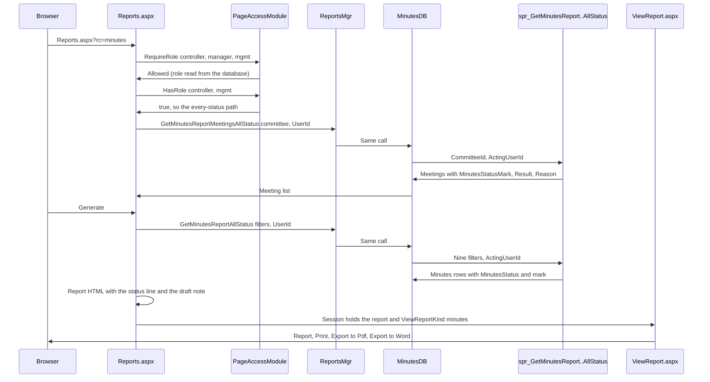
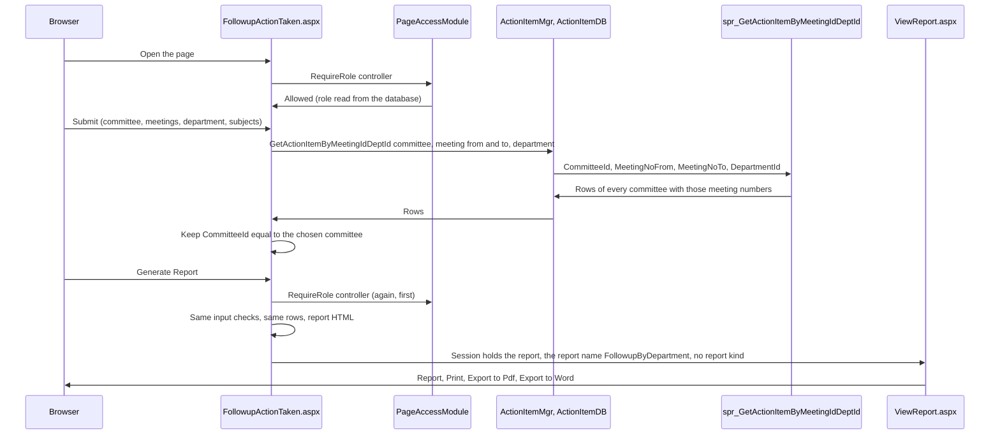

# Program to Program: Reports

- Title: Program to Program: Reports
- Audience: Developers and installers (internal)
- Shipped: No
- Applies to: RA1c2
- Last updated by: RA1c2, based on 1db6ac6
- Status: Draft
- Verified against: for step RA1c2: BMMS/Report/FollowupActionTaken.aspx(.cs) (git diff against 1db6ac6),
  BMMS/XML/PageAccess.xml, BMMS/UserControl/MenuUserControl.ascx, BMMSDAL/ActionItemDB.cs
  (GetActionItemByMeetingIdDeptId), Database/README.md (section Step RA1c2); for step RA1c1: BMMS/Report/ViewReport.aspx.cs (git diff against 4946500); and before:
  BMMS/Report/Reports.aspx.cs, Followup.aspx.cs, ViewReport.aspx.cs (diff of step RA1b),
  BMMS/PageAccessModule.cs (HasRole, RefuseRequest), BMMSBAL/ReportsMgr.cs, BMMSBAL/HTML_Report.cs,
  BMMSDAL/MinutesDB.cs and ActionItemDB.cs (the three calls), Database/BMMS-Fix-ReportAccess-Step41.sql,
  BMMS-Test-ReportAccess-Step41.sql (header), BMMS/XML/PageAccess.xml, Database/README.md (section RA1b)
- To confirm: why Export to Pdf cannot print Tamil or Hindi for Followup by Department (from the step
  requirement, not shown by the code read); the file covers only the flows changed in steps RA1b and RA1c2 (the Minutes report in every
  status, Management's Followup and Followup by Department); the other reports (agenda reports, Minutes Extract, the Controller's Followup,
  notices, sitting fees and so on) are not written yet (WF2c3); the tables the three procedures read are
  from the views named in their header (View_Minute, View_Meeting, View_Action_Item), not from the view
  texts

## Scope

The report pages that read minutes and follow-up data: Reports.aspx (rc=minutes) for the Controller,
the Manager and Management, and Followup.aspx (fc=followup, fc=summary) for the Controller and Management,
with ViewReport.aspx that shows, prints and exports what they built. Written for step RA1b (step 41). Step
RA1c2 adds Followup by Department (FollowupActionTaken.aspx, Controller only; see "Followup by Department").
[[CONFIRM: the other report pages are not written yet (WF2c3)]]

## Programs involved

| Program | Role in this flow |
|---|---|
| Report/Reports.aspx(.cs) | Meeting list, filters, grid, builds the report HTML for rc=minutes |
| Report/Followup.aspx(.cs) | Same for fc=followup and fc=summary |
| Report/FollowupActionTaken.aspx(.cs) | Followup by Department (RA1c2): grid and report HTML of one committee's follow-up items |
| Report/ViewReport.aspx(.cs) | Shows the stored report, Print, Export to Pdf, Export to Word |
| PageAccessModule | RequireRole, HasRole, RefuseRequest (role read from the database) |
| ReportsMgr, HTML_Report (BMMSBAL) | The three report calls, StatusMarkOf, refusal texts; MinutesStatusLine, DraftNote |
| MinutesDB, ActionItemDB (BMMSDAL) | The three procedure calls with the OUTPUT parameters |
| spr_GetMinutesReportMeetingsAllStatus, spr_GetMinutesReportAllStatus, spr_GetFollowupReportForManagement | Step 41, read only, check the acting user |

## Main flow

The Minutes report in every status (Controller and Management). A Manager or any other allowed role takes
the older path (spr_GetMinutesReportMeetings and spr_GetMinutesReport, finalised and confirmed only).

| From | To | Data | Notes |
|---|---|---|---|
| Browser | Reports.aspx | rc=minutes | Any other rc than minutes, minutes_extract, agenda_summary and agenda_details is refused |
| Reports.aspx | PageAccessModule | RequireRole and HasRole | Decided on every request, never from the address or ViewState |
| Reports.aspx | ReportsMgr, MinutesDB | CommitteeId, ActingUserId (the session's UserId) | The meeting list |
| MinutesDB | spr_GetMinutesReportMeetingsAllStatus | @CommitteeId, @ActingUserId | OUTPUT @Result and @Reason |
| spr_GetMinutesReportMeetingsAllStatus | Reports.aspx | Meetings with at least one minutes row, any status, with MinutesStatusMark | By MeetingNo |
| Reports.aspx | spr_GetMinutesReportAllStatus | Nine filters of the Minutes report, ActingUserId | No finalised or confirmed filter |
| Reports.aspx | ViewReport.aspx | Report HTML in the session, Session["ViewReportKind"] | The kind is cleared first and set after the report is stored |

Management's Followup: Followup.aspx (fc=followup or summary) calls RequireRole("controller", "mgmt"); for
Management (HasRole("mgmt")) it calls ReportsMgr.GetFollowupReportForManagement, which calls
spr_GetFollowupReportForManagement with the committee, meeting, department and confirm filters and the acting
user; the rows carry MinutesStatus and MinutesStatusMark. The Controller keeps ReportsMgr.GetFollowupReport,
a query built in the code, with no mark. The mark is printed as "Minutes status: [mark]" under each item
(Followup) or in a "Minutes status" column (Followup Summary), and a draft item gets the bordered draft note.

Drawn from: BMMS/Report/Reports.aspx.cs (Page_Load, GetReportMeetings, GetReportDetails, the HTML of the
minutes), BMMS/Report/Followup.aspx.cs (Page_Load, GetReportDetails and the two HTML builders),
BMMSBAL/ReportsMgr.cs, BMMSBAL/HTML_Report.cs, BMMSDAL/MinutesDB.cs, BMMSDAL/ActionItemDB.cs,
Database/BMMS-Fix-ReportAccess-Step41.sql (header).

## Followup by Department (step RA1c2)

Report/FollowupActionTaken.aspx, in the Controller's Reports menu after Followup Summary. The Controller
chooses a committee, a department (all or one), a meeting or a range of meetings and the subjects, then Submit
(View Format View shows the grid; Print shows Generate Report). The page keeps only the rows of the chosen
committee, because the procedure ignores its committee parameter and meeting numbers start again in every
committee.

| From | To | Data | Notes |
|---|---|---|---|
| Browser | FollowupActionTaken.aspx | Committee, Department, Meeting No (Particular or Between), Subject No. (All or Between), View Format | The Subject No lists offer the subjects of the same filtered rows |
| FollowupActionTaken.aspx | PageAccessModule | RequireRole("controller") | First in Page_Load and first in the Generate Report handler |
| FollowupActionTaken.aspx | spr_GetActionItemByMeetingIdDeptId | CommitteeId, MeetingNoFrom, MeetingNoTo, DepartmentId (-1 for all) | The procedure does not use CommitteeId; no database step |
| spr_GetActionItemByMeetingIdDeptId | FollowupActionTaken.aspx | Follow-up rows with CommitteeId | By meeting number and department only |
| FollowupActionTaken.aspx | ViewReport.aspx | Report HTML in the session, report name FollowupByDepartment | The report kind is removed first, so a kind left by an earlier report does not stay |

Report HTML: the table is written with border='1' (it was border='1px', which the PDF converter of the report
window rejected, so Export to Pdf printed its fallback sentence); the stray style block for printing was
removed. Export to Pdf cannot print Tamil or Hindi text; Export to Word and Print can.
[[CONFIRM: why Export to Pdf cannot print Tamil or Hindi for this report; taken from the step requirement, not shown by the code read]]

Drawn from: BMMS/Report/FollowupActionTaken.aspx.cs (Page_Load, btnCreatePDF_Click, GetCommitteeFollowupRows,
CreateReportHTML), BMMS/UserControl/MenuUserControl.ascx, BMMS/XML/PageAccess.xml, BMMSDAL/ActionItemDB.cs.

## Refusal paths

| Where | When | What happens |
|---|---|---|
| Reports.aspx Page_Load | rc missing or not one of the four codes | PageAccessModule.RefuseRequest("unknown report code"): DENIED-PAGE in the log, "Access denied" |
| Reports.aspx Page_Load | rc=minutes: role not controller, manager or mgmt; another rc: role not controller or manager | RequireRole refuses: "Access denied" |
| Followup.aspx Page_Load | fc not followup or summary; role not controller or mgmt | "Access denied" |
| Followup.aspx Page_Load | Session role mgmt but the database role could not be read | RefuseRequest("role could not be read for the Management path") |
| ViewReport.aspx Page_Load | Database or session role mgmt, and ViewReportKind missing, empty or not minutes, followup or summary, or ?pdf=1 | RefuseRequest("report kind not allowed for the role") |
| ViewReport.aspx Page_Load (after the check above) | No stored report: Session["ViewReport"] null or empty (opened by address, or the session ended), or the Export to Pdf or Export to Word postback with none | Not a refusal: HTTP 200, a page that says "The report is no longer available. Close this window and click Generate again.", no error-log entry, the request ends (step RA1c1). Page_Load answers first; the two export handlers check again |
| FollowupActionTaken.aspx Page_Load and Generate Report handler | Role in the database not controller (a Manager, for example) | RequireRole refuses: "Access denied" (RA1c2) |
| FollowupActionTaken.aspx Generate Report | The same input checks as Submit fail (committee, meeting or ranges), or no rows | The check message or the no-record message; no report is stored |
| spr_GetMinutesReportMeetingsAllStatus, spr_GetMinutesReportAllStatus | Reason 8: acting user missing, 0 or inactive | No rows; the page shows "Your session is no longer valid. Please log in again." |
| The same procedures | Reason 4: role not controller or mgmt | No rows; "You are not allowed to see this report." |
| spr_GetFollowupReportForManagement | Reason 8 as above; Reason 4: role not mgmt | No rows; the same two messages |

Empty meeting list on the every-status path: "No meetings with minutes for this committee."

## Where each rule lives

| Rule | C# | Procedure |
|---|---|---|
| Who may open each report page | PageAccess.xml; RequireRole in Reports.aspx.cs and Followup.aspx.cs; ViewReport.aspx.cs for Management | none |
| Message when no report is stored | ViewReport.aspx.cs (NoStoredReport, SendNoReportMessage; also in the two export handlers) | none |
| Every-status path for the Controller and Management | Reports.aspx.cs (allStatus from HasRole) | spr_GetMinutesReportMeetingsAllStatus, spr_GetMinutesReportAllStatus |
| Acting user check, Reasons 8 and 4 | ReportsMgr.ReportRefusedMessage turns them into text | The three step 41 procedures |
| The mark (F Finalised, C Confirmed, anything else Draft (not finalised)) | ReportsMgr.StatusMarkOf reads it | The three step 41 procedures |
| Status line and draft note | HTML_Report.MinutesStatusLine, DraftNote, IsDraftMark (one-cell table with border 1, because the PDF export draws a table border but not a div border) | none |
| Followup by Department: Controller only | PageAccess.xml; RequireRole in FollowupActionTaken.aspx.cs (Page_Load, Generate Report) | none |
| Followup by Department: only the chosen committee's rows | FollowupActionTaken.aspx.cs (GetCommitteeFollowupRows, a row filter on CommitteeId) | spr_GetActionItemByMeetingIdDeptId ignores @CommitteeId (baseline, not changed) |
| Manager and other roles: finalised and confirmed only | Reports.aspx.cs (older path) | spr_GetMinutesReport, spr_GetMinutesReportMeetings (step 22, unchanged) |

## Tables read and written

None written. Followup by Department reads View_Action_Item through spr_GetActionItemByMeetingIdDeptId (as
listed in chapter 04). The three procedures read the views View_Minute (minutes rows), View_Meeting (meetings) and
View_Action_Item (follow-up rows), and Users and Roles for the acting user's role. PageAccessModule reads
the user through UserMgr.GetUserDataTableByUserId (View_Users).

## Drawn from

BMMS/Report/Reports.aspx.cs, Followup.aspx.cs, ViewReport.aspx.cs, BMMS/PageAccessModule.cs,
BMMS/XML/PageAccess.xml, BMMSBAL/ReportsMgr.cs, BMMSBAL/HTML_Report.cs, BMMSDAL/MinutesDB.cs,
BMMSDAL/ActionItemDB.cs, Database/BMMS-Fix-ReportAccess-Step41.sql (header and first procedure),
Database/BMMS-Test-ReportAccess-Step41.sql (header), Database/README.md (section RA1b).
