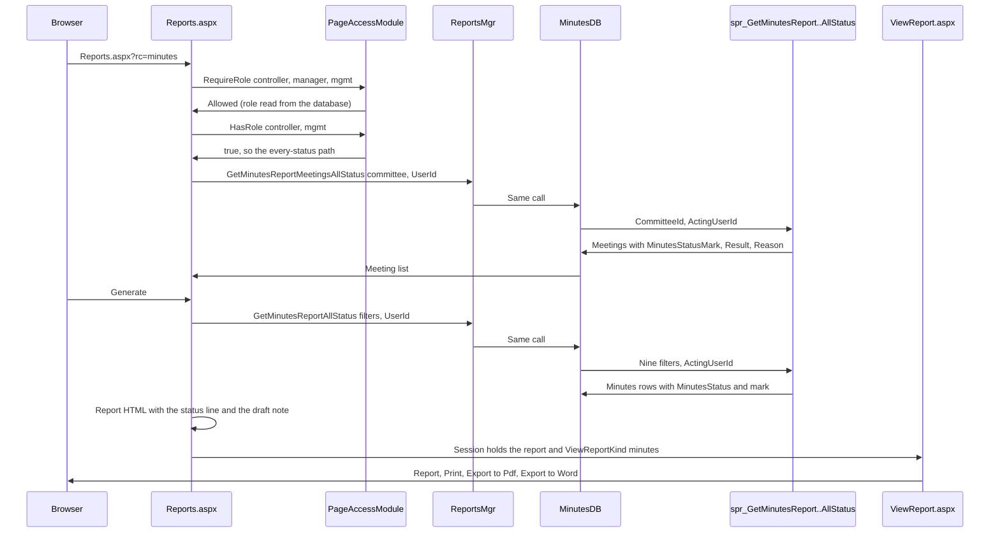
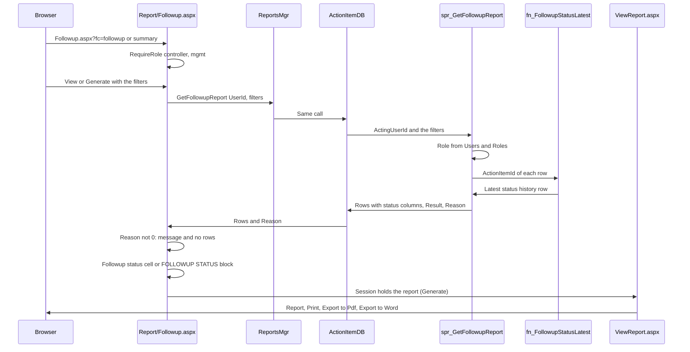
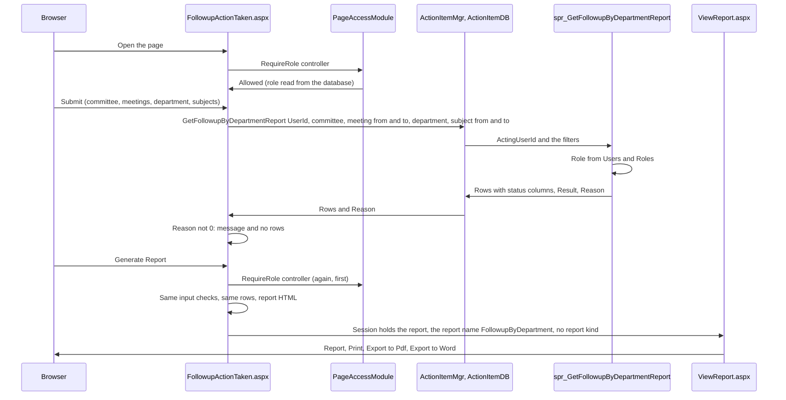

# Program to Program: Reports

- Title: Program to Program: Reports
- Audience: Developers and installers (internal)
- Shipped: No
- Applies to: FU2b (Followup and Followup Summary, Followup by Department: the procedures with the acting user and the Followup status; "Programs involved", the Management paragraph, "Followup by Department", "Refusal paths", "Where each rule lives", "Tables read and written"); UN6d (one pointer in "Scope" only); RA1c2
- Last updated by: FU2b, based on c4300b5
- Status: Draft
- Verified against: for step FU2b: BMMS/Report/Followup.aspx(.cs) and FollowupActionTaken.aspx(.cs) (diff against c4300b5), BMMS/FollowupStatusText.cs (Word, Line), BMMSBAL/ReportsMgr.cs, ActionItemMgr.cs, BMMSDAL/ActionItemDB.cs (diff), Database/BMMS-Fix-FollowupReports-Step49.sql (read in full for the three new objects and spr_ReopenFollowup), Database/README.md (section Step FU2b); for step UN6d: BMMS/Master/Followup.aspx.cs (it is the Master page, not Report/Followup.aspx), Database/README.md (section Step UN6d); for step RA1c2: BMMS/Report/FollowupActionTaken.aspx(.cs) (git diff against 1db6ac6),
  BMMS/XML/PageAccess.xml, BMMS/UserControl/MenuUserControl.ascx, BMMSDAL/ActionItemDB.cs
  (GetActionItemByMeetingIdDeptId), Database/README.md (section Step RA1c2); for step RA1c1: BMMS/Report/ViewReport.aspx.cs (git diff against 4946500); and before:
  BMMS/Report/Reports.aspx.cs, Followup.aspx.cs, ViewReport.aspx.cs (diff of step RA1b),
  BMMS/PageAccessModule.cs (HasRole, RefuseRequest), BMMSBAL/ReportsMgr.cs, BMMSBAL/HTML_Report.cs,
  BMMSDAL/MinutesDB.cs and ActionItemDB.cs (the three calls), Database/BMMS-Fix-ReportAccess-Step41.sql,
  BMMS-Test-ReportAccess-Step41.sql (header), BMMS/XML/PageAccess.xml, Database/README.md (section RA1b)
- To confirm: why Export to Pdf cannot print Tamil or Hindi for Followup by Department (from the step
  requirement, not shown by the code read); the file covers only the flows changed in steps RA1b and RA1c2 (the Minutes report in every
  status, Management's Followup and Followup by Department); the other reports (agenda reports, Minutes Extract, the Controller's Followup,
  notices, sitting fees and so on) are not written yet (WF2c3); the tables the three procedures read are
  from the views named in their header (View_Minute, View_Meeting, View_Action_Item), not from the view
  texts

## Scope

The report pages that read minutes and follow-up data: Reports.aspx (rc=minutes) for the Controller,
the Manager and Management, and Followup.aspx (fc=followup, fc=summary) for the Controller and Management,
with ViewReport.aspx that shows, prints and exports what they built. Written for step RA1b (step 41). Step
RA1c2 adds Followup by Department (FollowupActionTaken.aspx, Controller only; see "Followup by Department").
The Followup page of the Master menu (Master/Followup.aspx, where the Controller saves the action text and the
Confirmed ticks and the MD Secretariat reads) is not a report. It is described in 09-Dashboard-and-Alerts.md, section
"Action Item Details panel and the Followup page saves (step UN6d)", beside the other save of Action_Item.
[[CONFIRM: the other report pages are not written yet (WF2c3)]]

## Programs involved

| Program | Role in this flow |
|---|---|
| Report/Reports.aspx(.cs) | Meeting list, filters, grid, builds the report HTML for rc=minutes |
| Report/Followup.aspx(.cs) | Same for fc=followup and fc=summary |
| Report/FollowupActionTaken.aspx(.cs) | Followup by Department (RA1c2): grid and report HTML of one committee's follow-up items; since FU2b with the Followup status |
| FollowupStatusText (BMMS) | FU2b: Word and Line, the status texts of the Followup page, used by the two report pages |
| Report/ViewReport.aspx(.cs) | Shows the stored report, Print, Export to Pdf, Export to Word |
| PageAccessModule | RequireRole, HasRole, RefuseRequest (role read from the database) |
| ReportsMgr, HTML_Report (BMMSBAL) | The report calls, StatusMarkOf, refusal texts; MinutesStatusLine, DraftNote |
| ActionItemMgr (BMMSBAL) | FU2b: GetFollowupByDepartmentReport; IsBlankReopenReason (not a report) |
| MinutesDB, ActionItemDB (BMMSDAL) | The procedure calls with the OUTPUT parameters |
| spr_GetMinutesReportMeetingsAllStatus, spr_GetMinutesReportAllStatus | Step 41, read only, check the acting user |
| spr_GetFollowupReport, spr_GetFollowupByDepartmentReport, fn_FollowupStatusLatest | Step 49 (FU2b), read only, check the acting user; the function gives the latest status history row of an item |

## Main flow

The Minutes report in every status (Controller and Management). A Manager or any other allowed role takes
the older path (spr_GetMinutesReportMeetings and spr_GetMinutesReport, finalised and confirmed only).

| From | To | Data | Notes |
|---|---|---|---|
| Browser | Reports.aspx | rc=minutes | Any other rc than minutes, minutes_extract, agenda_summary and agenda_details is refused |
| Reports.aspx | PageAccessModule | RequireRole and HasRole | Decided on every request, never from the address or ViewState |
| Reports.aspx | ReportsMgr, MinutesDB | CommitteeId, ActingUserId (the session's UserId) | The meeting list |
| MinutesDB | spr_GetMinutesReportMeetingsAllStatus | @CommitteeId, @ActingUserId | OUTPUT @Result and @Reason |
| spr_GetMinutesReportMeetingsAllStatus | Reports.aspx | Meetings with at least one minutes row, any status, with MinutesStatusMark | By MeetingNo |
| Reports.aspx | spr_GetMinutesReportAllStatus | Nine filters of the Minutes report, ActingUserId | No finalised or confirmed filter |
| Reports.aspx | ViewReport.aspx | Report HTML in the session, Session["ViewReportKind"] | The kind is cleared first and set after the report is stored |

Followup and Followup Summary (step FU2b): Followup.aspx (fc=followup or summary) calls
RequireRole("controller", "mgmt"). For both roles it calls ReportsMgr.GetFollowupReport, which calls
spr_GetFollowupReport (step 49) with the acting user (the session's UserId), the committee, meeting, department
and confirm filters; the From and To meeting dates of the page are not used. The procedure reads the role of the
acting user in the database: Reason 8 (user missing, inactive or the system account) or Reason 4 (a role other than
Controller or Management), then no rows. The rows are those of View_Action_Item with the six status columns of the
latest status history row (fn_FollowupStatusLatest); for Management they also carry MinutesStatus and
MinutesStatusMark (NULL for the Controller). Before step 49 the Controller's rows came from a query built in
ReportsMgr and Management's from spr_GetFollowupReportForManagement (step 41); neither is called any more. The page
decides on the minutes status (column, "Minutes status: [mark]" under each item, the Summary column, the bordered
draft note) by the role read from the database (HasRole("mgmt")), not by the columns of the rows.

The Followup status comes from the status columns with FollowupStatusText: Word gives "Pending", "Confirmed" or
"Confirmed (before history)" (the Summary only "Pending" or "Confirmed"), Line gives the "Confirmed by ..." or
"Reopened by ...: [reason]" line. It is shown in the "Followup status" column of the View grid (word and line; the
Summary the word only), in a FOLLOWUP STATUS block after ACTION TAKEN in the generated Followup report, and in a
"Followup status" column of the printed Summary (the word only). Every text is HTML-encoded.

| From | To | Data | Notes |
|---|---|---|---|
| Followup.aspx | ReportsMgr, ActionItemDB | ActingUserId, CommitteeId, MeetingNoSearch, MeetingId, FromMeetingId, ToMeetingId, DepartmentId, ConfirmStatus | ConfirmStatus: -1 Both, 1 Confirmed, 0 Pending |
| ActionItemDB | spr_GetFollowupReport | The same, parameters only | OUTPUT @Result and @Reason; no SQL text is built in the code |
| spr_GetFollowupReport | fn_FollowupStatusLatest | ActionItemId | OUTER APPLY: an item with no history row has empty status columns |
| spr_GetFollowupReport | Followup.aspx | View_Action_Item columns, MinutesStatus, MinutesStatusMark, StatusAction, StatusReason, StatusOn, StatusByName, StatusByLogin, StatusByActive | Order: CommitteeId, MeetingId, DepartmentId, IsConfirmed, then AgendaNo, ActionItemId |
| Followup.aspx | ViewReport.aspx | Report HTML in the session | Unchanged; the report kind rules of RA1b still apply |

Drawn from: BMMS/Report/Reports.aspx.cs (Page_Load, GetReportMeetings, GetReportDetails, the HTML of the
minutes), BMMS/Report/Followup.aspx.cs (Page_Load, GetReportDetails, StatusCellHtml, StatusBlockHtml and the two HTML
builders), BMMS/FollowupStatusText.cs, Database/BMMS-Fix-FollowupReports-Step49.sql, BMMSBAL/ReportsMgr.cs, BMMSBAL/HTML_Report.cs, BMMSDAL/MinutesDB.cs, BMMSDAL/ActionItemDB.cs,
Database/BMMS-Fix-ReportAccess-Step41.sql (header).

## Followup by Department (steps RA1c2 and FU2b)

Report/FollowupActionTaken.aspx, in the Controller's Reports menu after Followup Summary. The Controller
chooses a committee, a department (all or one), a meeting or a range of meetings and the subjects, then Submit
(View Format View shows the grid; Print shows Generate Report). Since step FU2b the rows come from
spr_GetFollowupByDepartmentReport (step 49), which takes the acting user, the committee and the subject range
(two whole numbers, or none) itself; before, the page read spr_GetActionItemByMeetingIdDeptId, which ignores its
committee parameter, and filtered the committee and the subject range in two row filters on the page. The
procedure is for the Controller only: Management and every other role get Reason 4, a missing, inactive or system
account Reason 8; then no rows. Each row carries the six status columns, and the page shows the Followup status
(the word and the line, as on the Followup page) in a "Followup status" column of the View grid and under the
subject in the report's Subject cell.

| From | To | Data | Notes |
|---|---|---|---|
| Browser | FollowupActionTaken.aspx | Committee, Department, Meeting No (Particular or Between), Subject No. (All or Between), View Format | The Subject No lists offer the subjects of the same filtered rows |
| FollowupActionTaken.aspx | PageAccessModule | RequireRole("controller") | First in Page_Load and first in the Generate Report handler |
| FollowupActionTaken.aspx | spr_GetFollowupByDepartmentReport | ActingUserId, CommitteeId, MeetingNoFrom, MeetingNoTo, DepartmentId (-1 for all), SubjectNoFrom, SubjectNoTo (NULL: no range) | Step 49; the page parses both subject numbers as whole numbers; OUTPUT @Result and @Reason |
| spr_GetFollowupByDepartmentReport | FollowupActionTaken.aspx | Follow-up rows of that committee with the six status columns | ORDER BY SubjectNo, AgendaNo, ActionItemId |
| FollowupActionTaken.aspx | ViewReport.aspx | Report HTML in the session, report name FollowupByDepartment | The report kind is removed first, so a kind left by an earlier report does not stay |

Report HTML: the table is written with border='1' (it was border='1px', which the PDF converter of the report
window rejected, so Export to Pdf printed its fallback sentence); the stray style block for printing was
removed. Export to Pdf cannot print Tamil or Hindi text; Export to Word and Print can.
[[CONFIRM: why Export to Pdf cannot print Tamil or Hindi for this report; taken from the step requirement, not shown by the code read]]

Drawn from: BMMS/Report/FollowupActionTaken.aspx.cs (Page_Load, btnCreatePDF_Click, GetCommitteeFollowupRows,
GetFollowup, StatusCellHtml, CreateReportHTML), BMMS/UserControl/MenuUserControl.ascx, BMMS/XML/PageAccess.xml,
BMMSBAL/ActionItemMgr.cs, BMMSDAL/ActionItemDB.cs, Database/BMMS-Fix-FollowupReports-Step49.sql.

## Refusal paths

| Where | When | What happens |
|---|---|---|
| Reports.aspx Page_Load | rc missing or not one of the four codes | PageAccessModule.RefuseRequest("unknown report code"): DENIED-PAGE in the log, "Access denied" |
| Reports.aspx Page_Load | rc=minutes: role not controller, manager or mgmt; another rc: role not controller or manager | RequireRole refuses: "Access denied" |
| Followup.aspx Page_Load | fc not followup or summary; role not controller or mgmt | "Access denied" |
| Followup.aspx Page_Load | Session role mgmt but the database role could not be read | RefuseRequest("role could not be read for the Management path") |
| ViewReport.aspx Page_Load | Database or session role mgmt, and ViewReportKind missing, empty or not minutes, followup or summary, or ?pdf=1 | RefuseRequest("report kind not allowed for the role") |
| ViewReport.aspx Page_Load (after the check above) | No stored report: Session["ViewReport"] null or empty (opened by address, or the session ended), or the Export to Pdf or Export to Word postback with none | Not a refusal: HTTP 200, a page that says "The report is no longer available. Close this window and click Generate again.", no error-log entry, the request ends (step RA1c1). Page_Load answers first; the two export handlers check again |
| FollowupActionTaken.aspx Page_Load and Generate Report handler | Role in the database not controller (a Manager, for example) | RequireRole refuses: "Access denied" (RA1c2) |
| FollowupActionTaken.aspx Generate Report | The same input checks as Submit fail (committee, meeting or ranges), or no rows | The check message or the no-record message; no report is stored |
| spr_GetMinutesReportMeetingsAllStatus, spr_GetMinutesReportAllStatus | Reason 8: acting user missing, 0 or inactive | No rows; the page shows "Your session is no longer valid. Please log in again." |
| The same procedures | Reason 4: role not controller or mgmt | No rows; "You are not allowed to see this report." |
| spr_GetFollowupReport (Followup.aspx: View, Generate, Export) | Reason 8: acting user missing, 0, inactive or the system account; Reason 4: role not controller or mgmt | No rows, no grid; the same two messages (FU2b; before, only Management's path had them) |
| spr_GetFollowupByDepartmentReport (FollowupActionTaken.aspx: the grid, the subject lists, Generate Report, the check of Submit) | Reason 8 as above; Reason 4: every role but the Controller, Management included | No rows, no grid, the subject lists disabled; the same two messages (FU2b) |

Empty meeting list on the every-status path: "No meetings with minutes for this committee."

## Where each rule lives

| Rule | C# | Procedure |
|---|---|---|
| Who may open each report page | PageAccess.xml; RequireRole in Reports.aspx.cs and Followup.aspx.cs; ViewReport.aspx.cs for Management | none |
| Message when no report is stored | ViewReport.aspx.cs (NoStoredReport, SendNoReportMessage; also in the two export handlers) | none |
| Every-status path for the Controller and Management | Reports.aspx.cs (allStatus from HasRole) | spr_GetMinutesReportMeetingsAllStatus, spr_GetMinutesReportAllStatus |
| Acting user check, Reasons 8 and 4 | ReportsMgr.ReportRefusedMessage turns them into text | The step 41 minutes procedures, spr_GetFollowupReport and spr_GetFollowupByDepartmentReport (step 49) |
| Followup and Followup Summary: the filters and the order | Followup.aspx.cs passes them; no SQL text is built in the code | spr_GetFollowupReport (ORDER BY CommitteeId, MeetingId, DepartmentId, IsConfirmed, AgendaNo, ActionItemId) |
| Followup status: the latest history row | none | fn_FollowupStatusLatest |
| Followup status: the words and lines | FollowupStatusText.Word and Line; Followup.aspx.cs (StatusCellHtml, StatusBlockHtml, the Summary column); FollowupActionTaken.aspx.cs | none |
| Minutes status on Followup and Followup Summary: by role | Followup.aspx.cs (forManagement from HasRole("mgmt")) | spr_GetFollowupReport fills MinutesStatus and MinutesStatusMark for Management only |
| The mark (F Finalised, C Confirmed, anything else Draft (not finalised)) | ReportsMgr.StatusMarkOf reads it | The three step 41 procedures |
| Status line and draft note | HTML_Report.MinutesStatusLine, DraftNote, IsDraftMark (one-cell table with border 1, because the PDF export draws a table border but not a div border) | none |
| Followup by Department: Controller only | PageAccess.xml; RequireRole in FollowupActionTaken.aspx.cs (Page_Load, Generate Report) | none |
| Followup by Department: Controller only, in the database too | as above | spr_GetFollowupByDepartmentReport (Reason 4 for every other role) |
| Followup by Department: the chosen committee's rows and the subject range | FollowupActionTaken.aspx.cs (GetFollowup parses the two numbers) | spr_GetFollowupByDepartmentReport (@CommitteeId, @SubjectNoFrom, @SubjectNoTo); the two row filters of the page are gone |
| Manager and other roles: finalised and confirmed only | Reports.aspx.cs (older path) | spr_GetMinutesReport, spr_GetMinutesReportMeetings (step 22, unchanged) |

## Tables read and written

None written. Since step 49, Followup, Followup Summary and Followup by Department read View_Action_Item, Meeting
(Followup, for the minutes status), Action_Item_Status_History and Users (the user who acted) through
fn_FollowupStatusLatest, and Users and Roles for the acting user's role; they write nothing. The three step 41
procedures read the views View_Minute (minutes rows), View_Meeting (meetings) and
View_Action_Item (follow-up rows), and Users and Roles for the acting user's role. PageAccessModule reads
the user through UserMgr.GetUserDataTableByUserId (View_Users).

## Drawn from

BMMS/Report/Reports.aspx.cs, Followup.aspx.cs, ViewReport.aspx.cs, BMMS/PageAccessModule.cs,
BMMS/XML/PageAccess.xml, BMMSBAL/ReportsMgr.cs, BMMSBAL/HTML_Report.cs, BMMSDAL/MinutesDB.cs,
BMMSDAL/ActionItemDB.cs, Database/BMMS-Fix-ReportAccess-Step41.sql (header and first procedure),
Database/BMMS-Test-ReportAccess-Step41.sql (header), Database/README.md (section RA1b).
