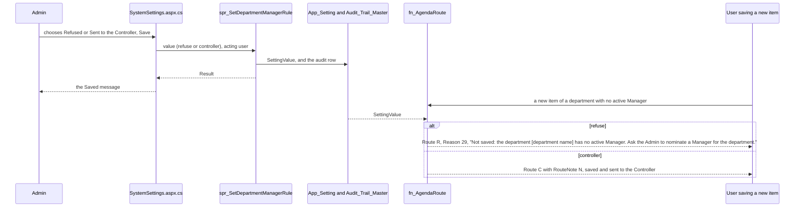

# Program to Program: System Settings

- Title: Program to Program: System Settings
- Audience: Developers and installers (internal)
- Shipped: No
- Applies to: GM1a (step 56: one paragraph under "Tables read and written"); UD1b (step 53: the setting "Department without an active Manager" is read by the route of a new item); user-ud1a
- Commit: 32c619d
- Last updated by: GM1a, based on 32c619d (the one paragraph; the rest was last updated by UD1b, based on db1d641)
- Status: Draft
- Verified against: for GM1a: Database/README.md (section Step GM1a), Database/BMMS-Fix-GovernanceLog-Step56.sql (the Reason lines of spr_SetDepartmentManagerRule and spr_SetAppSetting); for UD1b: BMMS/Master/SystemSettings.aspx and .aspx.cs (the card, LoadDeptRule, btnSaveDeptRule_Click), BMMSBAL/Utilities.cs (DeptNoManagerAction), Database/BMMS-Fix-DepartmentApprovers-Step53.sql (fn_AgendaRoute), Database/README.md (section Step UD1b)
- To confirm: feature area written only for the setting DeptNoManagerAction (WF2c3); the other settings of the page (the agenda lock option, the organisation details) are not written yet

## Scope

This file covers the setting DeptNoManagerAction, shown on the System Settings page as the card "Department without an active
Manager". Until step 52 it was only stored. Since step UD1b (database step 53) fn_AgendaRoute reads it when a User saves a new
agenda item whose department has no active Manager: Refused (the default) or Sent to the Controller.

[[CONFIRM: the other settings of the page are not written yet (WF2c3)]]

## Programs involved

| Program | Kind | Part in the flow |
|---|---|---|
| Master/SystemSettings.aspx(.cs) | Page | The card with the choices "Refused (default)" and "Sent to the Controller"; `LoadDeptRule`, `btnSaveDeptRule_Click` |
| Utilities.GetAppSetting, Utilities.SetDepartmentManagerRule | BAL | Read and save the setting |
| spr_SetDepartmentManagerRule | Procedure | Saves the value (Admin only) and writes the audit row |
| fn_AgendaRoute | Inline table function | Reads the value when the department has no active Manager |
| spr_AddEditAgenda, spr_GetAgendaCreationMailId | Procedures | Read the route; refuse with Reason 29 or save with RouteNote 'N' |

## Main flow

| From | To | Data | Notes |
|---|---|---|---|
| Admin | SystemSettings.aspx | The choice and Save | The card text: "Used when a new agenda item's department has no active Manager. A change is written to the audit trail." |
| SystemSettings.aspx | spr_SetDepartmentManagerRule | The value, the acting user | Only the two values are sent; anything else is refused (Reason 3) |
| spr_SetDepartmentManagerRule | App_Setting, Audit_Trail_Master | The value, the audit row | |
| SystemSettings.aspx | Admin | The Saved message | "Saved: when a department has no active Manager, a new agenda item will be sent to the Controller. The setting is now in use." or "Saved: when a department has no active Manager, a new agenda item will be refused. The setting is now in use." |
| App_Setting | fn_AgendaRoute | DeptNoManagerAction | Any value other than 'controller' reads as 'refuse'; read only when the Reporting Person is not an active Controller and the department has no active Manager other than the creator |
| fn_AgendaRoute | the new item | Route R (refuse) or C with RouteNote 'N' | R: Reason 29; C: the save message and the Created mail add "Sent to the Controller: the department had no active Manager." |

## Refusal paths

| Reason | Raised by | Meaning | Message the page shows |
|---|---|---|---|
| 29 | spr_AddEditAgenda | A new item of a User whose department has no active Manager, with the setting on Refused | "Not saved: the department [department name] has no active Manager. Ask the Admin to nominate a Manager for the department." (on Agenda Entry) |
| 4, 8 | spr_SetDepartmentManagerRule | Only an Admin may save; an invalid acting user | "Not saved: only an Admin can change system settings." / the acting-user message (SystemSettings.aspx.cs) |

## Where each rule lives

| Rule | C# | Procedure or function |
|---|---|---|
| The two values and the default refuse | `LoadDeptRule`, `btnSaveDeptRule_Click` | spr_SetDepartmentManagerRule; fn_AgendaRoute |
| What each value does to a new item | `CheckNewItemRoute` (Agenda.aspx.cs) | fn_AgendaRoute, spr_AddEditAgenda |
| The card text | SystemSettings.aspx | none |

## Tables read and written

| Object | Reads | Writes |
|---|---|---|
| spr_SetDepartmentManagerRule | App_Setting (the acting-user check is not described here) | App_Setting, Audit_Trail_Master |
| fn_AgendaRoute | App_Setting, Users, Roles, Department, and fn_DepartmentManagers | none |

Since step GM1a (database step 56) spr_SetDepartmentManagerRule, like spr_SetAppSetting, also writes one row of change type ST (setting
changed) into Governance_Change_Log when the value changed, in the same transaction; a save that changes nothing writes no row. The
row is read on the Governance Matrix page (Data-Flow/03-Program-to-Program/15-Governance-Matrix.md). The System Settings page, its messages
and the audit row are unchanged.

## Drawn from

BMMS/Master/SystemSettings.aspx (the card) and .aspx.cs (LoadDeptRule, btnSaveDeptRule_Click), BMMSBAL/Utilities.cs,
Database/BMMS-Fix-DepartmentApprovers-Step53.sql (fn_AgendaRoute), Database/README.md (section Step UD1b).

