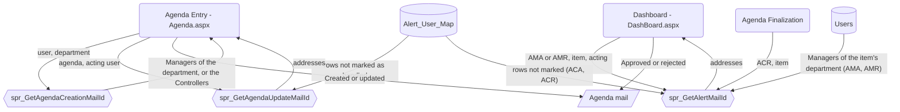

# Program to Program: Mail Sending

- Title: Program to Program: Mail Sending
- Audience: Developers and installers (internal)
- Shipped: No
- Applies to: UD1b (step 53: the recipients of the agenda mails); user-ud1a
- Commit: db1d641
- Last updated by: UD1b, based on db1d641
- Status: Draft
- Verified against: for UD1b: BMMS/Master/Agenda.aspx.cs (GenerateMail, GenerateUpdateMail), BMMS/DashBoard/DashBoard.aspx.cs (the mail after Result 1), BMMS/Master/AgendaFinalization.aspx.cs (the call of AlertMgr.GetAlertMailId), Database/BMMS-Fix-DepartmentApprovers-Step53.sql (spr_GetAlertMailId, spr_GetAgendaUpdateMailId, spr_GetAgendaCreationMailId read in full), Database/README.md (section Step UD1b)
- To confirm: feature area written only for the recipients of the agenda mails since step UD1b (WF2c3); the mail server settings, the Mail_Mgr send, the mail log and the other mails are not written yet

## Scope

This file covers who gets which agenda mail since step UD1b (database step 53). The mail texts do not change, except that the
"has been Created" mail of a User's item sent to the Controller adds the line "Sent to the Controller: the department had no
active Manager." The Admin role is in no recipient list.

[[CONFIRM: the sending itself (Mail_Mgr, the SMTP settings, the log) and the other mails are not written yet (WF2c3)]]

## Programs involved

| Program | Kind | Part in the flow |
|---|---|---|
| Master/Agenda.aspx(.cs) | Page | The Created mail (`GenerateMail`) and the update mail (`GenerateUpdateMail`) |
| DashBoard/DashBoard.aspx(.cs) | Page | The mail of an approval or rejection by a Manager or the Controller, after Result 1 |
| Master/AgendaFinalization.aspx(.cs) | Page | The mail of a rejection at finalisation |
| AgendaMgr.GetAgendaCreationMailId, AgendaMgr.GetAgendaUpdateMailId, AlertMgr.GetAlertMailId | BAL | Read the recipients |
| spr_GetAgendaCreationMailId, spr_GetAgendaUpdateMailId, spr_GetAlertMailId | Procedures | The recipient lists |
| Mail_Mgr.SendWebEmail | BAL | Sends the mail |

## Main flow

| From | To | Data | Notes |
|---|---|---|---|
| Agenda.aspx | spr_GetAgendaCreationMailId | User id, department id | Route M: Bcc every active Manager of the department other than the creator; route C: the active Controllers; routes I and R: none (the item is refused) |
| Agenda.aspx | Agenda.aspx (GenerateMail) | The Bcc of a Manager's or the Controller's own item | The Reporting Person gets a Bcc, but not one of the Admin role |
| Alert_User_Map | spr_GetAgendaUpdateMailId | The rows of the item's alert except the acting user | Rows marked as handled are left out; Admin, system account, empty addresses and the types a role does not see are left out as before |
| DashBoard.aspx | spr_GetAlertMailId | Code AMA or AMR | AMA: the Controllers and the creator; AMR: the creator; both also every other active Manager of the item's department (the one who decided is left out) |
| AgendaFinalization.aspx, DashBoard.aspx | spr_GetAlertMailId | Code ACA or ACR | The users of the item's alert whose row is not marked as handled |
| the pages | Agenda mail | Subject, body, addresses | The body of the Created mail adds "Sent to the Controller: the department had no active Manager." when the item went to the Controller for that reason |

## Refusal paths

[[CONFIRM: not written yet (WF2c3)]]

## Where each rule lives

| Rule | C# | Procedure or function |
|---|---|---|
| Recipients of the Created mail | `GenerateMail` | spr_GetAgendaCreationMailId, fn_AgendaRoute, fn_DepartmentManagers |
| Recipients of the approval and rejection mails | `btnApprove_Click`, `btnReject_Click`, AgendaFinalization.aspx.cs `GenerateMail` | spr_GetAlertMailId |
| Recipients of the update mail | `GenerateUpdateMail` | spr_GetAgendaUpdateMailId |
| No mail for the Admin role; none for a handled Manager | none | the three procedures |

## Tables read and written

| Object | Reads | Writes |
|---|---|---|
| spr_GetAgendaCreationMailId | Users, Roles, Department, App_Setting, User_Department (through fn_AgendaRoute, fn_DepartmentManagers) | none |
| spr_GetAgendaUpdateMailId | Alert_Master, Alert_User_Map, Users, Roles | none |
| spr_GetAlertMailId | Users, Roles, Agenda, Alert_Master, Alert_User_Map, User_Department (through fn_DepartmentManagers) | none |

## Drawn from

BMMS/Master/Agenda.aspx.cs (GenerateMail, GenerateUpdateMail), BMMS/DashBoard/DashBoard.aspx.cs, BMMS/Master/AgendaFinalization.aspx.cs,
Database/BMMS-Fix-DepartmentApprovers-Step53.sql (spr_GetAgendaCreationMailId, spr_GetAgendaUpdateMailId, spr_GetAlertMailId), System-Manual/07-Mail,
Database/README.md (section Step UD1b).
