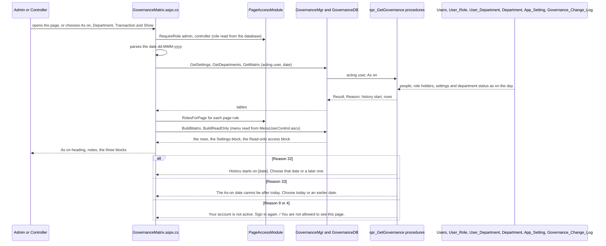
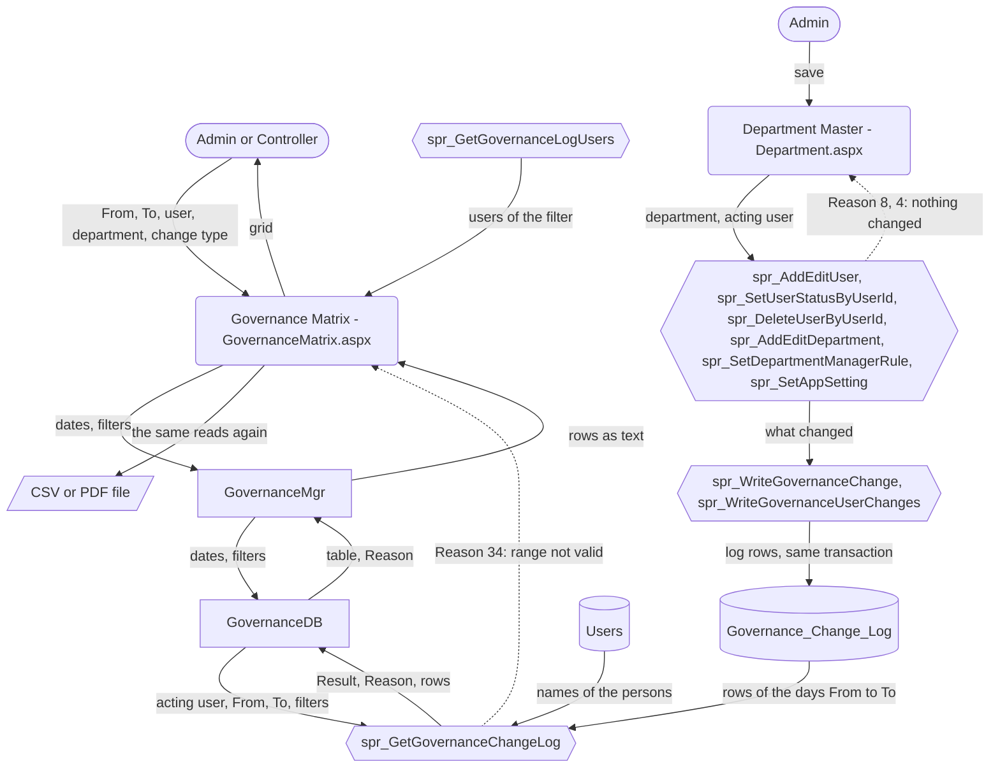

# Program to Program: Governance Matrix and change log

- Title: Program to Program: Governance Matrix and change log
- Audience: Developers and installers (internal)
- Shipped: No
- Applies to: GM1a (step 56: the page Report/GovernanceMatrix.aspx, the read procedures, the change log and the procedures that write it)
- Commit: 32c619d
- Last updated by: GM1a, based on 32c619d
- Status: Draft
- Verified against: BMMS/Report/GovernanceMatrix.aspx and .aspx.cs (read in full), BMMSBAL/GovernanceMgr.cs (read in full), BMMSDAL/GovernanceDB.cs (the method and procedure names), BMMS/PageAccessModule.cs (RolesForPage), BMMS/Master/Department.aspx.cs, BMMSBAL/DepartmentMgr.cs and BMMSDAL/DepartmentDB.cs (diff), Database/BMMS-Fix-GovernanceLog-Step56.sql (the table, fn_GovernanceRefusal and the five read procedures read; the log writers and the dated functions read at their comment blocks only), Database/README.md (section Step GM1a)
- To confirm: the rows the seven replaced procedures write into Governance_Change_Log are described from the comment blocks of the Fix script and Database/README.md, not from the full procedure texts; the tables each replaced procedure reads are not listed here (they are the ones it read before step 56)

## Scope

This file covers the Governance Matrix page (Admin menu and the Controller's Reports menu), its two views (Matrix and Change log), the
exports, and how the change log is written. The page is read only. The log is written by the procedures that change users,
departments and the two settings, in their own transaction, never by the page.

## Programs involved

| Program | Kind | Part in the flow |
|---|---|---|
| Report/GovernanceMatrix.aspx(.cs) | Page | The two views, the filters, the grids, Print, the CSV and PDF exports; `ReadMatrix`, `ReadLog`, `LoadLogFilters` |
| PageAccessModule.RequireRole, PageAccessModule.RolesForPage | Module | The page check (admin, controller) from the database; the roles PageAccess.xml allows for the page rules of the matrix |
| GovernanceMgr | BAL | `BuildMatrix`, `BuildReadOnly`, `ReadMenu`, the refusal texts, `Csv`, `HtmlTable` |
| GovernanceDB | DAL | `GetMatrix`, `GetSettings`, `GetDepartments` (dated reads), `GetChangeLog`, `GetLogUsers` |
| spr_GetGovernanceMatrix, spr_GetGovernanceSettings, spr_GetGovernanceDepartments, spr_GetGovernanceChangeLog, spr_GetGovernanceLogUsers | Procedures, read only | Check the acting user and the dates (fn_GovernanceRefusal) and return the rows |
| fn_GovernanceMatrixPeople, fn_GovernanceRoleHolders and the dated functions | Functions | The people of each rule and each role, today or as on an earlier day |
| spr_AddEditUser, spr_SetUserStatusByUserId, spr_DeleteUserByUserId, spr_AddEditDepartment, spr_SetDepartmentManagerRule, spr_SetAppSetting | Procedures | Write the log rows of what changed, inside their transaction |
| spr_WriteGovernanceChange, spr_WriteGovernanceUserChanges | Internal procedures | Write the rows; denied to public; refused at nesting level 1 |
| PDFUtilities.HtmlReportToPdf, OrganisationDetails.ReportBannerHtml | BAL | The PDF of either view |

## Main flow: reading the matrix

| From | To | Data | Notes |
|---|---|---|---|
| Admin or Controller | GovernanceMatrix.aspx | As on, Department, Transaction | The first visit starts from today, All departments, All transactions; the response is no-cache |
| GovernanceMatrix.aspx | PageAccessModule | The role | `RequireRole("admin", "controller")` is the first line of `Page_Load`; any other role gets "Access denied" |
| GovernanceMatrix.aspx | GovernanceDB, then the procedures | Acting user (`Session["UserId"]`), As on | A date that does not parse gives "Enter a valid date (dd-MMM-yyyy)." before any call |
| Procedures | GovernanceMatrix.aspx | Result, Reason, history start (Detail), rows | Kind P rows: the people of a rule (transaction, department, column E enters, A approves, C Controller, R route to the Controller, I refused); kind H rows: the people of every role |
| PageAccessModule | GovernanceMatrix.aspx | The roles of a page, from the cached PageAccess.xml | The rows of agenda finalisation, minutes update, finalisation and confirmation, Followup, meeting, committee, attendance, User Master, Department Master and System Settings |
| GovernanceMatrix.aspx | Admin or Controller | Heading, notes, Settings, Who enters and who approves, Read-only access | The notes of an earlier date are built by the page |

## Change log, exports and the writing of the log

| From | To | Data | Notes |
|---|---|---|---|
| Admin or Controller | GovernanceMatrix.aspx | From, To (default the last 30 days), User, Department, Change type | The filters are loaded on the first click of Change log (users from spr_GetGovernanceLogUsers, the departments of today) |
| GovernanceDB | spr_GetGovernanceChangeLog | Acting user, From, To, user id, department id, change type | Reason 34 when From or To is missing, From is after To, or To is after today: "Choose a From date that is not after the To date, and a To date that is not after today." |
| Governance_Change_Log, Users | spr_GetGovernanceChangeLog | The rows, newest first, with the name and login of ChangedBy | A deleted ChangedBy gives empty names, shown as "(user no longer exists)" |
| GovernanceMatrix.aspx | CSV or PDF file | The rows read again at the click | The CSV puts a ' before a cell that begins with = + - @, a tab or a carriage return; the PDF holds the banner and the same tables; file names GovernanceMatrix-yyyymmdd and GovernanceChangeLog-yyyymmdd-yyyymmdd |
| Department Master | spr_AddEditDepartment | Department, acting user (`Session["UserId"]`) | Reason 8 "Not saved: your account is not active. Sign in again. Nothing was changed."; Reason 4 "Not saved: only an Admin can change departments. Nothing was changed." |
| The six procedures | spr_WriteGovernanceChange, spr_WriteGovernanceUserChanges | The change: type, user or department or setting, old and new value | Only when something changed; a save that changes nothing writes no row |
| spr_WriteGovernance... | Governance_Change_Log | The row | Same transaction as the change; INSERT, UPDATE and DELETE are denied to public, so no other path writes it |

## Refusal paths

| Reason | Raised by | Meaning | Message the page shows |
|---|---|---|---|
| 8 | The five read procedures; spr_AddEditDepartment | Acting user missing, 0 or inactive | Governance Matrix: "Your account is not active. Sign in again."; Department Master: "Not saved: your account is not active. Sign in again. Nothing was changed." |
| 4 | The five read procedures; spr_AddEditDepartment | A role other than Admin and Controller (reads), other than Admin (department save) | "You are not allowed to see this page."; "Not saved: only an Admin can change departments. Nothing was changed." |
| 32 | The three dated reads | As on is before the history start | "History starts on [date]. Choose that date or a later one." |
| 33 | The three dated reads | As on is missing or after today | "The As-on date cannot be after today. Choose today or an earlier date." |
| 34 | spr_GetGovernanceChangeLog | The range is not valid | "Choose a From date that is not after the To date, and a To date that is not after today." |
| 6 | spr_DeleteUserByUserId | The user is ChangedBy of a log row | The delete message of Reason 6, group "user changes" (see chapter 04) |

A failure that is not a refusal is written to the error log and the page shows "The governance matrix could not be loaded. Reload the page
to try again." or "The change log could not be loaded. Reload the page to try again."

## Where each rule lives

| Rule | C# | Procedure or function |
|---|---|---|
| Only Admin and Controller open the page | PageAccess.xml; `RequireRole("admin", "controller")` | fn_GovernanceRefusal (again, by the acting user) |
| The history start and the date limits | The page parses the date; `GovernanceMgr.RefusalMessage` words the Reason | fn_GovernanceRefusal, fn_GovernanceHistoryStart |
| The people of each rule, today and as on a day | `GovernanceMgr.BuildMatrix` arranges them | fn_GovernanceMatrixPeople, fn_GovernanceRoleHolders and the dated functions |
| The rules that are page rules | `PageAccessModule.RolesForPage` and `BuildMatrix` | none |
| Read-only access block | `GovernanceMgr.ReadMenu`, `BuildReadOnly` (the menu file and the page rules) | none |
| The change types and their wording | `GovernanceMgr.ChangeTypeName`, `SourceName`, `SettingName` | The check constraint on ChangeType; spr_WriteGovernanceChange, spr_WriteGovernanceUserChanges |
| The log is written only by the procedures | none | DENY on the table; spr_Write... denied to public and refused at nesting level 1 |
| CSV cells starting with = + - @, a tab or a carriage return | `GovernanceMgr.CsvCell` | none |

## Tables read and written

| Object | Reads | Writes |
|---|---|---|
| spr_GetGovernanceMatrix | Through fn_GovernanceMatrixPeople and fn_GovernanceRoleHolders: Users, Roles, User_Role, User_Department, Department, Governance_Change_Log (earlier days), App_Setting | none |
| spr_GetGovernanceSettings | App_Setting (today), Governance_Change_Log through fn_SettingOn (earlier days), User_Role (history start) | none |
| spr_GetGovernanceDepartments | Department, Governance_Change_Log through fn_DepartmentActiveOn | none |
| spr_GetGovernanceChangeLog, spr_GetGovernanceLogUsers | Governance_Change_Log, Users | none |
| The six replaced procedures | The tables they read before step 56 | Their own tables as before, and Governance_Change_Log (with Audit_Trail_Master as before) |

## Drawn from

BMMS/Report/GovernanceMatrix.aspx and .aspx.cs, BMMSBAL/GovernanceMgr.cs, BMMSDAL/GovernanceDB.cs, BMMS/PageAccessModule.cs (RolesForPage),
BMMS/Master/Department.aspx.cs, BMMSBAL/DepartmentMgr.cs, BMMSDAL/DepartmentDB.cs, Database/BMMS-Fix-GovernanceLog-Step56.sql,
Database/BMMS-Test-GovernanceLog-Step56.sql (as described in Database/README.md, not read line by line), Database/README.md (section Step GM1a).
