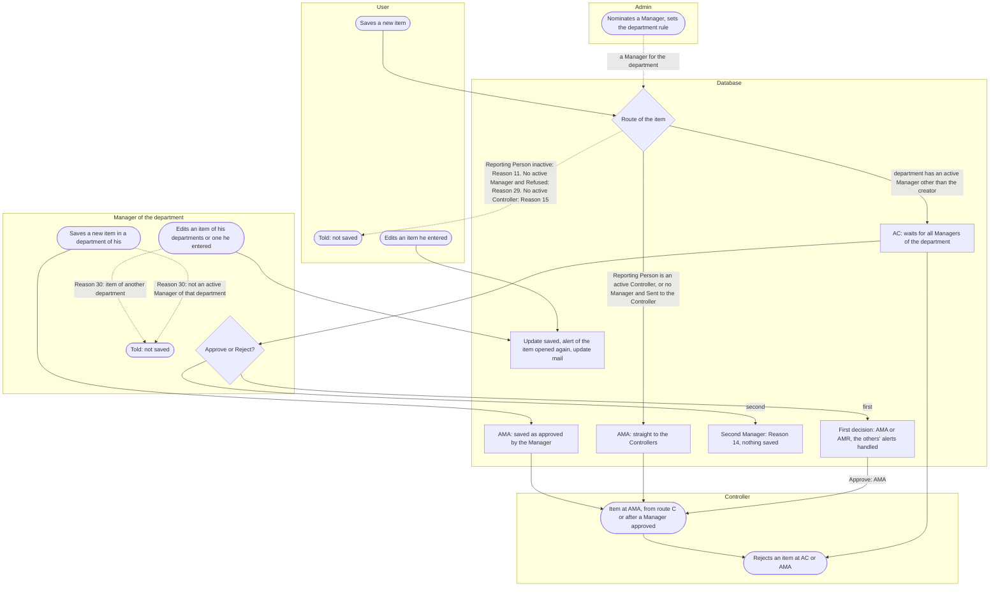
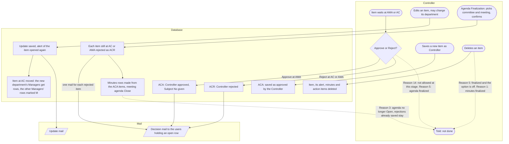

# Workflow: Agenda Life Cycle

- Title: Workflow: Agenda Life Cycle
- Audience: Developers and installers (internal)
- Shipped: No
- Applies to: WF2e1 (the whole life cycle: edit, delete, the Controller's decision, finalisation, the status codes, who is alerted and mailed; one decision row corrected and one added for the alerts of a Manager's new item); UD1c (step 54: one decision-points row, the department of a Manager's new item and his Update); UD1b (step 53: the route of a new item and the Manager's approval); user-ud1a
- Commit: 31c81ab
- Last updated by: WF2e1, based on 31c81ab
- Status: Draft
- Verified against: for WF2e1: catalog of BMMS_Test at step 57 (spr_AddEditAgenda, spr_AddEditAgendaByManager, spr_AddEditAgendaByController, spr_UpdateAgendaByAgendaId, spr_DeleteAgendaByAgendaId, spr_AgendaFinalizeByMeetingId, spr_CheckAgendaApprovedByMeetingId, spr_CheckAgendaByMeetingId, spr_CheckAgendaFinalizeByMeetingId, spr_GetAgendaApprovalState, spr_GetAgendaLockByMeetingId, spr_GenerateSubjectNoByMeetingId, spr_SetManagerAlertRows, spr_RerouteWaitingAgendas, spr_GetAlertMailId, spr_GetAgendaCreationMailId, spr_GetAgendaUpdateMailId, spr_GetActiveUserList, fn_AgendaRoute, fn_AgendaWaitingFor, fn_AgendaChangeRefusal, fn_AgendaStatusGroup, fn_DepartmentManagers, fn_DashboardAlerts, foreign-keys.txt), BMMS/Master/Agenda.aspx.cs (grvAgenda_RowCommand, btnSave_Click, CheckItemAccess, CheckNewItemRoute, GenerateMail, GenerateUpdateMail), BMMS/Master/AgendaFinalization.aspx.cs (btnFinalize_Click, RejectAgenda, GenerateMail, LoadAgenda), BMMS/DashBoard/DashBoard.aspx.cs (btnApprove_Click, btnReject_Click, GenerateMail), BMMSBAL/AgendaMgr.cs, BMMSBAL/MeetingMgr.cs (MeetingChangeReason, IsMeetingOpenForChange, IsAgendaOpen, GetMeetingsToActOn), BMMS/XML/PageAccess.xml, Database/BMMS-Fix-ResetDatabase-Seeds.sql (the Agenda_Status and Roles rows only), Database/BMMS-Fix-ManagerScope-Step54.sql (the alert insert of spr_AddEditAgendaByManager), Database/README.md (Step UD1c, owner answer 6); for UD1c: Database/BMMS-Fix-ManagerScope-Step54.sql (the comment block and the Reason 30 checks of spr_AddEditAgendaByManager), Database/README.md (section Step UD1c); for UD1b: Database/BMMS-Fix-DepartmentApprovers-Step53.sql (fn_AgendaRoute, fn_AgendaWaitingFor, the comment blocks of spr_AddEditAgenda and spr_UpdateAgendaByAgendaId), Database/README.md (section Step UD1b), System-Manual/04-Database (the routing and approval tables)
- To confirm: (1) the alert set of a Manager's new item differs from the UD1c/UD1b requirement; owner decision pending (WF2e1); (2) the Bcc of the "has been Created" mail of a Manager's or a Controller's new item is his Reporting Person only, not the alert set; whether that is intended (WF2e1); (3) the status AF is seeded but no procedure sets it (WF2e1); (4) the alert and mail procedures read the Controller role as RoleId 2; only the reset seed was read (WF2e1)

## Lanes

- User: saves a new item. The system routes it by the item's department, not by the user's Reporting Person alone. Edits an item
  he entered, until a Manager or the Controller has decided it.
- Manager (every active Manager of the item's department): approves or rejects an item that waits at AC, never his own. The
  first decision wins. Saves a new item in a department he is an active Manager of (it starts at AMA, approved by himself), and
  edits the items of his departments and the items he entered.
- Controller: receives the item straight from a User whose Reporting Person is an active Controller, or when the department has
  no active Manager and the setting says Sent to the Controller; decides at AMA (approve or reject); may reject at AC. Saves a
  new item (it starts at ACA), edits any item and may move it to another department, deletes items, and finalises the agenda of a
  meeting on Agenda Finalization (the page is open to the Controller only).
- Admin: nominates the Managers (User Master) and sets what happens to an item of a department without a Manager (System
  Settings, "Department without an active Manager"). Also sets the System Settings option "Controller can add, edit and delete
  agenda items after the agenda is finalized". The Admin role takes no part in an item and is never alerted or mailed about one.
- Database: decides the route, writes the alerts, locks the item at a decision, copies the approved items to the minutes at
  finalisation.

The pages check some rules that the procedures do not check again (who may open an item, that a User or Manager cannot edit an
item the Controller has decided, the meeting date for a Delete and a Dashboard decision). They are named in the decision points
below with "page only".

## Status codes of an agenda item

The code is Agenda.AgendaStatusCode and is copied to the alert type of the item's alert (Alert_Master.AlertTypeCode). The names are
the rows of Agenda_Status in the reset seed. The group is the one of fn_AgendaStatusGroup, used by the Dashboard statistics.

| Code | Name | Meaning | Set by | Group |
|---|---|---|---|---|
| AC | Agenda Creation | A new item that waits for every Manager of its department | spr_AddEditAgenda, Save, route M | in progress |
| AMA | Manager Approved | The item waits for the Controller | spr_UpdateAgendaByAgendaId when a Manager approves an item at AC; spr_AddEditAgendaByManager, Save (a Manager's own new item, saved as approved by him); spr_AddEditAgenda, Save, route C (a User's item that goes straight to the Controller: no Manager approved it, RouteNote 'N' when the department had no Manager); spr_RerouteWaitingAgendas (a one-time script, called by no page) | in progress |
| AMR | Manager Rejected | A Manager rejected the item at AC. No procedure moves it on | spr_UpdateAgendaByAgendaId, Manager Reject | rejected |
| ACA | Controller Approved | The Controller approved the item. It gets the next Subject No of the meeting and goes to the minutes at finalisation | spr_UpdateAgendaByAgendaId, Controller Approve at AMA; spr_AddEditAgendaByController, Save | approved |
| ACR | Controller Rejected | The Controller rejected the item at AC or AMA, or the item was rejected at finalisation. No procedure moves it on | spr_UpdateAgendaByAgendaId, Controller Reject | rejected |
| AF | Finalized | In Agenda_Status and as an alert type in the seed, but no procedure of the catalog sets it: finalising an agenda is Meeting.AgendaStatus 'Close', not an item status [[CONFIRM: whether AF is kept for later or can go (WF2e1)]] | none | other (as any other or empty code) |

Moves: AC to AMA or AMR (Manager) or ACR (Controller); AMA to ACA or ACR (Controller); a new item of a Manager starts at AMA, a new
item of the Controller at ACA. An Update never changes the status. AMA is shown as "Manager Approved" also when no Manager
approved the item (route C): the label belongs to the code.

## Workflow diagram 1: entry and the Manager's decision

| From | To | Data | Notes |
|---|---|---|---|
| User | Database | New item, department | Route read by fn_AgendaRoute |
| Database | User | Refusal Reason 11, 15 or 29 | Nothing is saved; no alert, no mail |
| Database | Manager | Alert row on route M | One unread row for every active Manager of the department except the creator |
| Manager | Database | Approve or Reject | At AC only; the meeting date and the open agenda are checked (step 52, M6a) |
| Database | Other Managers | Alert rows marked handled | See the Alerts workflow |
| Database | Controller | Alert on route C | The active Controllers get it |
| Database | Controller | Alert after a Manager approved | The active Controllers and the creator get a new row; after a Manager rejected only the creator gets one |
| Database | Manager | Second decision refused, Reason 14 | The first decision locks the item (the lock on the item is taken first) |
| Manager | Database | New item in a department | spr_AddEditAgendaByManager; status AMA, saved as approved by the Manager (who and when are recorded); the department must be an active department of which he is an active Manager |
| Database | Manager | Reason 30, nothing saved | Message: "Not saved: you are not a Manager of that department." Also for an Update of an item that is neither his own nor of one of his departments |
| User, Manager | Database | Update of an item | spr_AddEditAgenda, spr_AddEditAgendaByManager; the status, the department and the creator are not written; a Manager's Update stamps who and when only when the text of the Manager comment changes |
| Database | Users holding a row | Alert opened again, update mail | Only when a saved field changed; see "Who is alerted and who is mailed" |
| Controller | Database | Reject | At AC or AMA, as before |

Drawn from: catalog spr_AddEditAgenda, spr_AddEditAgendaByManager, spr_UpdateAgendaByAgendaId, spr_SetManagerAlertRows, fn_AgendaRoute,
fn_AgendaWaitingFor; BMMS/Master/Agenda.aspx.cs (grvAgenda_RowCommand, btnSave_Click, CheckItemAccess, CheckNewItemRoute);
Database/BMMS-Fix-DepartmentApprovers-Step53.sql and BMMS-Fix-ManagerScope-Step54.sql (comment blocks).

## Workflow diagram 2: the Controller, delete and finalisation

| From | To | Data | Notes |
|---|---|---|---|
| Controller | Database | Approve | spr_UpdateAgendaByAgendaId; only at AMA (a Controller's row in fn_AgendaWaitingFor has CanApprove at AMA only); the creator's own item included |
| Controller | Database | Reject | At AC or AMA; on the Dashboard the meeting date must not have passed (page only, message "The meeting date has passed, so this item can no longer be approved or rejected. It will be rejected when the agenda is finalized.") |
| Database | Controller | Reason 14 | Not allowed at this stage; the status name is in the message; an inactive user gets Reason 8, the system account Reason 12 |
| Database | Mail | Decision mail | Page sends it after the save; subject "Agenda ([number]) has been [approved or rejected] by Controller"; a mail failure does not undo the decision |
| Controller | Database | New item | spr_AddEditAgendaByController; status ACA, Subject No the next number of the approved items; after finalisation the Minutes row is made at once (decision type 3) |
| Controller | Database | Update | spr_AddEditAgendaByController; the only Update that writes the department; the Controller comment is stamped with who and when only when its text changes |
| Database | Database | Item at AC moved to another department | The Managers of the new department get rows (spr_SetManagerAlertRows), unmarked rows of other Managers are marked M by the Controller |
| Controller | Database | Delete | Page: Controller only (message "Only the Controller can delete agenda items. Nothing was deleted."), meeting date not passed (message "The meeting date has passed, so agenda items can no longer be edited or deleted."); procedure: spr_DeleteAgendaByAgendaId |
| Database | Database | Delete cascade | The alert (its user rows go with it), the action items and the Minutes row of the item, then the item; the Subject Nos of other items are not renumbered (the renumbering in the page is commented out) |
| Controller | Database | Finalize | Agenda Finalization lists the meetings whose agenda is still Open; the confirm text counts the approved items and the items to be rejected |
| Database | Controller | Each pending item rejected | The page saves one rejection (ControllerComments "Agenda rejected by Controller on agenda finalized.") for each item at AC or AMA, each with its mail, then calls spr_AgendaFinalizeByMeetingId |
| Database | Database | Finalize | Deletes the meeting's old minutes and their action items, makes a Minutes row for every item with ControllerApprovedStatus 'Approved' (decision type 3, Proposed Resolution as Actual Resolution), sets Meeting.AgendaStatus to 'Close'. No alert and no mail of its own |
| Database | Controller | Reason 3 or 4 | Agenda not Open (the status is in the detail) or meeting not found; rejections saved before stay saved, and the page says how many items could not be rejected and how many mails could not be sent |

Drawn from: catalog spr_UpdateAgendaByAgendaId, spr_AddEditAgendaByController, spr_DeleteAgendaByAgendaId,
spr_AgendaFinalizeByMeetingId, spr_CheckAgendaApprovedByMeetingId, spr_CheckAgendaByMeetingId, spr_CheckAgendaFinalizeByMeetingId,
spr_GetAgendaApprovalState, spr_GenerateSubjectNoByMeetingId, fn_AgendaWaitingFor, fn_AgendaChangeRefusal, foreign-keys.txt
(Alert_User_Map and Minutes cascade); BMMS/DashBoard/DashBoard.aspx.cs (btnApprove_Click, btnReject_Click, GenerateMail);
BMMS/Master/AgendaFinalization.aspx.cs; BMMS/Master/Agenda.aspx.cs (grvAgenda_RowCommand); BMMS/XML/PageAccess.xml.

## Who is alerted and who is mailed

"Alerted" means an Alert_User_Map row on the item's alert. "Mailed" is the Bcc of the mail the page sends after the save; the
person who saved is the To address of every agenda mail. In every case only active users are alerted and mailed, never the
protected system account and never a user of the Admin role (a user without an address is skipped in a mail). A mail failure never
undoes the save.

| Action | Alerted (rows written) | Mailed (Bcc) | Source |
|---|---|---|---|
| Save by a User, route M (the department has an active Manager other than the creator and the Reporting Person is not an active Controller) | Alert type AC. Every active Manager of the item's department, unread; the creator is left out; no Controller | The same Managers that have an address ("Agenda ([number]) has been Created"), the creator excluded | spr_AddEditAgenda, spr_SetManagerAlertRows, spr_GetAgendaCreationMailId |
| Save by a User, route C (the Reporting Person is an active Controller, or the department has no Manager and the setting says Sent to the Controller) | Alert type AMA. Every active Controller | The active Controllers with an address, the creator excluded; when the department had no Manager the mail and the page add "Sent to the Controller: the department had no active Manager." | spr_AddEditAgenda, spr_GetAgendaCreationMailId |
| Save by a User, route I or R, or route C with no active Controller | Nobody: Reason 11, 29 or 15, nothing saved | Nobody | spr_AddEditAgenda, Agenda.aspx.cs (CheckNewItemRoute) |
| Save by a Manager | Alert type AMA. The active Controllers (read as RoleId 2), the active users whose home department is the item's department, and every active Manager of the department (fn_DepartmentManagers); the creator is not left out [[CONFIRM: the alert set differs from the UD1c/UD1b requirement, owner decision pending (WF2e1)]] | His Reporting Person, when that person is active and not of the Admin role; nobody else, so the Controllers get the alert but no mail [[CONFIRM: whether a mail to the Controllers is meant (WF2e1)]] | spr_AddEditAgendaByManager, Agenda.aspx.cs (GenerateMail) |
| Save by the Controller | Alert type ACA. The active users whose home department is the item's department only (the Controllers and the department's Managers are not added) | His Reporting Person, when that person is active and not of the Admin role | spr_AddEditAgendaByController, Agenda.aspx.cs (GenerateMail) |
| Update, by any role | No new row. When a saved field changed: every unmarked row of the item's alert of an active user, except the acting user's, is set unread and shown again; rows marked handled (H, N, M) and rows of inactive users stay as they are | The users of those rows with an address, the acting user left out, "Agenda ([number]) has been Updated" with one line per changed field; Controllers are left out when the item is at ACA or ACR, Managers when it is at AMA or AMR; no mail when nothing changed or nobody is left | spr_AddEditAgenda, spr_AddEditAgendaByManager, spr_AddEditAgendaByController, spr_GetAgendaUpdateMailId, Agenda.aspx.cs (GenerateUpdateMail) |
| Update by the Controller that moves an item at AC to another department | As an Update, and: the unmarked rows of Managers who are not Managers of the new department are marked M (item moved), and every active Manager of the new department gets a row (a row marked N or M of his is opened again) | As the Update | spr_AddEditAgendaByController, spr_SetManagerAlertRows |
| Manager approves (AC to AMA) | The other Managers' rows (not the creator's) are marked H (another Manager decided) and read; every other unmarked row is set unread; new rows for the active Controllers (RoleId 2) and for the creator; the deciding Manager's row is marked read | The active Controllers (RoleId 2), the creator, and every active Manager of the item's department except the deciding Manager ("approved by Manager") | spr_UpdateAgendaByAgendaId, spr_GetAlertMailId (AMA) |
| Manager rejects (AC to AMR) | As an approval, but the only new row is the creator's; no row is added for a Controller | The creator and every active Manager of the item's department except the deciding Manager ("rejected by Manager"); no Controller | spr_UpdateAgendaByAgendaId, spr_GetAlertMailId (AMR) |
| Controller approves (AMA to ACA) or rejects (AC or AMA to ACR) | No new row for anyone but the creator: his row is deleted and written again, unread, while he is active and not of the Admin role; every unmarked row is set unread; the deciding Controller's row is marked read. So the users already holding an unmarked row (the Controllers, the department's users, the Managers not yet handled) are alerted again | Every user who holds an unmarked row on the item's alert, including the creator ("approved by Controller" or "rejected by Controller") | spr_UpdateAgendaByAgendaId, spr_GetAlertMailId (ACA, ACR) |
| Finalisation of the agenda | Each pending item (AC or AMA) is rejected as above, so as a Controller rejection. The finalisation itself writes no alert | One decision mail for each rejected item, subject "Agenda ([number]) has been rejected by Controller on agenda finalized", to the users of the unmarked rows; none for the approved items and none for the finalisation | AgendaFinalization.aspx.cs, spr_UpdateAgendaByAgendaId, spr_GetAlertMailId (ACR), spr_AgendaFinalizeByMeetingId |
| Delete | None: the item's alert and its rows are deleted | None | spr_DeleteAgendaByAgendaId |

What the Dashboard shows is narrower than the rows: a Controller does not see unmarked ACA and ACR rows, a Manager does not see
unmarked AMA and AMR rows, the Admin role sees none of the agenda types, and a row marked H, N or M is shown to its Manager whatever
the type is now (fn_DashboardAlerts). The rows are written all the same, and the mail sets above read the rows, not the Dashboard.
The Controller role is read as RoleId 2 in the alert insert of a Manager's new item, in a Manager's approval and in the AMA mail;
the reset seed gives the Controller RoleId 2 (Admin 1, Controller 2, Manager 3, User 4, Management 5)
[[CONFIRM: that RoleId 2 is the Controller in every installed database; only the reset seed was read (WF2e1)]].

## Decision points

| Decision | Who | Rule | Where it lives |
|---|---|---|---|
| Where a new item of a User starts | Database | In order: Reporting Person inactive: refused; Reporting Person an active Controller: AMA; department has an active Manager other than the creator: AC; otherwise the setting: refuse or AMA with RouteNote 'N' | fn_AgendaRoute, spr_AddEditAgenda |
| Where an item entered by a Manager or the Controller starts | Database | Manager: AMA, saved as approved by him; Controller: ACA, saved as approved by him; no route check | spr_AddEditAgendaByManager, spr_AddEditAgendaByController |
| In which department a Manager may enter a new item, and which items he may update (step 54) | Database | A new item only in an active department of which he is an active Manager, otherwise Reason 30, nothing saved; an Update only of an item he entered or of one of his departments (fn_ManagerDepartments) | fn_ManagerDepartments, spr_AddEditAgendaByManager |
| Who is alerted of a Manager's new item (step 54; corrected in WF2e1) | Database | The active Controllers (RoleId 2), the active users whose home department is the item's department, and every active Manager of the department (fn_DepartmentManagers); active, not the system account, never the Admin role; the creator is not left out. The row before said the alert goes to "the other active Managers": the insert does not leave the creator out. See the line below the table | spr_AddEditAgendaByManager (Save branch) |
| Who may approve or reject at AC | Database | Every active Manager of the item's department (role Manager, active, not the system account, an open department mapping, or, for a user with no department mapping rows at all, the home department), never the creator; the Reporting Person and the alert rows do not decide | fn_AgendaWaitingFor, fn_DepartmentManagers |
| Which decision stands | Database | The first; the item is locked, a second Manager gets Reason 14 | spr_UpdateAgendaByAgendaId |
| Whether a Manager may decide after the meeting date | Database | No (Reason 28, step 52). The procedure lets the Controller reject after the date, but the Dashboard page refuses an Approve or a Reject of every role after the meeting date (message above); the item is then rejected at finalisation. The row before said "the Controller's reject stays possible": that holds for the procedure, not for the Dashboard | spr_UpdateAgendaByAgendaId, DashBoard.aspx.cs (btnApprove_Click, btnReject_Click) |
| Who decides at AMA | Database | Only a Controller: approve (ACA) or reject (ACR). A Manager, a User or any other role gets Reason 14; the Controller may approve an item he entered | fn_AgendaWaitingFor, spr_UpdateAgendaByAgendaId |
| Whether the Controller may reject at AC | Database | Yes: reject only, not approve; the Manager's step is not skipped by an approval | fn_AgendaWaitingFor |
| What the Controller's approval changes | Database | Status ACA, ControllerApprovedStatus 'Approved', who and when; the page then gives the item the next Subject No of the meeting | spr_UpdateAgendaByAgendaId, spr_GenerateSubjectNoByMeetingId |
| What a Controller's move of an item at AC to another department does | Database | The new department's Managers get rows, the other Managers' rows become 'M'; a move back opens them | spr_AddEditAgendaByController, spr_SetManagerAlertRows |
| Who may open and update an item (page only for a User; checked again for a Manager) | Page, Database | The Controller every item; a Manager the items of his departments and the items he entered; every other role only the items it entered. A User or Manager cannot open an item the Controller has approved or rejected (message "This Agenda was [Approved or Rejected] by Controller", or "by Manager" when the Manager rejected it); a User cannot open an item a Manager has approved or rejected. spr_AddEditAgenda itself checks neither the owner nor the status | Agenda.aspx.cs (CheckItemAccess, grvAgenda_RowCommand), spr_AddEditAgendaByManager (Reason 30) |
| When an item can still be changed or deleted | Database | The agenda of the meeting must be Open (Reason 5 otherwise, for every role in a decision, an Update by a User or a Manager and a Save); the Controller may still add, edit and delete after finalisation when the System Settings option is on (default on); no change once the minutes are finalized or confirmed (Reason 1); the acting user must be active (Reason 8) | fn_AgendaChangeRefusal, spr_AddEditAgenda, spr_AddEditAgendaByManager, spr_AddEditAgendaByController, spr_DeleteAgendaByAgendaId |
| Whether the meeting date allows an edit or a delete | Page | Open until the end of the meeting date, closed from the next day, for every role; a meeting without a date stays open (message "The meeting date has passed, so agenda items can no longer be edited or deleted."); a new item is refused after the date as well. The procedures do not check the date | Agenda.aspx.cs, MeetingMgr.IsMeetingOpenForChange |
| Who may delete an item | Page, Database | The Controller only (page); the procedure applies the finalisation rule with the Controller's option | Agenda.aspx.cs (grvAgenda_RowCommand), spr_DeleteAgendaByAgendaId |
| Which items finalisation rejects | Page | Every item of the meeting at AC or AMA, from the list the page read when the meeting was chosen, not read again at the click: an item that reached AC or AMA after that stays unrejected when the agenda closes. A meeting without items is finalised with the message "Agenda Finalized (no agenda items)." | AgendaFinalization.aspx.cs (LoadAgenda, btnFinalize_Click), spr_CheckAgendaApprovedByMeetingId |
| Which items go to the minutes | Database | Every item with ControllerApprovedStatus 'Approved' (status ACA); items at AMR and ACR do not | spr_AgendaFinalizeByMeetingId |
| Who may finalise, and when | Page, Database | The Controller (Agenda Finalization is open to the Controller only); only a meeting whose agenda is Open, otherwise Reason 3 ("Agenda already finalized" on the page) | PageAccess.xml, AgendaFinalization.aspx.cs (PageValidation), spr_AgendaFinalizeByMeetingId |
| What a failed mail does | Page | Nothing is undone: the item, the decision or the rejection stays saved and the page says the mail could not be sent | Agenda.aspx.cs, DashBoard.aspx.cs, AgendaFinalization.aspx.cs |
| What happens to an item of a department that loses its last Manager | Database | Rule 12 stops the Manager from leaving while an item waits that no other Manager could decide; the Controller can still reject such items | fn_ManagerReleaseRefusal |

Differs from the UD1c/UD1b requirement: UD1c (owner answer 6) adds the other Managers of the department to the alert of a Manager's new item and UD1b leaves the creator out of the set of his own item, but the insert in spr_AddEditAgendaByManager gives a row to every active Manager of the department with the creator included, besides the Controllers and the home-department users; owner decision pending.

## Change record (WF2e1)

- Extended, not rewritten: the lanes, the diagram and the table of the UD1b version are kept; the diagram is now top-down and split
  in two, the edit, the delete, the Controller's decision and the finalisation are added, and so are the status table and the
  table of who is alerted and mailed. The five CONFIRM points about them (WF2c4) are closed.
- Corrected: the step 54 decision row said the new item's alert also goes to "the other active Managers"; the insert gives it to
  every active Manager of the department, the creator included, besides the Controllers and the home-department users.
- Corrected: the row on the meeting date said the Controller's reject stays possible; that holds for the procedure, but the
  Dashboard page refuses the Controller's Approve and Reject after the meeting date as well.
- Corrected: the row on who may approve at AC now also names a user with no department mapping rows (the home department counts).
- Notation: the refusal arrow of the first diagram is dashed, as 00-Notation.md says.

## Drawn from

Database/BMMS-Fix-DepartmentApprovers-Step53.sql (fn_AgendaRoute, fn_AgendaWaitingFor, fn_ManagerReleaseRefusal, the comment
blocks of spr_AddEditAgenda, spr_UpdateAgendaByAgendaId and spr_AddEditAgendaByController), Database/README.md (section Step UD1b),
System-Manual/04-Database (Agenda entry and routing, Approval); and, for WF2e1, the catalog procedures, pages and classes listed in
the header.
