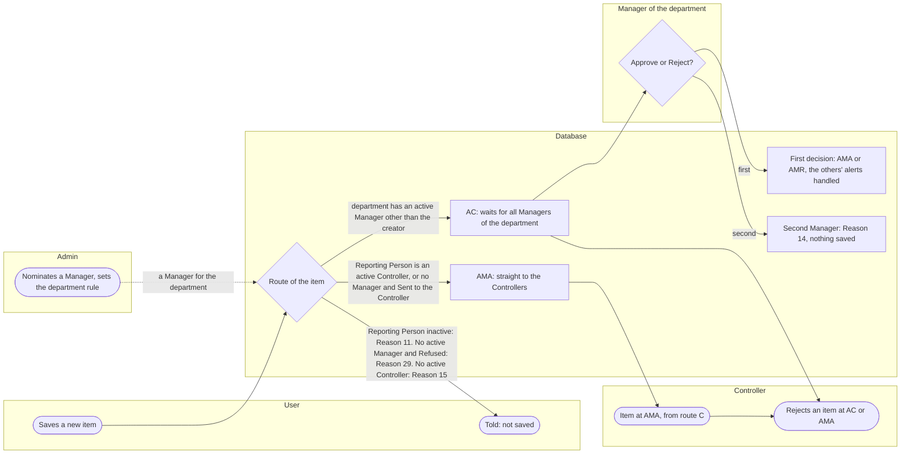

# Workflow: Agenda Life Cycle

- Title: Workflow: Agenda Life Cycle
- Audience: Developers and installers (internal)
- Shipped: No
- Applies to: UD1c (step 54: one decision-points row, the department of a Manager's new item and his Update); UD1b (step 53: the route of a new item and the Manager's approval); user-ud1a
- Commit: 42cb88c
- Last updated by: UD1c, based on 42cb88c
- Status: Draft
- Verified against: for UD1c: Database/BMMS-Fix-ManagerScope-Step54.sql (the comment block and the Reason 30 checks of spr_AddEditAgendaByManager), Database/README.md (section Step UD1c); for UD1b: Database/BMMS-Fix-DepartmentApprovers-Step53.sql (fn_AgendaRoute, fn_AgendaWaitingFor, the comment blocks of spr_AddEditAgenda and spr_UpdateAgendaByAgendaId), Database/README.md (section Step UD1b), System-Manual/04-Database (the routing and approval tables)
- To confirm: workflow written only as far as the route of a new item and the Manager's approval at AC (step UD1b); the edit, the delete, the Controller's approval at AMA and the finalisation are not drawn here yet (WF2c4)

## Lanes

- User: saves a new item. The system routes it by the item's department, not by the user's Reporting Person alone.
- Manager (every active Manager of the item's department): approves or rejects an item that waits at AC, never his own. The
  first decision wins.
- Controller: receives the item straight from a User whose Reporting Person is an active Controller, or when the department has
  no active Manager and the setting says Sent to the Controller; decides at AMA; may reject at AC or AMA.
- Admin: nominates the Managers (User Master) and sets what happens to an item of a department without a Manager (System
  Settings, "Department without an active Manager").
- Database: decides the route, writes the alerts, locks the item at a decision.

[[CONFIRM: the Controller's approval at AMA, the edit and delete of an item and the finalisation are not drawn yet (WF2c4)]]

## Workflow diagram

| From | To | Data | Notes |
|---|---|---|---|
| User | Database | New item, department | Route read by fn_AgendaRoute |
| Database | User | Refusal Reason 11, 15 or 29 | Nothing is saved; no alert, no mail |
| Database | Manager | Alert row on route M | One unread row for every active Manager of the department except the creator |
| Manager | Database | Approve or Reject | At AC only; the meeting date and the open agenda are checked (step 52, M6a) |
| Database | Other Managers | Alert rows marked handled | See the Alerts workflow |
| Database | Controller | Alert on route C | The active Controllers get it |
| Controller | Database | Reject | At AC or AMA, as before |

## Decision points

| Decision | Who | Rule | Where it lives |
|---|---|---|---|
| Where a new item of a User starts | Database | In order: Reporting Person inactive: refused; Reporting Person an active Controller: AMA; department has an active Manager other than the creator: AC; otherwise the setting: refuse or AMA with RouteNote 'N' | fn_AgendaRoute, spr_AddEditAgenda |
| Where an item entered by a Manager or the Controller starts | Database | Manager: AMA; Controller: ACA; no route check | spr_AddEditAgendaByManager, spr_AddEditAgendaByController |
| In which department a Manager may enter a new item, and which items he may update (step 54) | Database | A new item only in an active department of which he is an active Manager, otherwise Reason 30, nothing saved; an Update only of an item he entered or of one of his departments (fn_ManagerDepartments); the item's alert also goes to the other active Managers of its department | fn_ManagerDepartments, spr_AddEditAgendaByManager |
| Who may approve or reject at AC | Database | Every active Manager of the item's department (role Manager, active, not the system account, an open department mapping), never the creator; the Reporting Person and the alert rows do not decide | fn_AgendaWaitingFor, fn_DepartmentManagers |
| Which decision stands | Database | The first; the item is locked, a second Manager gets Reason 14 | spr_UpdateAgendaByAgendaId |
| Whether a Manager may decide after the meeting date | Database | No (Reason 28, step 52); the Controller's reject stays possible | spr_UpdateAgendaByAgendaId |
| What a Controller's move of an item at AC to another department does | Database | The new department's Managers get rows, the other Managers' rows become 'M'; a move back opens them | spr_AddEditAgendaByController, spr_SetManagerAlertRows |
| What happens to an item of a department that loses its last Manager | Database | Rule 12 stops the Manager from leaving while an item waits that no other Manager could decide; the Controller can still reject such items | fn_ManagerReleaseRefusal |

## Drawn from

Database/BMMS-Fix-DepartmentApprovers-Step53.sql (fn_AgendaRoute, fn_AgendaWaitingFor, fn_ManagerReleaseRefusal, the comment
blocks of spr_AddEditAgenda, spr_UpdateAgendaByAgendaId and spr_AddEditAgendaByController), Database/README.md (section Step UD1b),
System-Manual/04-Database (Agenda entry and routing, Approval).
