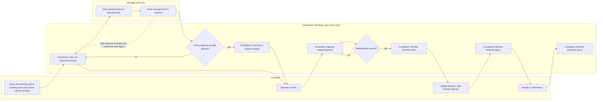

# Workflow: Meeting Life Cycle

- Title: Workflow: Meeting Life Cycle
- Audience: Developers and installers (internal)
- Shipped: No
- Applies to: UN6b (step 42): the meeting status on the Dashboard; the rest not written yet
- Last updated by: UN6b, based on 0736c7f
- Status: Draft
- Verified against: for the Dashboard status (step UN6b): Database/BMMS-Fix-DashboardMeetings-Step42.sql
  (fn_MeetingDashboardState, spr_GetDashboardMeetings), BMMS/UserControl/MeetingSummary.ascx.cs,
  BMMS/DashBoard/DashBoard.aspx.cs (diff: Reload after Approve and Reject), Database/README.md (section Step UN6b),
  Documents/User-Manuals/Glossary.md (the screens of each role)
- To confirm: workflow only partly written (WF2c4): the lanes below show the meeting status the Dashboard gives at
  each stage; the agenda routing, the approval stages, the minutes steps, the follow-up and the mails are not drawn
  yet

## Lanes

The meeting status the Dashboard shows (step UN6b) follows the stages of the life cycle below. Three lanes: the
Controller (who saves the meeting, finalises the agenda and takes the minutes through their steps), the Manager and
the User (who enter and decide agenda items) and the Dashboard (what every role sees in the Meetings card).

[[CONFIRM: the lanes for the Admin, MD Secretariat and Management, the agenda routing and the mails are not written yet (WF2c4)]]

## Workflow diagram

What the diagram shows. A meeting is Scheduled until the end of its meeting date and Completed after it. The
status label is the first rule that fits: grey when the minutes are finalised or confirmed, red when the meeting
date has passed and the minutes are not finalised or confirmed (also if the agenda was never finalised), green when
the agenda is finalised, orange when the Submit agenda by date has passed, blue otherwise. The arrows between the
Controller and Manager lanes show who does the work, the arrows into the Dashboard lane show which label follows.
The last arrow is dashed: the Meetings card is read again after a successful Approve or Reject, so the four counts
follow the decision (counts are shown to the Controller, Management, the Manager and the User; not to MD
Secretariat and Admin).

| From | To | Data | Notes |
|---|---|---|---|
| Controller | Dashboard | A saved meeting | Blue "Open for submission", also for a meeting with no dates |
| Dashboard | Manager and User | The open meeting | Agenda items are entered on Agenda Entry |
| Manager and User | Dashboard | Items approved or rejected | The counts of Items, Approved, Rejected and Pending (In progress for the User) change |
| Controller | Dashboard | Agenda finalised | Green "Agenda finalised" until the meeting date passes |
| Dashboard | Controller | Meeting date passed, minutes still open | Red "Minutes pending" |
| Controller | Dashboard | Minutes finalised | Grey "Minutes finalised" |
| Controller | Dashboard | Minutes confirmed | Grey "Minutes confirmed" |

## Decision points

| Decision | Who | Rule | Where it lives |
|---|---|---|---|
| Is the meeting in the Scheduled or the Completed list? | The database, for every role | The meeting date is today or later (or there is no date): Scheduled; before today: Completed. Today is the database server's date, so a meeting dated today is Scheduled until the end of that day | fn_MeetingDashboardState (IsScheduled) |
| Which label does the meeting carry? | The database, for every role | The first rule that fits: grey (minutes F or C), red (date before today), green (agenda not Open), orange (submission date before today; the submission date itself is still open), blue | fn_MeetingDashboardState (StateCode, StateLabel); MeetingSummary.StateCssClass for the chip |
| How many completed meetings are listed? | The database | The last 10, newest first, for every role | spr_GetDashboardMeetings (TOP 10) |
| Does a Manager or a User see a completed meeting? | The database, from the acting user id | Only when the meeting has at least one item of one of their departments | spr_GetDashboardMeetings with fn_UserDepartmentScope |
| Are the counts shown? | The database | Controller, Management, Manager, User: yes; MD Secretariat, Admin: no | spr_GetDashboardMeetings (@StatisticsShown) |
| Which items does a count cover? | The database | Controller and Management: every item; Manager and User: the items of their department(s). Approved is ACA, Rejected is AMR and ACR, Pending (In progress) is AC and AMA | fn_AgendaStatusGroup; spr_GetDashboardMeetings |
| When are the counts read again? | The Dashboard | After a successful Approve or Reject on the Dashboard | DashBoard.aspx.cs (MeetingSummary1.Reload) |

## Drawn from

Database/BMMS-Fix-DashboardMeetings-Step42.sql (fn_MeetingDashboardState, fn_AgendaStatusGroup,
fn_UserDepartmentScope, spr_GetDashboardMeetings); BMMS/UserControl/MeetingSummary.ascx.cs (StateCssClass, RoleViews);
BMMS/DashBoard/DashBoard.aspx.cs (Reload calls); Documents/User-Manuals/Glossary.md (which role uses Agenda Entry,
Agenda Finalize, Update Minutes, Finalize Minutes and Minutes Confirmation); Database/README.md (section Step UN6b).
