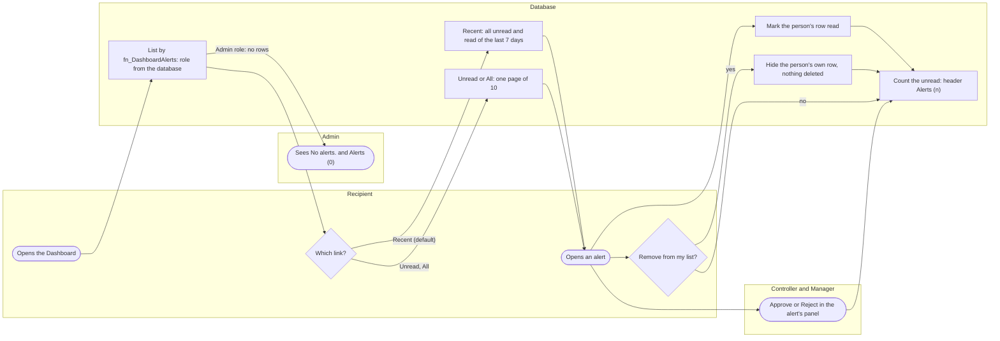
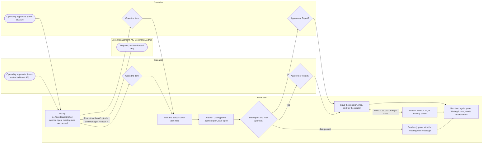
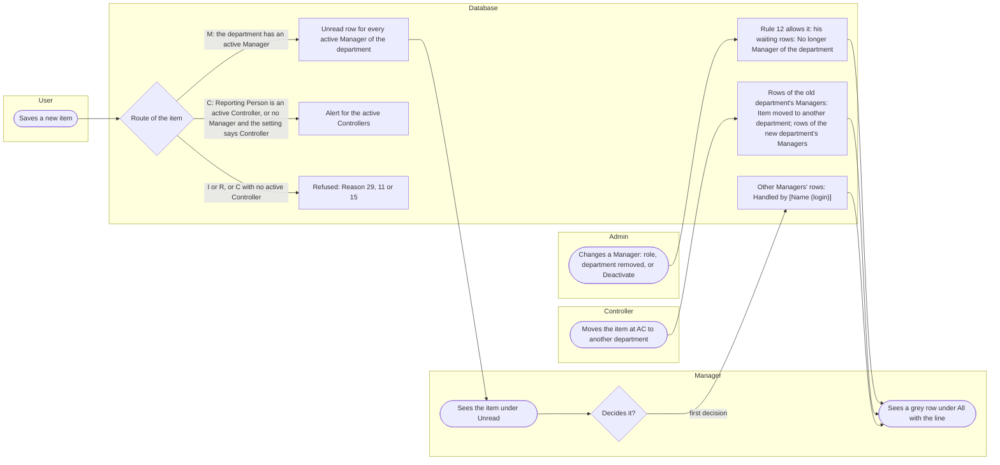
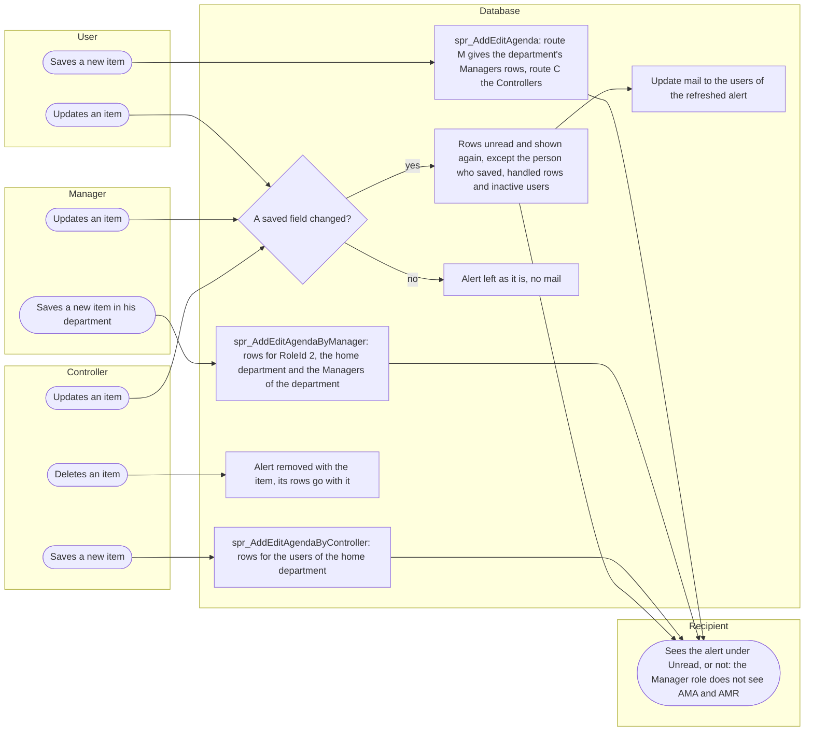

# Workflow: Alerts

- Title: Workflow: Alerts
- Audience: Developers and installers (internal)
- Shipped: No
- Applies to: WF2e1 (the new section "Alerts written when an agenda item is entered or updated": the recipients of each save procedure, the alert rows made unread again, the Update mail, Delete; the decision row of step 54 corrected; the row "Whether an edited item alerts again" completed); IU1 (step 55): two rows of the first decision points table (who gets the meeting and committee alert and mail, who gets an action item row at finalisation); UD1c (step 54): one decision row of the section "Alerts of the Managers of a department" (a Manager's new item alerts the other Managers of its department); UD1b (step 53): the new section "Alerts of the Managers of a department: created, handled, closed" and two changed decision rows; MR1 (step 52): two rows of the decision points of the section "Approval from the Dashboard"; UN6c2b (step 45): the Unread alerts card and the note that the filters do not apply to the Alerts card; UN6c2a (step 44): the section "Approval from the Dashboard: My approvals and Approve or Reject"; UN6c1 (step 43): how an alert is listed, read, removed and counted; the rest not written yet
- Commit: 31c81ab
- Last updated by: WF2e1, based on 31c81ab
- Status: Draft
- Verified against: for WF2e1: BMMS/Master/Agenda.aspx.cs (btnSave_Click, grvAgenda_RowCommand, GenerateUpdateMail), BMMSBAL/AgendaMgr.cs, the BMMS_Test catalog of step 57 (modules spr_AddEditAgenda, spr_AddEditAgendaByManager, spr_AddEditAgendaByController, spr_SetManagerAlertRows, fn_DepartmentManagers, fn_DashboardAlerts, spr_GetAgendaUpdateMailId, spr_DeleteAgendaByAgendaId; foreign keys), Database/BMMS-Fix-DepartmentApprovers-Step53.sql (the Alert_User_Map insert of spr_AddEditAgendaByManager, line 1927; fn_DashboardAlerts, line 608), Database/BMMS-Fix-ManagerScope-Step54.sql (the same insert, line 690), Database/BMMS-Fix-ResetDatabase-Seeds.sql (lines 109-110, the Roles insert at line 228; no Users row read) and Database/BMMS-Fix-GovernanceLog-Step56.sql (the Roles insert, line 2639), Documents/Data-Flow/03-Program-to-Program/04-Agenda-Entry-and-Routing.md; for IU1: Database/BMMS-Fix-InactiveUsers-Step55.sql (fn_FunctionalUsers and its readers, by Database/README.md), BMMS-Test-InactiveUsers-Step55.sql (the parts named in the README), Database/README.md (section Step IU1); for UD1c: Database/BMMS-Fix-ManagerScope-Step54.sql (the comment block of spr_AddEditAgendaByManager; the alert insert itself read at WF2e1), Database/README.md (section Step UD1c, owner answer 6); for UD1b: Database/BMMS-Fix-DepartmentApprovers-Step53.sql (the functions and procedures named in the section's "Drawn from"), BMMS/Master/User.aspx.cs and BMMSBAL/UserMgr.cs (diff), Database/README.md (section Step UD1b), Tests/packs/two-approvers/README.md; for MR1: Database/README.md (section Step MR1), BMMSBAL/UserMgr.cs and MeetingMgr.cs (diff); the Fix script was not read line by line; for UN6c2b: BMMS/DashBoard/DashBoard.aspx and .aspx.cs (the note of the Alerts card, SetUnreadAlerts in LoadAlertGRV), BMMS/UserControl/MeetingSummary.ascx.cs (SetUnreadAlerts, SetCount), Database/README.md (section Step UN6c2b); for UN6c2a: BMMS/DashBoard/DashBoard.aspx.cs (LoadApprovals, lnkApproval_Click, BindAgendaDetails, btnApprove_Click, btnReject_Click), Database/BMMS-Fix-AgendaWaitingFor-Step44.sql (read in full), Database/README.md (section Step UN6c2a, Known items), the tester run of 2026-11-14 and the owner's tests as given; for UN6c1: BMMS/DashBoard/DashBoard.aspx.cs (alert region, lnkSource_Click, Remove), BMMS/MasterPage/Main.Master.cs
  (alert count), Database/BMMS-Fix-DashboardAlerts-Step43.sql (fn_DashboardAlerts, spr_GetDashboardAlerts, spr_GetAlertCount,
  spr_RemoveAlertForUser, the two mail procedures), Database/README.md (section Step UN6c1), the owner's test result as given
- To confirm: the creation of alerts for the other agenda steps (Approve, Reject, finalisation), for meetings, committees and minutes is not drawn here (WF2e4; the recipients of meeting, committee and action item rows are in the decision points above); owner decision pending, not a verification point: the alert recipients of a Manager's new item (the line "Differs from the UD1c/UD1b requirement" in the decision row "Who is alerted when a Manager enters a new item")
- Change record: WF2e1, based on 31c81ab. Corrected: (1) the decision row "Who is alerted when a Manager enters a new item (step 54)" said "besides the step 53 recipients, the other active Managers of the item's department" from the comment block of spr_AddEditAgendaByManager; the Alert_User_Map statement was read and the row now states the recipients as the code has them, per save procedure, with the one line that says where they differ from the UD1c and UD1b requirement; (2) the row "Whether an edited item alerts again" said an edit shows the alert unread again: it does so only when a saved field changed, and not for the person who saved, rows marked as handled and rows of inactive users (read from the three save procedures). Added: the section "Alerts written when an agenda item is entered or updated" and the sentence in the introduction that points to it. The rest is kept.
This workflow follows an alert after it exists: who sees it, how it is read, removed and counted. The writing
of alerts (an agenda item entered, approved or rejected, a meeting or a committee saved) is done by the save
procedures of the other areas and is described in their files. For an agenda item that is entered or updated it is drawn in the
section "Alerts written when an agenda item is entered or updated" below (the program-to-program file is
[Agenda Entry and Routing](../03-Program-to-Program/04-Agenda-Entry-and-Routing.md)).

Since step 45 (UN6c2b) the Dashboard also shows the unread count as the "Unread alerts" summary card (for the
Controller, Management, Manager and User). It is the unread count of the Alerts card's own list (the rule of the
header count), a dash when the list cannot be read, and it follows no filter: the Committee and Department drop-downs
at the top do not apply to the Alerts card, which says "Your own alerts, for every committee. The filters at the top
do not apply."

## Lanes

- Recipient (any role except Admin): opens the Dashboard, chooses Recent, Unread or All, opens an alert, removes it
  from the list.
- Controller and Manager: the same, and approve or reject the item from the alert's panel. A Controller does not
  see ACA and ACR alerts (the Controller's own decisions); a Manager does not see AMA and AMR alerts (the
  Manager's own decisions).
- Admin: has no functional alerts. The card says "No alerts.", the header "Alerts (0)", and no functional mail goes
  to the Admin.
- Database: lists by one rule from the acting user id, marks read, hides the person's own row, counts.

## Workflow diagram

| From | To | Data | Notes |
|---|---|---|---|
| Recipient | Database | Acting user id, mode, page number | The role comes from the database, never from the page |
| Database (list) | Admin | No rows | The Admin role gets none of the eleven functional alert types; the rows stay in the tables |
| Recipient | Database | Recent, Unread or All | Recent: every unread alert and the read ones whose event date is today or in the seven days before; All: everything not removed |
| Recipient | Database (mark) | Alert id | Only the row of that user; the list is read again in the mode chosen |
| Controller or Manager | Database (count) | Approve or Reject | The header count is read again after the decision |
| Recipient | Database (hide) | The alert row id | StatusId 0 on the person's own row; another user's or an unknown id gives Reason 4 and changes nothing |
| Database (hide) | Recipient | The alert gone from the list | An edit of the item (step 36) shows the alert again, unread |
| Database (count) | Recipient | Unread count | "Alerts (n)", or "Alerts" without a number when the count cannot be read |

## Decision points

| Decision | Who | Rule | Where it lives |
|---|---|---|---|
| Which alerts a person may see | Database | Admin none; Controller not ACA and ACR; Manager not AMA and AMR, except a row marked as handled, which is listed whatever its type (since step 53); removed rows never | fn_DashboardAlerts |
| Which alerts Recent shows | Recipient (by link) | Every unread alert and the read alerts of the last 7 days (database server date); Unread and All as named | spr_GetDashboardAlerts (@Mode) |
| The date and the person on an alert | Database | The event: entry, decision, or an edit more than one minute after the decision; a dash where no approver is recorded (before step 35) | fn_DashboardAlerts (EventOn, ActorUserId) |
| Whether a row may be removed | Database | Only the acting user's own row | spr_RemoveAlertForUser |
| Whether the Admin gets functional mail | Database | No: the Admin role is left out of both recipient procedures | spr_GetAlertMailId, spr_GetAgendaUpdateMailId |
| Whether an edited item alerts again | Database | An edit that changes a saved field shows the alert unread again, also one removed from a list (step 36), for every recipient except the person who saved; rows marked as handled and rows of inactive users stay as they are; an edit that changes nothing leaves the alert as it is (step 53) | the Update branches of spr_AddEditAgenda, spr_AddEditAgendaByManager, spr_AddEditAgendaByController |
| Who gets the alert row and the mail of a meeting or committee saved (MC, MU, CC, CU; step 55) | Database | The same users for both: active, not the protected system account, not the Admin role, not the person who saved; a user without an address keeps the alert and gets no mail; with nobody to mail, no mail is sent | fn_FunctionalUsers (read by spr_AddEditMeeting, spr_AddEditCommittee, spr_GetMeetingCommitteeMailId) |
| Who gets an action item row at minutes finalisation (step 55) | Database | The users of fn_FunctionalUsers: no row for the Admin role; no back-fill for a user made active later; rows already saved for the Admin role or now-inactive users are kept and not shown | spr_MinutesFinalizeByMeetingId |

## Approval from the Dashboard: My approvals and Approve or Reject (step UN6c2a)

A Controller and a Manager see what waits for them in the My approvals panel and in the Waiting for me column, and
decide from the Agenda Alert panel. One database rule (fn_AgendaWaitingFor) decides who may decide an item, so the
panel, the column, the buttons and the approval agree. The other roles have no panel: the User, Management, MD
Secretariat and the Admin see items and alerts but are never offered Approve or Reject.

### Lanes

- Controller: sees the items at AMA in My approvals (by the rule he may also reject an item at AC, but the panel and
  the buttons are about AMA); opens one; Approve or Reject; the decision is saved, the mail goes out, the lists load
  again.
- Manager: sees the items at AC of his departments, other than his own (since step 53 every active Manager of the
  item's department; before: the items routed to him by the creator's manager or an alert row); the same steps. A Manager sees only what the server lets him approve.
- Other roles (User, Management, MD Secretariat, Admin): no panel; an opened item is read-only.
- Database: lists by the rule from the acting user id and the database server's date; answers what the person may do
  with an opened item; refuses what the rule does not allow.

### Workflow diagram

| From | To | Data | Notes |
|---|---|---|---|
| Controller or Manager | Database (list) | Acting user id, committee and department last chosen, page number | The panel follows both drop-downs; a Manager's department must be one of his |
| Database (list) | Other roles | Reason 4, no rows | The panel is hidden; the system account gets Reason 12 and the panel is hidden too |
| Controller or Manager | Database (mark) | The alert id of the row | Opening marks the person's own alert read, no other person's |
| Database (answer) | Controller or Manager | CanApprove, CanReject, AgendaOpen, DateOpen | Approve and Reject are shown when he may approve and the agenda is open; with the date passed the item is read-only and the message "The meeting date has passed, so this item can no longer be approved or rejected. It will be rejected when the agenda is finalized." shows above Close and "Remove from my list" |
| Controller or Manager | Database (save) | Approve or Reject, the comments | The page asks the state again for the date; the procedure checks the rule again |
| Database (save) | Controller or Manager | Result 1, or Reason 14 | After Result 1 the mail is sent; a mail failure leaves the decision saved |
| Database (save) | Controller or Manager | The lists | The panel, the Waiting for me counts, the Alerts card and the header count are read again |

### Decision points

| Decision | Who | Rule | Where it lives |
|---|---|---|---|
| Whether a person has the My approvals panel | Database | Controller and Manager only (Reason 4 for every other role, Reason 12 for the system account) | spr_GetDashboardApprovals |
| Which items are in the panel and in Waiting for me | Database | The person may approve it, the meeting's agenda is Open and the meeting date is today or later (database server's date) | fn_AgendaWaitingFor (IsWaiting) |
| Which items a Manager may decide | Database | At AC, and he is an active Manager of the item's department, not the creator; the Reporting Person and the alert rows no longer decide (since step 53; before: the creator's manager, or any alert row of the item) | fn_AgendaWaitingFor |
| Which items a Controller may decide | Database | Approve at AMA; reject at AC or AMA. The panel and the buttons are shown at AMA only | fn_AgendaWaitingFor; DashBoard.aspx.cs `BindAgendaDetails` |
| Whether Approve and Reject are shown | Database | May approve and the agenda Open; with the meeting date passed, read-only with the message | spr_GetAgendaApprovalState |
| Whether a decision is saved | Database | The rule again (Reason 14 when not allowed); since step 52 a Manager's decision after the meeting date is also refused by the procedure (Reason 28, nothing saved, no mail, no alert); the page checks the date first (step M6a); the Controller's reject after the meeting date stays possible | spr_UpdateAgendaByAgendaId; DashBoard.aspx.cs |
| Whether a Manager may be released (role changed away from Manager, a department removed, Deactivate) | Database | Refused (Reason 24) while items routed to him wait: open ones (meeting date not passed, or no date) and past ones (date passed, agenda never finalized, which only the Controller's Agenda Finalization closes), and while he is the last active Manager of a department with items waiting. The personal part reads the same rule as the panel | fn_ManagerReleaseRefusal (reads fn_AgendaWaitingFor); spr_AddEditUser; spr_SetUserStatusByUserId |
| What the person sees when the state cannot be read | Page | Read-only, with "Whether you may approve this item could not be checked, so it is shown read-only. Close it and open it again." (before a decision: "The item could not be checked, so nothing was changed. Try again.") | DashBoard.aspx.cs |
| What happens to an item of a meeting whose date has passed | Database | It is not listed in My approvals or counted in Waiting for me; nobody can approve it; the message tells the person it will be rejected when the agenda is finalised (Agenda Finalize, as the Glossary records) | fn_AgendaWaitingFor; DashBoard.aspx.cs (message text) |

## Alerts of the Managers of a department: created, handled, closed (step UD1b)

Since step 53 an item waiting at AC has one alert, and every active Manager of the item's department has a row on it. The rows
are written and changed in the database; each Manager sees only his own row.

### Lanes

- User: saves a new item. By the route, the item waits at AC (every Manager of the department gets an unread row), or goes to the
  Controllers (they get the alert), or is refused (no alert).
- Manager (any of the department): sees the item under Unread; decides it; or finds his row greyed under All when another Manager
  decided, when he left the department, or when the Controller moved the item.
- Controller: may move an item at AC to another department; decides at AMA.
- Admin: changes a Manager's role, departments or status in User Master; gets no alert of any kind of the agenda, meeting or
  committee.
- Database: writes the rows, marks them, lists them.

### Workflow diagram

| From | To | Data | Notes |
|---|---|---|---|
| User | Database | New item, department | The route is read for the item's department (fn_AgendaRoute) |
| Database | Manager | One unread row on route M | spr_SetManagerAlertRows; the creator is left out; no row for the Admin role |
| Manager | Database | Approve or Reject | The first decision wins; a second Manager gets Reason 14 |
| Database | Other Managers | Rows marked 'H' (HandledBy the deciding Manager) | Same transaction as the decision; read; never unread again |
| Admin | Database | Role change, department removed, Deactivate | Allowed only when another Manager of the department could decide the waiting items |
| Database | The Manager who leaves | His waiting rows of those departments marked 'N' | User Master says "Saved. [n] waiting approval alert(s) of [departments] were closed; the other Managers of the department still have them." |
| Controller | Database | A move of an item at AC to another department | The other Managers' rows 'M'; the new department's Managers get rows; a move back opens the 'M' rows |
| Database | A new, re-activated or newly mapped Manager | Unread rows of the waiting items of his departments | Items on open agendas whose meeting date is today or later; his own 'N' or 'M' row opens again, an 'H' row never |

### Decision points

| Decision | Who | Rule | Where it lives |
|---|---|---|---|
| Whether an item waits for the Managers, goes to the Controllers or is refused | Database | Reporting Person inactive: refused; an active Controller: Controllers; department with an active Manager other than the creator: Managers; else the setting "Department without an active Manager" (Refused or Sent to the Controller) | fn_AgendaRoute |
| Who gets a row on route M | Database | Every active Manager of the department except the creator; never the Admin role | spr_SetManagerAlertRows, fn_DepartmentManagers |
| What happens to the other Managers' rows at a decision | Database | Marked handled 'H' with the deciding Manager and the time | spr_UpdateAgendaByAgendaId |
| Whether a handled row is counted or shown unread | Database | Never; listed under All only | fn_DashboardAlerts, spr_GetDashboardAlerts, spr_GetAlertCount |
| Whether a row can come back to life | Database | 'N' and 'M' rows open again when the Manager is mapped to the department again or the item moves back; 'H' never | spr_SetManagerAlertRows |
| Whether a Manager may leave a department | Database | Refused (Reason 24) only when no other Manager of the department could decide an item waiting for him; otherwise allowed, and his waiting rows of it are closed | fn_ManagerReleaseRefusal |
| Who gets mail of the item later | Database | A handled Manager gets no later mail of the item | spr_GetAlertMailId, spr_GetAgendaUpdateMailId |
| Who is alerted when a Manager enters a new item (steps 53 and 54) | Database | spr_AddEditAgendaByManager, Save: rows (AMA) for the users of RoleId 2, for every user whose home department is the item's department, and, since step 54, for the users of fn_DepartmentManagers for the item's department, whatever their home department; active, not the system account, never the Admin role; the creator is not left out. spr_AddEditAgendaByController, Save: rows (ACA) only for the users whose home department is the item's department (no Controller group, same filters). RoleId 2 is the Controller as the reset seed makes the roles (Database/BMMS-Fix-ResetDatabase-Seeds.sql); on a database not made by the reset the id comes from its own rows. Differs from the UD1c/UD1b requirement: the creator is not left out of his own item's alert set, and the Controllers and every active user whose home department is the item's department get rows too, not only the other Managers of the department; owner decision pending. | spr_AddEditAgendaByManager (the Alert_User_Map insert of the Save branch), spr_AddEditAgendaByController, fn_DepartmentManagers |

Drawn from (UD1b): Database/BMMS-Fix-DepartmentApprovers-Step53.sql (fn_AgendaRoute, fn_DepartmentManagers, spr_SetManagerAlertRows,
fn_DashboardAlerts, spr_GetAlertMailId, spr_GetAgendaUpdateMailId; the comment blocks of spr_AddEditAgenda, spr_UpdateAgendaByAgendaId,
spr_AddEditAgendaByController, spr_AddEditUser and spr_SetUserStatusByUserId), BMMS/Master/User.aspx.cs and BMMSBAL/UserMgr.cs (the Released
message), Database/README.md (section Step UD1b), Tests/packs/two-approvers/README.md.

## Alerts written when an agenda item is entered or updated (step WF2e1)

The alert of an agenda item is written by the save procedure of the role that saves it (the page chooses the procedure by the
role in the session). A new item gets one alert and one row for each recipient; an Update writes no new row, it only makes the existing
rows unread again. The recipients of each procedure are in the decision point "Who is alerted when a Manager enters a new item" above and in
the decision points of this section. The program-to-program view is
[Agenda Entry and Routing](../03-Program-to-Program/04-Agenda-Entry-and-Routing.md).

### Lanes

- User: saves a new item (route M or C, or refused, as in the section on step 53) or updates an item he entered.
- Manager: saves a new item in one of his active departments (it starts at AMA, approved by himself) or updates an item of his departments
  or one he entered.
- Controller: saves a new item (it starts at ACA, approved by himself), updates any item, may move an item at AC to another department,
  and is the only role that deletes an item.
- Recipient: the person who has a row. A Manager does not see AMA and AMR rows (unless marked as handled), a Controller does not see ACA
  and ACR rows; the Admin role has none.
- Database: writes the rows, makes them unread again, removes them with the item.

### Workflow diagram

| From | To | Data | Notes |
|---|---|---|---|
| User | Database | A new item | spr_AddEditAgenda; the route decides the recipients (section on step 53) |
| Manager | Database | A new item in one of his active departments | spr_AddEditAgendaByManager; rows by the decision point of step 54 above |
| Controller | Database | A new item | spr_AddEditAgendaByController; rows only for the users whose home department is the item's department |
| User, Manager, Controller | Database | An Update of the item | Each role's own procedure; the Update compares the saved values with the new ones |
| Database | Recipient | Rows unread again | Only when a saved field changed; not the person who saved, not rows marked as handled ('H', 'N', 'M'), not inactive users; a row the person had removed from his list is shown again |
| Database | Recipient | The Update mail | spr_GetAgendaUpdateMailId, the same users as the refreshed rows who have an address; the Admin role is left out; a Controller on an ACA or ACR alert and a Manager on an AMA or AMR alert are left out |
| Controller | Database | A Delete | The alert of the item is removed and its rows with it; nobody is told |

### Decision points

| Decision | Who | Rule | Where it lives |
|---|---|---|---|
| Which procedure writes the alert | Page | By the role in the session: Controller, Manager, any other role spr_AddEditAgenda | Agenda.aspx.cs `btnSave_Click` |
| Who gets the rows of a new item | Database | By procedure: see the decision points "Who gets a row on route M" and "Who is alerted when a Manager enters a new item" above; route C of spr_AddEditAgenda gives the active Controllers rows (alert type AMA) | the three save procedures; spr_SetManagerAlertRows |
| Whether the creator has a row on his own item | Database | Not on route M; yes on a Manager's item and on a Controller's item when the creator is in the recipient list of his procedure | the Alert_User_Map inserts |
| Whether an Update alerts again | Database | Only when one of Subject Type, Subject No, Short Text, Agenda Type, Agenda Text, the agenda text file name, Proposed Resolution, the attachment names, the Manager's comment or the Controller's comment changed (the Controller's procedure also the department); text is compared exactly | the Update branches of the three save procedures |
| Whether an Update sends mail | Page, Database | Not when nothing changed or when nobody with an address is left; the person who saved is the To address | Agenda.aspx.cs `GenerateUpdateMail`; spr_GetAgendaUpdateMailId |
| Whether the rows are shown | Database | A row is listed unless the filter of the role hides it (Manager: AMA and AMR unless handled; Controller: ACA and ACR unless handled; Admin: all functional types) | fn_DashboardAlerts |
| What a Delete does to the alert | Database | The alert of the item is deleted, the rows with it (foreign key cascade); the minutes row and action items of the item go too | spr_DeleteAgendaByAgendaId |

Drawn from (WF2e1): BMMS/Master/Agenda.aspx.cs (btnSave_Click, grvAgenda_RowCommand, GenerateUpdateMail), the BMMS_Test catalog of step 57 (spr_AddEditAgenda,
spr_AddEditAgendaByManager, spr_AddEditAgendaByController, spr_SetManagerAlertRows, spr_GetAgendaUpdateMailId, spr_DeleteAgendaByAgendaId,
fn_DashboardAlerts, the foreign keys of Alert_User_Map), Documents/Data-Flow/03-Program-to-Program/04-Agenda-Entry-and-Routing.md.

## Drawn from

BMMS/DashBoard/DashBoard.aspx.cs (LoadAlertGRV, AlertMode_Click, lnkSource_Click, Remove from my list),
BMMS/MasterPage/Main.Master.cs (alert count), Database/BMMS-Fix-DashboardAlerts-Step43.sql (fn_DashboardAlerts,
spr_GetDashboardAlerts, spr_GetAlertCount, spr_RemoveAlertForUser, spr_GetAlertMailId, spr_GetAgendaUpdateMailId),
Database/README.md (section Step UN6c1). For the section on step UN6c2a: BMMS/DashBoard/DashBoard.aspx.cs
(LoadApprovals, lnkApproval_Click, BindAgendaDetails, btnApprove_Click, btnReject_Click, ShowAgendaPanelMessage),
Database/BMMS-Fix-AgendaWaitingFor-Step44.sql (fn_AgendaWaitingFor, spr_GetAgendaApprovalState,
spr_GetDashboardApprovals, spr_UpdateAgendaByAgendaId), Database/README.md (section Step UN6c2a, Known items).
