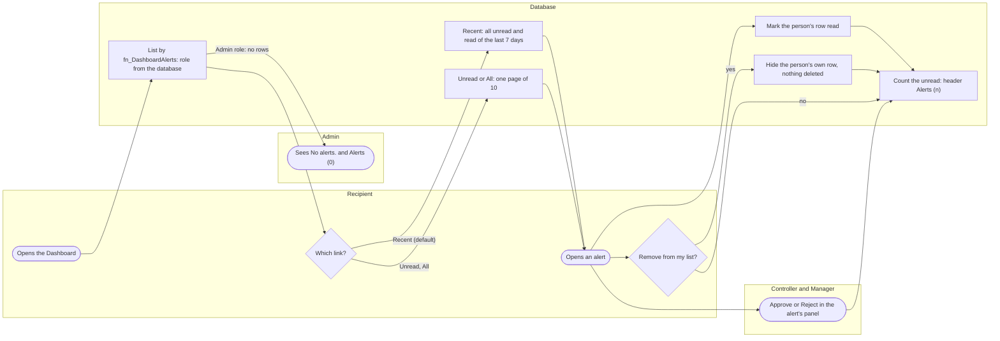
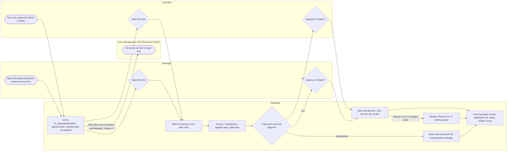

# Workflow: Alerts

- Title: Workflow: Alerts
- Audience: Developers and installers (internal)
- Shipped: No
- Applies to: UN6c2a (step 44): the section "Approval from the Dashboard: My approvals and Approve or Reject"; UN6c1 (step 43): how an alert is listed, read, removed and counted; the rest not written yet
- Last updated by: UN6c2a, based on 493cb45
- Status: Draft
- Verified against: for UN6c2a: BMMS/DashBoard/DashBoard.aspx.cs (LoadApprovals, lnkApproval_Click, BindAgendaDetails, btnApprove_Click, btnReject_Click), Database/BMMS-Fix-AgendaWaitingFor-Step44.sql (read in full), Database/README.md (section Step UN6c2a, Known items), the tester run of 2026-11-14 and the owner's tests as given; for UN6c1: BMMS/DashBoard/DashBoard.aspx.cs (alert region, lnkSource_Click, Remove), BMMS/MasterPage/Main.Master.cs
  (alert count), Database/BMMS-Fix-DashboardAlerts-Step43.sql (fn_DashboardAlerts, spr_GetDashboardAlerts, spr_GetAlertCount,
  spr_RemoveAlertForUser, the two mail procedures), Database/README.md (section Step UN6c1), the owner's test result as given
- To confirm: the creation of alerts (which action writes which alert to whom) is not drawn yet (WF2c4)

This workflow follows an alert after it exists: who sees it, how it is read, removed and counted. The writing
of alerts (an agenda item entered, approved or rejected, a meeting or a committee saved) is done by the save
procedures of the other areas and is described in their files.

## Lanes

- Recipient (any role except Admin): opens the Dashboard, chooses Recent, Unread or All, opens an alert, removes it
  from the list.
- Controller and Manager: the same, and approve or reject the item from the alert's panel. A Controller does not
  see ACA and ACR alerts (the Controller's own decisions); a Manager does not see AMA and AMR alerts (the
  Manager's own decisions).
- Admin: has no functional alerts. The card says "No alerts.", the header "Alerts (0)", and no functional mail goes
  to the Admin.
- Database: lists by one rule from the acting user id, marks read, hides the person's own row, counts.

## Workflow diagram

| From | To | Data | Notes |
|---|---|---|---|
| Recipient | Database | Acting user id, mode, page number | The role comes from the database, never from the page |
| Database (list) | Admin | No rows | The Admin role gets none of the eleven functional alert types; the rows stay in the tables |
| Recipient | Database | Recent, Unread or All | Recent: every unread alert and the read ones whose event date is today or in the seven days before; All: everything not removed |
| Recipient | Database (mark) | Alert id | Only the row of that user; the list is read again in the mode chosen |
| Controller or Manager | Database (count) | Approve or Reject | The header count is read again after the decision |
| Recipient | Database (hide) | The alert row id | StatusId 0 on the person's own row; another user's or an unknown id gives Reason 4 and changes nothing |
| Database (hide) | Recipient | The alert gone from the list | An edit of the item (step 36) shows the alert again, unread |
| Database (count) | Recipient | Unread count | "Alerts (n)", or "Alerts" without a number when the count cannot be read |

## Decision points

| Decision | Who | Rule | Where it lives |
|---|---|---|---|
| Which alerts a person may see | Database | Admin none; Controller not ACA and ACR; Manager not AMA and AMR; removed rows never | fn_DashboardAlerts |
| Which alerts Recent shows | Recipient (by link) | Every unread alert and the read alerts of the last 7 days (database server date); Unread and All as named | spr_GetDashboardAlerts (@Mode) |
| The date and the person on an alert | Database | The event: entry, decision, or an edit more than one minute after the decision; a dash where no approver is recorded (before step 35) | fn_DashboardAlerts (EventOn, ActorUserId) |
| Whether a row may be removed | Database | Only the acting user's own row | spr_RemoveAlertForUser |
| Whether the Admin gets functional mail | Database | No: the Admin role is left out of both recipient procedures | spr_GetAlertMailId, spr_GetAgendaUpdateMailId |
| Whether an edited item alerts again | Database | An edit shows the alert unread again, also one removed from a list (step 36) | the save procedures of the agenda (step 36) |

## Approval from the Dashboard: My approvals and Approve or Reject (step UN6c2a)

A Controller and a Manager see what waits for them in the My approvals panel and in the Waiting for me column, and
decide from the Agenda Alert panel. One database rule (fn_AgendaWaitingFor) decides who may decide an item, so the
panel, the column, the buttons and the approval agree. The other roles have no panel: the User, Management, MD
Secretariat and the Admin see items and alerts but are never offered Approve or Reject.

### Lanes

- Controller: sees the items at AMA in My approvals (by the rule he may also reject an item at AC, but the panel and
  the buttons are about AMA); opens one; Approve or Reject; the decision is saved, the mail goes out, the lists load
  again.
- Manager: sees the items routed to him at AC (he is the creator's manager, or has an alert row of the item,
  also one he removed from his list); the same steps. A Manager sees only what the server lets him approve.
- Other roles (User, Management, MD Secretariat, Admin): no panel; an opened item is read-only.
- Database: lists by the rule from the acting user id and the database server's date; answers what the person may do
  with an opened item; refuses what the rule does not allow.

### Workflow diagram

| From | To | Data | Notes |
|---|---|---|---|
| Controller or Manager | Database (list) | Acting user id, committee and department last chosen, page number | The panel follows both drop-downs; a Manager's department must be one of his |
| Database (list) | Other roles | Reason 4, no rows | The panel is hidden; the system account gets Reason 12 and the panel is hidden too |
| Controller or Manager | Database (mark) | The alert id of the row | Opening marks the person's own alert read, no other person's |
| Database (answer) | Controller or Manager | CanApprove, CanReject, AgendaOpen, DateOpen | Approve and Reject are shown when he may approve and the agenda is open; with the date passed the item is read-only and the message "The meeting date has passed, so this item can no longer be approved or rejected. It will be rejected when the agenda is finalized." shows above Close and "Remove from my list" |
| Controller or Manager | Database (save) | Approve or Reject, the comments | The page asks the state again for the date; the procedure checks the rule again |
| Database (save) | Controller or Manager | Result 1, or Reason 14 | After Result 1 the mail is sent; a mail failure leaves the decision saved |
| Database (save) | Controller or Manager | The lists | The panel, the Waiting for me counts, the Alerts card and the header count are read again |

### Decision points

| Decision | Who | Rule | Where it lives |
|---|---|---|---|
| Whether a person has the My approvals panel | Database | Controller and Manager only (Reason 4 for every other role, Reason 12 for the system account) | spr_GetDashboardApprovals |
| Which items are in the panel and in Waiting for me | Database | The person may approve it, the meeting's agenda is Open and the meeting date is today or later (database server's date) | fn_AgendaWaitingFor (IsWaiting) |
| Which items a Manager may decide | Database | At AC, and he is the creator's manager or has any alert row of the item (also a removed one); the department plays no part until step UD1b | fn_AgendaWaitingFor |
| Which items a Controller may decide | Database | Approve at AMA; reject at AC or AMA. The panel and the buttons are shown at AMA only | fn_AgendaWaitingFor; DashBoard.aspx.cs `BindAgendaDetails` |
| Whether Approve and Reject are shown | Database | May approve and the agenda Open; with the meeting date passed, read-only with the message | spr_GetAgendaApprovalState |
| Whether a decision is saved | Database | The rule again (Reason 14 when not allowed); the date is checked by the page, not by the procedure (known item M6a) | spr_UpdateAgendaByAgendaId; DashBoard.aspx.cs |
| What the person sees when the state cannot be read | Page | Read-only, with "Whether you may approve this item could not be checked, so it is shown read-only. Close it and open it again." (before a decision: "The item could not be checked, so nothing was changed. Try again.") | DashBoard.aspx.cs |
| What happens to an item of a meeting whose date has passed | Database | It is not listed in My approvals or counted in Waiting for me; nobody can approve it; the message tells the person it will be rejected when the agenda is finalised (Agenda Finalize, as the Glossary records) | fn_AgendaWaitingFor; DashBoard.aspx.cs (message text) |

## Drawn from

BMMS/DashBoard/DashBoard.aspx.cs (LoadAlertGRV, AlertMode_Click, lnkSource_Click, Remove from my list),
BMMS/MasterPage/Main.Master.cs (alert count), Database/BMMS-Fix-DashboardAlerts-Step43.sql (fn_DashboardAlerts,
spr_GetDashboardAlerts, spr_GetAlertCount, spr_RemoveAlertForUser, spr_GetAlertMailId, spr_GetAgendaUpdateMailId),
Database/README.md (section Step UN6c1). For the section on step UN6c2a: BMMS/DashBoard/DashBoard.aspx.cs
(LoadApprovals, lnkApproval_Click, BindAgendaDetails, btnApprove_Click, btnReject_Click, ShowAgendaPanelMessage),
Database/BMMS-Fix-AgendaWaitingFor-Step44.sql (fn_AgendaWaitingFor, spr_GetAgendaApprovalState,
spr_GetDashboardApprovals, spr_UpdateAgendaByAgendaId), Database/README.md (section Step UN6c2a, Known items).
