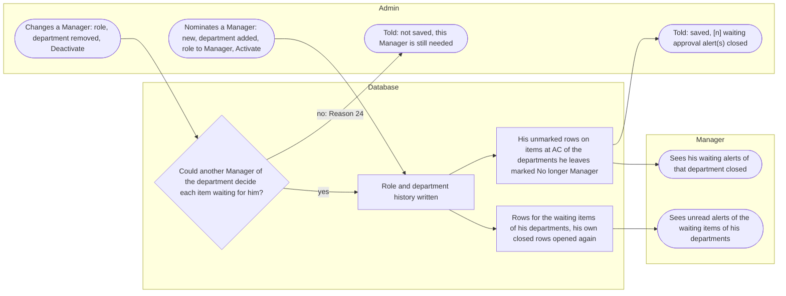

# Workflow: User Life Cycle

- Title: Workflow: User Life Cycle
- Audience: Developers and installers (internal)
- Shipped: No
- Applies to: UD1c (step 54: one decision-points row, the Reporting Person); UD1b (step 53: a Manager leaving or joining a department); user-ud1a
- Commit: 42cb88c
- Last updated by: UD1c, based on 42cb88c
- Status: Draft
- Verified against: for UD1c: Database/BMMS-Fix-ManagerScope-Step54.sql (fn_ReportingPersonAllowed, the two Reason 31 checks of spr_AddEditUser), BMMS/Master/User.aspx.cs (diff), Database/README.md (section Step UD1c); for UD1b: BMMS/Master/User.aspx.cs and BMMSBAL/UserMgr.cs (diff), Database/BMMS-Fix-DepartmentApprovers-Step53.sql (fn_ManagerReleaseRefusal, spr_SetManagerAlertRows, the comment blocks of spr_AddEditUser and spr_SetUserStatusByUserId), Database/README.md (section Step UD1b)
- To confirm: workflow written only for a Manager's role, departments and status since step UD1b (WF2c4); the creation of a user, the password steps, the delete and the other roles are not drawn here yet

## Lanes

- Admin: changes a Manager in User Master: a role change away from Manager, a department removed, Deactivate; or nominates a
  Manager: a new Manager, a department added, a role changed to Manager, Activate. The protected system account may do the same
  as an Admin.
- Manager: sees the effect on his Dashboard: his waiting approval alerts of the department he left are closed ("No longer
  Manager of the department (dd-MMM-yyyy)"); the alerts of the waiting items of a department he joined appear unread.
- Other Managers of the department: keep their alerts and may decide the waiting items.
- Database: checks rule 12, writes the history rows, closes or gives the alert rows.

## Workflow diagram

| From | To | Data | Notes |
|---|---|---|---|
| Admin | Database | The changed Manager | Rule 12 checks the items on open agendas whose meeting date has not passed, and past items whose agenda was never finalized |
| Database | Admin | Reason 24 and its lines | "Not saved: this Manager is still needed." and one line per part, then "Nothing was changed." |
| Database | Admin | Result 1 and the Released detail | "Saved. [n] waiting approval alert(s) of [departments] were closed; the other Managers of the department still have them." (Deactivate: "User deactivated. ...") |
| Database | Manager | Rows marked 'N' | Read; listed under All only, greyed |
| Database | Manager | Unread rows | Only for items on open agendas whose meeting date is today or later; an 'N' or 'M' row of his own opens again, an 'H' row never |

## Decision points

| Decision | Who | Rule | Where it lives |
|---|---|---|---|
| Whether a Manager may leave a department | Database | Refused (Reason 24) only when an item waiting for him could be decided by no other active Manager of the department | fn_ManagerReleaseRefusal (reads fn_AgendaWaitingFor and fn_DepartmentManagers) |
| What happens to his waiting alerts when he may leave | Database | Marked 'N' with HandledBy the acting user; the other Managers keep theirs | spr_SetManagerAlertRows (@Release 1) |
| What a new, re-activated or newly mapped Manager receives | Database | An unread row on the alert of each waiting item of his departments (the creator's own items excepted) | spr_SetManagerAlertRows (@Release 0) |
| Who may make these changes | Page access, database | The Admin role (User Master is admin only); the protected system account may act as the acting user | PageAccess.xml; spr_SetManagerAlertRows |
| Who may be a user's Reporting Person (step 54) | Admin (the choice), database (the check) | An active Controller or an active Manager of the user's department, never the user himself; "- Select -" is always allowed; refused with Reason 31 on Create and on every Update, also when the Reporting Person is unchanged; a Department change clears the choice | fn_ReportingPersonAllowed, spr_GetReportingPersonList, spr_AddEditUser; User.aspx.cs |

## Drawn from

BMMS/Master/User.aspx.cs (btnSave_Click, grvUser_RowCommand), BMMSBAL/UserMgr.cs (ReleasedMessage), Database/BMMS-Fix-DepartmentApprovers-Step53.sql
(fn_ManagerReleaseRefusal, spr_SetManagerAlertRows, the comment blocks of spr_AddEditUser and spr_SetUserStatusByUserId), Database/README.md
(section Step UD1b), System-Manual/06-Configuration-and-Settings (User Master is admin only since step RA1a).
