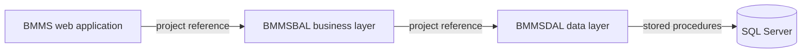
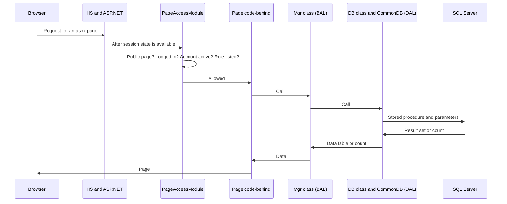

# Overview and Architecture

- Title: Overview and Architecture
- Audience: Developers and installers (internal)
- Shipped: No
- Applies to: WF2b1
- Last updated by: WF2b1, based on 3dd0eec
- Status: Draft
- Verified against: BMMS.sln, BMMS/BMMS.csproj, BMMSBAL/BMMSBAL.csproj, BMMSDAL/BMMSDAL.csproj,
  BMMS/Web.config (structure), BMMS/Global.asax.cs, BMMS/PageAccessModule.cs,
  BMMS/XML/PageAccess.xml, BMMS/UserControl/MenuUserControl.ascx, BMMS/Default.aspx.cs,
  BMMS/Master/Department.aspx(.cs), BMMSDAL/CommonDB.cs, BMMSDAL/ConnectDB.cs,
  BMMSDAL/DepartmentDB.cs, BMMSBAL/DepartmentMgr.cs, BMMSBAL/Common.cs, BMMSBAL/Utilities.cs,
  the file list of git (tracked libraries, Database/ scripts, Documentation/), the BMMS_Test
  catalog export of 2026-11-09 (kept outside the repository; procedure count), and, as leads only,
  Documentation/Architecture and Documentation/Modernization; for Word and the DLLs:
  BMMSBAL/DocToString.cs, BMMSBAL/WordUtilities.cs, BMMS/Master/Agenda.aspx.cs,
  BMMS/Report/ViewReport.aspx.cs (btnExportToWord_Click), Grep over BMMS, BMMSBAL and BMMSDAL for
  Interop, Word.Application, ProgID and CreateObject, BMMSBAL.csproj hint paths, git ls-files
  BMMS/dll
- To confirm: whether the installed site runs with compilation debug="true"; where
  itextsharp.dll and Microsoft.Office.Interop.Word.dll are to come from when BMMS/dll is restored
  (git tracks no file there); the licence of the iTextSharp version in use; that
  Documentation/Pages.xlsx is the only file left in Documentation/ after WF2b1

## Purpose of BMMS

BMMS (Board Minutes and Meeting Software) is an ASP.NET Web Forms application that runs the board
and committee meeting cycle of a company. The menu and the pages show these areas:

- Masters: departments, designations, member types, subject types, decision types, users, members,
  committees, committee members, meetings, meeting members, attendance.
- Agenda: items raised by users, approved first by the user's Manager and then by a Controller,
  then finalized per meeting.
- Minutes: updated per agenda item, then finalized and confirmed; follow-up of the decisions.
- Alerts and mail: dashboard alerts, mails, notices, free-form Send Mail.
- Reports: notices, minutes, follow-up and action taken, attendance, calendars, committee and
  meeting masters, sitting fees, audit trail.
- Utilities: Change Password, Reset Password, Backup Database, Reset Database, SMTP Server Config,
  System Settings.

The roles are admin, controller, manager, user, mgmt and md_sect (BMMS/XML/PageAccess.xml). What
each role does is described in the user manuals; this manual is for the people who build, install
and support BMMS.

Owner's rule (the owner of BMMS is Gashpy Software): "Behaviour changes only by an owner decision,
recorded in the step record and the change log. Approval and governance rules are never changed
without the owner's approval."

## Solution and projects

`BMMS.sln` holds three projects. All three target .NET Framework 4.8 (`TargetFrameworkVersion`
v4.8 in each project file).

| Project | Kind | Contents |
|---|---|---|
| BMMS | ASP.NET Web Forms application | The 47 `.aspx` pages (root, `Master/`, `Report/`, `DashBoard/`, `Error/`), the master pages, the user controls (for example the menu), CSS and scripts, the XML settings in `XML/`, `Global.asax`, `PageAccessModule.cs`, and the project's own rich-text control `BMMS.Controls.RichTextEditor` (`RichTextEditor.cs`) |
| BMMSBAL | Class library (business layer) | One `*Mgr` class per area (for example `DepartmentMgr`, `UserMgr`, `AgendaMgr`), `Common`, `Utilities`, mail (`Mail_Mgr`), PDF output (`PDF_Reports`, `PDFUtilities`, `HtmlToPdfBuilder`), Word output (`WordUtilities`), database backup (`Sql_Backup_Mgr`), report queries (`ReportsMgr`) |
| BMMSDAL | Class library (data layer) | One `*DB` class per area (for example `DepartmentDB`), `CommonDB` (runs the calls), `ConnectDB` (reads the connection string) |

Project references run one way: BMMS references BMMSBAL (`ProjectReference` in BMMS.csproj), and
BMMSBAL references BMMSDAL (in BMMSBAL.csproj). BMMSDAL references no other project. No page, user
control or master page in BMMS names `BMMSDAL` or `CommonDB` (a search of the BMMS project finds no
use), so the pages reach the database only through the BAL.

BMMSBAL is compiled with C# language version 7.3 (`LangVersion` in BMMSBAL.csproj).

| From | To | Data | Notes |
|---|---|---|---|
| BMMS | BMMSBAL | Method calls | Pages call `*Mgr` and `Common` |
| BMMSBAL | BMMSDAL | Method calls | `*Mgr` calls `*DB` |
| BMMSDAL | SQL Server | Procedure name and parameters | Through `CommonDB` |

Drawn from: BMMS/BMMS.csproj, BMMSBAL/BMMSBAL.csproj, BMMSDAL/BMMSDAL.csproj.

## Layers: pages, BAL, DAL, database

Pages (BMMS). A page's code-behind calls `Common.InitSetup(className)` at the start (for example
BMMS/Master/Department.aspx.cs). `InitSetup` redirects to the login page when nobody is logged in,
and otherwise looks up the page title and URL for the page's class name in `XML/PageSettings.xml`.
Pages read the signed-in user from the session (`Session["UserId"]`, `Session["RoleCode"]`,
`Session["UserName"]`, `Session["LoginName"]`, which the login page sets in
BMMS/Default.aspx.cs).

BAL (BMMSBAL). Each area has a `*BAL` data class, a `*BALList` and a `*Mgr` class with static
methods. As an example, `DepartmentMgr` calls `DepartmentDB` (for example
`DepartmentDB.GetDepartmentList`). `Utilities.WriteErrorLog` writes the error log, one file per
day, in a `Log` folder under the application's base directory.

DAL (BMMSDAL). A `*DB` class (for example `DepartmentDB`) builds the `SqlParameter` array and
calls `CommonDB`:

- `CommonDB.ExecuteProcedure(name, parameters)` runs a stored procedure with `ExecuteNonQuery`
  and returns the affected-row count; a result set of the procedure is not returned.
- `CommonDB.GetDataTable(name, parameters)` runs a stored procedure and returns the result set as
  a `DataTable`.
- `CommonDB.GetDataTableFromQuery(sql)` runs a text query (`CommandType.Text`). In BMMSBAL it is
  used by `ReportsMgr` (3 matches in the file).

`ConnectDB.GetConnectionString()` reads the connection string named `ConnectionString` through
`ConfigurationManager`. The connection string itself is in a file kept out of git (see
06-Configuration-and-Settings).

Database. Nearly every call is a stored procedure (`spr_*`): the BMMS_Test catalog export of
2026-11-09 (kept outside the repository) lists 157 procedures whose names start with `spr_`.
The installed BMMS database can differ from BMMS_Test; chapter 04 describes what the export shows.

## Request life cycle

A request for an `.aspx` page passes these stages.

| From | To | Data | Notes |
|---|---|---|---|
| Browser | IIS and ASP.NET | HTTP request | A Web Forms request or postback |
| IIS and ASP.NET | PageAccessModule | The request | Registered as module `PageAccess` in Web.config, in `httpModules` and in `system.webServer/modules` (integrated mode) |
| PageAccessModule | Page | Allowed request | Otherwise a redirect to the login page or the "Access denied" page |
| Page | Browser | HTML | Errors are answered by `Global.asax` (below) |

Drawn from: BMMS/Web.config, BMMS/PageAccessModule.cs, BMMS/Global.asax.cs.

PageAccessModule (`BMMS.Security.PageAccessModule`) handles the event `PostAcquireRequestState` and
looks at `.aspx` requests only. In order:

1. A page listed under `<public>` in `XML/PageAccess.xml` passes (Default.aspx, Logout.aspx,
   Error/ErrorPage.aspx).
2. Without a logged-in user (`Common.IsLoggedIn()`) the request goes to `Default.aspx`. For an
   UpdatePanel postback the module answers in the ASP.NET AJAX "pageRedirect" format.
3. The account must be active: the module reads the user's status on every request. An inactive
   user's session is cleared and the login page is opened with `?status=inactive`. If the read
   fails, the request passes and the error is written to the error log.
4. The role in `Session["RoleCode"]` must be listed for the page (`roles="*"` means any
   logged-in user). A page that is not in the file is not allowed.
5. The mode is the `mode` attribute of the root element of PageAccess.xml. In `Enforce` mode a
   denied request gets an "Access denied" page with HTTP 403. In `LogOnly` mode nothing is blocked
   for role reasons and the request that would be denied is written to `App_Data\PageAccessLog.txt`.
   The file in the repository has `mode="Enforce"`. The policy file is cached and reloaded when it
   changes; when it cannot be read, only the login requirement applies.

The menu (BMMS/UserControl/MenuUserControl.ascx) shows each role its links by
`Session["RoleCode"]`; the menu hides links, PageAccessModule is the server-side check. The
stored procedures make the final decision on which changes a role may make (see chapter 08).

Errors. `Global.asax.cs` handles `Application_Error`: the error is written once to the error log
and answered with a short fixed page without the exception text; HTTP 404 gets a short "Page not
found." page and is not logged. The "Access denied" page of PageAccessModule does not pass
through this handler. `Session_End` records the end of the session in the login audit for the
user in the session.

Web.config in outline: the connection string is read from a separate file
(`connectionStrings configSource="connectionStrings.config"`), session state is in process with
a 10-minute timeout (`sessionState timeout="10" mode="InProc"`), the two rich-text limits are in
`appSettings`, and the `ScriptModule` and `PageAccess` modules are registered. `compilation
debug="true"` is set in the file. [[CONFIRM: whether the installed site runs with debug="true"; compare the installed Web.config]]

## Third-party components

| Component | Version in the project files | Where it is referenced | Notes |
|---|---|---|---|
| AjaxControlToolkit | 1.0.20229.20821 | BMMS.csproj (no hint path) | A tracked copy is in BMMS/bin |
| iTextSharp (PDF output) | 4.0.2.0 | BMMSBAL.csproj (hint path `..\BMMS\dll\itextsharp.dll`) and BMMS.csproj (no hint path) | Tracked copies are in BMMS/bin and BMMSBAL/bin/Debug; the folder BMMS/dll named by the hint path is not tracked |
| Microsoft.Office.Interop.Word (Word output) | 12.0.0.0 | BMMSBAL.csproj (hint path `..\BMMS\dll\Microsoft.Office.Interop.Word.dll`) | A tracked copy is in BMMSBAL/bin/Debug. Word is not needed on the server: the reference stays in BMMSBAL.csproj and the two classes that use it (`WordUtilities.CreateWord`, `DocToString.ConvertDocToString`) remain in the code, but nothing calls them: `CreateWord` has no caller, and `ConvertDocToString` is called only in a commented line (Master/Agenda.aspx.cs, line 1413). The commented WordUtilities calls in Report/ViewReport.aspx.cs (lines 90, 149, 150) are `ExportToWord` and `ExportToPdf`, which do not use Interop (the only Interop code in WordUtilities.cs is inside `CreateWord`, lines 178-196). No late-bound Word call exists and Web.config names no Office assembly. The Export to Word button sends the report HTML as a `.doc` download (content type `application/msword`) and starts no Word. The DLL is needed to build, not to run |
| HtmlAgilityPack | not versioned in the reference | BMMS.csproj and BMMSBAL.csproj (hint path `..\Lib\HtmlAgilityPack\HtmlAgilityPack.dll`) | Tracked in Lib/HtmlAgilityPack with its LICENSE.txt and README.txt |
| VBIDE (COM reference) | 5.3 | BMMSBAL.csproj | A COM reference of the project file |

BMMS.Controls.RichTextEditor is the project's own rich-text control (BMMS/RichTextEditor.cs); the
project file has no reference to FreeTextBox.

The projects refer to the DLLs by hint paths that point into BMMS/dll, a folder that git does not
track (`git ls-files BMMS/dll` lists nothing). The hint paths in BMMSBAL.csproj are
`..\BMMS\dll\itextsharp.dll` and `..\BMMS\dll\Microsoft.Office.Interop.Word.dll`. A fresh clone
therefore cannot build until both DLLs are restored into BMMS/dll.
[[CONFIRM: where the two DLLs are to come from (a shared location, the tracked copies in BMMS/bin and BMMSBAL/bin/Debug, or a package); confirm on a clean build machine]]

iTextSharp licence. The project references iTextSharp 4.0.2.0. The old notes say that the AGPL
licence came with iText 5 and that 4.0.2 is under LGPL/MPL, so no licence problem arises from the
version in use. [[CONFIRM: lead from old Errata notes: iTextSharp 4.0.2 is LGPL/MPL; check the licence text that comes with the library or the project's published licence for that version]]

## Superseded documents

The old `Documentation/` folder was merged into this manual and removed in step WF2b1. This
table records where each part went. These are the step's decisions; the old files stay in git
history.

| Old file | Where it went |
|---|---|
| Architecture/BMMS-Architecture.md and its PDF export (same content) | Sections 1 to 3 into this chapter. Section 4 (Configuration) into 06 as leads. Section 5 (Security) into 08 as leads. Section 6 (Workflows) is covered by Data-Flow/04-Workflows. Section 7 (Database) into 03 and 04. Section 8 (Build, test and release) into 02 and 10 (leads in 10). Section 9 (Known limitations) into 04 and 05, re-checked there |
| Architecture/BMMS-Current-State-Architecture.md and its older copy Architecture/CurrentStateArchitecture.md | Branch policy into 02. The governance rule into this chapter as the owner's rule (see Purpose of BMMS). Phase plans, sprint status, machine locations and the recovery checklist are dropped: they are plans and history, not current facts, and git history keeps them |
| Modernization/BMMS-Recommendations-Errata.md | The iTextSharp licence into this chapter. The dynamic-SQL scan into 04 and 08 (leads). The missing procedures into 04. The SQL Server version and compatibility level into 02 and 03. The corrections to an outside recommendations document are dropped as history, except two security points, now kept as leads in 08 (the old Triple DES routine) and 03 (the sa login and the Backup Database permission) |
| Modernization/BMMS-Fix-Delete-Procedures.sql and BMMS-Test-Delete-Procedures.sql | Dropped. They are earlier drafts of Database/BMMS-Fix-Delete-Procedures.sql and Database/BMMS-Test-Delete-Procedures.sql, which are tracked in git (the Database/ copies are the later ones) |
| Modernization/Sprint2-DependencyRemoval.md | Dropped: empty |
| SUPERSEDED.md | Removed with the folder |
| Pages.xlsx | Stays in Documentation/ until the owner has compared it with BMMS/XML/PageAccess.xml |

[[CONFIRM: that Documentation/Pages.xlsx is the only file left in Documentation/ after WF2b1; check with git ls-files Documentation after the removal]]

Drawn from: git ls-files (the Database/ copies of the two delete scripts, Documentation/Pages.xlsx),
the old Documentation/ files as leads.
