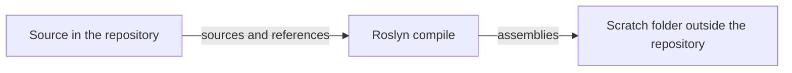
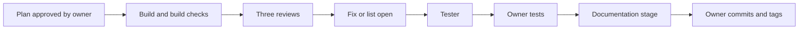

# Development Environment

- Title: Development Environment
- Audience: Developers and installers (internal)
- Shipped: No
- Applies to: WF3a2
- Last updated by: WF3a2, based on 5c6228f
- Status: Draft
- Verified against: for the development workflow (steps 1, 5, 6, 7 and 9) and the agents: CLAUDE.md (diff),
  .claude/agents/tester.md; for the section "The tester: what the development machine needs": Tests/package.json,
  Tests/README.md, Tests/_runner/Tester.Common.ps1 and Run-Tests.ps1 (tool lookup), Tests/lib/run.js,
  .gitignore, Database/README.md (section Step WF3a1); and for the rest: BMMS.sln, BMMS/BMMS.csproj, BMMSBAL/BMMSBAL.csproj, BMMSDAL/BMMSDAL.csproj,
  BMMS/Web.config (connectionStrings and compilation lines), BMMS/connectionStrings.config.example,
  .gitignore, CLAUDE.md, .claude/agents/*.md (name and description lines),
  .claude/hooks/doc-writer-guard.ps1, Documents/README.md, Documents/_build/DocTools.ps1,
  Documents/_build/Export-Documents.ps1 and Check-Documents.ps1 (tool lookup), Database/README.md
  (the sqlcmd -I line and the csc line), 07-database.txt of the BMMS_Test catalog export of
  2026-11-09 (kept outside the repository), the refs shown by git for-each-ref and git log, and, as
  leads only, Documentation/Architecture (BMMS-Architecture.md section 8 and
  BMMS-Current-State-Architecture.md); git ls-files BMMS/dll and the HintPaths of
  BMMSBAL/BMMSBAL.csproj
- To confirm: the exact command lines for the compile, the site precompile and the SQL parse; the
  branch policy (master protected, modernization for development); which Visual Studio workloads
  and which SQL Server edition a developer needs; where itextsharp.dll and
  Microsoft.Office.Interop.Word.dll are to come from when BMMS/dll is restored; how the
  documentation tools are installed

This chapter describes what a developer needs to build and test BMMS. The projects, the layers and
the third-party components are in 01-Overview-and-Architecture; they are not repeated here.
Installing BMMS on a server is in 03-Deployment-and-Installation.

## Tools and versions

| Item | What the files show |
|---|---|
| Solution | `BMMS.sln` is a Visual Studio solution file (format version 12.00) written by Visual Studio version 18 (`# Visual Studio Version 18`, `VisualStudioVersion = 18.10.12224.181`); it requires at least `MinimumVisualStudioVersion = 10.0.40219.1` |
| Projects | BMMS, BMMSBAL, BMMSDAL, each `TargetFrameworkVersion` v4.8 (.NET Framework 4.8) |
| Configurations | Debug and Release, each for Any CPU and for x86 (the solution lists all four) |
| C# language version | `LangVersion` 7.3 is set in the x86 configurations of the three projects (see 01-Overview-and-Architecture) |
| Web server for development | BMMS.csproj has `UseIISExpress` false |
| Database | SQL Server. The BMMS_Test catalog export of 2026-11-09 shows product version 17.0.1145.4 (RTM), Enterprise Developer Edition (64-bit), with BMMS_Test at compatibility level 100 |
| Database scripts | Transact-SQL for compatibility level 100 (see "The development workflow"). From the command line they run with `sqlcmd -I` (quoted identifiers ON; Database/README.md) |
| Shell for the tools | PowerShell 7 (the check, export and guard scripts start with `#Requires -Version 7` or 7.3) |
| Source control | git |

Output folders. In BMMS.csproj every configuration writes to `bin\`. In BMMSBAL.csproj and
BMMSDAL.csproj the Debug configuration writes to `bin\Debug\` and Release to `bin\Release\` (the
x86 configurations to `bin\x86\Debug\` and `bin\x86\Release\`). `.gitignore` lists `bin/` and `obj/`
(the third-party DLLs tracked under BMMS/bin and BMMSBAL/bin/Debug are kept on purpose; see
01-Overview-and-Architecture for the components and the open question about BMMS/dll).

[[CONFIRM: which Visual Studio workloads and which SQL Server edition a developer needs; the files name only the solution's Visual Studio version and the edition of the test server in the export]]

### Document tools

The documents in Documents/ are checked and exported by scripts in Documents/_build/ (Documents/README.md,
"Checks and export"). They use these tools, found as follows (Documents/_build/DocTools.ps1):

| Tool | Used for | How the scripts find it |
|---|---|---|
| pandoc | Reading Markdown for the checks; Markdown to Word | `-Pandoc <path to pandoc.exe>`, then pandoc on PATH, then the winget per-user folder and `C:\Program Files\Pandoc`. Only a real `.exe` is accepted |
| mermaid-cli (mmdc) | Parsing and rendering the Mermaid diagrams | `-Mmdc`, then `$env:BMMS_DOC_TOOLS\node_modules\.bin\mmdc.cmd`, then `C:\Tools\bmms-doc-tools\node_modules\.bin\mmdc.cmd`, then mmdc on PATH; started through node |
| Microsoft Edge | The browser mermaid-cli renders with (network traffic blocked) | `-Edge`, then the standard install folders |
| Microsoft Word | Export only: fills the title, version and date and updates the table of contents (COM) | Not searched; the export script starts Word through COM |

The check scripts (`Check-Documents.ps1`, `Check-UserManuals.ps1`) need pandoc and, for the Mermaid
check, mermaid-cli; they skip a check they cannot run and say so. The export script needs all four
tools and makes no network calls. [[CONFIRM: how the documentation tools are installed on the owner's machine; the scripts only say where they look]]

### The tester: what the development machine needs

The tester (step WF3a1; what it is and how it runs are in 10-Testing-and-Release) needs this on the
development machine:

| Item | What the files show |
|---|---|
| PowerShell 7 | The runner scripts start with `#Requires -Version 7` |
| Node.js | Version 20 or later (`engines` in Tests/package.json); the runner refuses when node is not found |
| playwright-core | The one Node package, version 1.65.0 (Tests/package.json, with package-lock.json). Install once per machine, and after Tests/package.json changes, with `npm ci` in the Tests folder (needs the internet). No browser is downloaded |
| Chrome | The installed Google Chrome, started headless through playwright-core (`channel: 'chrome'` in Tests/lib/run.js) |
| MSBuild | Found with vswhere from the Visual Studio Installer, else at a fixed Visual Studio 18 Community path; the runner builds BMMS/BMMS.csproj into Tests/_build (the projects' own bin and obj are not written) |
| IIS Express | `C:\Program Files (x86)\IIS Express\iisexpress.exe`, run on port 18573 with the .NET 4 runtime |
| SQL Server | The local default instance (the tester's server name is fixed as `.`), with sysadmin rights for the owner's Windows login for the one-time setup |
| Database BMMS_Quality | A restore of BMMS_Test with every database step installed, then cleared, given its fixture and baselined by Tests/_runner/Setup-Quality.ps1. It is separate from BMMS and BMMS_Test, which the tester never uses |
| Two SQL logins | bmms_tester (owner of BMMS_Quality) and bmms_site (the site copy's login), made by the setup; neither has a server role or access to another database. bmms_app must already be linked in BMMS_Quality with db_backupoperator, db_datareader and db_datawriter |
| Port 18573 | Must be free when a run starts (the runner refuses otherwise). Port 49673 was tried first and lies in the Windows range for outgoing connections |
| sqlcmd | Used by the runner and the setup scripts |

Local folders that git does not hold (`.gitignore`): `Tests/_results/` (results of every run),
`Tests/_site/` (the site copy, rebuilt at every run), `Tests/_build/` (its build), `Tests/local/` (the
generated credentials and the baseline record, readable by the owner's Windows account only) and
`Tests/node_modules/`. The baseline backup BMMS_Quality_baseline.bak lies in the SQL Server backup
folder. Nothing in these folders is committed, and no password is written in a document.

## Getting the source

The repository has these branches and tags (git for-each-ref on the working copy):

- Local branches `legacy`, `main`, `master` and `modernization`; remote-tracking branches
  `origin/main` and `origin/modernization` (and `origin/HEAD`).
- Tags: one per step (for example `user-ud1a`, `workflow-wf2a`), and the tag
  `BMMS-Recovered-Baseline`.
- `modernization` and `origin/modernization` point to the same commit as this chapter's base
  (3dd0eec, "WF2a: Documents baseline, doc-writer agent with guard hook, export and check tooling").

Branch policy. The older architecture notes (Documentation/Architecture/BMMS-Current-State-Architecture.md)
say that `master` is the recovery baseline with no direct changes (emergency fixes only) and that
`modernization` is the branch for active development. The current development work is committed on
`modernization`. [[CONFIRM: that `master` is protected and `modernization` is the development branch; the policy comes from the old notes, git shows only that the branches exist and that development commits are on modernization; confirm with the owner]]

Working rules that apply to the source (CLAUDE.md): one tag per step; commits are staged by
explicit path (`git add <path>`), never as a whole; the owner commits, tags and pushes, not the
tools. Left out of commits: BMMS/Files/AgendaText/, Database/BMMS-Check-SmallintParameters.sql,
bin and obj. Rebuilt binaries are never committed, although bin/ and obj/ files are tracked.

Files that git does not hold and a new working copy therefore lacks (`.gitignore`):

- `BMMS/connectionStrings.config` (the connection string; see the next section);
- `App_Data/PageAccessLog.txt`, and the upload and output folders `BMMS/Files/MemberPhoto/`,
  `BMMS/Files/MemberResume/`, `BMMS/Files/PDF/`, `BMMS/Files/AgendaAttach/`,
  `BMMS/Files/SqlBackup/`, `BMMS/Files/Branding/` and the contents of `BMMS/Files/Temp/` (the
  folder itself is kept by a `.gitkeep` file, which the Send Mail page needs);
- the `Log/` folders and `*.bak` files;
- `BMMS/dll/`, which the project references use as hint paths for itextsharp.dll and
  Microsoft.Office.Interop.Word.dll; it is not in `.gitignore` but git tracks no file there
  (`git ls-files BMMS/dll` lists nothing). A fresh clone cannot build until itextsharp.dll and the
  Interop DLL are restored into BMMS/dll (hint paths in BMMSBAL.csproj; 01-Overview-and-Architecture).
  [[CONFIRM: where the two DLLs are to come from; confirm on a clean build machine]]

## Connection settings (placeholders only)

BMMS/Web.config does not hold the connection string: it contains
`<connectionStrings configSource="connectionStrings.config"/>`, so ASP.NET reads the section from
the file `BMMS/connectionStrings.config` next to Web.config. That file is in `.gitignore`
(twice, in two spellings) and is never committed. The data layer reads the connection named
`ConnectionString` (see 01-Overview-and-Architecture).

To set up a development machine, copy `BMMS/connectionStrings.config.example` (tracked) to
`BMMS/connectionStrings.config` and replace the placeholders. The example holds one
`add` element named `ConnectionString`, with these parts:

| Part | Value in the example | What you put there |
|---|---|---|
| server | `.` (the local default instance) | `<server>` of your SQL Server |
| database | `BMMS` | `<database>`: BMMS_Test for development and tests (see below) |
| login | `bmms_app` | the SQL login of the application, `<login>` |
| password | `YOUR_PASSWORD` | `<password>`, kept only in your own `connectionStrings.config` |
| TrustServerCertificate | `True` | as the example has it |

Never put the real values into a document, a commit message or a tracked file. Test scripts run on
BMMS_Test only (CLAUDE.md); the database-name guard in the scripts is `BMMS%`, so the name of a
test copy must start with BMMS (see 03-Deployment-and-Installation for the scripts).
[[CONFIRM: which database name and login a developer's connectionStrings.config should use; the example shows BMMS and bmms_app, the house rules say tests run on BMMS_Test]]

## Building without touching bin and obj

The house rule (CLAUDE.md, step 2 of the development workflow) is: compile into a scratch folder,
with Build and not Rebuild, so that `bin` and `obj` of the repository stay untouched. This matters
because bin/ and obj/ files are tracked in git and a rebuild would change them; rebuilt binaries
must not go into commits.

Method:

1. Compile the projects with the Roslyn compiler (csc), with the output folder set to a scratch
   folder outside the repository, `<scratch folder>`. The order follows the references: BMMSDAL,
   then BMMSBAL (references BMMSDAL, `HtmlAgilityPack`, `itextsharp`,
   `Microsoft.Office.Interop.Word`), then BMMS (references BMMSBAL, `AjaxControlToolkit`,
   `HtmlAgilityPack`, `itextsharp`). The sources and references are those of the three project
   files (01-Overview-and-Architecture).
2. The compile must end with 0 errors. Nothing is written under `bin` or `obj`.

| From | To | Data | Notes |
|---|---|---|---|
| Source | Roslyn compile | The `.cs` files and the references of the project files | `bin` and `obj` are not used |
| Roslyn compile | Scratch folder | Assemblies | Kept outside the repository; deleted when no longer needed |

Drawn from: CLAUDE.md (development workflow, step 2), the three project files.

The exact command line (the csc path, the switches, the reference list, the scratch folder) is not
in a tracked file. [[CONFIRM: the exact compile command line for the three projects; it is not in a tracked file, ask the owner for the script or command used for the build check]] The tracked
Database/README.md shows, for a small check program, a call of the .NET Framework 4 compiler of the
form `csc.exe /nologo /r:BMMSBAL.dll /r:System.Data.dll /r:System.Web.dll /out:<program>.exe <program>.cs`;
that is an example of the compiler's use, not the build command.

Visual Studio's own Build writes to `bin` and `obj` (the output paths above). To use Visual Studio
without changing tracked files, do not commit what it writes; stage source files by explicit path.

## Site precompile check

Step 2 of the development workflow also names a site precompile. It compiles the `.aspx`, `.ascx`
and master pages of the BMMS web application, as ASP.NET does on the first request, and so finds
errors in the page markup and in inline code that a compile of the `.cs` files does not. It is run
against the repository's BMMS folder and writes to a target folder outside the repository, in the
same way as the compile above: `<scratch folder>`, never `bin` or `obj`.

The tool and the command line are not in a tracked file. [[CONFIRM: the exact site precompile command (tool, source and target folders, switches); not in a tracked file, ask the owner]]
A precompile needs the application's `bin` folder with the compiled assemblies of the build, or a
copy of them. [[CONFIRM: how the precompile gets the assemblies when the compile goes to a scratch folder]]

## The development workflow

CLAUDE.md sets the workflow for every step. In short:

1. Plan first. The owner approves the plan before any code or file change. Every plan names the
   documents affected (by the update matrix in Documents/README.md) or says "documents affected:
   none". It lists its browser checks in two sets: "tester" (the packs the tester runs) and "owner
   by eye" (looks, print, Word, PDF layout).
2. Build, then the build checks: the compile into a scratch folder, the site precompile, an SQL
   parse, and the step's Test script on BMMS_Test.
3. Review: three read-only reviewer agents, each run separately on the step's git diff and its new
   untracked files, each given the step's requirement and not the reasoning behind the code.
4. Fix the High and Medium findings, or list them as open with a reason; Low findings go to the
   backlog ("Known items for later steps" in Database/README.md). After a fix, run the build checks
   again and the reviewer that raised the finding.
5. Tester, after the fixes and before the owner's tests: the tester agent runs the step's packs
   (always at least access-matrix). A step with a new database script first brings the tester's
   baseline up to date with Tests/_runner/Update-Baseline.ps1, on the owner's approval of the build.
   A failed check goes to the owner as it is, with the main session's reading of it; the tester
   never writes or changes a test, a pack or an expected result, and nothing is changed to make a
   run pass without the owner's word. A REFUSED, VOID or RUNNER FAILED result is reported, and the
   tester is run again once the cause is removed (10-Testing-and-Release, "The tester").
6. Report to the owner in six parts: the build checks and results, the files changed, the three
   reviewer records, what was fixed and what is open, test steps for the owner (the "owner by eye"
   set), and the tester record verbatim.
7. Documentation stage, after the owner's tests pass and before the commit: the doc-writer agent
   updates the documents; the two check scripts run; the documents go in the same commit as the
   step.
8. Nobody but the owner commits, tags or pushes.

| From | To | Data | Notes |
|---|---|---|---|
| Plan approved by owner | Build and build checks | The approved plan | Names the documents affected |
| Build and build checks | Three reviews | The step's git diff and new files | Reviewers get the requirement, not the reasoning |
| Three reviews | Fix or list open | Findings | High and Medium fixed or listed open; Low to the backlog |
| Fix or list open | Tester | The step's packs; a new database script first updates the baseline | The tester agent runs the packs; a failure goes to the owner as it is |
| Tester | Owner tests | The report in six parts, the tester record verbatim | Build checks run again after a fix |
| Owner tests | Documentation stage | The test result | The doc-writer gets the requirement, the diff and the test result |
| Documentation stage | Owner commits and tags | Code and documents | One commit and one tag per step |

Drawn from: CLAUDE.md (development workflow, steps 1 to 9).

### The build checks

| Check | What it is | Where it is described |
|---|---|---|
| Compile | Build (not Rebuild) into a scratch folder; `bin` and `obj` untouched; 0 errors | "Building without touching bin and obj" |
| Site precompile | Compile of the pages | "Site precompile check" |
| SQL parse | Each new or changed script is parsed, not run, with `sqlcmd` and `SET NOEXEC ON` (the batches are compiled by the server and nothing executes). The exact command is not in a tracked file | below |
| Test script | The step's Test script, run on BMMS_Test only | 10-Testing-and-Release |

The SQL parse: connect to `<server>` with `sqlcmd -I` (quoted identifiers ON, as in
Database/README.md), run `SET NOEXEC ON;` first and then the script, and read the errors the
server reports. [[CONFIRM: the exact sqlcmd command line and how the script is fed to it for the NOEXEC parse; not in a tracked file, ask the owner]]

### SQL house rules for scripts

From CLAUDE.md:

- Test scripts run on BMMS_Test only.
- Numbered database steps have a Fix, a Rollback and a Test script, a marker in the procedure text
  and a row in `BMMS-Check-InstalledSteps.sql`.
- Compatibility level 100: no `THROW`, `TRY_CONVERT`, `IIF`, `CONCAT`, `FORMAT` or `OFFSET`.
- Database-name guard `BMMS%` (the scripts check the database name against it; the checking code is
  described in 03-Deployment-and-Installation).
- Plain ASCII; LF line endings in `.sql` files.
- One README section per step (Database/README.md).

### The agents

The agents are Claude Code subagents defined in `.claude/agents/`:

| Agent | Purpose (its description line) |
|---|---|
| security-reviewer | Read-only security review of one step: SQL and procedures, input and output handling, roles and acting-user rules, mail headers, secrets, uploads, audit rows, races and rollback. Never edits files |
| ux-reviewer | Read-only usability review of one step: steps per role, the owner's terms, messages about what was and was not saved, validation, confirmations, read-only states, keyboard use, edge cases, mail failure after a save. Never edits files |
| ui-reviewer | Read-only visual review of one step: use of bmms-workbench.css and existing page patterns, clipping and overflow at laptop widths, column alignment, colour and contrast, icons with text or tooltip, Chrome and Edge at 100 percent. Never edits files |
| tester | Runs the tester's packs (Tests/_runner/Run-Tests.ps1) and returns a fixed record; tools Read and Bash, confined by .claude/hooks/tester-guard.ps1; writes nothing and changes no test (10-Testing-and-Release) |
| doc-writer | Writes and updates the documents in Documents/ for one step, after the owner's tests pass and before the commit, and returns a record of the documents changed, the statements it could not verify and a shot list. Writes only inside Documents/ |

The doc-writer has a guard hook (`.claude/hooks/doc-writer-guard.ps1`, declared in the agent's
frontmatter, so it runs only while doc-writer runs). It blocks:

- any Write or Edit outside the Documents/ folder, and inside Documents/Export/ and
  Documents/_build/;
- any Bash command that is not one read-only git command (log, diff, show, status, ls-files,
  blame, describe, for-each-ref, rev-parse), and any such command with characters other than
  letters, digits, spaces and `. _ / : = @ % ^ ~ , + -`, or with an option such as `--output`,
  `--ext-diff`, `--textconv`, `--exec`, `--no-index` or `-O`;
- anything it cannot read or understand (it fails closed; the hook command ends with
  `|| exit 2`).

It is a second layer. The main session also compares `git status --short --ignored` before and
after doc-writer runs; only files inside Documents/ may change.

### Documentation checks

After doc-writer, run from the repository root in PowerShell 7:

- `pwsh -File Documents/_build/Check-Documents.ps1`
- `pwsh -File Documents/_build/Check-UserManuals.ps1`

What they check, and the export, are in Documents/README.md ("Checks and export"). The export
refuses a document with an inline `[[CONFIRM: ...]]` or a non-empty "To confirm" field.
