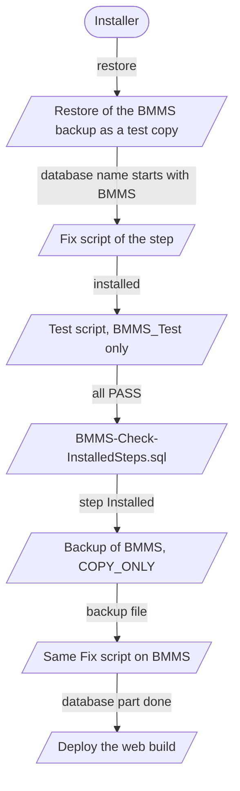
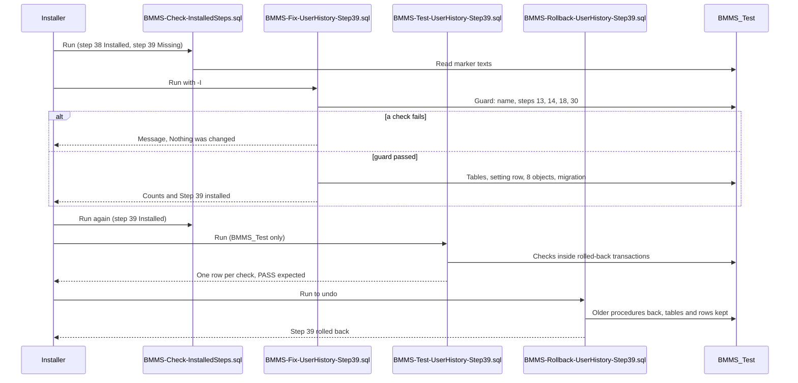

# Deployment and Installation

- Title: Deployment and Installation
- Audience: Developers and installers (internal)
- Shipped: No
- Applies to: UN6c2a (step 44: the run order, rollback and the section "Installing step 44 on a test database"); UN6c1 (step 43: the run order, rollback and the section "Installing step 43 on a test database"); UN6b (step 42: the run order, rollback and the section "Installing step 42 on a test database"); WF3a2 (section "The tester's baseline after a new database step"); the rest RA1b (step 41)
- Last updated by: UN6c2a, based on 493cb45
- Status: Draft
- Verified against: for UN6c2a (step 44): Database/BMMS-Fix-AgendaWaitingFor-Step44.sql (guards, messages, read in full), BMMS-Rollback-AgendaWaitingFor-Step44.sql (guards, messages),
  BMMS-Test-AgendaWaitingFor-Step44.sql (header, the comparison cases), BMMS-Check-InstalledSteps.sql (diff), Database/README.md (section Step UN6c2a, "What to run where"), the owner's test result and the tester run of 2026-11-14 as given;
  for UN6c1 (step 43): Database/BMMS-Fix-DashboardAlerts-Step43.sql (guards, messages),
  BMMS-Rollback-DashboardAlerts-Step43.sql (guards, messages), BMMS-Test-DashboardAlerts-Step43.sql (header),
  BMMS-Check-InstalledSteps.sql (diff), Database/README.md (section Step UN6c1, "What to run where"), the owner's
  test result as given (128 numbered checks passed); for UN6b (step 42): Database/BMMS-Fix-DashboardMeetings-Step42.sql (header, guards, messages),
  BMMS-Rollback-DashboardMeetings-Step42.sql (guards, messages), BMMS-Test-DashboardMeetings-Step42.sql (header, guards),
  BMMS-Check-InstalledSteps.sql (diff), Database/README.md (section Step UN6b, "What to run where"), the owner's
  test result as given (71 of 71); for WF3a2: CLAUDE.md (step 5), Tests/_runner/Update-Baseline.ps1 (diff),
  Database/README.md (section Step WF3a2); and for the rest: Database/README.md ("Always test on a copy first", "Run order" with its
  re-run notes, "Test and check scripts", the "what to run where" parts of steps 13, 15, 29, 30
  and UD1a (step 39)), the header comments and guard code of the Database/ Fix, Rollback, Add,
  Check and Test scripts (all names listed by git; BMMS-Check-SmallintParameters.sql left out),
  Database/BMMS-Fix-UserHistory-Step39.sql, BMMS-Rollback-UserHistory-Step39.sql and
  BMMS-Test-UserHistory-Step39.sql in full, Database/BMMS-Check-InstalledSteps.sql,
  BMMS/Web.config, BMMS/connectionStrings.config.example, BMMS/BMMS.csproj (Fonts content),
  BMMS/Properties/AssemblyInfo.cs, BMMSBAL/Utilities.cs (WriteErrorLog), BMMSBAL/Sql_Backup_Mgr.cs,
  BMMSBAL/OrganisationDetails.cs, BMMSBAL/PdfFonts.cs, BMMS/PageAccessModule.cs,
  BMMS/Master/BackupDatabase.aspx.cs, BMMS/Master/Agenda.aspx.cs, BMMS/Master/Member.aspx.cs,
  BMMS/Report/SendMail.aspx.cs (folders written), git ls-files (BMMS/Files, BMMS/Fonts), 07-database.txt
  of the BMMS_Test catalog export of 2026-11-09 (kept outside the repository), Chapters 01 and 02
  of this manual, Documents/Data-Flow/04-Workflows/06-Release-and-Install.md (still a stub);
  the CREATE OR ALTER lines of BMMS-Fix-UserHistory-Step39.sql, git ls-files BMMS/dll, the
  HintPaths of BMMSBAL/BMMSBAL.csproj; for step 40 (RA1a): Database/BMMS-Fix-RoleAccess-Step40.sql
  (header, guards, messages), BMMS-Rollback-RoleAccess-Step40.sql (guards, messages),
  BMMS-Test-RoleAccess-Step40.sql (header), BMMS-Check-InstalledSteps.sql (the step 40 rows),
  Database/README.md (step RA1a: order, test result); for step 41 (RA1b):
  Database/BMMS-Fix-ReportAccess-Step41.sql (header, guards, messages), BMMS-Rollback-ReportAccess-Step41.sql
  (guards, messages), BMMS-Test-ReportAccess-Step41.sql (header), BMMS-Check-InstalledSteps.sql (diff),
  Database/README.md (step RA1b section and run order line 41)
- To confirm: where itextsharp.dll and the Interop DLL are to come from for a fresh clone; the IIS settings (site, application pool, .NET version, identity, bindings, folder
  permissions); the server prerequisites beyond what the project files show; what is installed on
  BMMS (step state, build, runtime Web.config, SMTP settings); the minimum SQL Server version; the
  exact sqlcmd command line and login option; whether the SQL Server service can write to the
  backup folder under the site; whether a restore of the pre-step backup is the intended way back
  for steps 1 to 31; how the deployed build reaches the server; the Check script's result after the
  step 39 rollback (its two headers disagree); that the live connection string does not use the sa
  login; the permission the application login needs for Backup Database; the step 42 Test script was read in
  part (header and part 1), not in full (its count, 71 numbered checks, is confirmed by the owner's full run)

This chapter covers installing BMMS: the database scripts, the web application and the order of
both. The projects and layers are in 01-Overview-and-Architecture, the development tools, the
connection settings of a development machine and the SQL house rules are in
02-Development-Environment; they are not repeated here. What the scripts and Test scripts prove is
in 10-Testing-and-Release; the install and release workflow as lanes is in
Data-Flow/04-Workflows/06-Release-and-Install.md (not written yet).

## What is installed

BMMS has two parts that are installed separately and in a fixed relation to each other.

| Part | What it is | Where the repository holds it |
|---|---|---|
| Web application | The ASP.NET Web Forms site (BMMS project) with its two class libraries compiled in, its XML settings, fonts and folders | `BMMS/` (site), `BMMSBAL/`, `BMMSDAL/` |
| Database | One SQL Server database. The live one is called `BMMS`; test copies are called `BMMS_Test` (the copy the tests run on), `BMMS_bak1` and `BMMS_Quality` in Database/README.md | `Database/*.sql` and `Database/README.md` |

The web application reads the database through the connection named `ConnectionString` in
`BMMS/connectionStrings.config`, a file that is not in git (see 02-Development-Environment). The
application also sends mail through an SMTP server named in the database table of mail settings
(SMTP Configuration page); chapter 07 describes mail.

What the BMMS_Test catalog export of 2026-11-09 (kept outside the repository) shows for that copy,
for orientation: compatibility level 100, collation SQL_Latin1_General_CP1_CI_AS, 33 user tables,
11 views, 165 stored procedures, 4 inline table-valued and 3 scalar functions, 58 foreign keys. The
installed `BMMS` may differ from BMMS_Test; BMMS-Check-InstalledSteps.sql (below) is the way to
see the real state of any database.

[[CONFIRM: what is installed on BMMS today (which steps, which build, which Web.config); run BMMS-Check-InstalledSteps.sql on BMMS and compare the site folder; Database/README.md dates its "installed on" statements and they are older than steps 31 to 39]]

## Server prerequisites

Web server. Facts from the files:

- .NET Framework 4.8: every project targets v4.8 (01-Overview-and-Architecture).
- IIS in integrated pipeline mode: Web.config registers the `PageAccess` and `ScriptModule`
  modules under `system.webServer/modules` with `preCondition="integratedMode"`, and the
  request-filtering rule that hides the folders `PDF`, `SqlBackup` and `Log` is an IIS setting
  (`system.webServer/security/requestFiltering/hiddenSegments`), answered by IIS before the
  application.
- Windows authentication is declared (`authentication mode="Windows"`); the application's own
  login is a session login on the Default.aspx page (01-Overview-and-Architecture).
- Session state is in process (`sessionState mode="InProc"`, 10 minutes): the site must run as a
  single worker process, and an application pool recycle ends every session.
- The PDF font files in `BMMS/Fonts/Pdf` must be present in the site folder: a missing file stops
  the PDF export with the message "The PDF font file is missing: [path]" in the error log
  (BMMSBAL/PdfFonts.cs). The files are Content in BMMS.csproj, so Publish copies them.
- Microsoft Word is not needed on the web server: no code calls the Word Interop classes, and the
  Export to Word button sends HTML as a `.doc` download (01-Overview-and-Architecture).

Database server.

- SQL Server. The scripts are written for compatibility level 100 (no `THROW`, `TRY_CONVERT`,
  `IIF`, `CONCAT`, `FORMAT` or `OFFSET`, CLAUDE.md) but they do use `CREATE OR ALTER`, filtered
  indexes and table-value constructors, so the server itself must support those. BMMS_Test runs
  on product version 17.0.1145.4 (07-database.txt) at compatibility level 100.
- The application login (named `bmms_app` in the connection string example) needs DELETE and
  ALTER on the tables (or db_owner) for Reset Database: without them Reset Database stops at its
  first reseed, rolls back and logs the error (Database/README.md, step 29).
  [[CONFIRM: lead from old Errata notes: check that the live connection string does not use the sa login]]
  [[CONFIRM: the permission the application login needs for Backup Database (BACKUP DATABASE, for example db_backupoperator); not verified against the live login]]
- Backup Database (Utilities page) runs a `BACKUP DATABASE` statement into
  `<site>\Files\SqlBackup` (BMMSBAL/Sql_Backup_Mgr.cs, BMMS/Master/BackupDatabase.aspx.cs). The path
  is handed to SQL Server, so the SQL Server service must be able to write to it.

Mail. Every alert mail, Notice, Send Mail and Reset Password use the SMTP settings. A new or reset
database has the safe default (localhost, port 25, no login, no real mail, step 30), so real
settings must be entered on SMTP Configuration before BMMS can mail (Database/README.md,
step 30 and the mail sender of step 37).

[[CONFIRM: the IIS settings of the live site: site and application pool names, pool identity, integrated pipeline, .NET CLR version, bindings and certificate, upload limits; none is in a tracked file]]
[[CONFIRM: the minimum SQL Server version the scripts need (CREATE OR ALTER and the filtered indexes); the files show only the version of the test server]]
[[CONFIRM: that the SQL Server service and the application pool identity can write where the site needs them to (the folders below); the code shows what is written, not the accounts]]

## Database install: run order of the numbered steps

### Safe way to install any step

From Database/README.md ("Always test on a copy first"): every change goes to a test copy before
it goes to `BMMS`.

1. Restore the latest `BMMS` backup as a second database with another name. The README uses
   `BMMS_bak1` and, for later steps, `BMMS_Test`; the name must start with BMMS (see the
   database-name guard below). Never restore over `BMMS` for a test, and never over an existing
   test database. In SSMS: Restore Database, change the database name and the two file names.
2. Run the scripts and the tests on the copy. Every test must show PASS (or SKIPPED) before going
   on.
3. Back up `BMMS` with `BACKUP DATABASE BMMS TO DISK = N'<backup folder>\BMMS_before_change.bak' WITH COPY_ONLY;`
   (the README's example statement, with the folder replaced).
4. Run the same scripts on `BMMS`, in the same order. Since step 33 the README's "what to run
   where" lists give for `BMMS`: the Check script, the Fix script, the Check script again, then the
   build; "no test script on BMMS".

Test scripts run on BMMS_Test only (CLAUDE.md). The Reset Database test refuses to run on a database
named exactly `BMMS`.

### The database-name guard

Chapter 02 refers to this section. Every Fix, Rollback, Check and Test script, except scripts 1, 2
and 4 to 9 and BMMS-Check-Orphans.sql (named below), has no `USE` line: it works in the database that is selected (the SSMS toolbar, or the
`-d` option of sqlcmd) and begins with a guard batch. The guard of a Fix or Rollback script, as the
scripts show it:

1. It reads `DB_NAME()` and compares it with the pattern `BMMS%`. A name that does not start with
   BMMS stops the script with the error text "Current database is "[name]". Select the BMMS
   database (or its test copy) and run again. Nothing was changed."
2. It checks that the steps it depends on are installed, by the marker text each step leaves in the
   procedures it owns (see "Checking installed steps"). When one is missing it stops with a message
   that names the missing step and ends with "Nothing was changed." (The step 39 script's checks
   are listed in the worked example below.)
3. Each failed check raises the error and then runs `SET NOEXEC ON`. With NOEXEC on, SQL Server
   skips every following batch, so nothing is created, changed or deleted, even though the file
   has more `GO` batches. The last batch of the file runs `SET NOEXEC OFF`, so the next script in
   the same window starts clean.
4. A script that passes the guard prints `Database: [name]` before its first change.

The scripts 1, 2 and 4 to 9 (BMMS-Fix-Login-Procedures.sql, BMMS-Fix-Delete-Procedures.sql,
BMMS-Add-PrimaryKeys.sql, BMMS-Add-ForeignKeys-Safe.sql, BMMS-Fix-FK-Procedures.sql,
BMMS-Add-ForeignKeys-Step3.sql, BMMS-Fix-MinutesFinalize-Procedure.sql,
BMMS-Add-ForeignKeys-Step4.sql) and BMMS-Check-Orphans.sql start with `USE [BMMS]`; they have no
name guard. To run one of them on a test copy, change that first line to the copy's name in the
SSMS window and do not save the change (Database/README.md). Step 3 (BMMS-Fix-ResetDatabase-Seeds.sql)
lost its `USE` line in step 29 and has the usual guard.

The Test scripts have two forms of guard, as a search of the scripts shows:

- Most test scripts use the same `BMMS%` check. BMMS-Test-ResetDatabase.sql and
  BMMS-Test-UserHistory-Step39.sql also refuse the exact name `BMMS` (they run the Reset Database
  procedure inside a transaction that is rolled back).
- The test scripts of code steps (for example BMMS-Test-AgendaDates-M4.sql,
  BMMS-Test-MeetingDelete-D1.sql, BMMS-Test-LoginName-Step34.sql,
  BMMS-Test-ManagerDepartment-Step33.sql) run on the database named exactly `BMMS_Test` and stop
  on any other name.

Two scripts stop for other reasons as well: BMMS-Add-ForeignKeys-Step4.sql adds nothing and prints
a message when Reset Database has not been updated (step 3), and BMMS-Add-ForeignKeys-Step5.sql
refuses a key whose column holds an unknown user (Database/README.md, steps 9 and 11).

### Run order

The list below is the install order as Database/README.md ("Run order") gives it. The README holds
the full description of each script (what it replaces, what it needs); the table here names the
script, what it is for in a few words, and what the README says about the order with the web
build. "SQL before the build" means: install the database script first, then deploy the web
application.

| Step | Script | In short | Order notes (from the README) |
|---|---|---|---|
| 1 | BMMS-Fix-Login-Procedures.sql | Login lookup split, needed by the password hashing | `USE [BMMS]` line |
| 2 | BMMS-Fix-Delete-Procedures.sql | Delete procedures with reference checks | `USE [BMMS]` line |
| 3 | BMMS-Fix-ResetDatabase-Seeds.sql | Reset Database seeds hashed passwords and "no manager" as NULL; installs the procedure only | Does not reset anything |
| 4 | BMMS-Add-PrimaryKeys.sql | Primary keys | `USE [BMMS]` line |
| 5 | BMMS-Add-ForeignKeys-Safe.sql | FK_Agenda_Committee, FK_Attendance_Committee | `USE [BMMS]` line |
| 6 | BMMS-Fix-FK-Procedures.sql | Seven procedures changed so the next keys can be added | Needs the MemberDB.cs NULL-state fix deployed |
| 7 | BMMS-Add-ForeignKeys-Step3.sql | Four foreign keys | `USE [BMMS]` line |
| 8 | BMMS-Fix-MinutesFinalize-Procedure.sql | Minutes finalization no longer duplicates action items | `USE [BMMS]` line |
| 9 | BMMS-Add-ForeignKeys-Step4.sql | FK_Users_ManagerId | After the build that stores "no manager" as NULL; refuses on a restored baseline until `UPDATE dbo.Users SET ManagerId = NULL WHERE ManagerId = 0;` has been run |
| 10 | BMMS-Fix-UserDelete-Procedure.sql | A user with history cannot be deleted | Always after steps 2 and 6 |
| 11 | BMMS-Add-ForeignKeys-Step5.sql | 21 keys from user-id columns to Users | Refuses until step 10 is installed |
| 12 | BMMS-Fix-Attendance-FutureMeeting.sql | Attendance only for a meeting dated today or earlier | Before deploying the build that reads its Result |
| 13 | BMMS-Fix-UserProtection-Stage1.sql | Who may change which user account | After step 10, before the build that reads Reason |
| 14 | BMMS-Fix-UserStatus-Stage2a.sql | Inactive users | SQL before the build |
| 15 | BMMS-Fix-MeetingLocks.sql | Meeting-state locks | SQL before the build, the build straight after (no gap) |
| 16 | BMMS-Fix-MeetingLocks-Step16.sql | Meeting locks part 2, table App_Setting | SQL before the build, the build straight after |
| 17 | BMMS-Fix-UserStatus-Stage2b.sql | Inactive users get no new alerts or mail | SQL before the build, the build straight after |
| 18 | BMMS-Fix-SystemAccount-Stage3.sql | The protected System Administrator account | SQL before the build, the build straight after |
| 19 | BMMS-Fix-OrganisationSettings-Step19.sql | Organisation details as settings | SQL before the build |
| 21 | BMMS-Fix-MemberTypes-Step21.sql | Member Type Master | Installed before step 20 (step 20 needs it); SQL before the build, the build straight after |
| 20 | BMMS-Fix-AgendaRouting-Step20.sql | Agenda routing and the meeting signer | Needs steps 18, 19 and 21; SQL before the build, the build straight after |
| 22 | BMMS-Fix-MinutesGating-Step22.sql | Minutes reports only after Minutes Finalisation | Needs step 15; SQL before the build |
| 24 | BMMS-Fix-MeetingDates-Step24.sql | Meeting dates | Needs steps 16, 17 and 18; SQL before the build |
| 23 | BMMS-Fix-WorkflowOrder-Step23.sql | Meeting workflow order | Installed after step 28 (numbered before steps 24 to 28 were built); needs steps 12 and 15 to 18; SQL before the build |
| 29 | BMMS-Fix-ResetDatabase-Step29.sql | Reset Database made safe | Needs steps 18 and 21; SQL before the build; in the last group, after step 23 |
| 30 | BMMS-Fix-SmtpDefault-Step30.sql | Safe SMTP default | Needs steps 18 and 21; SQL before the build (the build works with or without it) |
| 31 | BMMS-Fix-UnicodeText-Step31.sql | Unicode agenda and minutes text | Needs steps 18, 20 and 23; SQL before the build of step U1b; refuses to run once step 32 has replaced one of its procedures |
| D1 | BMMS-Fix-MeetingDelete-D1.sql | Meeting delete rules | After step 31; either order with the build; shown as step 100 by the Check script |
| 33 | BMMS-Fix-ManagerDepartment-Step33.sql | Agenda Entry list by department | After step D1 (step 32 is reserved and not built); before the build of step C2; BMMS-Rollback-ManagerDepartment-Step33.sql |
| 34 | BMMS-Fix-LoginName-Step34.sql | Login ID in the access log | After step 33; either order with the build |
| 35 | BMMS-Fix-CommentAuthor-Step35.sql | Who last saved a comment, and when | After step 34 |
| 36 | BMMS-Fix-AlertRefresh-Step36.sql | A changed agenda item alerts again | After step 35; the script stops when step 35 is not installed |
| 37 | BMMS-Fix-UpdateMail-Step37.sql | Mail on Update | After step 36; the sender must be set (README, "The sender") |
| 38 | BMMS-Fix-MinutesDueDate-Step38.sql | Optional due date on a Followup decision | Needs step 31; either order with the build |
| 39 | BMMS-Fix-UserHistory-Step39.sql | Role and department history | After step 38; needs steps 13, 14, 18 and 30; either order with the build |
| 40 | BMMS-Fix-RoleAccess-Step40.sql | User accounts and member types for Admin only | After step 39 (stops otherwise); either order with the build; BMMS-Rollback-RoleAccess-Step40.sql |
| 41 | BMMS-Fix-ReportAccess-Step41.sql | Minutes report in every status for the Controller and Management; Followup for Management | After step 40 (stops otherwise; also needs step 22); SQL before the build (the build calls the procedures); BMMS-Rollback-ReportAccess-Step41.sql |
| 42 | BMMS-Fix-DashboardMeetings-Step42.sql | Dashboard Meetings card: status colours, last 10 completed meetings, counts by role and department | After step 41 (stops otherwise; also needs the tables User_Department and Agenda_Status); SQL before the build (the build calls the objects); BMMS-Rollback-DashboardMeetings-Step42.sql |
| 43 | BMMS-Fix-DashboardAlerts-Step43.sql | Dashboard Alerts card (Recent, Unread, All; server paging; person and event date; Remove from my list), header count, Action Items scope, Due date and Overdue; no functional alerts or mail for Admin | After step 42 (stops otherwise; also needs steps 35, 37 and 38); SQL before the build (the build calls the objects); BMMS-Rollback-DashboardAlerts-Step43.sql |
| 44 | BMMS-Fix-AgendaWaitingFor-Step44.sql | Dashboard My approvals panel and Waiting for me column; one rule (fn_AgendaWaitingFor) for who may approve; the Approve and Reject buttons read the server | After step 43 (stops otherwise; also needs step 42's fn_UserDepartmentScope and the procedures spr_UpdateAgendaByAgendaId and spr_GetDashboardMeetings); stops when either of those two is neither the text the step was built from nor the step 44 text; SQL before the build (the build calls the objects; the earlier build keeps working with step 44 installed); BMMS-Rollback-AgendaWaitingFor-Step44.sql |

Steps 25, 26 and 28 have no database script (code only). Step 27 is not built. Step 32 is reserved
for role permissions and not built. The lettered code steps that have a database script are D1
(above); the others in Database/README.md ("Step E1", "Step A2a" and so on) are code, markup or CSS
only and need no database script.

The out-of-number-order installs, in the order to install:

1. Steps 1 to 19, then 21, then 20, then 22 and 24.
2. Step 23, after step 28 was built (the list in the README stays in number order; step 24 was
   installed before it on the databases that followed the README order).
3. Steps 29, 30 and 31, last of the numbered group, in that order.
4. Step D1, then 33, 34, 35, 36, 37, 38, 39, 40, 41, 42, 43 and 44 in number order. Step 44 is the last step;
   it stops unless step 43 is installed. Step 43 stops unless step 42 is installed. Step 42 stops unless step 41 is installed. Step 41 stops unless step 40 is installed (and step 22, whose two
   minutes report procedures it leaves unchanged). Step 40 stops unless step 39 is installed. (Re-running step 13, 14, 18 or 21 brings back an older text:
   run step 40 again.)

On a new database (restored from the baseline, not `BMMS`), after step 30, the README adds one
call: `EXEC dbo.spr_sys_SetSmtpDefault @ConfirmDatabaseName = N'[the database name]';` (Result 1).
The restored mail row would otherwise keep mailing through whatever server it names. Never run it
on `BMMS`, which keeps its real settings.

If you install from the command line use `sqlcmd -I` (quoted identifiers ON); installing from SSMS
already does this (Database/README.md). The filtered indexes of step 39 need it, and its header
says so. The
scripts also set the ANSI options they need (for example step 39 sets ANSI_NULLS and
QUOTED_IDENTIFIER ON itself).

| From | To | Data | Notes |
|---|---|---|---|
| Installer | Restore | Backup of BMMS | Never over BMMS or an existing test database |
| Restore | Fix script | The test copy | The guard stops any database whose name does not start with BMMS |
| Fix script | Test script | Installed objects | Test runs on BMMS_Test only |
| Test script | Check script | PASS rows | PASS or SKIPPED for every check |
| Check script | Backup | Status Installed | Read only |
| Backup | Same Fix script on BMMS | Backup file | A backup of BMMS before the change |
| Same Fix script on BMMS | Deploy the web build | Database part done | For most steps the SQL goes first; see the table above |

Drawn from: Database/README.md ("Always test on a copy first", "Run order"),
Database/BMMS-Fix-UserHistory-Step39.sql (guard).

## Checking installed steps

BMMS-Check-InstalledSteps.sql is read only: it reads object definitions and constraint names, and
creates, changes and deletes nothing, so it can run on `BMMS` as well as on a copy. It has the
database-name guard of a script without a `USE` line.

How a step is detected. Each numbered step leaves a marker: a text in a comment inside the
procedures, functions and views the step owns, for example `UserHistory-Step39` in the text of the
eight objects of step 39. The Check script reads the text of each object (`OBJECT_DEFINITION`)
and looks for the marker with `LIKE`. For a step that is replaced by a later one it checks what
survives (the older markers the later step keeps). Some steps also check a column, a table, a
constraint or a setting row (for step 39: the tables User_Role and User_Department and the
App_Setting row DeptNoManagerAction, 11 markers in all).

What it prints (result grids):

1. One row per step (1 to 24, 29, 30, 31, 33 to 42, and step D1 shown as step 100): Step,
   Script, Status, Detail. Status is Installed (every marker present), Partly (some present),
   Missing (none) or Not detectable (none of today's steps). Detail gives "[n] of [m] markers" and,
   for Partly, which step to run again.
2. Every marker that is missing, for a step that is not fully installed.
3. The mail sender of step 37 (whether MailSenderUserId names an active Controller-role user whose
   address is the From Mail Id of SMTP Configuration; the addresses are not shown).
4. The history check of step 39 (whether the history rows agree with Users; counts only, no names).
5. The name of the current database.

Partly usually means that an older script was run again after a newer one, which brings back an
older procedure text (see "Upgrading an existing installation"). Step 32 is reserved and has no
row.

### The tester's baseline after a new database step

After a new numbered database step the tester's baseline (the database BMMS_Quality on the
development machine) is brought up to date with Tests/_runner/Update-Baseline.ps1, on the owner's
approval of the build and before the tester runs (CLAUDE.md, step 5); until then every tester run is
refused as "out of date". It does not install the step on BMMS or BMMS_Test. How it works is in
10-Testing-and-Release ("Upkeep after a new database step").

## Web application install

There is no deployment script or publish profile in the repository (the tracked scripts are the
database scripts and the documentation tools). [[CONFIRM: how the build reaches the server (Visual Studio Publish, a folder copy or another way); no tracked file says]] The facts the files give:

0. Fresh install point: BMMS/dll is not tracked (`git ls-files BMMS/dll` lists nothing), so a
   fresh clone cannot build until itextsharp.dll and the Interop DLL that the BMMSBAL.csproj hint
   paths name (`..\BMMS\dll\...`) are restored into BMMS/dll. [[CONFIRM: where the two DLLs are to come from]]
1. Build the three projects (02-Development-Environment). BMMS.csproj marks the fonts as Content, so
   Publish includes them; the BMMS project output goes to `bin\`.
2. The site folder (the IIS application root) holds the pages, `bin`, `Fonts`, `XML`, `CSS`,
   `JScript`, `Web.config` and the folders listed below. The version shown in the footer is
   AssemblyInformationalVersion, `1.1.0` in BMMS/Properties/AssemblyInfo.cs.
3. Create `connectionStrings.config` next to `Web.config` from `connectionStrings.config.example`:
   one `add` element named `ConnectionString`. Put the real values in only on the server
   (02-Development-Environment lists the parts: server, database, login, password,
   TrustServerCertificate). For BMMS the database is `BMMS`; for a test site, `BMMS_Test`.
4. Web.config is not deployed over the runtime Web.config of a server: lines that a step adds to
   Web.config (the `globalization` line of step U1b, the hidden-segments and custom-header lines
   of steps 26 and E2c) are added to the runtime file by hand (Database/README.md, steps U1b and
   F1 and E2c). Compare the runtime file with the repository's after each deployment. [[CONFIRM: the installed Web.config, in particular compilation debug="true" (see 01-Overview-and-Architecture)]]
5. Recycle the application pool after a Web.config change (the README does so in its test steps).
   Session state is in process, so every user is signed out by a recycle.
6. Open the site: the login page (Default.aspx) is the only public page besides Logout and the
   error page; every other `.aspx` page needs a signed-in user whose role is listed in
   `XML/PageAccess.xml` (01-Overview-and-Architecture).

The XML files in `BMMS/XML` are part of the site: `AppSettings.xml`, `PageAccess.xml`,
`PageSettings.xml` and `ReportSettings.xml` (what they hold is chapter 06). `PageAccess.xml` has the
mode of the access check (`Enforce` in the repository file).

### Folders the application writes to

The code creates or writes these folders under the site. Git does not hold their contents
(02-Development-Environment), so a new site has them empty or absent. The identity that runs the
application pool must be able to create and write files in them.

| Folder | Written by | Notes |
|---|---|---|
| `Log` | `Utilities.WriteErrorLog`: one file per day, `yyyy_MM_dd_ErrorLog.txt` | Created when missing. Hidden from browsers (hidden segment `Log`) |
| `App_Data` | PageAccessModule: `PageAccessLog.txt`, a line for each request refused (or, in LogOnly mode, that would be refused) | Created when missing. Never served by IIS |
| `Files/AgendaAttach` | Agenda Entry: attachments of an agenda item | Names made safe and unique; served to signed-in pages by link |
| `Files/AgendaText` | Agenda Entry: uploaded agenda text file | Left out of commits (CLAUDE.md) |
| `Files/MemberPhoto` | Member Master: photo, `<member code>-Photo.jpg` | The two default photos (MalePhoto.png, FemalePhoto.png) are tracked in git |
| `Files/MemberResume` | Member Master: resume, `<member code>-Resume.Doc` | |
| `Files/Temp` | Send Mail: the attachment of a mail in preparation; files older than 24 hours are removed | The folder is kept by a `.gitkeep` file; Send Mail needs it |
| `Files/SqlBackup` | Backup Database: `SqlBakup-<date and time>.bak`, written by SQL Server | Hidden from browsers (hidden segment `SqlBackup`) |
| `Files/Branding` | System Settings: the organisation logo, `report-logo.png` | Created by the logo upload |
| `Files/PDF` | No longer written by the report pages (steps 25 and 26 build the PDFs in memory); Followup pages still write `Followup.pdf` there | Hidden from browsers (hidden segment `PDF`) |
| `Fonts/Pdf` | Read only: the Noto Serif files for PDF output | Part of the build (Content); must be present |

The Reset Database page counts the files in `Files/AgendaAttach`, `AgendaText`, `MemberPhoto`,
`MemberResume` and `SqlBackup`; a reset does not remove them (Database/README.md, step 29).

[[CONFIRM: which accounts need which permission on these folders on the live server; and whether the site and SQL Server run on the same machine (the backup path is a path on the SQL Server machine)]]

## Upgrading an existing installation

1. Run BMMS-Check-InstalledSteps.sql on the database (on `BMMS` it is allowed, it reads only) and
   note which steps are Installed, Partly or Missing.
2. Rehearse on a copy (restore of the live backup as `BMMS_Test` or another BMMS name), as in
   "Safe way to install any step": install the missing steps in the run order, run the Test script
   of each, run the Check script again.
3. Back up `BMMS`, then run on `BMMS`: for each missing step the Check script, the Fix script, the
   Check script again (the "what to run where" lists of the README steps 33 and later give exactly
   this, "no test script on BMMS").
4. Deploy the build in the relation to the SQL that the step's README section gives: for most steps
   the SQL first, and for steps 15 to 18, 20 and 21 straight after, in a quiet period, with no gap
   (the README describes what the older build does during the gap). For steps 34, 38, 39 and D1
   either order is safe.
5. Add by hand to the runtime Web.config any line the step added (see the web install above), and
   recycle the application pool.

The re-run rule. Many procedures are replaced by several steps, each time keeping the earlier
steps' marker texts. A step that is run again later brings back an older text of a procedure that a
newer step had replaced, and the newer step then reads Partly or Missing in the Check script. The
rule in the README is: after re-running an older step, run the later steps that replace the same
procedures again, in number order, with the steps 29, 30, 31 and 39 last. Examples from the
README:

- If step 2, 3, 6, 10, 13, 18, 21, 29 or 30 is run again, run step 39 again. Step
  39 is safe to run again: it keeps its tables, rows and setting value and re-syncs the rows with
  Users.
- If step 13, 14, 18 or 21 is run again, run step 40 again, after step 39 (step 40 changes no data
  and is safe to run again). The Check script then reads step 40 Partly or Missing until you do.
- Step 41 adds three procedures and replaces nothing, so re-running an older step does not remove it.
  The Fix script checks that spr_GetMinutesReport and spr_GetMinutesReportMeetings carry the step 22
  marker, that View_Minute, View_Meeting and View_Action_Item exist, and that step 40 is installed.
- Step 42 adds five objects (three inline table functions and two procedures) and replaces nothing, so
  re-running an older step does not remove it. The Fix script checks that spr_GetFollowupReportForManagement
  carries the step 41 marker and that the tables User_Department and Agenda_Status exist.
- If step 3, 18, 21 or 29 is run again, run step 30 again, as the last step (it holds the whole
  step 29 text).
- If step 6, 15, 16, 17, 18, 20 or 23 is run again, run step 31 again, as the last step of that
  chain (its columns stay Unicode, but an older procedure turns new text into `?`, and the Check
  script shows step 31 Partly until then).
- If step 6, 16, 17, 18, 23 or 31 is run again, run step 38 again. If step 16, 17, 18, 20, 31 or 35
  is run again, run step 35, 36 and 37 again in that order.

The full chains for every step are the paragraphs that follow the run order list in
Database/README.md; the Detail column of the Check script names the step to run again for each
Partly row. Step 31 refuses to run once step 32 has replaced one of its procedures.

## Rolling back a step

Rollback scripts exist for steps 33 to 42 only (Database/ folder):

| Step | Script | What it restores | What it keeps |
|---|---|---|---|
| 33 | BMMS-Rollback-ManagerDepartment-Step33.sql | The baseline texts of the two agenda list procedures | Changes no data; the Check script then reads step 33 Missing |
| 34 | BMMS-Rollback-LoginName-Step34.sql | The step 1 text of the login procedure | The column Login_Name with its login IDs; step 34 then reads Partly |
| 35 | BMMS-Rollback-CommentAuthor-Step35.sql | The step 31 texts of the three agenda procedures | The who and when values already written; roll back step 36 first; step 35 then reads Missing |
| 36 | BMMS-Rollback-AlertRefresh-Step36.sql | The texts of steps 31 and 35 | The alerts already refreshed; roll back step 37 first; step 36 then reads Missing |
| 37 | BMMS-Rollback-UpdateMail-Step37.sql | The step 36 texts; drops the mail-recipient procedure and deletes the MailSenderUserId setting row | The alert refresh of step 36. Roll back the build first (or at the same time): the step 37 build would show "the mail could not be sent" |
| 38 | BMMS-Rollback-MinutesDueDate-Step38.sql | The step 31 text of the minutes update procedure | The due dates already stored |
| 39 | BMMS-Rollback-UserHistory-Step39.sql | The older procedures (steps 2, 13 and 30); drops the three new objects | The tables User_Role and User_Department with all rows, and the setting row |
| 40 | BMMS-Rollback-RoleAccess-Step40.sql | The step 18 text of the user rule function and the step 21 texts of the two member type procedures (THROW included) | Changes no data; the Check script then reads step 40 Missing; stops with "Nothing was changed" when no object carries the step 40 marker |
| 41 | BMMS-Rollback-ReportAccess-Step41.sql | Nothing is restored: it drops the three procedures spr_GetMinutesReportMeetingsAllStatus, spr_GetMinutesReportAllStatus and spr_GetFollowupReportForManagement | Changes no data; spr_GetMinutesReport and spr_GetMinutesReportMeetings of step 22 stay; roll back the build first (the step 41 build calls the procedures and would show the error page for the Controller's and Management's Minutes report and Management's Followup); stops with "Nothing was changed" when none of the three exists; the Check script then reads step 41 Missing |
| 42 | BMMS-Rollback-DashboardMeetings-Step42.sql | Nothing is restored: it drops spr_GetDashboardMeetings, spr_GetDashboardDepartments, fn_MeetingDashboardState, fn_UserDepartmentScope and fn_AgendaStatusGroup | Changes no data; spr_GetScheduleMeet was never changed; roll back the build first or at the same time (the step 42 build calls the objects; without them the Meetings card shows "The meeting list could not be loaded. Reload the page to try again." and the alerts and action items still work); stops with "Nothing was changed" when none of the five exists; the Check script then reads step 42 Missing |
| 43 | BMMS-Rollback-DashboardAlerts-Step43.sql | Drops the eight new objects and puts spr_GetAlertMailId and spr_GetAgendaUpdateMailId back as the texts of steps 18 and 37, letter for letter (the script compares the SHA-1 of the restored texts with the texts the step was built from) | Roll back the build first (the step 43 build calls the new procedures). The read rows that opening an action item created in ActionItem_User_Map stay; the earlier build lists an item for everyone who has a row. Stops with "Nothing was changed" when none of the eight exists and the mail procedures do not carry the step 43 marker; the Check script then reads step 43 Missing |

Each Rollback script has the database-name guard, checks that the step it undoes (or the step
before it) is in place and stops with "Nothing was changed" otherwise, changes no other data, and is
safe to run again, also where the step was never installed. Roll steps back in the reverse of their
install order (43, 42, 41, 40, 39, 38, 37, 36, 35, 34, 33). Roll back the application build of the step too, so the
database is not left half way (README, step 39).

For steps 1 to 31 and D1 no Rollback script is tracked in Database/. [[CONFIRM: that restoring the backup taken before the step is the intended way back for those steps; Database/README.md names no other]]

## Installing step 39 on a test database

A worked example with the step 39 scripts (step UD1a: role and department history). It shows what
the scripts do, in numbered steps. The server is `<server>` and the database is `BMMS_Test`.

Before you start. Step 39 is installed last and needs steps 13, 14, 18 and 30 (and the App_Setting
table of step 16). Its header says it is installed after step 38. The script itself does not look
for step 38; the Check script does (step 1 below).

1. Check the state. Select `BMMS_Test` and run BMMS-Check-InstalledSteps.sql. The first grid
   should show step 38 Installed and step 39 Missing (Database/README.md, step UD1a). If step 13,
   14, 18 or 30 is not Installed, run those first; step 39 will refuse otherwise.
2. Back up the database you are about to change. For `BMMS_Test` take a copy before you start if the
   current state matters (for `BMMS`, as in "Safe way to install any step", step 3).
3. Run the Fix script. In SSMS: select `BMMS_Test` in the toolbar, open
   `Database/BMMS-Fix-UserHistory-Step39.sql` and execute it. From the command line:

   `sqlcmd -S <server> -d BMMS_Test -I -i Database/BMMS-Fix-UserHistory-Step39.sql`

   `-I` is needed (quoted identifiers ON; the filtered indexes need it) and `-d` selects the
   database because the script has no `USE` line. [[CONFIRM: the exact sqlcmd command line and login option (for example -E or -U) of the owner; only the -I option is in a tracked file]]
4. The guard runs first. It stops the script, with "Nothing was changed.", and changes nothing,
   in these cases (the messages as the script has them, with the database name in place of
   [name]):
   - the database name does not start with BMMS;
   - "Step 13 (BMMS-Fix-UserProtection-Stage1.sql) is not installed in "[name]" (or step 2, 6 or 10
     was re-run after it). Run it first, then steps 14 and 18, then this script.";
   - "Steps 14 and 18 (...) are not installed in "[name]". Run them first, then this script.";
   - "Step 30 (BMMS-Fix-SmtpDefault-Step30.sql) is not installed in "[name]" (or step 3, 18, 21 or
     29 was re-run after it). Run it first, then this script.";
   - Table App_Setting (step 16) or Audit_Trail_Master is missing;
   - the number of users flagged as the system account is not exactly one ("exactly one is
     needed");
   - a user has a DepartmentId or RoleId that is not in Department or Roles ("Correct them
     first");
   - a table named User_Role or User_Department already exists but is not the step 39 table.
5. What the script prints when it succeeds, in order (no row counts are printed, NOCOUNT is on):
   - `Database: BMMS_Test`
   - `Table User_Role created.` and `Table User_Department created.` (only the first time)
   - `App_Setting DeptNoManagerAction added: "refuse".` (or `... kept: "[value]".` when the row
     exists)
   - three lines of counts: `User_Role: [n] opened, [n] closed rows added for inactive users, [n]
     closed (role changed), [n] closed (user inactive).`, the same for `User_Department`, and
     `Now: [n] users, [n] active; open role rows [n], open home department rows [n], open
     department rows [n]; all rows [n] and [n].`
   - `Step 39 installed: User_Role, User_Department, the setting DeptNoManagerAction and 8
     procedures (UserHistory-Step39); the texts of steps 3, 10, 13, 18, 21, 29 and 30 kept.`

   Note: the script says "8 procedures", but it creates 7 procedures (spr_AddEditUser,
   spr_SetUserStatusByUserId, spr_DeleteUserByUserId, spr_DeleteDepartmentByDeptId,
   spr_GetUserDepartmentMap, spr_SetDepartmentManagerRule, spr_sys_ResetDatabase) and 1 function
   (fn_ManagerReleaseRefusal), as its CREATE OR ALTER lines 381 to 1323 show. The "8 objects"
   elsewhere in this chapter is correct.

   If the last check finds something missing, the script ends with "Step 39 is not complete:
   markers [n] of 8, older texts [n] of 10, tables [n] of 2, setting row [n], delete parameters
   [n] of 5, reset parameters [n] of 4. Read the messages above and run the script again."
6. Run it a second time to see that it is safe. The tables and the setting are kept and nothing is
   created again; the migration runs again and prints its counts. The README states that a second
   run prints 0 opened and 0 closed (the rows already agree with Users). If a user was changed
   between the runs, the script closes the rows that no longer agree and opens the missing ones
   (the re-sync).
7. Run BMMS-Check-InstalledSteps.sql again. Step 39 should read Installed, 11 of 11 markers; steps
   2, 3, 10, 13, 18, 21, 29 and 30 should still read Installed; the history grid should read
   "history rows agree with Users".
8. Run the Test script on `BMMS_Test` only: `Database/BMMS-Test-UserHistory-Step39.sql`. It refuses
   a database named exactly `BMMS` and any name that does not start with BMMS, and stops if step 39
   is not installed. Part 1 only reads; part 2 works inside one transaction that is rolled back,
   with made-up users and departments (names beginning ZZ39); part 3 runs the Reset Database
   procedure inside a transaction that is rolled back and puts every identity counter back. The
   result is one grid with a Status per check, which should be PASS for every row, then one row with
   the database name and the counts Passed, Failed and Skipped. [[CONFIRM: the number of checks of the step 39 test on BMMS_Test; the script builds the list at run time and no tracked file states the count]]
9. Deploy the build when you are ready; for step 39 either order with the SQL is safe (the build
   sends the department list only when the new procedure exists).
10. To undo: run `Database/BMMS-Rollback-UserHistory-Step39.sql` on the same database
    (`sqlcmd -S <server> -d BMMS_Test -I -i Database/BMMS-Rollback-UserHistory-Step39.sql`). It stops
    unless the database name starts with BMMS and steps 18 and 30 are installed. It restores the
    older procedures and drops the three new objects; it keeps both tables, all their rows and the
    setting row. On success it prints `Step 39 rolled back: the procedures of steps 2, 13 and 30 are
    back; kept: User_Role ([n] rows), User_Department ([n] rows) and the setting
    DeptNoManagerAction.` If an object still carries the step 39 marker it ends with "Step 39 is not
    fully rolled back".
11. After a rollback: while the history rows exist and step 39 is rolled back, deleting a user who has
    history rows is refused by the foreign keys (User Master says "other data still refers to
    them"), and Reset Database fails and changes nothing. Install step 39 again (step 3 above)
    before deleting users or resetting the database; it re-syncs the rows with Users and prints the
    counts. The Check script reads step 39 Partly, 3 of 11 after the rollback (the tables and the
    setting row stay). [[CONFIRM: the Check script's status after the step 39 rollback; the Check script's own header and Database/README.md say Partly, 3 of 11, the Rollback script's header says Missing; run the Check script after a rollback on BMMS_Test]]

| From | To | Data | Notes |
|---|---|---|---|
| Installer | Check script | Run on BMMS_Test | Read only |
| Check script | BMMS_Test | Marker texts | One row per step |
| Installer | Fix script | Run with -I | Select the database first |
| Fix script | BMMS_Test | Guard reads, then tables, setting row, 8 objects and the migration | One transaction for the migration |
| Fix script | Installer | Messages | A failed check prints the message and sets NOEXEC |
| Installer | Test script | Run on BMMS_Test | Refuses BMMS |
| Test script | Installer | One grid with a Status per check | Rolled back; counters put back |
| Installer | Rollback script | Run to undo | Needs steps 18 and 30 |
| Rollback script | BMMS_Test | Older texts restored | Tables, rows and the setting row stay |

Drawn from: Database/BMMS-Fix-UserHistory-Step39.sql, Database/BMMS-Rollback-UserHistory-Step39.sql,
Database/BMMS-Test-UserHistory-Step39.sql, Database/BMMS-Check-InstalledSteps.sql, Database/README.md
(step UD1a, "what to run where").

## Installing step 40 on a test database

A worked example with the step 40 scripts (step RA1a: user accounts, member types and the code
masters for Admin only). The server is `<server>` and the database is `BMMS_Test`. The step changes
no data: it replaces one function and two procedures.

1. Check the state. Select `BMMS_Test` and run BMMS-Check-InstalledSteps.sql. Step 39 should read
   Installed and step 40 Missing.
2. Back up the database as for any step ("Safe way to install any step").
3. Run the Fix script (`sqlcmd -S <server> -d BMMS_Test -I -i Database/BMMS-Fix-RoleAccess-Step40.sql`).
   It has no `USE` line; select the database first. It stops with "Nothing was changed." when the
   database name does not start with BMMS, when fn_UserChangeRefusal does not have the step 18
   text or the two member type procedures do not have the step 21 text (the message names the
   steps to run first), or when step 39 is not installed ("The steps are installed in order: run
   step 39 first, then this script.").
4. On success it prints `Database: BMMS_Test` and then `Step 40 installed: fn_UserChangeRefusal,
   spr_AddEditMemberType and spr_DeleteMemberTypeByMemberTypeId (RoleAccess-Step40); the markers of
   steps 13, 14, 18 and 21 kept.` If an object lacks the marker afterwards it ends with "Step 40 is
   not complete: [n] of 3 objects carry the marker RoleAccess-Step40, [n] of 5 older markers kept.
   Read the messages above and run the script again." A second run prints the same success line.
5. Run BMMS-Check-InstalledSteps.sql again. Step 40 should read Installed, 3 of 3 markers; steps 13,
   14, 18, 21 and 39 should still read Installed.
6. Run the Test script on `BMMS_Test` only: `Database/BMMS-Test-RoleAccess-Step40.sql`. It refuses a
   database named exactly `BMMS` and any name that does not start with BMMS, and stops if step 40 is
   not installed. Part 1 only reads; part 2 works inside one transaction that is rolled back, with
   made-up users, a department and a member type (names beginning ZZ40), and puts every identity
   counter back. The result is one grid with a Status per check: 43 of 43 PASS on BMMS_Test (owner's
   run for step RA1a). Then run the older user and member type Test scripts (chapter 10).
7. Deploy the build when you are ready; either order with the SQL is safe. The build alone keeps
   the Controller out of the pages; the SQL alone makes the database refuse the same changes (an
   older build then shows a Controller the Reason 4 message).
8. To undo: run `Database/BMMS-Rollback-RoleAccess-Step40.sql` on the same database, and the
   previous build. It stops with "Step 40 is not installed in [name] (no object carries the marker
   RoleAccess-Step40): nothing to roll back. Nothing was changed." when none of the three objects
   carries the marker. On success it prints `Step 40 rolled back: fn_UserChangeRefusal of step 18
   and the member type procedures of step 21 are back.` If an object still carries the marker it
   ends with "Step 40 is not fully rolled back: [n] objects still carry RoleAccess-Step40. Read the
   messages above and run the script again." The Check script then reads step 40 Missing.

Drawn from: Database/BMMS-Fix-RoleAccess-Step40.sql, Database/BMMS-Rollback-RoleAccess-Step40.sql,
Database/BMMS-Test-RoleAccess-Step40.sql, Database/BMMS-Check-InstalledSteps.sql, Database/README.md
(step RA1a, "what to run where").

## Installing step 41 on a test database

A worked example with the step 41 scripts (step RA1b: the Minutes report in every status for the
Controller and Management, Followup for Management). The server is `<server>` and the database is
`BMMS_Test`. The step adds three read-only procedures, replaces nothing and changes no data. Run the
SQL before you deploy the build: the build calls the procedures.

1. Check the state. Select `BMMS_Test` and run BMMS-Check-InstalledSteps.sql. Step 40 should read
   Installed and step 41 Missing.
2. Back up the database as for any step ("Safe way to install any step").
3. Run the Fix script (`sqlcmd -S <server> -d BMMS_Test -I -i Database/BMMS-Fix-ReportAccess-Step41.sql`).
   It has no `USE` line; select the database first. It stops with "Nothing was changed." when the
   database name does not start with BMMS, when spr_GetMinutesReport or spr_GetMinutesReportMeetings
   does not have the step 22 text (or View_Minute, View_Meeting or View_Action_Item is missing), or when
   step 40 is not installed ("The steps are installed in order: run step 40 first, then this script.").
4. On success it prints `Database: BMMS_Test` and then `Step 41 installed:
   spr_GetMinutesReportMeetingsAllStatus, spr_GetMinutesReportAllStatus and
   spr_GetFollowupReportForManagement (ReportAccess-Step41); spr_GetMinutesReport and
   spr_GetMinutesReportMeetings of step 22 unchanged.` A second run prints the same line. If a
   procedure lacks the marker it ends with "Step 41 is not complete: [n] of 3 procedures carry the
   marker ReportAccess-Step41. Read the messages above and run the script again."
5. Run BMMS-Check-InstalledSteps.sql again. Step 41 should read Installed, 3 of 3 markers.
6. Run the Test script on `BMMS_Test` only: `Database/BMMS-Test-ReportAccess-Step41.sql`. It refuses a
   database named exactly `BMMS` and any name that does not start with BMMS, and stops if step 41 is not
   installed. Part 1 only reads; part 2 works inside one transaction that is rolled back, with made-up
   data (names beginning ZZ41). Result: one grid with a Status per check, all PASS (44 checks according to
   Database/README.md; the owner's run for step RA1b passed every row). Then run, unchanged, the Test
   scripts of steps 22, 31, 23 and 40 (chapter 10).
7. Deploy the build, then make the browser checks of Database/README.md (section RA1b).
8. To undo: the previous build first, then `Database/BMMS-Rollback-ReportAccess-Step41.sql`. It stops with
   "Step 41 is not installed in [name] (none of its three procedures exists): nothing to roll back.
   Nothing was changed." when none exists. On success it prints `Step 41 rolled back:
   spr_GetMinutesReportMeetingsAllStatus, spr_GetMinutesReportAllStatus and
   spr_GetFollowupReportForManagement dropped.` If a procedure is still there it ends with "Step 41 is
   not fully rolled back: [n] procedures are still there. Read the messages above and run the script
   again." The Check script then reads step 41 Missing.

Drawn from: Database/BMMS-Fix-ReportAccess-Step41.sql, Database/BMMS-Rollback-ReportAccess-Step41.sql,
Database/BMMS-Test-ReportAccess-Step41.sql (header), Database/BMMS-Check-InstalledSteps.sql,
Database/README.md (step RA1b, "what to run where"). Chapter 03 agrees with the README section of step 41
(order, SQL before the build, three markers, rollback behaviour); see "To confirm" for the points where it
does not.

## Installing step 42 on a test database

A worked example with the step 42 scripts (step UN6b: the Dashboard's Meetings card). The server is `<server>`
and the database is `BMMS_Test`. The step adds five read-only objects (three inline table functions and two
procedures), replaces nothing and changes no data. Run the SQL before you deploy the build: the build calls
the procedures.

1. Check the state. Select `BMMS_Test` and run BMMS-Check-InstalledSteps.sql. Step 41 should read
   Installed and step 42 Missing.
2. Back up the database as for any step ("Safe way to install any step").
3. Run the Fix script (`sqlcmd -S <server> -d BMMS_Test -I -i Database/BMMS-Fix-DashboardMeetings-Step42.sql`).
   It has no `USE` line; select the database first. It stops with "Nothing was changed." when the database name
   does not start with BMMS, or when spr_GetFollowupReportForManagement does not carry the step 41 marker or the
   table User_Department or Agenda_Status is missing ("The steps are installed in order: run step 41 first,
   then this script.").
4. On success it prints `Database: BMMS_Test` and then `Step 42 installed: fn_MeetingDashboardState,
   fn_UserDepartmentScope, fn_AgendaStatusGroup, spr_GetDashboardMeetings and spr_GetDashboardDepartments
   (DashboardMeetings-Step42); spr_GetScheduleMeet unchanged.` A second run prints the same line. If an object
   lacks the marker it ends with "Step 42 is not complete: [n] of 5 objects carry the marker
   DashboardMeetings-Step42. Read the messages above and run the script again."
5. Run BMMS-Check-InstalledSteps.sql again. Step 42 should read Installed, 5 of 5 markers.
6. Run the Test script on `BMMS_Test` only: `Database/BMMS-Test-DashboardMeetings-Step42.sql`. It refuses a
   database named exactly `BMMS` and any name that does not start with BMMS, and stops if step 42 is not
   installed. Part 1 only reads; part 2 works inside one transaction that is rolled back, with made-up data
   (names beginning ZZ42). Result: one grid with a Status per check, all PASS (71 of 71 in the owner's run for
   step UN6b).
7. Deploy the build, then make the browser checks of Database/README.md (section Step UN6b).
8. To undo: the previous build first, then `Database/BMMS-Rollback-DashboardMeetings-Step42.sql`. It stops with
   "Step 42 is not installed in [name] (none of its five objects exists): nothing to roll back. Nothing was
   changed." when none exists. On success it prints `Step 42 rolled back: spr_GetDashboardMeetings,
   spr_GetDashboardDepartments, fn_MeetingDashboardState, fn_UserDepartmentScope and fn_AgendaStatusGroup
   dropped.` If an object is still there it ends with "Step 42 is not fully rolled back: [n] objects are still
   there. Read the messages above and run the script again." The Check script then reads step 42 Missing.

On `BMMS`, the Consultant runs the Check script, the Fix script and the Check script again (steps 1, 3 and 5
of this list) after the backup (there is no Test script on `BMMS`), then deploys the build
(Database/README.md, section Step UN6b, "What to run where").

The tester's baseline was brought up to date for step 42 with Update-Baseline.ps1, and BMMS_Quality was built
afresh with the extended fixture (Setup-Quality.ps1, 2026-11-12); see 10-Testing-and-Release.

Drawn from: Database/BMMS-Fix-DashboardMeetings-Step42.sql, Database/BMMS-Rollback-DashboardMeetings-Step42.sql,
Database/BMMS-Test-DashboardMeetings-Step42.sql (header), Database/BMMS-Check-InstalledSteps.sql,
Database/README.md (section Step UN6b, "What to run where").

## Installing step 43 on a test database

A worked example with the step 43 scripts (step UN6c1: the Dashboard's Alerts card, the header count, the
Action Items scope). The server is `<server>` and the database is `BMMS_Test`. The step adds eight objects
(two inline table functions and six procedures) and replaces two procedures, spr_GetAlertMailId and
spr_GetAgendaUpdateMailId (the Admin role is left out of both). It changes no data. Run the SQL before you
deploy the build: the build calls the new procedures.

1. Check the state. Select `BMMS_Test` and run BMMS-Check-InstalledSteps.sql. Step 42 should read Installed
   and step 43 Missing.
2. Back up the database as for any step ("Safe way to install any step").
3. Run the Fix script (`sqlcmd -S <server> -d BMMS_Test -I -i Database/BMMS-Fix-DashboardAlerts-Step43.sql`).
   It has no `USE` line; select the database first. It stops with "Nothing was changed." when the database
   name does not start with BMMS, when step 42 or an earlier step it needs (35, 37, 38) is missing ("The steps
   are installed in order: run them first, then this script."), or when spr_GetAlertMailId or
   spr_GetAgendaUpdateMailId is neither the text the step was built from nor the step 43 text (a change made
   since would be lost; tell the Consultant).
4. On success it prints `Database: BMMS_Test` and then `Step 43 installed: fn_DashboardAlerts,
   spr_GetDashboardAlerts, spr_GetAlertCount, spr_RemoveAlertForUser, fn_DashboardActionItems,
   spr_GetDashboardActionItems, spr_OpenDashboardActionItem and spr_SaveDashboardActionText are new;
   spr_GetAlertMailId and spr_GetAgendaUpdateMailId leave out the Admin role (DashboardAlerts-Step43).` If an
   object lacks the marker it ends with "Step 43 is not complete: [n] of 10 objects carry the marker
   DashboardAlerts-Step43. Read the messages above and run the script again."
5. Run BMMS-Check-InstalledSteps.sql again. Step 43 should read Installed, 10 of 10 markers.
6. Run the Test script on `BMMS_Test` only, in a new query window:
   `Database/BMMS-Test-DashboardAlerts-Step43.sql`. Result: 128 numbered checks, all must PASS (all passed in
   the owner's run for step UN6c1).
7. Deploy the build, then make the browser checks of Database/README.md (section Step UN6c1).
8. To undo: the previous build first, then `Database/BMMS-Rollback-DashboardAlerts-Step43.sql`. On success it
   prints `Step 43 rolled back: the eight new objects are dropped; spr_GetAlertMailId and
   spr_GetAgendaUpdateMailId are again the texts of steps 18 and 37, letter for letter (SHA-1 compared).` If an
   object is still there it ends with "Step 43 is not fully rolled back: [n] of its eight new objects are
   still there. Read the messages above and run the script again." The Check script then reads step 43
   Missing. The Fix, Rollback, Fix sequence was checked on BMMS_Test.

On `BMMS`, the Consultant runs the Check script, the Fix script and the Check script again after the backup
(there is no Test script on `BMMS`), then deploys the build. Steps 37 to 42 come first there: the steps are
installed in order.

The tester's baseline was brought up to date for step 43 with Update-Baseline.ps1 -FixScript, and BMMS_Quality
was built afresh with the extended fixture (Setup-Quality.ps1, 2026-11-12); see 10-Testing-and-Release.

Drawn from: Database/BMMS-Fix-DashboardAlerts-Step43.sql, Database/BMMS-Rollback-DashboardAlerts-Step43.sql,
Database/BMMS-Test-DashboardAlerts-Step43.sql (header), Database/BMMS-Check-InstalledSteps.sql,
Database/README.md (section Step UN6c1, "What to run where").

## Installing step 44 on a test database

A worked example with the step 44 scripts (step UN6c2a: the Dashboard's My approvals panel, the Waiting for me
column and one rule for who may approve). The server is `<server>` and the database is `BMMS_Test`. The step adds
three objects (one inline table function, fn_AgendaWaitingFor, and two procedures, spr_GetAgendaApprovalState and
spr_GetDashboardApprovals) and replaces two procedures, spr_UpdateAgendaByAgendaId (the test "may this user act"
reads the function) and spr_GetDashboardMeetings (one more column and one more output). It changes no data and
grants nothing (the application login holds EXECUTE on the schema). Run the SQL before you deploy the build: the
build calls the new objects. The earlier build keeps working with step 44 installed.

1. Check the state. Select `BMMS_Test` and run BMMS-Check-InstalledSteps.sql. Step 43 should read Installed
   and step 44 Missing.
2. Back up the database as for any step ("Safe way to install any step").
3. Run the Fix script (`sqlcmd -S <server> -d BMMS_Test -I -i Database/BMMS-Fix-AgendaWaitingFor-Step44.sql`).
   It has no `USE` line; select the database first. It stops with "Nothing was changed." when the database
   name does not start with BMMS, when step 43 or an earlier object it needs is missing ("The steps are installed
   in order: run them first, then this script."), or when spr_UpdateAgendaByAgendaId or spr_GetDashboardMeetings
   is neither the text this step was built from (steps 35 and 42, compared by SHA-1 in pieces of 4,000
   characters) nor the step 44 text (a change made since would be lost; tell the Consultant).
4. On success it prints `Database: BMMS_Test` and then `Step 44 installed: fn_AgendaWaitingFor,
   spr_GetAgendaApprovalState and spr_GetDashboardApprovals are new; spr_UpdateAgendaByAgendaId reads its routing
   rule from the function and spr_GetDashboardMeetings has the column WaitingForMe (AgendaWaitingFor-Step44).` If
   an object lacks the marker it ends with "Step 44 is not complete: [n] of 5 objects carry the marker
   AgendaWaitingFor-Step44. Read the messages above and run the script again."
5. Run BMMS-Check-InstalledSteps.sql again. Step 44 should read Installed, 5 of 5 markers. Re-running step 16,
   17, 18, 20, 31, 35 or 42 afterwards brings back an older text and step 44 then reads Partly: run step 44 again.
6. Run the Test script on `BMMS_Test` only, in a new query window:
   `Database/BMMS-Test-AgendaWaitingFor-Step44.sql`. All numbered checks must PASS; among them the 1352-case
   comparison of the earlier and the new approval procedure (13 acting users x 13 items x 8 action words, no
   difference allowed). 120 checks, all PASS (run of 2026-11-14 on BMMS_Test). Then run
   BMMS-Test-DashboardMeetings-Step42.sql (71 checks, adjusted for the step 44 shape) and
   BMMS-Test-DashboardAlerts-Step43.sql (128 checks, unchanged).
7. Deploy the build, then make the browser checks of Database/README.md (section Step UN6c2a).
8. To undo: the previous build first, then `Database/BMMS-Rollback-AgendaWaitingFor-Step44.sql`. On success it
   prints `Step 44 rolled back: the three new objects are dropped; spr_UpdateAgendaByAgendaId and
   spr_GetDashboardMeetings are again the texts of steps 35 and 42, letter for letter (SHA-1 compared).` If an
   object is still there it ends with "Step 44 is not fully rolled back: [n] of its three new objects are still
   there. Read the messages above and run the script again."; if a restored text differs it says so and tells the
   Consultant. The Check script then reads step 44 Missing. The Fix, Rollback, Fix sequence was checked on
   BMMS_Test (Database/README.md). With the new build and no step 44 the panel shows its "could not be loaded"
   message, the meeting list fails to load and no item can be approved from the Dashboard.

On `BMMS`, the Consultant runs the Check script, the Fix script and the Check script again after the backup
(there is no Test script on `BMMS`), then deploys the build. Steps 43 and earlier come first there: the steps
are installed in order.

The tester's baseline was brought up to date for step 44 (the tester run of 2026-11-14 ran on the baseline
with step 44, and the fixture check passes 38 of 38); see 10-Testing-and-Release.

Drawn from: Database/BMMS-Fix-AgendaWaitingFor-Step44.sql, Database/BMMS-Rollback-AgendaWaitingFor-Step44.sql,
Database/BMMS-Test-AgendaWaitingFor-Step44.sql (header), Database/BMMS-Check-InstalledSteps.sql,
Database/README.md (section Step UN6c2a, "What to run where").
