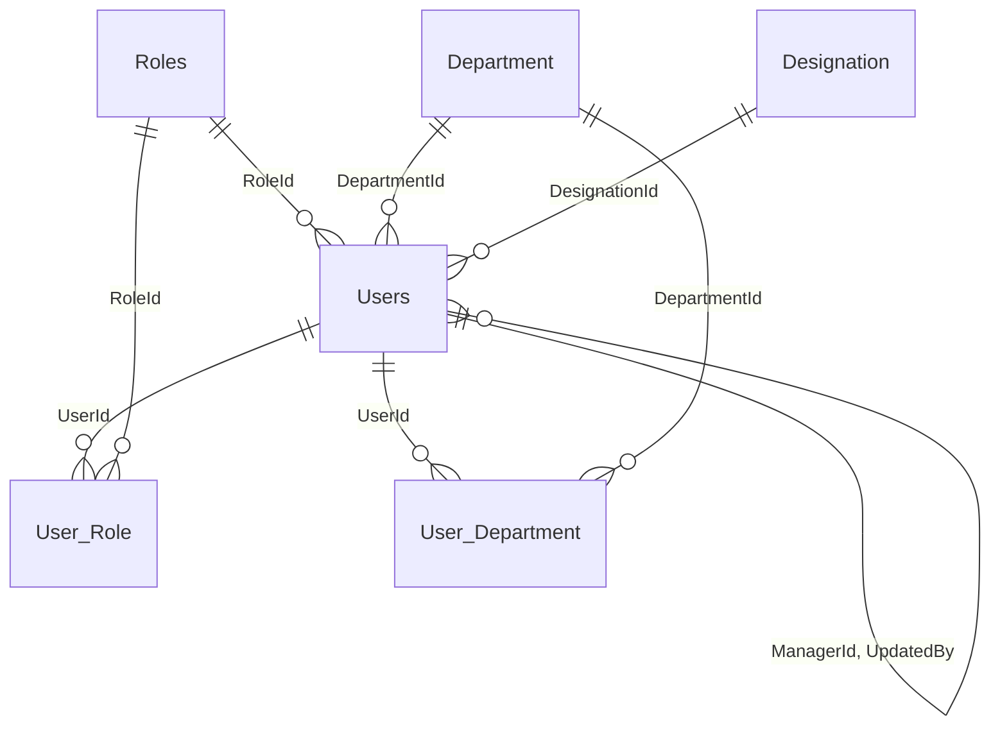
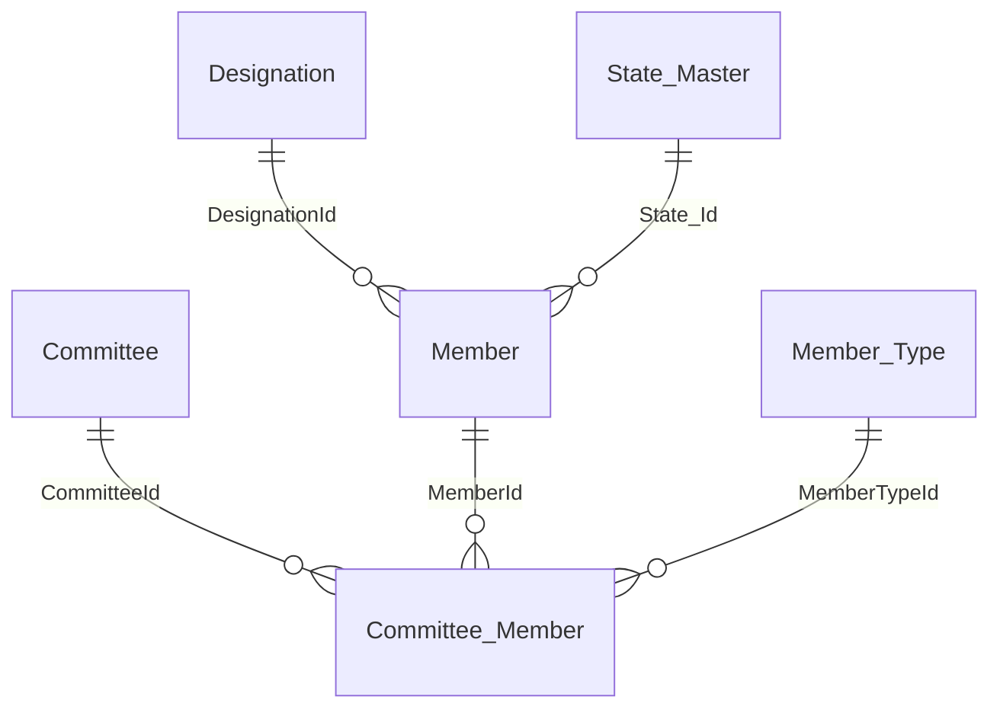
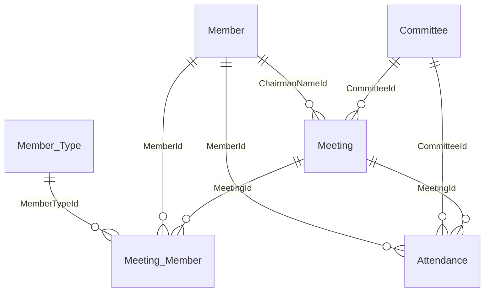
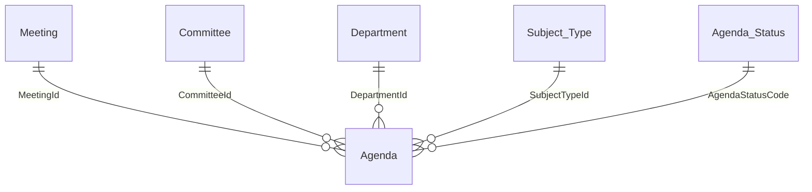
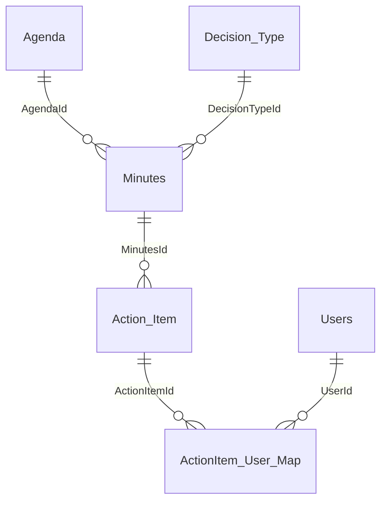
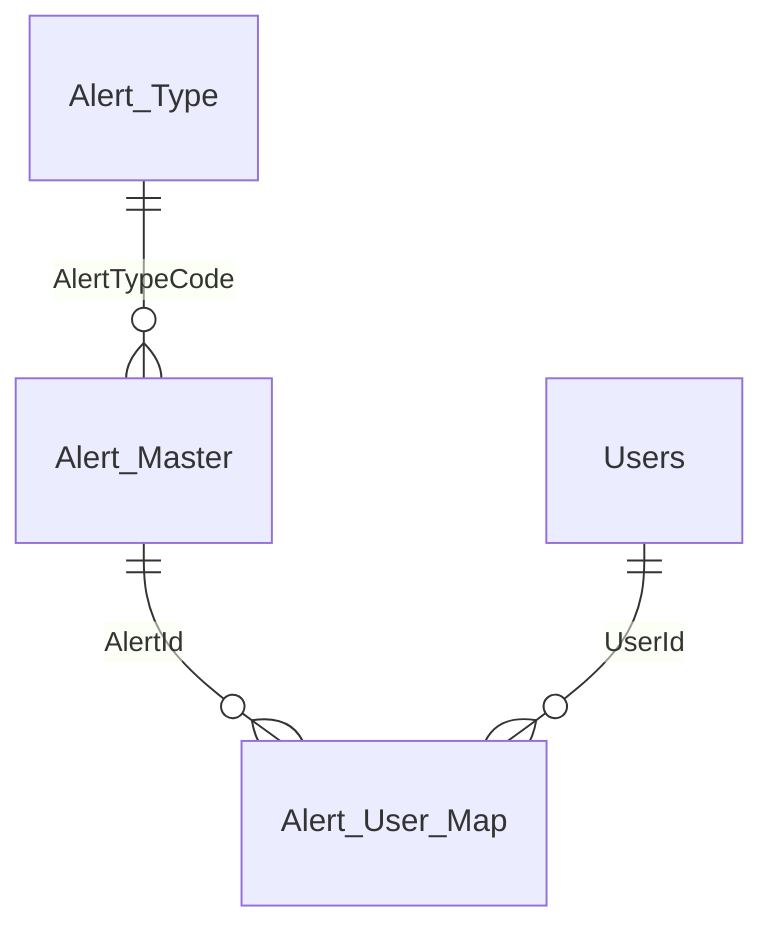
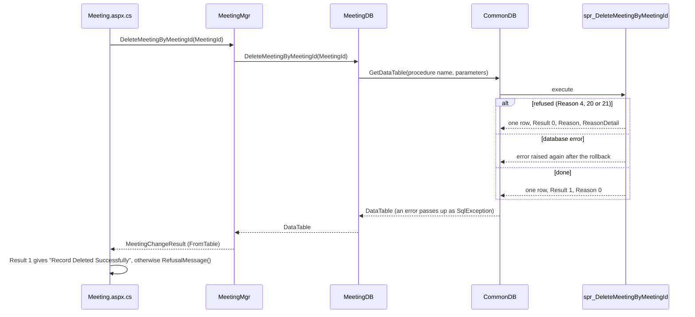

# Database

- Title: Database
- Audience: Developers and installers (internal)
- Shipped: No
- Applies to: UN6c2a (step 44: Approval, Meeting (spr_GetDashboardMeetings), Alerts and the dashboard, functions, Reason 4, 8, 12 and 14); UN6c1 (step 43: Alerts and the dashboard, Action items and follow-up, the two mail procedures, functions, Reason 4 and 8, not-called procedures); UN6b (step 42: the Meeting, Alerts and the dashboard, functions, Reason codes and not-called tables); the rest RA1b (step 41)
- Last updated by: UN6c2a, based on 493cb45
- Status: Draft
- Verified against: for step 44 (UN6c2a): Database/BMMS-Fix-AgendaWaitingFor-Step44.sql (all five objects, read in full), BMMS-Rollback-AgendaWaitingFor-Step44.sql, BMMS-Test-AgendaWaitingFor-Step44.sql (header and the comparison part), BMMS-Check-InstalledSteps.sql (diff), BMMSDAL/AgendaDB.cs and MeetingDB.cs (diff), BMMSBAL/AgendaMgr.cs and MeetingMgr.cs (diff), BMMS/DashBoard/DashBoard.aspx.cs (message texts), Database/README.md (section Step UN6c2a and Known items), the tester run of 2026-11-14 and the owner's tests as given;
  for step 43 (UN6c1): Database/BMMS-Fix-DashboardAlerts-Step43.sql (the procedures and the text read from the file: the listing and scope rules, parameters and Reasons), BMMS-Rollback-DashboardAlerts-Step43.sql (messages),
  BMMS-Check-InstalledSteps.sql (diff), BMMSDAL/AlertDB.cs and ActionItemDB.cs (diff), BMMSBAL/AlertMgr.cs and ActionItemMgr.cs (diff),
  BMMS/DashBoard/DashBoard.aspx.cs and BMMS/MasterPage/Main.Master.cs (message texts), Database/README.md (section Step UN6c1);
  for step 42 (UN6b): Database/BMMS-Fix-DashboardMeetings-Step42.sql (all five objects),
  BMMS-Rollback-DashboardMeetings-Step42.sql, BMMS-Check-InstalledSteps.sql (diff), BMMSDAL/MeetingDB.cs and
  DepartmentDB.cs (diff), BMMSBAL/MeetingMgr.cs and DepartmentMgr.cs (diff), BMMS/UserControl/MeetingSummary.ascx.cs
  (message texts), Grep of BMMS, BMMSBAL and BMMSDAL for GetScheduleMeet, Database/README.md (section Step UN6b);
  for step 41 (RA1b): Database/BMMS-Fix-ReportAccess-Step41.sql (header and the first
  procedure), BMMS-Rollback-ReportAccess-Step41.sql (messages), BMMS-Check-InstalledSteps.sql (diff),
  BMMSDAL/MinutesDB.cs and ActionItemDB.cs (the three calls), BMMSBAL/ReportsMgr.cs (diff), Database/README.md
  (section RA1b); the BMMS_Test catalog export of 2026-11-09 (kept outside the repository): README.txt,
  02-tables-columns.txt, 03-keys.txt, 04-indexes.txt, 05-constraints.txt, 07-database.txt, and
  01-modules.sql.txt (searched for how the tables are used); Database/BMMS-Add-PrimaryKeys.sql,
  BMMS-Add-ForeignKeys-Safe.sql, BMMS-Add-ForeignKeys-Step3.sql, -Step4.sql, -Step5.sql (headers),
  BMMS-Fix-MeetingLocks-Step16.sql, BMMS-Fix-MemberTypes-Step21.sql, BMMS-Fix-UserHistory-Step39.sql,
  BMMS-Fix-UserStatus-Stage2a.sql, BMMS-Fix-LoginName-Step34.sql, BMMS-Fix-SystemAccount-Stage3.sql,
  BMMS-Fix-MinutesDueDate-Step38.sql (headers); Documents/Data-Flow/00-Notation.md (UD1a lines).
  For "Stored procedures and functions" part 1: 01-modules.sql.txt (header, marker and text of the
  procedures and functions of the part 1 areas, and the INSERT, UPDATE and DELETE statements);
  BMMSDAL/CommonDB.cs, UserDB.cs, UtilitiesDB.cs, DepartmentDB.cs, DesignationDB.cs, MemberDB.cs,
  MemberTypeDB.cs, SubjectTypeDB.cs, DecisionTypeDB.cs, CommitteeDB.cs, CommitteeMemberDB.cs, RoleDB.cs,
  SysCodeDB.cs, AuditTrail_DB.cs (procedure names, method names); BMMSBAL/Common.cs (SaveSendMail);
  Database/BMMS-Check-InstalledSteps.sql (marker names); Database/README.md, step 29 and step 30
  sections.
  For "Stored procedures and functions" part 2: 01-modules.sql.txt (header, marker, text and the
  INSERT, UPDATE and DELETE statements of the agenda, approval, finalisation, meeting, meeting member,
  attendance, chairman, minutes, action item, alert and report procedures, the three table functions
  fn_AgendaChangeRefusal, fn_AgendaRoute and fn_WorkflowState, and the eight views of part 2; the
  scans for EXEC, EXECUTE, sp_executesql and EXEC @); BMMSDAL/AgendaDB.cs, MeetingDB.cs,
  MeetingMemberDB.cs, AttendanceDB.cs, MinutesDB.cs, ActionItemDB.cs, AlertDB.cs, UserDB.cs (method and
  procedure names, the queries built in the code), CommitteeMemberDB.cs, RoleDB.cs, UtilitiesDB.cs,
  CommonDB.cs; BMMSBAL/ReportsMgr.cs, Sql_Backup_Mgr.cs, AgendaMgr.cs, RoleMgr.cs, MeetingMemberMgr.cs,
  CommitteeMemberMgr.cs, AlertMgr.cs (the methods that pass through to the data layer); Grep of
  BMMS/*.cs, BMMS/DashBoard/DashBoard.aspx.cs and BMMS/Report/Reports.aspx.cs for the callers named in
  the part 2 tables; Database/BMMS-Check-InstalledSteps.sql (marker names and step 12, 22, 33 to 38 and
  D1 rows); Database/BMMS-Fix-UnicodeText-Step31.sql (the view refresh); Database/BMMS-Fix-AgendaRouting-Step20.sql
  and BMMS-Test-AgendaRouting-Step20.sql (callers of spr_RerouteWaitingAgendas).
  For "Result, Reason and ReasonDetail", "Reason codes", "History tables" and "Settings rows":
  01-modules.sql.txt (the SET @Reason statements, the final SELECT and the CATCH blocks of the procedures
  that return Reason, fn_UserChangeRefusal, fn_AgendaChangeRefusal, spr_AddEditUser,
  spr_SetUserStatusByUserId, spr_DeleteUserByUserId, spr_DeleteDepartmentByDeptId,
  spr_DeleteMeetingByMeetingId, spr_AddEditMeetingMember, spr_AddEditMemberType,
  spr_DeleteMemberTypeByMemberTypeId, spr_UpdateAgendaByAgendaId, spr_UpdateMeetingChairman,
  spr_sys_ResetDatabase, spr_sys_SetSmtpDefault, the setting procedures, spr_RecordLoginByUserId,
  spr_AddEditAuditTrialLogin, spr_AddEditAuditTrailSqlBackup, spr_SaveSendMail; the Grep for THROW, RAISERROR and
  every INSERT, UPDATE and DELETE on the four audit tables and on App_Setting); 02-tables-columns.txt,
  04-indexes.txt, 05-constraints.txt and 06-parameters.txt (the history tables, the audit tables, App_Setting,
  spr_UpdateSMTPMaster); BMMSDAL/CommonDB.cs; BMMSBAL/MeetingMgr.cs, UserMgr.cs, MemberTypeMgr.cs,
  DepartmentMgr.cs, AgendaMgr.cs, OrganisationDetails.cs, Utilities.cs, Common.cs (GetAppSetting);
  Grep of BMMSDAL and BMMSBAL for Reason; BMMS/Master/Meeting.aspx.cs, User.aspx.cs, MemberType.aspx.cs,
  SystemSettings.aspx.cs, ResetDatabase.aspx.cs, BMMS/DashBoard/DashBoard.aspx.cs (the Reason handling) and a
  Grep of BMMS/**/*.cs for Reason and RefusalMessage; BMMS/XML/AppSettings.xml (delete_reference);
  Database/BMMS-Fix-UserHistory-Step39.sql (header), BMMS-Fix-MeetingLocks-Step16.sql,
  BMMS-Fix-OrganisationSettings-Step19.sql, BMMS-Fix-WorkflowOrder-Step23.sql, BMMS-Fix-UpdateMail-Step37.sql
  (the App_Setting inserts); Database/BMMS-Check-InstalledSteps.sql (MailSenderUserId lines);
  Database/README.md (run order, the step 10, 13 and UD1a sections, Known items for later steps);
  Documentation/Architecture/BMMS-Architecture.md sections 7 and 9 (leads only);
  Documents/Data-Flow/00-Notation.md (UD1a lines); for the open known items added in the third
  fix run: BMMS-Rollback-UserHistory-Step39.sql and BMMS-Check-InstalledSteps.sql (headers).
  For step 40 (RA1a): Database/BMMS-Fix-RoleAccess-Step40.sql (header, fn_UserChangeRefusal text),
  BMMS-Rollback-RoleAccess-Step40.sql and BMMS-Test-RoleAccess-Step40.sql (headers),
  BMMSBAL/UserMgr.cs and MemberTypeMgr.cs (the Reason 4 texts); the catalog text of these three
  objects was not re-exported, so their rows state the step 40 script.
- To confirm: the catalog is BMMS_Test, so what the installed BMMS database holds is not confirmed (see "Source of
  this chapter"); the meaning of Attendance.MemberOf values other than 'C' and of the numeric Status
  columns is not stated here because no source read for this chapter defines it; whether the seven
  data-layer methods that name procedures missing from the catalog are reached by a route the Grep did
  not cover (see "Called by the code, not in the database"); whether the installed BMMS database has
  those seven procedures; the views carry no marker, so the Step column of the views table is the
  rebuild date, not a step number; only the methods named in "Called by the code, not in the database"
  were searched for page callers, not every data-layer method; how the id of a deleted user comes to be
  given to a new user (see "Known database limitations"); the Step column of "Reason codes" for the user
  rules (codes 1 to 9) is taken from the run order of Database/README.md, which names step 13 for the Reason
  column of those procedures, and the first appearance of a code in an older script was not checked in the
  script texts; the pages were searched for Reason handling with a Grep of .cs files only, so a mapping
  in an .aspx file or in a user control is not covered; the minimum SQL Server version, because 24
  procedures use THROW against the house rule for compatibility level 100 (see "Known database
  limitations"); the step 39 status after its rollback (Missing against Partly, 3 of 11); the count of procedures with
  THROW after step 40 (a new catalog export is needed); the five step 42 objects are described from the Fix
  script, not from a catalog export (the export of 2026-11-09 predates them); that the data-layer and BAL
  methods GetScheduleMeet are unused is from a Grep of .cs files only (a caller in an .aspx file is not covered)

## Source of this chapter (BMMS_Test catalog)

This chapter is written from a read-only export of the catalog views of the BMMS_Test database,
taken on 2026-11-09 from the code at commit 3dd0eec (branch modernization). The export is kept
outside the repository, because the procedure texts in it include the seeded default accounts; it is
called "the catalog export" in this chapter. It reflects BMMS_Test. The installed BMMS database may
differ: where a table or key below was added by a numbered step, check the installed database with
Database/BMMS-Check-InstalledSteps.sql before you rely on it. [[CONFIRM: the state of the installed
BMMS database was not read; run the check script on it]]

What the export covers (catalog views only):

| File | Content |
|---|---|
| 01-modules.sql.txt | Text of 183 modules: 165 stored procedures, 3 scalar functions, 4 inline table functions, 11 views; none without text or encrypted |
| 02-tables-columns.txt | 33 user tables, 314 columns |
| 03-keys.txt | 32 primary keys, 1 unique key, 58 foreign keys (92 key-column rows) |
| 04-indexes.txt | 46 index-column rows |
| 05-constraints.txt | 8 check and 25 default constraints |
| 06-parameters.txt | 519 procedure and function parameters |
| 07-database.txt | Compatibility level, collation, version, object counts |

What it does not cover: no user table was read, so there are no row contents and no row counts; no
permissions, logins, jobs or server settings.

Object counts (07-database.txt): 33 user tables, 11 views, 165 stored procedures, 3 scalar functions,
4 inline table functions, 32 primary key constraints, 1 unique constraint, 58 foreign key
constraints, 8 check constraints, 25 default constraints.

BMMS_Test runs at compatibility level 100 with the collation SQL_Latin1_General_CP1_CI_AS, on SQL
Server 17.0 (Developer Edition). Compatibility level 100 is also the rule for every script in
Database/ (no THROW, TRY_CONVERT, IIF, CONCAT, FORMAT or OFFSET in a script).

## Tables and keys

The full column list of every table (name, type, length, nullability, identity) is in the catalog
export, file 02-tables-columns.txt, not in this chapter. Below, each table lists its purpose, primary
key (PK), the foreign keys it holds (FK out), the tables that point to it (Referenced by), the
unique and check constraints, the defaults worth knowing, and the indexes other than the primary
key. Every primary key is a clustered index. Every key table has a single-column primary key, and
every foreign key is a single-column key (03-keys.txt). Most tables have an identity key named after
the table (for example `MeetingId`); the code tables Agenda_Status, Alert_Type, App_Setting and
Source_Type are keyed on a code value instead.

"Users" is the target of many keys: the audit columns CreatedBy, UpdatedBy, ClosedBy and similar
point to Users.UserId in most tables. These are listed as "audit keys to Users" and not repeated
for every table.

### Users, roles and history

| Table | Purpose | PK | FK out | Constraints, defaults, indexes |
|---|---|---|---|---|
| Users | One row per user: login name, user name, current role, home department, designation, manager, account status, system-account flag | UserId | RoleId to Roles, DepartmentId to Department, DesignationId to Designation (these three also ON UPDATE CASCADE), ManagerId to Users, UpdatedBy to Users | AccountStatus NOT NULL, default 1, check 0 or 1 (CK_Users_AccountStatus); IsSystem bit NOT NULL, default 0, check 0 or 1 (CK_Users_IsSystem). No key on Users.CreatedBy |
| Roles | The role list (RoleCode, RoleName, RoleDescription, OrderNo) | RoleId | none | Referenced by Users.RoleId and User_Role.RoleId |
| User_Role | Role history of a user (step 39): one row per period, EffectiveFrom, EffectiveTo (NULL means current), CreatedOn/CreatedBy, ClosedOn/ClosedBy/CloseReason | UserRoleId | UserId to Users, RoleId to Roles, CreatedBy to Users, ClosedBy to Users | CK_User_Role_Dates (EffectiveTo is NULL or not before EffectiveFrom); CK_User_Role_Closed (the four close columns are all empty on an open row, and on a closed row EffectiveTo, ClosedOn and ClosedBy are set and CloseReason is R, D or C); default CreatedOn getdate(); unique filtered index UX_User_Role_Open on UserId where EffectiveTo is NULL (one open role per user); index IX_User_Role_UserId on (UserId, EffectiveFrom) |
| User_Department | Department history of a user (step 39), same period and close columns as User_Role, plus IsHome | UserDepartmentId | UserId, CreatedBy and ClosedBy to Users, DepartmentId to Department | CK_User_Department_Dates and CK_User_Department_Closed (as for User_Role); defaults IsHome 0 and CreatedOn getdate(); unique filtered index UX_User_Department_Open on (UserId, DepartmentId) where EffectiveTo is NULL; unique filtered index UX_User_Department_OpenHome on UserId where EffectiveTo is NULL and IsHome = 1 (one open home department per user); indexes IX_User_Department_UserId (UserId, EffectiveFrom) and IX_User_Department_Department (DepartmentId, EffectiveTo) |

Users is also referenced by the audit keys of almost every other table (Action_Item,
ActionItem_User_Map, Agenda, Alert_Master, Alert_User_Map, Attendance, Audit_Trail_Master,
Audit_Trail_SqlBackup, Committee, Committee_Member, Meeting, Meeting_Member, Member, User_Role and
User_Department), and by Users.ManagerId and Users.UpdatedBy on itself.

Users keeps the current RoleId and DepartmentId; User_Role and User_Department hold the history
(Fix script header BMMS-Fix-UserHistory-Step39.sql: "Users keeps the current RoleId and
DepartmentId"). The history tables are described further in the section "History tables".

### Masters

| Table | Purpose | PK | Notes |
|---|---|---|---|
| Department | Departments (DepartmentCode, DepartmentName, OrderNo, StatusId) | DepartmentId | Referenced by Agenda, User_Department and Users. CreatedBy and UpdatedBy have no key |
| Designation | Designations (DesignationCode, DesignationName, StatusId) | DesignationId | Referenced by Member and Users. CreatedBy and UpdatedBy have no key |
| Subject_Type | Agenda subject types (SubjectTypeCode, SubjectTypeName, OrderNo) | SubjectTypeId | Referenced by Agenda.SubjectTypeId (ON UPDATE CASCADE). Default IsDelete 0 |
| Decision_Type | Minutes decision types (DecisionTypeCode, DecisionTypeName) | DecisionTypeId | Referenced by Minutes.DecisionTypeId. Default IsDelete 0. DecisionTypeId 1 is the Followup decision (the procedure that finalizes the minutes creates an Action_Item for each minute with DecisionTypeId = 1) |
| Member_Type | Member types, each with a scope: C committee role or M meeting role (step 21) | MemberTypeId | Referenced by Committee_Member and Meeting_Member. Columns added by step 21: IsReserved (bit NOT NULL, default 0) and MemberScope (char(1) NOT NULL, default 'C'). CK_Member_Type_MemberScope (C or M); CK_Member_Type_Reserved (a reserved type must have StatusId 1); unique indexes UX_Member_Type_Code on MemberTypeCode and UX_Member_Type_Name on MemberTypeName. Defaults DisplayOrder 0, IsDelete 0 |
| State_Master | States (State_Code, State_Name) | State_Id | Referenced by Member.State_Id |
| Agenda_Status | Agenda status codes (AgendaStatusCode, AgendaStatusName) | AgendaStatusCode | Code table keyed on a varchar code (the reset procedure seeds AC "Agenda Creation", AMA "Manager Approved", ACA "Controller Approved", AMR "Manager Rejected" and more). Referenced by Agenda.AgendaStatusCode |
| Alert_Type | Alert types (AlertTypeCode, AlertTypeName, AlertTypeDescription, OrderNo, StatusId) | AlertTypeCode | Referenced by Alert_Master.AlertTypeCode. CreatedBy and UpdatedBy have no key |
| Source_Type | Source types (SourceTypeCode, SourceTypeName) | SourceTypeCode | PK added by BMMS-Add-PrimaryKeys.sql. No foreign key points to it: Alert_Master.SourceType holds a code but has no key to it |

Roles, the other master, is in "Users, roles and history". The masters have no foreign keys between
them, so there is no diagram for this area. The master tables Department, Designation, Roles,
Alert_Type, Decision_Type, Member_Type and Subject_Type have CreatedBy and UpdatedBy columns without
a foreign key to Users (see "Missing keys" below).

### Committees and members

| Table | Purpose | PK | FK out | Constraints, defaults, indexes |
|---|---|---|---|---|
| Committee | A committee or board: code, name, incorporation and cessation date, colour code, Board flag, MeetingStartNo | CommitteeId | audit keys (CreatedBy, UpdatedBy) to Users | Referenced by Agenda, Attendance, Committee_Member and Meeting. Defaults: Board 0, MeetingStartNo 1, IsDelete 0. CessationDate is varchar(50) |
| Member | A person who sits on committees or attends meetings: code, name, designation, address, state, contact fields, DOB, DOJ, relieving date, photo and resume paths | MemberId | DesignationId to Designation (ON UPDATE CASCADE), State_Id to State_Master, audit keys to Users | Referenced by Attendance, Committee_Member, Meeting (ChairmanNameId) and Meeting_Member. Default RelievingDate '' (empty string). DOB, DOJ and RelievingDate are varchar(50). SexId has no key |
| Committee_Member | A member's membership of a committee: member type, appointment date, cessation date, fee settings | CommitteeMemberId | CommitteeId to Committee (ON DELETE CASCADE), MemberId to Member (ON DELETE CASCADE), MemberTypeId to Member_Type, audit keys to Users | CessationDate is varchar(50) and NOT NULL |

### Meetings and attendance

| Table | Purpose | PK | FK out | Constraints, defaults, indexes |
|---|---|---|---|---|
| Meeting | A meeting: number, committee, venue, place, date, time, chairman, agenda submission date, colour code, and the three status columns AgendaStatus, MinutesStatus, SubjectStatus | MeetingId | CommitteeId to Committee (ON DELETE CASCADE), ChairmanNameId to Member, audit keys to Users | Defaults: AgendaStatus 'Open', MinutesStatus 'Open', SubjectStatus 'Open', Place ''. The status columns drive the locks and the workflow (Fix script header BMMS-Fix-MeetingLocks-Step16.sql: AgendaStatus 'Open' to 'Close', MinutesStatus 'Open' to 'F' and then 'C') |
| Meeting_Member | A member tagged to one meeting with a meeting-scope member type (invitee, in attendance and the like) | MeetingMemberId | MeetingId to Meeting (ON DELETE CASCADE), MemberId to Member (ON DELETE CASCADE), MemberTypeId to Member_Type, audit keys to Users | |
| Attendance | One row per member per meeting: MemberOf, Attendance value, SittingFees | AttendanceId | MeetingId to Meeting (ON DELETE CASCADE), MemberId to Member (ON DELETE CASCADE), CommitteeId to Committee, UpdatedBy to Users | Default SittingFees 0. MemberOf = 'C' is read as the committee members in the procedures read for this chapter |

### Agenda

| Table | Purpose | PK | FK out | Constraints, defaults, indexes |
|---|---|---|---|---|
| Agenda | An agenda item: AgendaNo, committee, meeting, department, subject type, short text, agenda text and path, proposed resolution, file path, the Manager and Controller approval columns (approver, date, comments, status), AgendaStatusCode, SubjectNo | AgendaId | MeetingId to Meeting (ON DELETE CASCADE), CommitteeId to Committee, DepartmentId to Department (ON UPDATE CASCADE), SubjectTypeId to Subject_Type (ON UPDATE CASCADE), AgendaStatusCode to Agenda_Status, MgrApprovedBy, ControllerApprovedBy, CreatedBy, UpdatedBy to Users | Referenced by Minutes. In 02-tables-columns.txt the column numbers 6 and 7 are absent (the numbering goes from 5 to 8) |

### Minutes and action items

| Table | Purpose | PK | FK out | Constraints, defaults, indexes |
|---|---|---|---|---|
| Minutes | The minute of one agenda item: decision type, DueDate (optional, used for a Followup decision, step 38), Directions, ActualResolution | MinutesId | AgendaId to Agenda (ON DELETE CASCADE), DecisionTypeId to Decision_Type | Default StatusId 0. CreatedBy and UpdatedBy have no key |
| Action_Item | A follow-up created when the minutes are finalized, for each minute whose DecisionTypeId is 1: ActionText, ActionStatus ('Pending' when created), IsComplied, IsConfirmed | ActionItemId | MinutesId to Minutes, UpdatedBy to Users | Defaults IsComplied 0 and IsConfirmed 0 |
| ActionItem_User_Map | The read state of an action item per user (ReadStatus, StatusId). Since step 43 it no longer decides who sees an item; a person with no row sees the item unread, and opening it creates the row | ActionItemUserMapId (constraint named PK_Alert_ActionItem_Map) | ActionItemId to Action_Item (ON DELETE CASCADE), UserId to Users | |

### Alerts

| Table | Purpose | PK | FK out | Constraints, defaults, indexes |
|---|---|---|---|---|
| Alert_Master | One alert: SourceType, SourceTypeId (the id of the agenda, committee or meeting it is about), DepartmentId, CommitteeId, DisplayText, AlertTypeCode, AlertSendOption | AlertId | AlertTypeCode to Alert_Type, CreatedBy to Users | DepartmentId and CommitteeId hold 0 for "none" in the insert statements read, and have no key (see "Missing keys") |
| Alert_User_Map | Which users receive an alert, with ReadStatus and StatusId | AlertUserId | AlertId to Alert_Master (ON DELETE CASCADE), UserId to Users | |

### Settings and mail

These tables have no foreign keys to or from other tables.

| Table | Purpose | PK | Notes |
|---|---|---|---|
| App_Setting | Name and value settings (SettingCode, SettingValue, Description), for example AgendaControllerBypass and DeptNoManagerAction | SettingCode | Created by BMMS-Fix-MeetingLocks-Step16.sql (step 16). A change is written to Audit_Trail_Master with Audit_Table 'App_Setting' (Fix script header BMMS-Fix-UserHistory-Step39.sql). The rows are described in "Settings rows" |
| SysCodeSetting | Display-name lookup for status and sex values (MainCode, SubCode, DisplayName, DisplayOrder, IsActive) | SysCodeId (not an identity column) | Defaults DisplayOrder 0 and IsActive 1. The procedures read the status name with SubCode = StatusId. The reset procedure seeds the main codes Status and Sex |
| SMTP_Master | The mail server settings (server, port, user name, password, from address, Bcc) | none | The only table without a primary key (see below). The Password column is varchar(max). The text of its use is in the procedures spr_GetSMTPMaster and the reset and default-setting procedures |

### Audit

| Table | Purpose | PK | FK out | Notes |
|---|---|---|---|---|
| Audit_Trail_Master | Field-level change log: Audit_Type, Audit_Table, Key_Field, Key_Value, Field_Name, Old_Value, New_Value, Update_By, Update_On | Audit_Trail_Maser_Id (spelled so in the catalog) | Update_By to Users | |
| Audit_Trail_SendMail | Mail log: Mail_To, Mail_Subject, Mail_Body_Text, Mail_Attachment_Path, Mail_Send_On, Mail_Send_By | Audit_Trail_SendMail_Id | none | PK added by BMMS-Add-PrimaryKeys.sql. Mail_Send_By has no key |
| Audit_Trail_SqlBackup | Database backup log: Backup_File_Name, User_Id, Backup_Date_Time, User_IP_Address, Server_Url | Audit_Trail_SqlBackup_Id | User_Id to Users | |
| Audit_Trial_Login | Login log (the table name is spelled Trial in the catalog): User_Id, Login_DateTime, Logout_DateTime, Login_Status, User_IP_Address, Server_Url, Login_Name | Audit_Trial_Login_Id | none | Login_Name added by step 34 (BMMS-Fix-LoginName-Step34.sql). User_Id has no key |

The audit tables hold no foreign key to each other. The one other table in the catalog is
`sysdiagrams`, the database-diagram table of SQL Server Management Studio: PK diagram_id and a unique
key UK_principal_name on (principal_id, name). No procedure read for this chapter uses it.

### Keys that cross areas

- The audit keys to Users (CreatedBy, UpdatedBy, ClosedBy, ManagerId) tie every area to the users
  area.
- Meeting.ChairmanNameId, Attendance.MemberId and Meeting_Member.MemberId tie the meeting area to
  Member (committees and members area); Attendance.CommitteeId and Meeting.CommitteeId tie it to
  Committee.
- Agenda.MeetingId, CommitteeId and DepartmentId tie the agenda area to the meeting, committee and
  users/masters areas; Minutes.AgendaId ties minutes to Agenda.
- Alert_Master.SourceTypeId (the id of an agenda, committee or meeting), DepartmentId and CommitteeId
  point to those rows without a key.

### Delete and update actions

Eleven foreign keys have ON DELETE CASCADE (03-keys.txt): ActionItem_User_Map to Action_Item,
Agenda to Meeting, Alert_User_Map to Alert_Master, Attendance to Meeting and to Member,
Committee_Member to Committee and to Member, Meeting to Committee, Meeting_Member to Meeting and to
Member, and Minutes to Agenda. All other foreign keys have no delete action, so a parent row cannot
be deleted while a child row points to it; the delete procedures check or remove the child rows
themselves (Fix script headers BMMS-Add-ForeignKeys-Step3.sql and -Step4.sql). The keys from Agenda to
Department and Subject_Type, from Member to Designation, and from Users to Department, Designation
and Roles also have ON UPDATE CASCADE.

### Tables without a primary key, and columns without a foreign key

Tables with no primary key today (03-keys.txt): one, SMTP_Master. Source_Type and
Audit_Trail_SendMail had none until BMMS-Add-PrimaryKeys.sql added them; the catalog shows both now
have one. The old notes also list SMTP_Master as keyless; the catalog confirms it.

Columns that look like keys but have no foreign key in the catalog (checked one by one against
03-keys.txt):

| Column | Catalog today | Why, where a script says so |
|---|---|---|
| Minutes.CreatedBy, Minutes.UpdatedBy | No key | BMMS-Add-ForeignKeys-Step5.sql header: two procedures insert Minutes rows with CreatedBy = 1 and UpdatedBy = 1 hard-coded, and user 1 does not exist in the live data; "Logged as a defect; not changed here" |
| Users.CreatedBy | No key | Same header: 2 rows hold 1 (seed data) and user 1 does not exist |
| CreatedBy, UpdatedBy of Department, Designation, Roles, Alert_Type, Decision_Type, Member_Type, Subject_Type | No key | Same header: seed rows hold 1, and a key back to Users would make a circle that the reset procedure cannot delete its way out of |
| Audit_Trial_Login.User_Id, Audit_Trail_SendMail.Mail_Send_By | No key | Same header: they hold ids of users deleted long ago (login and mail history) |
| Alert_Master.DepartmentId, Alert_Master.CommitteeId | No key | Same header: 0 is stored for "none" |
| Alert_Master.SourceTypeId, Alert_Master.SourceType | No key | The id refers to an agenda, committee or meeting depending on SourceType (insert statements in the alert procedures); no script adds a key and none to Source_Type exists |
| Member.SexId | No key | No Fix script read states a reason. The old notes say it holds a SysCodeSetting id [[CONFIRM: what Member.SexId stores; read the member procedures and the Member page code]] |
| StatusId columns (for example Member.StatusId, Meeting_Member.StatusId, Committee.StatusId) | No key | The procedures read the name from SysCodeSetting with SubCode = StatusId, which has no unique key on SubCode |

Keys that the older notes and script headers list as missing and that the catalog now shows as
present: Agenda.MgrApprovedBy and Agenda.ControllerApprovedBy (FK_Agenda_MgrApprovedBy and
FK_Agenda_ControllerApprovedBy, added by BMMS-Add-ForeignKeys-Step5.sql although the headers of the
earlier scripts say they were left without a key), Alert_User_Map.UserId (FK_Alert_User_Map_Users,
same script), and Users.ManagerId (FK_Users_ManagerId, BMMS-Add-ForeignKeys-Step4.sql).

### Which script added a key or table

The script headers use their own "step" numbers for the key series ("Critical fix #5, step N"),
which are not the numbered database steps; the file names are given here.

| Object | Added by | Header says |
|---|---|---|
| Source_Type and Audit_Trail_SendMail primary keys | Database/BMMS-Add-PrimaryKeys.sql | "Critical fix #6: add primary keys to the two tables that have none" |
| FK_Agenda_Committee, FK_Attendance_Committee | Database/BMMS-Add-ForeignKeys-Safe.sql | "Critical fix #5, step 2" |
| FK_Action_Item_Minutes, FK_ActionItem_User_Map_Users, FK_Meeting_Chairman, FK_Member_State_Master | Database/BMMS-Add-ForeignKeys-Step3.sql (run BMMS-Fix-FK-Procedures.sql first) | "Critical fix #5, step 4" |
| FK_Users_ManagerId | Database/BMMS-Add-ForeignKeys-Step4.sql | "Critical fix #5, step 5" |
| 21 keys to Users.UserId (the audit columns of Agenda, Meeting, Committee, Committee_Member, Meeting_Member, Member, Attendance, Action_Item, Alert_Master, Alert_User_Map, Audit_Trail_Master, Audit_Trail_SqlBackup and Users.UpdatedBy) | Database/BMMS-Add-ForeignKeys-Step5.sql (run BMMS-Fix-UserDelete-Procedure.sql first) | "Critical fix #5, step 7" |
| Users.AccountStatus (NOT NULL, default 1, check 0 or 1) | Database/BMMS-Fix-UserStatus-Stage2a.sql | "Users.AccountStatus NOT NULL, DEFAULT 1 ..., CHECK IN (0, 1)" |
| Users.IsSystem | Database/BMMS-Fix-SystemAccount-Stage3.sql | adds the bit column with default 0 |
| App_Setting table | Database/BMMS-Fix-MeetingLocks-Step16.sql (step 16) | creates the table |
| Member_Type.IsReserved, MemberScope, the two checks and the two unique indexes | Database/BMMS-Fix-MemberTypes-Step21.sql (step 21) | "Table Member_Type, new columns" |
| Audit_Trial_Login.Login_Name | Database/BMMS-Fix-LoginName-Step34.sql (step 34) | adds the column |
| User_Role and User_Department with their checks, defaults and indexes | Database/BMMS-Fix-UserHistory-Step39.sql (step 39, UD1a) | "Role and department history" |

The keys on the master and code tables (for example Agenda to Agenda_Status, Users to Department,
Minutes to Agenda) are not added by any script read for this chapter; they come from the original
database design. [[CONFIRM: that these keys belong to the original database; no script or history
for them was read]]

### UD1a statements in Documents/Data-Flow/00-Notation.md, checked against the catalog

The statements in the notation file about User_Role and User_Department (written by the user save,
a role history row that closes the old row and opens the new one, department history rows with a
home department) match the catalog: both tables exist with EffectiveFrom, EffectiveTo, ClosedOn,
ClosedBy, CloseReason (and IsHome on User_Department), CK_User_Role_Closed and
CK_User_Department_Closed allow the closing values R, D and C, and the filtered unique indexes allow
one open role per user and one open home department per user. No correction was needed in that file.

## Stored procedures and functions

The BMMS_Test catalog export holds 165 stored procedures, 3 scalar functions, 4 inline table
functions and 11 views (01-modules.sql.txt). This section lists them in two parts. Part 1 covers
login and session, users and roles, the user-protection functions, the masters, settings, SMTP, Reset
Database and backup, and the audit trail. Part 2 (from "Part 2: agenda, meetings, minutes, action items,
alerts and reports") covers agenda entry and routing, approval, agenda finalisation, meeting, meeting
members, attendance, chairman, minutes, action items and follow-up, alerts and the dashboard, reports,
the views and functions not covered by part 1, and the cross-check between the code and the catalog.

### How procedures are named

| Prefix or pattern | Meaning (as the catalog shows it) |
|---|---|
| `spr_AddEdit<Thing>` | Insert or update. Most take `@Code` with the value 'Save' or 'Update' (read in spr_AddEditCommittee, spr_AddEditDecisionType, spr_AddEditMember, spr_AddEditUser) |
| `spr_Delete<Thing>By<Key>` | Delete one row, after a check of the rows that point to it |
| `spr_Get<Thing>`, `spr_Get<Thing>By<Key>` | Read; no INSERT, UPDATE or DELETE in the text |
| `spr_GetNext<Thing>Code` | The next code for a master (for example C01 for a committee, D001 for a department, M001 for a member, as the text of the procedure builds it) |
| `spr_Set<Thing>`, `spr_Update<Thing>`, `spr_Record<Thing>`, `spr_Check<Thing>` | Change a setting or a status, write an audit row, check a condition without changing anything |
| `spr_sys_<Thing>` | System procedures run by an Admin or by script: spr_sys_ResetDatabase and spr_sys_SetSmtpDefault |
| `fn_<Thing>` | Functions called from inside procedures |
| `View_<Thing>` | Views that join the tables for the lists and reports |
| `sp_*diagram*`, `fn_diagramobjects` | SQL Server Management Studio database-diagram objects (they read and write sysdiagrams) |

One procedure, `dbo.GetCommitteeMemberByMeetingId`, has no prefix; it is described with the committee
members below.

### How the data layer calls them

The data layer is the project BMMSDAL, one class per area named after the area (UserDB,
CommitteeDB, DepartmentDB and so on; AuditTrail_DB for the audit trail). A method builds an array of
SqlParameter and calls one of two helpers in BMMSDAL/CommonDB.cs, each with the procedure name as a
string (CommandType StoredProcedure):

- `CommonDB.GetDataTable(name, parameters)` runs the procedure and fills a DataTable with the rows it
  returns.
- `CommonDB.ExecuteProcedure(name, parameters)` runs it with ExecuteNonQuery and returns the row count.

Both open a connection from `ConnectDB.GetConnectionString()` and close it afterwards (the connection
string itself is not in this chapter). The business layer (BMMSBAL, classes named `<Area>Mgr`) calls the
data layer. Two exceptions are in the code read for this part: `UtilitiesDB.ResetDatabase` builds its
own command with a 300-second timeout, and spr_SaveSendMail is called from BMMSBAL/Common.cs, not from
BMMSDAL. A few procedures also have OUTPUT parameters next to the result row (@OutResult and @OutReason
on spr_AddEditUser, spr_SetUserStatusByUserId and spr_ResetPasswordByUserId, plus @OutReasonDetail on
spr_DeleteUserByUserId, @Result and @Reason on spr_sys_ResetDatabase and spr_sys_SetSmtpDefault); the
data-layer methods read the row.

### The Result contract in one sentence

A procedure that can refuse a request returns one row with the columns Result (1 done, 0 not done),
Reason (0 when nothing refused, otherwise a code) and ReasonDetail (text, often empty); the data layer
hands that row to the page as a DataTable. The codes and the wording are in the section "Result,
Reason and ReasonDetail" and "Reason codes", and are not repeated here.

### How to read the tables

- Data layer: the class and method in BMMSDAL that name the procedure (Grep of BMMSDAL/*.cs). "Not
  called from the code" means no BMMSDAL, BMMSBAL or page file names it.
- Writes: tables with an INSERT, UPDATE or DELETE in the procedure text in 01-modules.sql.txt. "none"
  means the text has none.
- Returns: "Full" is Result, Reason and ReasonDetail; "Result" is the column Result only (1 done,
  0 blocked); "No" is rows of data, or nothing.
- Step: the numbered database step that last replaced the procedure, from the marker in its text (the
  marker names are listed in Database/BMMS-Check-InstalledSteps.sql); "baseline" when the text carries
  no marker and the catalog shows the modified date of the first import (2026-10-01). Markers of
  earlier stages are read as: UserProtection-Stage1 is step 13, UserStatus-Stage2a is step 14,
  UserStatus2b-Step17 is step 17, SystemAccount3-Step18 is step 18.

The step column shows what BMMS_Test holds. A later re-run of an earlier script can replace a
procedure; the installed database may differ (see "Source of this chapter").

### Login and session

The application checks the password in C#, not in SQL: spr_GetUserByLoginName looks the user up by
login name (a case-sensitive comparison) and ignores its @Password, @User_IP_Address and @Server_Url
parameters (header of the procedure, step 1). After the password is verified, the application calls
spr_RecordLoginByUserId. The login log table is Audit_Trial_Login.

| Procedure | Data layer | Writes | Returns | Step |
|---|---|---|---|---|
| spr_GetUserByLoginName | UserDB.GetUserByLoginName | none | No (the user row with DesignationName, RoleCode and RoleName) | 1 |
| spr_RecordLoginByUserId | UserDB.RecordLogin | Audit_Trial_Login (UPDATE every earlier row of the user to status 'C', INSERT one open row 'O' with the login name) | No | 34 |
| spr_AddEditAuditTrialLogin | UtilitiesDB.AddEditAuditTrialLogin | Audit_Trial_Login (UPDATE: closes the open rows of the user, sets Logout_DateTime) | No | baseline |
| spr_GetUserStatusByUserId | UserDB.GetUserStatusByUserId | none | No (AccountStatus; the header says it is read on every page request) | 14 |

### Users, roles and the user history

User_Role and User_Department (the history, step 39) are written only by spr_AddEditUser,
spr_SetUserStatusByUserId, spr_DeleteUserByUserId and spr_sys_ResetDatabase; no other procedure in the
catalog has an INSERT, UPDATE or DELETE on them. The Roles table has no write procedure in the
catalog (see the open point on the role procedures below). The tables are described in "Users, roles and
history"; the section "History tables" will describe how the periods are opened and closed.

| Procedure | Data layer | Writes | Returns | Step |
|---|---|---|---|---|
| spr_AddEditUser | UserDB.AddEditUser (15th parameter @DepartmentIds only when the caller passes a list) | Users, User_Role, User_Department (INSERT and UPDATE) | Full (also OUTPUT @OutResult, @OutReason) | 39 |
| spr_DeleteUserByUserId | UserDB.DeleteUserByUserId | Users, User_Role, User_Department, Alert_User_Map, ActionItem_User_Map (DELETE) | Full (also OUTPUT) | 39 |
| spr_SetUserStatusByUserId | UserDB.SetUserStatusByUserId | Users, User_Role, User_Department (deactivate closes the open rows; activate opens them again) | Full (also OUTPUT) | 39 |
| spr_ResetPasswordByUserId | UserDB.ResetPasswordByUserId | Users (Password, UpdatedOn, UpdatedBy) | Full (also OUTPUT) | 13 |
| spr_CheckUserChange | UserDB.CheckUserChange | none (checks a planned change without making it) | Full (Result 1 when Reason is 0) | 13 |
| spr_LockUserByUserId | UserDB.LockUserByUserId (BMMSBAL UserMgr.LockUserByUserId passes through; the one call in BMMS/Default.aspx.cs is commented out) | none | No: retired, raises error 50002 and points to spr_SetUserStatusByUserId | 14 |
| spr_GetUser | UserDB.GetUserList | none | No (reads View_Users) | 18 |
| spr_GetActiveUserList | UserDB.GetActiveUserList | none | No (same rows as spr_GetUser, active users only) | 18 |
| spr_GetUserByUserId | UserDB.GetUserByUserId, UserDB.GetUserDataTableByUserId | none | No | baseline |
| spr_GetUserListForUserPage | UserDB.GetUserListForUserPage | none | No (View_Users rows plus CanEdit, CanChangeRole, CanDelete, CanDeactivate, CanActivate, ManagedCount; the Can columns call fn_UserChangeRefusal) | 18 |
| spr_GetUserDepartmentMap | UserDB.GetUserDepartmentMap | none | No (the open departments, home department first; @UserId NULL means every user) | 39 |
| spr_GetRole | RoleDB.GetRoleList | none | No | baseline |

Notes on these rows, from the procedure headers:

- spr_AddEditUser: Save is checked as Create (acting user = CreatedBy), Update as Edit and, when the
  role really changes, as RoleChange (acting user = UpdatedBy). @DepartmentIds is the comma list of the
  user's departments (digits and commas, at most 2000 characters). Only a Manager may have several
  departments, and the home department must be in the list. A role change away from Manager closes the
  other departments and is refused when the user is the last active Manager of a department with items
  waiting, or items waiting at AC are routed to him. On success ReasonDetail names the departments
  closed (written in the text as `MappingsClosed:` followed by the names).
- spr_SetUserStatusByUserId: Deactivate closes every open role and department row; Activate is refused
  while the home department is inactive, otherwise opens the role row and the home department, and for a
  Manager the other departments closed by the last deactivation (an inactive one is skipped and named in
  ReasonDetail).
- spr_DeleteUserByUserId: rows the user wrote in another user's history (CreatedBy, ClosedBy) are kept as
  history and refuse the delete; the user's own User_Role and User_Department rows are removed with an
  otherwise unused user.
- spr_ResetPasswordByUserId: the data-layer method returns the Result value; if the procedure returns no
  row (the version from before step 13) it returns 1, as its comment says.

### User-protection functions

These decide who may change which account. They are called inside procedures, not from the data layer.

| Function | Type | Called from (catalog text) | Writes | Returns | Step |
|---|---|---|---|---|---|
| fn_UserChangeRefusal(@ActingUserId, @TargetUserId, @Action, @NewRoleId) | Scalar, returns INT: 0 when the change is allowed, otherwise the refusal code | spr_AddEditUser, spr_CheckUserChange, spr_DeleteUserByUserId, spr_GetUserListForUserPage, spr_ResetPasswordByUserId, spr_SetUserStatusByUserId | none (a function cannot write) | A Reason code, not the Result columns. Since step 40 (RA1a) the Controller has no branch of its own: it has the rule of every role other than Admin, so it may only Edit and ResetPassword its own account, and Create or any action on another account gives code 4 (the Admin rule and codes 1, 2, 3, 7 and 8 are unchanged) | 18, 40 (text replaced; the markers of steps 13, 14 and 18 are kept) |
| fn_ManagerReleaseRefusal(@UserId, @DepartmentId, @Personal) | Inline table function: one row per finding (Kind 'D' last active Manager of a department with items waiting at AC; Kind 'P', when @Personal is 1, items routed to the user himself), none when nothing stops it | spr_AddEditUser | none | Rows (Kind, DepartmentId, DepartmentName, Items) | 39 |

Actions the first function knows (from its text): Create, Edit, Delete, Deactivate, Activate,
RoleChange and ResetPassword. It treats the protected system account (Users.IsSystem = 1) as untouchable
except that the account may change its own password. The recommended hardening that rests on it is in
the Security chapter.

### Masters

All masters follow one pattern: a list, a read by key, a next-code procedure, one AddEdit and one Delete.
The Delete procedures count the rows in the tables that point to the master and delete only when every
count is zero (header of BMMS-Fix-Delete-Procedures.sql, as it appears in the catalog text of
spr_DeleteCommitteeByCommitteeId). The AddEdit procedures of the plain masters return nothing, so a
refusal is not reported by them.

#### Department

| Procedure | Data layer | Writes | Returns | Step |
|---|---|---|---|---|
| spr_GetDepartment | DepartmentDB.GetDepartmentList | none | No | baseline |
| spr_GetDepartmentByDeptId | DepartmentDB.GetDepartmentByDeptId | none | No | baseline |
| spr_GetNextDeptCode | DepartmentDB.GetNextDeptCode | none | No | baseline |
| spr_AddEditDepartment | DepartmentDB.AddEditDepartment | Department | No | baseline |
| spr_DeleteDepartmentByDeptId | DepartmentDB.DeleteDepartmentByDeptId and DepartmentDB.DeleteDepartment | Department (DELETE) | Full (Result as before step 39, Reason and ReasonDetail added; refused while a user has an open mapping to the department or only closed mappings exist) | 39 |

#### Designation

| Procedure | Data layer | Writes | Returns | Step |
|---|---|---|---|---|
| spr_GetDesignation | DesignationDB.GetDesignationList | none | No | baseline |
| spr_GetDesignationByDesignationId | DesignationDB.GetDesignationByDesignationId | none | No | baseline |
| spr_GetNextDesignationCode | DesignationDB.GetNextDesignationCode | none | No | baseline |
| spr_AddEditDesignation | DesignationDB.AddEditDesignation | Designation | No | baseline |
| spr_DeleteDesignationByDesignationId | DesignationDB.DeleteDesignationByDesignationId | Designation (DELETE) | Result | 2 |

#### Member

| Procedure | Data layer | Writes | Returns | Step |
|---|---|---|---|---|
| spr_GetMember | MemberDB.GetMemberList | none | No | baseline |
| spr_GetMemberByMemberId | MemberDB.GetMemberByMemberId, MemberDB.GetMemberDTbyMemberId | none | No | baseline |
| spr_GetMemberByMemberType | MemberDB.GetMemberByMemberType | none | No | baseline |
| spr_GetUnTagMemberByCommitteeId | MemberDB.GetUnTagMemberByCommitteeId | none | No | baseline |
| spr_GetUnTagMemberByMeetingId | MemberDB.GetUnTagMemberByMeetingId | none | No | baseline |
| spr_GetNextMemberCode | MemberDB.GetNextMemberCode | none | No | baseline |
| spr_AddEditMember | MemberDB.AddEditMember | Member; Committee_Member (an edit that sets a relieving date copies it into CessationDate of the member's committee rows that have none); a State_Id of 0 or blank is stored as NULL | No | 6 |
| spr_DeleteMemberByMemberId | MemberDB.DeleteMemberByMemberId | Member (DELETE) | Result | 6 |

#### Member type

| Procedure | Data layer | Writes | Returns | Step |
|---|---|---|---|---|
| spr_GetMemberType | MemberTypeDB.GetMemberTypeList | none | No | 21 |
| spr_GetMemberTypeByMemberTypeId | MemberTypeDB.GetMemberTypeByMemberTypeId | none | No | 21 |
| spr_GetMemberTypeForTagging | MemberTypeDB.GetMemberTypeForTagging | none | No | 21 |
| spr_GetNextMemberTypeCode | MemberTypeDB.GetNextMemberTypeCode | none | No | baseline |
| spr_AddEditMemberType | MemberTypeDB.AddEditMemberType | Member_Type | Full (an active Admin only since step 40, RA1a: a Controller gets Reason 4; a reserved type cannot be edited; the acting user and server time are stored, the CreatedOn, CreatedBy, UpdatedOn and UpdatedBy parameters are kept for the older build and not used; an error is re-raised with RAISERROR instead of THROW since step 40) | 21, 40 |
| spr_DeleteMemberTypeByMemberTypeId | MemberTypeDB.DeleteMemberTypeByMemberTypeId | Member_Type (DELETE) | Full (an active Admin only since step 40: a Controller gets Reason 4; not a reserved type, not a type in use; RAISERROR instead of THROW since step 40) | 21, 40 |

#### Subject type

| Procedure | Data layer | Writes | Returns | Step |
|---|---|---|---|---|
| spr_GetSubjectType | SubjectTypeDB.GetSubjectTypeList | none | No | baseline |
| spr_GetSubjectTypeBySubjectTypeId | SubjectTypeDB.GetSubjectTypeBySubjectTypeId | none | No | baseline |
| spr_GetNextSubjectTypeCode | SubjectTypeDB.GetNextSubjectTypeCode | none | No | baseline |
| spr_AddEditSubjectType | SubjectTypeDB.AddEditSubjectType | Subject_Type | No | baseline |
| spr_DeleteSubjectTypeBySubjectTypeId | SubjectTypeDB.DeleteSubjectTypeBySubjectTypeId | Subject_Type (DELETE) | Result | 2 |

#### Decision type

| Procedure | Data layer | Writes | Returns | Step |
|---|---|---|---|---|
| spr_GetDecisionType | DecisionTypeDB.GetDecisionTypeList | none | No | baseline |
| spr_GetDecisionTypeByDecisionTypeId | DecisionTypeDB.GetDecisionTypeByDecisionTypeId | none | No | baseline |
| spr_GetNextDecisionTypeCode | DecisionTypeDB.GetNextDecisionTypeCode | none | No | baseline |
| spr_AddEditDecisionType | DecisionTypeDB.AddEditDecisionType | Decision_Type | No | baseline |
| spr_DeleteDecisionTypeByDecisionTypeId | DecisionTypeDB.DeleteDecisionTypeByDecisionTypeId | Decision_Type (DELETE; blocked while Minutes use the type) | Result | 2 |

#### Committee

| Procedure | Data layer | Writes | Returns | Step |
|---|---|---|---|---|
| spr_GetCommittee | CommitteeDB.GetCommitteeList | none | No | baseline |
| spr_GetCommitteeByCommitteeId | CommitteeDB.GetCommitteeByCommitteeId | none | No | baseline |
| spr_GetNextCommitteeCode | CommitteeDB.GetNextCommitteeCode | none | No | baseline |
| spr_AddEditCommittee | CommitteeDB.AddEditCommittee | Committee; Alert_Master and Alert_User_Map (an alert of type CC on Save and CU on Update, to the active users other than the creator and the system account) | No | 18 |
| spr_DeleteCommitteeByCommitteeId | CommitteeDB.DeleteCommitteeByCommitteeId | Committee (DELETE; blocked while a Meeting or Committee_Member row points to it) | Result | 2 |

#### Committee member

| Procedure | Data layer | Writes | Returns | Step |
|---|---|---|---|---|
| spr_GetCommitteeMember | CommitteeMemberDB.GetCommitteeMemberList | none | No | baseline |
| spr_GetCommitteeMemberByCommitteeId | CommitteeMemberDB.GetCommitteeMemberByCommitteeId (uses fn_CommitteeMemberDateCheck) | none | No | 16 |
| spr_GetCommitteeMemberByCommitteeMemberId | CommitteeMemberDB.GetCommitteeMemberByCommitteeMemberId | none | No | baseline |
| spr_GetCommitteeMemberByMeetingId | CommitteeMemberDB.GetCommitteeMemberByMeetingId (uses fn_CommitteeMemberDateCheck) | none | No | 16 |
| dbo.GetCommitteeMemberByMeetingId (no spr_ prefix) | Not called from the code (the data-layer method of that name calls spr_GetCommitteeMemberByMeetingId) | none | No (View_Committee_Member joined to Meeting and Attendance) | baseline |
| spr_GetNextCommitteeMemberCode | CommitteeMemberDB.GetNextCommitteeMemberCode; not in the catalog (see the open point below) | not applicable | not applicable | not applicable |
| spr_AddEditCommitteeMember | CommitteeMemberDB.AddEditCommitteeMember | Committee_Member | Full (the type must be an active committee type, unless an edit keeps the row's current type) | 21 |
| spr_DeleteCommitteeMemberByCommitteeMemberId | CommitteeMemberDB.DeleteCommitteeMemberByCommitteeMemberId | Committee_Member (DELETE; blocked while Attendance holds the same committee and member) | Result | 2 |

The two attendance procedures that CommitteeMemberDB also calls (spr_GetPresentCommitteeMemberByCommitteeId
and spr_GetSittingFeesApplicable) belong to part 2.

#### State and code lookups

| Procedure | Data layer | Writes | Returns | Step |
|---|---|---|---|---|
| spr_GetStateMaster | UtilitiesDB.GetStateMaster | none | No | baseline |
| spr_GetSysCodeSetting | SysCodeDB.GetSysCodeSetting | none | No | baseline |

State_Master has no write procedure in the catalog.

### Settings

Settings are rows of App_Setting. A change goes through a procedure that checks the acting user is an
active Admin and writes one Audit_Trail_Master row (Audit_Table 'App_Setting') when the value changed.

| Procedure | Data layer | Writes | Returns | Step |
|---|---|---|---|---|
| spr_GetAppSetting | UtilitiesDB.GetAppSetting | none | No (one setting with the last change taken from Audit_Trail_Master) | 16 |
| spr_SetAppSetting | UtilitiesDB.SetAppSetting | App_Setting, Audit_Trail_Master; in a transaction (own, or a savepoint inside the caller's) | Full; only the setting AgendaControllerBypass with the value 0 or 1 is accepted | 16 |
| spr_SetDepartmentManagerRule | UtilitiesDB.SetDepartmentManagerRule | App_Setting, Audit_Trail_Master | Full; the setting DeptNoManagerAction, values 'refuse' and 'controller'; the header says it is stored only and nothing reads it yet | 39 |
| spr_GetOrganisationSettings | UtilitiesDB.GetOrganisationSettings | none | No (always the 12 organisation settings in a fixed order, with the last change) | 19 |
| spr_SetOrganisationSettings | UtilitiesDB.SetOrganisationSettings | App_Setting, Audit_Trail_Master (all 12 saved, or none) | Full | 19 |
| spr_RecordOrganisationLogo | UtilitiesDB.RecordOrganisationLogo | Audit_Trail_Master (one row for an Upload or Remove; the file itself is kept by the application, which writes or deletes it only after Result = 1) | Full | 19 |

The rows of App_Setting are described in "Settings rows".

### SMTP

| Procedure | Data layer | Writes | Returns | Step |
|---|---|---|---|---|
| spr_GetSMTPMaster | UtilitiesDB.GetSMTPMaster | none | No | baseline |
| spr_UpdateSMTPMaster | UtilitiesDB.UpdateSMTPMaster | SMTP_Master (UPDATE every row; INSERT when the table is empty; the table is locked until commit) | No | 30 |
| spr_sys_SetSmtpDefault | Not called from the code; called by spr_sys_ResetDatabase and run by hand on a new database (Database/README.md, step 30) | SMTP_Master (DELETE all rows, INSERT one safe default row) | Full when @ReturnRow = 1 (the default), also OUTPUT @Result, @Reason; Reason 3 when the named database is not the current one | 30 |

The default row cannot send real mail: server localhost, port 25, no user name or password, no Bcc
(header of spr_sys_SetSmtpDefault). The parameter sizes of spr_UpdateSMTPMaster are unchanged: a From
or Bcc address longer than 50 characters is cut (its header calls this a known item).

### Reset Database and backup

| Procedure | Data layer | Writes | Returns | Step |
|---|---|---|---|---|
| spr_sys_ResetDatabase | UtilitiesDB.ResetDatabase (own command, 300-second timeout); UtilitiesDB.GetDatabaseName reads DB_NAME() for the confirm text | See below | Full (also OUTPUT @Result, @Reason) | 39 |
| spr_AddEditAuditTrailSqlBackup | AuditTrail_DB.AddEditAuditTrailSqlBackup | Audit_Trail_SqlBackup (INSERT: file name, user, time, IP address, server URL) | No | baseline |
| spr_GetAuditTrailSqlBackup | AuditTrail_DB.GetAuditTrailSqlBackup | none | No | baseline |

What spr_sys_ResetDatabase does (its text and Database/README.md, steps 29 and 30):

1. Prechecks, changing nothing: the acting user exists and is active (Reason 8), is an Admin (Reason 4),
   and the typed database name is the current database, compared without regard to case (Reason 3,
   ReasonDetail DatabaseName).
2. It saves every identity counter, then in one transaction (XACT_ABORT ON) deletes the rows of 28
   tables, child tables first: ActionItem_User_Map, Alert_User_Map, Meeting_Member, Committee_Member,
   Attendance, SysCodeSetting, the four audit tables (Audit_Trail_Master, Audit_Trail_SqlBackup,
   Audit_Trial_Login, Audit_Trail_SendMail), Action_Item, Alert_Master, Minutes, Agenda, Agenda_Status,
   Meeting, Committee, Member, Member_Type, Alert_Type, Decision_Type, User_Department, User_Role, Users,
   Department, Designation, Subject_Type and Roles. It does not touch App_Setting, so the organisation
   settings and the other settings are kept.
3. It resets the identity counters after all clearing: the five tables that TRUNCATE used to clear
   (before step 29) and the two history tables start again at their seed, the other tables get RESEED 0.
4. It replaces the mail settings by the safe default (spr_sys_SetSmtpDefault, inside the transaction).
5. It seeds the default rows: the status and sex lookups in SysCodeSetting, Agenda_Status, Alert_Type,
   Member_Type (with scope and the reserved flag), Decision_Type, Subject_Type, Department,
   Designation, Roles, the four default user accounts (one of them the protected system account,
   Users.IsSystem = 1), one open User_Role and User_Department row for each of those users, and two
   committees. The values, the password hashes and the login names of the seeded accounts are in the
   procedure text and are deliberately not copied into this manual. The seeded passwords are hashes of
   the application's default password, which is kept in one place in the application code (the header
   names Common.DefaultPassword in BMMSBAL/Common.cs).
6. It writes one Audit_Trail_Master row (Audit_Table 'Database', Field_Name 'Reset', "Reset by" and
   the acting user's login name, Update_By 1), commits and returns Result 1. On any error it rolls back,
   puts the identity counters back to their saved values and raises the error again.

The Reset page types the database name first and the browser, the page and the procedure each compare it
(Database/README.md, step 29). Run the real reset only on a throw-away database, never on BMMS_Test or
BMMS (the same README section).

### Audit trail

| Procedure | Data layer | Writes | Returns | Step |
|---|---|---|---|---|
| spr_GetAuditTrailMasterByUserId | AuditTrail_DB.GetAuditTrailMasterByUserId (arguments: user, from date, to date) | none | No | baseline |
| spr_SaveSendMail | Not in BMMSDAL: BMMSBAL/Common.cs SaveSendMail (called from BMMSBAL/Mail_Mgr.cs) | Audit_Trail_SendMail (INSERT: To, subject, body, attachment path, time, sender) | No | baseline |
| spr_AddEditAuditTrialLogin, spr_RecordLoginByUserId | See "Login and session" | Audit_Trial_Login | No | baseline, 34 |
| spr_AddEditAuditTrailSqlBackup, spr_GetAuditTrailSqlBackup | See "Reset Database and backup" | Audit_Trail_SqlBackup | No | baseline |

Audit_Trail_Master is written by the procedures that change a setting, by spr_RecordOrganisationLogo,
by spr_sys_ResetDatabase and by procedures of part 2 (the agenda, minutes and re-route procedures).

### Views and functions of the areas in part 1

| Object | Type | What it does | Called from | Step |
|---|---|---|---|---|
| View_Users | View | Users joined to Department, Designation and Roles, with IsSystem and AccountStatus; it includes the Password column (the stored value) | spr_GetUser, spr_GetUserListForUserPage | 18 |
| View_Member | View | Member joined to Designation and State_Master (left join) | spr_GetMember, spr_GetMemberByMemberId, spr_GetUnTagMemberByCommitteeId, spr_GetUnTagMemberByMeetingId, spr_GetMeetingFullMember, spr_GetCommitteeMemberByMeetingId (Grep of 01-modules.sql.txt) | baseline |
| View_Committee_Member | View | Committee_Member joined to Committee, Member, Designation and Member_Type | dbo.GetCommitteeMemberByMeetingId, spr_GetCommitteeMember and the other committee member readers, spr_GetMeetingFullMember, spr_GetMemberByMemberType, spr_GetSittingFeesApplicable (Grep of 01-modules.sql.txt) | baseline |
| fn_CommitteeMemberDateCheck(@AppointmentDate, @CessationDate, @MeetingDate, @Check) | Scalar function, returns INT 1 or 0 | 'A' appointed on or before the meeting date, 'C' not ceased before it, 'B' both; equal dates are allowed; an empty or not-a-date cessation counts as not ceased | spr_GetCommitteeMemberByCommitteeId, spr_GetCommitteeMemberByMeetingId, spr_UpdateAttendance, spr_UpdateMeetingChairman | 16 |
| fn_diagramobjects | Scalar function | Counts the installed SSMS diagram objects (sp_upgraddiagrams, sysdiagrams and six other diagram procedures) | Not called from the code | baseline |
| sp_alterdiagram, sp_creatediagram, sp_dropdiagram, sp_helpdiagramdefinition, sp_helpdiagrams, sp_renamediagram, sp_upgraddiagrams | Procedures | SQL Server Management Studio diagram support; they insert, update and delete rows of sysdiagrams | Not called from the code | baseline |

The other views and functions are in "Views and functions of the areas in part 2".

### Open points in part 1

- The data layer names procedures that are not in the catalog export: spr_GetNextCommitteeMemberCode
  (CommitteeMemberDB), spr_GetNextRoleCode, spr_GetRoleByRoleId, spr_AddEditRole and
  spr_DeleteRoleByRoleId (RoleDB, with BMMSBAL RoleMgr passing them through), and
  spr_GetNextMeetingMemberCode (MeetingMemberDB). A call would fail on BMMS_Test. The Grep of the
  callers and the seventh such name, spr_GetAgenda, are in "Called by the code, not in the database".
  [[CONFIRM: whether the installed BMMS database has the procedures]]
- spr_GetCommittee and similar baseline procedures were not read in full; their "Writes: none" rests on
  the absence of INSERT, UPDATE and DELETE in the text, and "Returns: No" on the absence of the three
  columns.

### Part 2: agenda, meetings, minutes, action items, alerts and reports

This is part 2 of "Stored procedures and functions". The tables have the same columns as in part 1 and
are read as described in "How to read the tables". The areas that follow, down to "Report queries built in
the code", belong to part 2.

Two things apply to the procedures below that change data and return the Full result. Each one runs in
its own transaction, or in a savepoint when the caller already has one, takes update locks (UPDLOCK,
HOLDLOCK) on the meeting row and on the agenda or member row it starts from, and raises the error again
after rolling back. And the meeting carries the state that the rules read: Meeting.AgendaStatus ('Open'
or 'Close'), Meeting.MinutesStatus ('Open', 'F' finalized, 'C' confirmed) and Meeting.SubjectStatus
('Open' or 'Close'). The agenda status codes on Agenda are AC (Agenda Creation: waiting for the
Manager), AMA (Manager Approved, or sent straight to the Controllers), ACA (Controller Approved) and AMR
(Manager Rejected), as the reset procedure seeds them; ACR is named in the alert filters
(spr_GetAlertByUserId, spr_GetAlertMailId).

### Agenda entry and routing

New items are numbered by the procedure (committee code, meeting number and a three-digit counter,
built from the highest AgendaNo of the meeting). Which stage a new item starts at depends on who saves it:

| Saved by | Procedure | Starts at | Alert recipients (active users, system account left out) |
|---|---|---|---|
| A user | spr_AddEditAgenda, using fn_AgendaRoute for the creator | AC when the creator's manager is active and a Manager (route M); AMA when there is no manager or the manager is not a Manager (route C); refused when the manager is inactive (Reason 11) or route C has no active Controller (Reason 15) | Route M: the Admins and the manager. Route C: the Admins and the active Controllers |
| A Manager | spr_AddEditAgendaByManager | AMA, MgrApprovedStatus 'Approved', MgrApprovedBy and MgrApprovedDate set to the acting user and the time | Admins, Controllers and the users of the item's department (the text tests RoleId 1 and 2, which the reset procedure seeds as admin and controller) |
| A Controller | spr_AddEditAgendaByController | ACA, ControllerApprovedStatus 'Approved', ControllerApprovedBy and ControllerApprovedDate set; the next SubjectNo is given; if the meeting's agenda is already finalized the item also gets its Minutes row | Admins (RoleId 1) and the users of the item's department |

| Procedure | Data layer | Writes | Returns | Step |
|---|---|---|---|---|
| spr_AddEditAgenda | AgendaDB.AddEditAgenda (through the private SaveAgendaRow, which asks sys.parameters whether the procedure has @ChangedFields) | Agenda; Alert_Master and Alert_User_Map (new item; an Update marks the alert unread again for everyone but the acting user); Audit_Trail_Master (field changes); Minutes (an Update sets ActualResolution of the item's minute to the proposed resolution) | Full (also OUTPUT @ChangedFields, the comma list of changed fields, used for the update mail) | 37 |
| spr_AddEditAgendaByManager | AgendaDB.AddEditAgendaByManager | Agenda, Alert_Master, Alert_User_Map, Audit_Trail_Master, Minutes (UPDATE on edit) | Full (also OUTPUT @ChangedFields) | 37 |
| spr_AddEditAgendaByController | AgendaDB.AddEditAgendaByController | Agenda, Alert_Master, Alert_User_Map, Audit_Trail_Master, Minutes (INSERT for an item added after the finalisation; UPDATE on edit) | Full (also OUTPUT @ChangedFields) | 37 |
| spr_DeleteAgendaByAgendaId | AgendaDB.DeleteAgendaByAgendaId | Action_Item, Minutes, Agenda, Alert_Master (DELETE; its Alert_User_Map rows go with it through the cascade key) | Full | 16 |
| spr_UpdateAgendaShortText | AgendaDB.UpdateAgendaShortText (the short text edited on the minutes page) | Agenda (ShortText); Audit_Trail_Master when the text changed | Full | 31 |
| spr_GetNextAgendaNo | AgendaDB.GetNextAgendaNo | none | No (the number the next item would get; the save procedures build the number themselves) | baseline |
| spr_GetAgenda | AgendaDB.GetAgenda; not in the catalog (see "Called by the code, not in the database") | not applicable | not applicable | not applicable |
| spr_GetAgendaByAgendaId | AgendaDB.GetAgendaByAgendaId | none | No (View_Agenda row) | baseline |
| spr_GetAgendaByMeetingId | AgendaDB.GetAgendaByMeetingId | none | No (View_Agenda) | 33 |
| spr_GetAgendaByMeetingIdDeptId | AgendaDB.GetAgendaByMeetingIdDeptId (second argument is a user id; the page header comment names the Manager's department and the items the Manager entered) | none | No (View_Agenda) | 33 |
| spr_GetAgendaBySubjectNo | AgendaDB.GetAgendaBySubjectNo | none | No (View_Agenda) | baseline |
| spr_GetAgendaLockByMeetingId | AgendaDB.GetAgendaLockByMeetingId (BMMSBAL AgendaMgr throws if no row comes back) | none | No (AllowChange, Reason, ReasonDetail, from fn_AgendaChangeRefusal with the bypass allowed) | 16 |
| spr_GetAgendaCreationMailId | AgendaDB.GetAgendaCreationMailId (BMMSBAL AgendaMgr throws if no row comes back) | none | No (Route, ManagerName, ActiveControllers, EmailId; always at least one row) | 20 |
| spr_GetAgendaUpdateMailId | AgendaDB.GetAgendaUpdateMailId | none | No (the addresses of the users the refreshed alert is shown to, active, not the system account, not the Admin role, with an address) | 37 (replaced in 43: the Admin role is left out) |
| spr_RerouteWaitingAgendas | Not called from the code; run once by Database/BMMS-Fix-AgendaRouting-Step20.sql (INSERT ... EXEC) and by BMMS-Test-AgendaRouting-Step20.sql | Agenda, Alert_Master, Alert_User_Map, Audit_Trail_Master (items waiting at AC whose creator now goes straight to the Controllers move to AMA; one audit row per item, written for the system account) | No (one row, Rerouted, the count) | 20 |

The agenda change refusal (fn_AgendaChangeRefusal) is the rule that the three save procedures, the
delete procedure, spr_UpdateSubjectNoByAgendaId and spr_GetAgendaLockByMeetingId share; it is described
under "Views and functions of the areas in part 2".

### Approval (Manager, Controller)

| Procedure | Data layer | Writes | Returns | Step |
|---|---|---|---|---|
| spr_UpdateAgendaByAgendaId | AgendaDB.UpdateAgendaByAgendaId (a Manager or Controller approves or rejects) | Agenda (comments, approved status, who and when, AgendaStatusCode); Alert_Master (AlertTypeCode); Alert_User_Map (marked unread, the creator added); Audit_Trail_Master | Full | 35 (replaced in 44: the test "may this user act" reads fn_AgendaWaitingFor) |
| spr_GetAgendaApprovalState | AgendaDB.GetAgendaApprovalState, through AgendaMgr (the Agenda Alert panel and the check before Approve and Reject, BMMS/DashBoard/DashBoard.aspx.cs) | none | What the acting user may do with one agenda item. Parameters @ActingUserId, @AgendaId; OUTPUT @Result, @Reason, @CanApprove, @CanReject, @AgendaOpen, @DateOpen (each flag 0 or 1). Reason 12 the system account, 8 the acting user missing or inactive, 4 the item does not exist; then every flag is 0. @AgendaOpen: the meeting's agenda is Open (NULL counts as Open). @DateOpen: the meeting has no date or its date is today or later by the database server's date. @CanApprove and @CanReject come from fn_AgendaWaitingFor | 44 |
| spr_GetDashboardApprovals | AgendaDB.GetDashboardApprovals, through AgendaMgr (the My approvals panel) | none | The items that wait for the acting user (fn_AgendaWaitingFor, IsWaiting = 1), newest meeting first (MeetingDate, MeetingId descending, then AgendaNo), a page of 10. Parameters @ActingUserId, @CommitteeId (0 = every committee), @DepartmentId (0 = no department filter), @PageNo; OUTPUT @Result, @Reason, @TotalRows, @PageShown (a page after the last gives the last). Columns RowNo, AgendaId, AgendaNo, SubjectNo, ShortText, AgendaStatusCode, CommitteeId, CommitteeCode, CommitteeName, MeetingId, MeetingNo, MeetingDate, DepartmentId, DepartmentName, AlertId (the item's first alert). Reason 12 the system account (checked before the role), 8 acting user missing or inactive, 4 a role other than Controller and Manager, an unknown or negative committee, a department for a Controller or one that is not the Manager's, a page below 1; a refused call returns the same columns with no rows | 44 |
| spr_GetAgendaApprovedByMeetingId | AgendaDB.GetAgendaApprovedByMeetingId | none | No (View_Agenda) | baseline |
| spr_GetMgrControllerByDeptId | UserDB.GetMgrControllerByDeptId (one overload with the department only, one with an extra user id passed as @IncludeUserId) | none | No (active Managers and Controllers of the department, plus the named user; View_Users columns and ManagerText) | 14 |
| spr_GetAlertMailId | AlertDB.GetAlertMailId (BMMSBAL AlertMgr; the dashboard calls it for the approve and reject mails) | none | No (addresses, by @Code AMR, AMA or ACA/ACR; since step 43 the Admin role is left out in every branch: AMR the creator, AMA the Controllers and the creator, ACA and ACR the users of the item's alert) | 18 (replaced in 43) |

Who may act at which stage is decided by one rule, the function fn_AgendaWaitingFor (step 44; the rule is that
of step 20, unchanged), and spr_UpdateAgendaByAgendaId reads it: a Manager
approves or rejects at AC an item routed to them or of whom they are the creator's manager (the department plays
no part); a
Controller approves at AMA and rejects at AC or AMA; anything else is refused (Reason 14); the protected
system account is refused (Reason 12); an inactive or unknown acting user is refused (Reason 8); once the
agenda is finalized every role is refused (Reason 5, ReasonDetail Finalized). From step 35, an approve or
reject records who decided and when, also with an empty comment. A Manager's reject sets AMR and
re-shows the item's alert to its recipients and the creator.

Step 44 (UN6c2a) made that rule one function so that the My approvals panel, the Waiting for me column, the
Approve and Reject buttons and the approval itself always agree. fn_AgendaWaitingFor(@UserId, @Today) returns
the items the user may decide with CanApprove, CanReject, AgendaOpen, DateOpen and IsWaiting (CanApprove and
AgendaOpen and DateOpen); it returns no rows for a role other than Manager and Controller, an inactive user and
the protected system account. For a Manager CanApprove and CanReject are 1 on an item at AC that is routed to
him (he is the creator's manager, Users.ManagerId, or he has any row in Alert_User_Map for the item's alert,
also one he removed from his list). For a Controller CanReject is 1 on an item at AC or AMA and CanApprove is 1
only at AMA. Every caller passes the database server's date as @Today. The order of the refusals in
spr_UpdateAgendaByAgendaId (12, 8, 4, 5, 14), everything it writes and its eight parameters are unchanged, and it
still does not look at the meeting date: the date rule of step M6a is checked by the page only, through
spr_GetAgendaApprovalState (a known item in Database/README.md). BMMS-Test-AgendaWaitingFor-Step44.sql installs the
earlier text under a temporary name inside a transaction that is rolled back and runs both on 1352 cases (13
kinds of acting user, 13 items, 8 action words); Result, Reason, ReasonDetail and every row written must be the
same in every case (32 cases are allowed, 688 are refused with Reason 14, 104 with Reason 12, 312 with Reason 8,
144 with Reason 5 and 72 with Reason 4, as the script expects). BMMS-Rollback-AgendaWaitingFor-Step44.sql puts
the earlier texts of spr_UpdateAgendaByAgendaId and spr_GetDashboardMeetings back letter for letter (SHA-1,
carriage returns left out, in pieces of 4,000 characters) and drops the three new objects.

### Agenda finalisation

| Procedure | Data layer | Writes | Returns | Step |
|---|---|---|---|---|
| spr_AgendaFinalizeByMeetingId | AgendaDB.AgendaFinalizeByMeetingId | Action_Item and Minutes (DELETE the meeting's rows), Minutes (INSERT one row for every Controller-approved item, DecisionTypeId 3, CreatedBy and UpdatedBy 1), Meeting (AgendaStatus 'Close') | Full (only from AgendaStatus 'Open': Reason 3 with the current status, Reason 4 when the meeting does not exist) | 15 |
| spr_GenerateSubjectNoByMeetingId | AgendaDB.GenerateSubjectNoByMeetingId (called by BMMS/DashBoard/DashBoard.aspx.cs, line 711 at the time of reading) | Agenda (SubjectNo, the next number for a Controller-approved item), Meeting (SubjectStatus 'Close') | No | baseline |
| spr_UpdateSubjectNoByAgendaId | AgendaDB.UpdateSubjectNoByAgendaId; the BMMSBAL method exists and the only mention in a page is a commented line (BMMS/Master/Agenda.aspx.cs); the procedure's header says "no page calls it today" | Agenda (SubjectNo) | Full | 16 |
| spr_CheckAgendaFinalizeByMeetingId | AgendaDB.CheckAgendaFinalizeByMeetingId | none | No (the Meeting row when AgendaStatus is 'Open') | baseline |
| spr_CheckAgendaByMeetingId | AgendaDB.CheckAgendaByMeetingId | none | No (the meeting's Agenda rows) | baseline |
| spr_CheckAgendaApprovedByMeetingId | AgendaDB.CheckAgendaApprovedByMeetingId | none | No (View_Agenda rows still at AC or AMA) | baseline |
| spr_CheckSubjectNoByMeetingId | AgendaDB.CheckSubjectNoByMeetingId | none | No (the Meeting row when SubjectStatus is 'Open') | baseline |

The Minutes rows that spr_AgendaFinalizeByMeetingId and spr_AddEditAgendaByController insert carry
CreatedBy 1 and UpdatedBy 1 written into the text; this is the hard-coded value the section "Tables
without a primary key, and columns without a foreign key" refers to (Minutes.CreatedBy has no key).

### Meeting

| Procedure | Data layer | Writes | Returns | Step |
|---|---|---|---|---|
| spr_AddEditMeeting | MeetingDB.AddEditMeeting | Meeting; Alert_Master and Alert_User_Map (an alert MC on Save, MU on Update, to the active users other than the creator and the system account) | Full (Reason 16 for a bad date, with ReasonDetail Missing, MeetingBeforeToday, SubmissionBeforeToday or SubmissionAfterMeeting; Reason 6 when attendance exists and the date or committee changes; Reason 10 when agenda items exist and the committee changes; Reason 4 not found) | 24 |
| spr_DeleteMeetingByMeetingId | MeetingDB.DeleteMeetingByMeetingId | Alert_User_Map and Alert_Master (the meeting's own MC and MU alerts), Meeting | Full (Reason 4 not found, 20 meeting date before today, 21 members, agenda items or attendance exist, named in ReasonDetail) | D1 |
| spr_GetMeeting | MeetingDB.GetMeetingList | none | No (View_Meeting) | baseline |
| spr_GetMeetingByCommitteeId | MeetingDB.GetMeetingByCommitteeId | none | No (View_Meeting) | baseline |
| spr_GetMeetingByMeetingId | MeetingDB.GetMeetingByMeetingId | none | No (View_Meeting) | baseline |
| spr_GetMeetingByMeetingNoFromTo | MeetingDB.GetMeetingByMeetingNoFromTo | none | No (View_Meeting) | baseline |
| spr_GetMeetingByFromToDate | MeetingDB.GetMeetingByFromToDate (BMMS/Report/SittingFees.aspx.cs calls the BAL method) | none | No (View_Meeting) | baseline |
| spr_GetMeetingForController | MeetingDB.GetMeetingForController | none | No (View_Meeting) | baseline |
| spr_GetMeetingForUsers | MeetingDB.GetMeetingForUsers | none | No (View_Meeting) | baseline |
| spr_GetLastMeetingByCommitteeId | MeetingDB.GetLastMeetingByCommitteeId | none | No (View_Meeting) | baseline |
| spr_GetScheduleMeet | MeetingDB.GetScheduleMeet (@Code 'Scheduled' or 'Completed', by MeetingDate against the server time). Since step 42 (UN6b) no page calls it: the Dashboard reads spr_GetDashboardMeetings; it is unchanged and left for a later step to drop | none | No (View_Meeting) | baseline |
| spr_GetDashboardMeetings | MeetingDB.GetDashboardMeetings, through MeetingMgr.GetDashboardMeetings (called by BMMS/UserControl/MeetingSummary.ascx.cs) | none | The Dashboard Meetings card, all six roles. Parameters @ActingUserId, @CommitteeId (0 = all committees), @DepartmentId (0 = all of the user's departments); OUTPUT @Result, @Reason, @StatisticsShown, @ActingRoleCode and, since step 44, @WaitingShown (last, 1 for a Controller and a Manager, else 0). Since step 44 a last column WaitingForMe holds, for a Controller and a Manager and on a Scheduled meeting only, the number of items of the meeting that wait for him (fn_AgendaWaitingFor, IsWaiting; for a Manager within the chosen department), and is NULL on Completed meetings and for every other role. Reason 8: the acting user is missing, 0 or inactive; Reason 4: a role outside admin, controller, manager, user, mgmt and md_sect, a committee that does not exist, a department that is not one of a Manager's or a User's, or any department for another role; a refused call returns the same columns with no rows. Rows: every scheduled meeting (no cap) then the last 10 completed meetings, newest first, for every role (a Manager or a User gets only completed meetings with an item of the chosen department or departments); columns MeetingId, CommitteeId, CommitteeCode, CommitteeName, MeetingNo, MeetingDate, MeetingTime, AgendaSubmissionDate, ListCode (S or C), StateCode, StateLabel, Items, Approved, Rejected, Pending. The counts are NULL and @StatisticsShown is 0 for md_sect and admin; for the others @StatisticsShown is 1 and Pending is AC plus AMA, over the chosen department or departments for a Manager and a User. "Today" is the database server's date | 42 (replaced in 44) |
| spr_GetDashboardDepartments | DepartmentDB.GetDashboardDepartments, through DepartmentMgr.GetDashboardDepartments | none | The departments of a Manager or a User for the Dashboard: DepartmentId, DepartmentName, IsHome, the home department first, then by name. Parameters @ActingUserId; OUTPUT @Result, @Reason (8 acting user missing or inactive, 4 another role; then no rows) | 42 |
| spr_GetNextMeetingNo | MeetingDB.GetNextMeetingNo | none | No (the next number, five digits, from the committee's MeetingStartNo for the first) | baseline |
| spr_GetMeetingStatusByMeetingId | MeetingDB.GetMeetingStatusByMeetingId | none | No (AgendaStatus, MinutesStatus, IsHeld, IsMinutesFinalized) | 15 |
| spr_GetMeetingEditLockByMeetingId | MeetingDB.GetMeetingEditLockByMeetingId | none | No (HasAttendance, HasAgenda; no row when the meeting does not exist) | 16 |
| spr_GetMeetingWorkflowState | MeetingDB.GetMeetingWorkflowState (reads fn_WorkflowState) | none | No (IsNew, AgendaFinalized, AttendanceRecorded, MinutesTotal, MinutesUpdated) | 23 |

### Meeting members

| Procedure | Data layer | Writes | Returns | Step |
|---|---|---|---|---|
| spr_AddEditMeetingMember | MeetingMemberDB.AddEditMeetingMember | Meeting_Member | Full (refused once the minutes are finalized, Reason 1; the type must be an active meeting-scope type, unless an edit keeps the row's type, Reason 13) | 21 |
| spr_DeleteMeetingMemberByMeetingMemberId | MeetingMemberDB.DeleteMeetingMemberByMeetingMemberId | Meeting_Member (DELETE) | Full (Reason 1 minutes finalized; Reason 2 the member's attendance is recorded; Reason 4 not found) | 15 |
| spr_GetMeetingMemberByMeetingId | MeetingMemberDB.GetMeetingMemberByMeetingId | none | No (View_Meeting_Member) | baseline |
| spr_GetMeetingMemberByMeetingIdMemberTypeId | MeetingMemberDB.GetMeetingMemberByMeetingIdMemberTypeId | none | No | 20 |
| spr_GetMeetingMemberByMeetingMemberId | MeetingMemberDB.GetMeetingMemberByMeetingMemberId | none | No (View_Meeting_Member) | baseline |
| spr_GetMeetingFullMember | MeetingDB.GetMeetingFullMember | none | No (reads View_Member, View_Committee_Member and View_Meeting_Member) | baseline |
| spr_GetCompanySecretary | UserDB.GetCompanySecretary | none | No (the In Attendance members, MemberTypeId 3, of the meeting in the order they were tagged; callers take the first as the signer) | 20 |
| spr_GetNextMeetingMemberCode | MeetingMemberDB.GetNextMeetingMemberCode; not in the catalog (see "Called by the code, not in the database") | not applicable | not applicable | not applicable |

### Attendance

| Procedure | Data layer | Writes | Returns | Step |
|---|---|---|---|---|
| spr_UpdateAttendance | AttendanceDB.UpdateAttendance | Attendance (INSERT or UPDATE one member's row; SittingFees is Committee_Member.ApplicableFee when the member is present 'P', otherwise 0) | Result (1 saved, 0 not saved; there is no Reason: a future meeting, finalized minutes, an agenda not finalized on a meeting created after step 23, or a member not on the committee on the meeting date, all give 0) | 23 |
| spr_CheckMeetingHeldByMeetingId | AttendanceDB.IsMeetingHeld | none | Result (1 when the meeting date is today or earlier, by the server date) | 12 |
| spr_GetAttendanceByMeetingId | AttendanceDB.GetAttendanceByMeetingId (arguments: meeting, MemberOf) | none | No (View_Attendance) | baseline |
| spr_GetAttendanceByMemberId | AttendanceDB.GetAttendanceByMemberId (member, from date, to date) | none | No (View_Attendance) | baseline |
| spr_GetAttendanceMembersByDesignId | AttendanceDB.GetAttendanceMembersByDesignId (designation, from date, to date) | none | No (View_Attendance) | baseline |
| spr_GetTotAmtByMemberId | AttendanceDB.GetTotAmtByMemberId (member, from date, to date) | none | No (View_Attendance) | baseline |
| spr_GetPresentCommitteeMemberByCommitteeId | CommitteeMemberDB.GetPresentCommitteeMemberByCommitteeId | none | No (View_Attendance) | baseline |
| spr_GetSittingFeesApplicable | CommitteeMemberDB.GetSittingFeesApplicable | none | No (View_Attendance rows with MemberOf 'C' for the meeting and committee, with the member type name) | baseline |

### Chairman

| Procedure | Data layer | Writes | Returns | Step |
|---|---|---|---|---|
| spr_UpdateMeetingChairman | MeetingDB.UpdateMeetingChairman | Meeting (ChairmanNameId) | Full (Reason 1 minutes finalized, 17 agenda not finalized on a meeting created after step 23, 4 meeting or member not found, 9 the new chairman is not on the committee on the meeting date, ReasonDetail the member's name; uses fn_CommitteeMemberDateCheck and fn_WorkflowState) | 23 |
| spr_GetMeetingChairman | MeetingDB.GetMeetingChairman | none | No | baseline |

### Minutes: update, finalise, confirm

Minutes rows are created by the agenda finalisation (one per Controller-approved item) and by the
Controller's save after it. From step 23 a meeting created after the step was installed (fn_WorkflowState,
IsNew, read from the setting WorkflowOrderFrom) must have its agenda finalized, attendance entered and
every minute updated before the order lets the next step run.

| Procedure | Data layer | Writes | Returns | Step |
|---|---|---|---|---|
| spr_UpdateMinutes | MinutesDB.UpdateMinutes (MinutesDB.HasDueDateParameter asks sys.parameters whether @DueDate exists) | Code 'All': Minutes (DueDate, DecisionTypeId, StatusId 1), Agenda (ShortText), Action_Item and ActionItem_User_Map (see below), Audit_Trail_Master (one row when the due date changes). Code 'Directions': Minutes (Directions). Code 'ActualResolution': Minutes (ActualResolution) and Agenda (ProposedResolution) | Full (Reason 7 minutes confirmed, 17 agenda not finalized, 18 attendance not entered, 22 due date before the meeting date, ReasonDetail the meeting date, 4 not found) | 38 |
| spr_MinutesFinalizeByMeetingId | AgendaDB.MinutesFinalizeByMeetingId | Meeting (MinutesStatus 'F'), Action_Item (one 'Pending' row for each minute with DecisionTypeId 1 that has none), ActionItem_User_Map (every active user other than the system account, rows not duplicated) | Full (only from 'Open': Reason 3 with the status; Reason 17 agenda not finalized, 18 attendance not entered, 19 minutes not all updated, ReasonDetail "not updated/total", for a meeting created after step 23; Reason 4 not found) | 23 |
| spr_MinutesConfirmByMeetingId | AgendaDB.MinutesConfirmByMeetingId | Meeting (MinutesStatus 'C', UpdatedOn, UpdatedBy) | Full (only from 'F': Reason 3 with the status; Reason 4 not found) | 15 |
| spr_CheckMinutesByMeetingId | AgendaDB.CheckMinutesByMeetingId | none | No (the Minutes rows of the meeting) | baseline |
| spr_CheckMinutesFinalizeByMeetingId | AgendaDB.CheckMinutesFinalizeByMeetingId | none | No (the Meeting row when MinutesStatus is 'F') | baseline |
| spr_CheckMinutesConfirmByMeetingId | AgendaDB.CheckMinutesConfirmByMeetingId | none | No (the Meeting row when MinutesStatus is 'C') | baseline |
| spr_GetMinutesByMeetingId | MinutesDB.GetMinutesByMeetingId | none | No (View_Minute) | baseline |
| spr_GetMinutesByMeetingIdAgendaId | MinutesDB.GetMinutesByMeetingIdAgendaId | none | No (View_Minute) | baseline |
| spr_GetMinutesByMeetingNoFromTo | MinutesDB.GetMinutesByMeetingNoFromTo | none | No (View_Minute) | baseline |
| spr_GetMinutesByMinutesId | MinutesDB.GetMinutesByMinutesId | none | No (View_Minute) | baseline |
| spr_UpdateAgendaShortText | See "Agenda entry and routing" | Agenda | Full | 31 |

What spr_UpdateMinutes does for the decision type (Code 'All'): a decision other than Followup
(DecisionTypeId 1) deletes the minute's Action_Item row; a Followup updates the Directions of the existing
row and marks its map rows read, or inserts a new Action_Item and maps it to the agenda's creator when
that user is active and not the system account, or to the active Controllers when the creator is inactive
or the system account (the text; a creator who no longer exists gets no row). The inserted
Action_Item has ActionStatus empty, whereas the finalisation creates it with 'Pending'.

### Action items and follow-up

An action item is created by the minutes finalisation, or by spr_UpdateMinutes for a Followup decision. The
due date (step 38) is Minutes.DueDate, not a column of Action_Item: View_Action_Item and
View_Action_Item_Users carry it from Minutes. spr_UpdateMinutes (above) is the only procedure that
writes it: for Code 'All' a Followup stores a passed date without its time, an explicit NULL clears it, a
date not passed (the default 9999-12-31, DueDateKeep-Step38) keeps the stored date, any other decision type
stores NULL, and a date before the meeting date is refused (Reason 22); a change writes one audit row
(Audit_Table 'Minutes', Field_Name 'DueDate'). MinutesDB.HasDueDateParameter asks the database whether
spr_UpdateMinutes has @DueDate; the comments in BMMSBAL/MinutesMgr.cs (line 151) and
BMMS/Master/MinutesUpdate.aspx.cs (line 433) say the page uses that answer, so that a database without
step 38 still works.

| Procedure | Data layer | Writes | Returns | Step |
|---|---|---|---|---|
| spr_UpdateActionItem | ActionItemDB.UpdateActionItem | Code 'All': Action_Item (IsComplied, IsConfirmed) and ActionItem_User_Map (StatusId 0 when confirmed). Code 'ActionText': Action_Item. Code 'ActualResolution': Minutes. The text has no transaction, no lock check and no result | No | 31 |
| spr_UpdateActionItemByUserId | ActionItemDB.UpdateActionItemByUserId | ActionItem_User_Map (ReadStatus 1 for the user's row) | No | baseline |
| spr_GetActionItemByUserId | ActionItemDB.GetActionItemByUserId | none | No (View_Action_Item_Users) | baseline |
| spr_GetActionItemByActionItemId | ActionItemDB.GetActionItemByActionItemId | none | No (View_Action_Item) | baseline |
| spr_GetActionItemByActionItemIdUserId | ActionItemDB.GetActionItemByActionItemIdUserId | none | No (View_Action_Item_Users) | baseline |
| spr_GetActionItemByMeetingId | ActionItemDB.GetActionItemByMeetingId (meeting, IsConfirmed) | none | No (View_Action_Item) | baseline |
| spr_GetActionItemByMeetingIdDeptId | ActionItemDB.GetActionItemByMeetingIdDeptId (committee, meeting number from and to, department) | none | No (View_Action_Item) | baseline |
| spr_GetDashboardActionItems | ActionItemDB.GetDashboardActionItems, through ActionItemMgr | none | The Dashboard's Action Items card: the rows of fn_DashboardActionItems for the acting user, newest meeting first (MeetingDate descending, AgendaNo, ActionItemId), with DueDate, ReadStatus, IsComplied, IsConfirmed and IsOverdue. Parameter @ActingUserId; OUTPUT @Result, @Reason (8 acting user missing, 0 or inactive; 4 role without the card; then no rows) | 43 |
| spr_OpenDashboardActionItem | ActionItemDB.OpenDashboardActionItem, through ActionItemMgr | ActionItem_User_Map: the acting user's own row, ReadStatus 1; the row is created when the person has none (one statement under a held update lock, never a second row). Nothing of the action item is changed | The item's row (the columns of the list). Parameters @ActingUserId, @ActionItemId; OUTPUT @Result, @Reason (8; 4 role without the card, or an item outside the acting user's scope; then no row and nothing written) | 43 |
| spr_SaveDashboardActionText | ActionItemDB.SaveDashboardActionText, through ActionItemMgr | Action_Item (ActionText only), only for an item in the acting user's scope (the scope is part of the UPDATE) | Parameters @ActingUserId, @ActionItemId, @ActionText; OUTPUT @Result, @Reason (8; 4 for Management, MD Secretariat, Admin, or an item outside the scope, confirmed or unknown). Only a Controller, a Manager and a User may save | 43 |

Since step 43 (UN6c1) the Dashboard's Action Items card no longer lists the items mapped to the user. The scope
is one rule on the server, fn_DashboardActionItems, from the acting user id alone (the role is read from Users
and Roles, nothing comes from the page): an item is an Action_Item with IsConfirmed 0, tied to a department by
its agenda item. A Controller and Management get all of them whatever the minutes status; a Manager and a User
get those of their departments (fn_UserDepartmentScope as of today) whose minutes are finalised (F) or confirmed
(C); MD Secretariat and Admin have no card. ActionItem_User_Map keeps each person's read state only; a person
without a row sees the item unread. IsOverdue is 1 when the due date (Minutes.DueDate) is set, its date is
before the database server's date and the item is neither complied (IsComplied 0) nor confirmed (IsConfirmed 0).

The follow-up report page does not use a procedure; its query is in the code (see "Report queries built in
the code").

### Alerts and the dashboard

Alerts are rows of Alert_Master with one Alert_User_Map row per recipient. They are written by the save
procedures of the other areas (agenda, meeting, committee and the approval procedure); the procedures
below only read and mark them. Since step 43 (UN6c1) the dashboard page (BMMS/DashBoard/DashBoard.aspx.cs) reads
the alerts with AlertMgr.GetDashboardAlerts, removes one with AlertMgr.RemoveAlertForUser, reads the action items
with ActionItemMgr.GetDashboardActionItems, opens one with ActionItemMgr.OpenDashboardActionItem and saves its
text with ActionItemMgr.SaveDashboardActionText; the header (BMMS/MasterPage/Main.Master.cs) reads the count with
AlertMgr.GetAlertCount. The page still marks an opened alert read with AlertMgr.UpdateAlertByUserId and makes the
approval calls (AgendaMgr.UpdateAgendaByAgendaId, GenerateSubjectNoByMeetingId, AlertMgr.GetAlertMailId). Since
step 44 (UN6c2a) it also reads the My approvals panel with AgendaMgr.GetDashboardApprovals and asks what the person
may do with an opened item with AgendaMgr.GetAgendaApprovalState (both in "Approval (Manager, Controller)"). The
older readers spr_GetAlertByUserId, spr_UpdateAlertByAlertUserId and spr_GetActionItemByUserId have no caller since
step 43. The Meetings card
of the Dashboard is a user control, BMMS/UserControl/MeetingSummary.ascx, that reads spr_GetDashboardMeetings and
spr_GetDashboardDepartments since step 42 (listed in "Meeting"; the three functions they use are in "Views and
functions of the areas in part 2"). Both read only.

| Procedure | Data layer | Writes | Returns | Step |
|---|---|---|---|---|
| spr_GetAlertByUserId | AlertDB.GetAlertByUserId (role name, user) | none | No (View_Alert rows of the user with StatusId 1, newest first; a controller does not see the types ACA and ACR, a manager does not see AMA and AMR) | baseline |
| spr_UpdateAlertByUserId | AlertDB.UpdateAlertByUserId (user, alert) | Alert_User_Map (ReadStatus 1) | No | baseline |
| spr_UpdateAlertByAlertUserId | AlertDB.UpdateAlertByAlertUserId | Alert_User_Map (StatusId 0: the alert is no longer shown) | No | baseline |
| spr_UpdateAlertByMeetingId | AlertDB.UpdateAlertByMeetingId (BMMS/Master/MinutesUpdate.aspx.cs calls the BAL method) | Alert_User_Map (StatusId 0 for the agenda alerts of the meeting) | No | baseline |
| spr_GetAlertMailId | See "Approval (Manager, Controller)" | none | No | 18 (replaced in 43: the Admin role is left out) |
| spr_GetDashboardAlerts | AlertDB.GetDashboardAlerts, through AlertMgr | none | One page of 10 alerts of the acting user (ROW_NUMBER, compatibility level 100), newest event first, with EventOn, ActorUserId, ActorName and ActorLogin. Parameters @ActingUserId, @Mode (R recent, U unread, A all), @PageNo; OUTPUT @Result, @Reason (8 acting user missing or inactive; 4 another mode or a page number below 1), @TotalRows, @UnreadCount, @PageShown (a page after the last gives the last). Recent: every unread alert and the read ones whose event date is today or in the seven days before (database server date) | 43 |
| spr_GetAlertCount | AlertDB.GetAlertCount, through AlertMgr (the header, Main.Master.cs) | none | The unread alerts of the acting user by fn_DashboardAlerts. OUTPUT @Result, @Reason (8), @UnreadCount | 43 |
| spr_RemoveAlertForUser | AlertDB.RemoveAlertForUser, through AlertMgr | Alert_User_Map (StatusId 0 on one row, only when it is the acting user's own; nothing is deleted) | OUTPUT @Result, @Reason (8; 4 for another user's row or an unknown one). Step 36 shows a removed alert again, unread, on an edit | 43 |

### Reports

The report procedures read only; none of them has an INSERT, UPDATE or DELETE in its text. The list and
filter procedures of the other areas (the meeting, attendance, minutes and action item readers above, and
spr_GetAuditTrailMasterByUserId in part 1) feed the report pages the same way. The two procedures written
for the minutes reports (step 22, BMMS-Fix-MinutesGating-Step22.sql) replace a query that was built in the
code:

| Procedure | Data layer | Writes | Returns | Step |
|---|---|---|---|---|
| spr_GetMinutesReport | MinutesDB.GetMinutesReport, called through ReportsMgr.GetMinutesReport and ReportsMgr.GetMinutesExtractReport (the minutes report and the minutes extract read the same procedure) | none | No (View_Minute rows of the committee, only for meetings whose MinutesStatus is 'F' or 'C'; filters: department, one meeting or a range of meetings, a range of subject numbers; a committee id of 0 or less returns no rows) | 22 |
| spr_GetMinutesReportMeetings | MinutesDB.GetMinutesReportMeetings | none | No (View_Meeting rows of the committee with MinutesStatus 'F' or 'C', by MeetingNo) | 22 |
| spr_GetMinutesReportMeetingsAllStatus | MinutesDB.GetMinutesReportMeetingsAllStatus, through ReportsMgr | none | Reports.aspx?rc=minutes for the Controller and Management: the View_Meeting columns of spr_GetMinutesReportMeetings plus MinutesStatusMark, for the meetings of the committee with at least one View_Minute row, in every status, by MeetingNo. Parameters @CommitteeId, @ActingUserId; OUTPUT @Result, @Reason (8 acting user missing or inactive, 4 another role; then no rows) | 41 |
| spr_GetMinutesReportAllStatus | MinutesDB.GetMinutesReportAllStatus, through ReportsMgr | none | The nine parameters of spr_GetMinutesReport and the same View_Minute columns, filters and order without the F or C filter, plus MinutesStatus and MinutesStatusMark; @ActingUserId, OUTPUT @Result, @Reason as above. Controller and Management | 41 |
| spr_GetFollowupReportForManagement | ActionItemDB.GetFollowupReportForManagement, through ReportsMgr | none | Followup.aspx for Management only: the View_Action_Item rows with the filters and order of the query ReportsMgr.GetFollowupReport builds for the Controller (committee; one meeting or a range; department; IsConfirmed; the From and To dates are not used), plus MinutesStatus and MinutesStatusMark. Parameters @CommitteeId, @MeetingNoSearch, @MeetingId, @FromMeetingId, @ToMeetingId, @DepartmentId, @ConfirmStatus, @ActingUserId; OUTPUT @Result, @Reason | 41 |

The mark in the step 41 procedures: MinutesStatus 'F' gives "Finalised", 'C' gives "Confirmed", anything else
(NULL, 'Open' or any other value) gives "Draft (not finalised)". A refused call returns an empty result with
the same columns. The three procedures change no data and replace nothing (marker ReportAccess-Step41,
BMMS-Fix-ReportAccess-Step41.sql). The Manager, the User and every other role keep spr_GetMinutesReport and
spr_GetMinutesReportMeetings (finalised and confirmed only); the Controller's Followup keeps the query built in
the code and shows no mark.

The agenda summary, full summary and details reports and the follow-up report are not procedures; see
"Report queries built in the code".

### Views and functions of the areas in part 2

| Object | Type | What it does | Called from | Step |
|---|---|---|---|---|
| fn_AgendaChangeRefusal(@MeetingId, @ActingUserId, @BypassAllowed) | Inline table function: one row, Reason and ReasonDetail | Reason 8 acting user missing or inactive; 4 meeting not found; 1 minutes finalized or confirmed; 0 agenda open; 0 when @BypassAllowed is 1, the user is a Controller and the setting AgendaControllerBypass is '1' (the default when the row is missing); otherwise 5 (ReasonDetail Finalized, or BypassOff for a Controller with the option off) | spr_AddEditAgenda (bypass not allowed), spr_AddEditAgendaByManager (not allowed), spr_AddEditAgendaByController (allowed), spr_DeleteAgendaByAgendaId, spr_UpdateSubjectNoByAgendaId, spr_GetAgendaLockByMeetingId (bypass allowed) | 16 |
| fn_AgendaRoute(@UserId) | Inline table function: one row, Route, ManagerId, ManagerName, ActiveControllers | Route M (the creator's manager is active and has the Manager role), C (no manager, or the manager is a Controller or has another role), I (the manager is set but inactive); ActiveControllers counts active Controllers other than the system account | spr_AddEditAgenda, spr_GetAgendaCreationMailId, spr_RerouteWaitingAgendas | 20 |
| fn_MeetingDashboardState(@Today) | Inline table function: one row per meeting: MeetingId, IsScheduled, StateCode, StateLabel | IsScheduled is 1 when the meeting date is @Today or later, or there is no date. The state is the first rule that fits: grey "Minutes finalised" or "Minutes confirmed" (MinutesStatus F or C), red "Minutes pending" (the meeting date is before @Today), green "Agenda finalised" (AgendaStatus not Open; NULL counts as Open), orange "Submission closed" (the agenda submission date is before @Today), blue "Open for submission" | spr_GetDashboardMeetings | 42 |
| fn_UserDepartmentScope(@UserId, @Today) | Inline table function: DepartmentId rows | The User_Department rows open on @Today (EffectiveFrom on or before it, EffectiveTo empty or after it) together with the home department Users.DepartmentId | spr_GetDashboardMeetings, spr_GetDashboardDepartments | 42 |
| fn_AgendaStatusGroup() | Inline table function: every agenda item with AgendaId, MeetingId, CommitteeId, DepartmentId, AgendaStatusCode, StatusGroup | The one definition of the groups: approved ACA, rejected AMR and ACR, in progress AC and AMA, other (AF and any other code; counted in Items only). The summary cards planned for a later step (UN6c) are to use it too | spr_GetDashboardMeetings | 42 |
| fn_AgendaWaitingFor(@UserId, @Today) | Inline table function: the agenda items one user may decide: AgendaId, MeetingId, CommitteeId, DepartmentId, AgendaStatusCode, UserId, CanApprove, CanReject, AgendaOpen, DateOpen, IsWaiting | The one rule for who may approve or reject an item (see "Approval (Manager, Controller)"). Manager: an item at AC for which he is the creator's manager or has an Alert_User_Map row of the item's alert (CanApprove and CanReject 1). Controller: an item at AC or AMA (CanReject 1; CanApprove 1 at AMA only). No rows for any other role, an inactive user and the protected system account. AgendaOpen: the meeting exists and its agenda is Open (NULL counts as Open); DateOpen: the meeting exists and has no date or a date on or after @Today; IsWaiting: CanApprove and AgendaOpen and DateOpen. Step UD1b is to change the Manager rule here and nowhere else | spr_UpdateAgendaByAgendaId, spr_GetAgendaApprovalState, spr_GetDashboardApprovals, spr_GetDashboardMeetings | 44 |
| fn_DashboardAlerts(@UserId) | Inline table function: the alerts of one user | The one listing rule of the Alerts card and the header count, from the user id alone (the role is read from the database): rows of Alert_User_Map with StatusId 1 joined to Alert_Master, Committee and the agenda item (inner join on Committee, as View_Alert); a Controller does not get ACA and ACR, a Manager does not get AMA and AMR, the Admin role gets nothing. Adds EventOn and the person by type: CC, CU, MC, MU and an alert whose item is gone use Alert_Master.CreatedOn and CreatedBy; AC uses Agenda.UpdatedOn, else CreatedOn, and UpdatedBy, else CreatedBy; AMA and AMR use MgrApprovedDate and MgrApprovedBy; ACA and ACR use ControllerApprovedDate and ControllerApprovedBy; an approval edited more than one minute after the decision date uses UpdatedOn and UpdatedBy; an approval with no recorded approver (before step 35) uses UpdatedOn, else Alert_Master.CreatedOn, and no person | spr_GetDashboardAlerts, spr_GetAlertCount | 43 |
| fn_DashboardActionItems(@UserId, @Today) | Inline table function: the action items of one user | The one scope rule of the Action Items card (see "Action items and follow-up"): the columns of the list plus ReadStatus (that of the user's own row, 0 for a person with no row), UserId (the acting user) and IsOverdue | spr_GetDashboardActionItems, spr_OpenDashboardActionItem, spr_SaveDashboardActionText | 43 |
| fn_WorkflowState(@MeetingId) | Inline table function: one row, none when the meeting does not exist | IsNew (created on or after the setting WorkflowOrderFrom), AgendaFinalized, AttendanceRecorded (chairman set and one member present 'P'), MinutesTotal, MinutesUpdated (StatusId 1) | spr_GetMeetingWorkflowState, spr_MinutesFinalizeByMeetingId, spr_UpdateAgendaShortText, spr_UpdateAttendance, spr_UpdateMeetingChairman, spr_UpdateMinutes | 23 |
| View_Agenda | View | Agenda joined to Committee, Meeting, Subject_Type, Agenda_Status and Department (left join) | spr_CheckAgendaApprovedByMeetingId, spr_GetAgendaApprovedByMeetingId, spr_GetAgendaByAgendaId, spr_GetAgendaByMeetingId, spr_GetAgendaByMeetingIdDeptId, spr_GetAgendaBySubjectNo; the report queries in ReportsMgr | 31 (refreshed) |
| View_Minute | View | Minutes joined to Agenda, Decision_Type, Committee, Meeting and Department; carries DueDate | spr_AddEditAgenda, spr_AddEditAgendaByController, spr_AddEditAgendaByManager, spr_UpdateMinutes, the minutes readers, spr_GetMinutesReport | 31 (refreshed) |
| View_Action_Item | View | Action_Item joined to Minutes, Agenda, Decision_Type, Meeting, Committee, Department and Subject_Type; carries DueDate | the action item readers by id and by meeting; the follow-up report query in ReportsMgr | 31 (refreshed) |
| View_Action_Item_Users | View | The same joined to ActionItem_User_Map (UserId, ReadStatus); no Subject_Type | spr_GetActionItemByUserId, spr_GetActionItemByActionItemIdUserId | 31 (refreshed) |
| View_Alert | View | Alert_User_Map joined to Alert_Master, Users, Alert_Type and Committee | spr_GetAlertByUserId | baseline |
| View_Attendance | View | Attendance joined to Member, Designation, Meeting and Committee | the attendance readers, spr_GetPresentCommitteeMemberByCommitteeId, spr_GetSittingFeesApplicable | baseline |
| View_Meeting | View | Meeting joined to Committee, with the chairman's name and designation (left join) | the meeting readers, spr_GetScheduleMeet, spr_GetMinutesReportMeetings | baseline |
| View_Meeting_Member | View | Meeting_Member joined to Meeting, Member, Designation, Member_Type, Committee and State_Master (left join) | spr_GetCompanySecretary, spr_GetMeetingFullMember, the meeting member readers | baseline |

The step shown for the views is the date of the last rebuild in the catalog, not a marker: the views carry
no marker. The four views marked "31 (refreshed)" have the modified date 2026-10-28, and the header of
Database/BMMS-Fix-UnicodeText-Step31.sql says it refreshes View_Agenda, View_Minute, View_Action_Item and
View_Action_Item_Users; the other views of part 2 show the date of the first import, 2026-10-01.

### Called by the code, not in the database

Method of the data layer (BMMSDAL) that names a procedure with no `-- ==== dbo.[name]` header in
01-modules.sql.txt, so the call would fail on a database like BMMS_Test. The Errata (section 3.3 of the old
modernization notes) was a lead; every row below was checked against the code. Seven procedures, not six:
spr_GetAgenda is the seventh. Each is named once in BMMSDAL, and the BAL method that passes it through is
never called from a page or from another BAL method (Grep of BMMS, BMMSBAL and BMMSDAL for the method
names, 2026-11-09):

| Procedure the code names | Class and method | BAL method that passes it through | Called by a page or another BAL method |
|---|---|---|---|
| spr_GetAgenda | AgendaDB.GetAgenda | AgendaMgr.GetAgenda | No: no call of AgendaMgr.GetAgenda in BMMS or BMMSBAL |
| spr_GetNextCommitteeMemberCode | CommitteeMemberDB.GetNextCommitteeMemberCode | CommitteeMemberMgr.GetNextCommitteeMemberCode | No |
| spr_GetNextMeetingMemberCode | MeetingMemberDB.GetNextMeetingMemberCode | MeetingMemberMgr.GetNextMeetingMemberCode | No |
| spr_GetNextRoleCode | RoleDB.GetNextRoleCode | RoleMgr.GetNextRoleCode | No |
| spr_GetRoleByRoleId | RoleDB.GetRoleByRoleId | RoleMgr.GetRoleByRoleId | No |
| spr_AddEditRole | RoleDB.AddEditRole | RoleMgr.AddEditRole | No |
| spr_DeleteRoleByRoleId | RoleDB.DeleteRoleByRoleId | RoleMgr.DeleteRoleByRoleId | No |

The only RoleMgr method that a page calls is RoleMgr.GetRoleList (BMMS/Master/User.aspx.cs line 71 and
BMMS/Master/Member.aspx.cs line 71), which reads spr_GetRole, a procedure that is in the catalog. The
Grep covered .cs, .aspx, .ascx and .master files of the whole repository and found only the definitions
of the other six methods and of their BAL wrappers. [[CONFIRM: that no page reaches these methods by a
route the Grep does not show, such as a file type other than those four]]

No other procedure name in BMMSBAL or BMMSDAL is missing from the catalog. The names in BMMSDAL are the
strings passed to CommonDB.GetDataTable, CommonDB.ExecuteProcedure and, in UtilitiesDB.ResetDatabase,
to SqlCommand; BMMSBAL names one procedure in code, spr_SaveSendMail in BMMSBAL/Common.cs (it has a
header in the catalog). The other matches of spr_ in BMMSBAL are comments, exception texts and the two
procedure names that MemberTypeMgr passes as labels to its result helper (both are in the catalog); the
view names in ReportsMgr are in "Report queries built in the code". The comparison of the names with the
catalog was made by hand from the Grep result.

### In the database, not called by the code

Procedures in the catalog that no .cs file names and that no other procedure calls (EXEC inside
01-modules.sql.txt; the only EXEC of a stored procedure in the whole export is
spr_sys_ResetDatabase calling spr_sys_SetSmtpDefault):

| Object | Who uses it |
|---|---|
| spr_RerouteWaitingAgendas | Only the step 20 script (BMMS-Fix-AgendaRouting-Step20.sql runs it once) and its Test script |
| spr_sys_SetSmtpDefault | Called by spr_sys_ResetDatabase; also run by hand on a new database (see "SMTP"); no .cs file names it |
| dbo.GetCommitteeMemberByMeetingId | Nothing: the data-layer method of that name calls spr_GetCommitteeMemberByMeetingId |
| sp_alterdiagram, sp_creatediagram, sp_dropdiagram, sp_helpdiagramdefinition, sp_helpdiagrams, sp_renamediagram, sp_upgraddiagrams, fn_diagramobjects | SQL Server Management Studio diagram support |

Procedures that a .cs file names, so they are not in the table above, but that no page calls (the
data-layer and BAL methods exist; checked for these only):

| Procedure | Class and method | What the search found |
|---|---|---|
| spr_UpdateSubjectNoByAgendaId | AgendaDB.UpdateSubjectNoByAgendaId, AgendaMgr.UpdateSubjectNoByAgendaId | Only a commented-out line in BMMS/Master/Agenda.aspx.cs; the procedure header agrees ("no page calls it today") |
| spr_GetAgendaApprovedByMeetingId | AgendaDB.GetAgendaApprovedByMeetingId, AgendaMgr.GetAgendaApprovedByMeetingId | Only a commented-out line in BMMS/Master/Agenda.aspx.cs |
| spr_GetAgendaBySubjectNo | AgendaDB.GetAgendaBySubjectNo, AgendaMgr.GetAgendaBySubjectNo | No page |
| spr_CheckSubjectNoByMeetingId | AgendaDB.CheckSubjectNoByMeetingId, AgendaMgr.CheckSubjectNoByMeetingId | No page |
| spr_LockUserByUserId | See "Users, roles and the user history" in part 1 | The one call is commented out |
| spr_GetScheduleMeet | MeetingDB.GetScheduleMeet, MeetingMgr.GetScheduleMeet | No page since step 42 (UN6b): the Dashboard's Meetings card reads spr_GetDashboardMeetings. The procedure is unchanged (the Step 42 Test script checks that it still carries the GETDATE() rule). Drop it in a later database step (Database/README.md, Known items) |

Not every data-layer method was searched for callers; the six rows above are the ones searched.

### Dynamic SQL in the stored procedures

Scan of 01-modules.sql.txt, the BMMS_Test catalog export of 2026-11-09, for EXEC(, EXECUTE(,
sp_executesql and EXEC @: no EXEC( or EXECUTE( with a string, and no EXEC @variable. The only dynamic SQL
is two calls of `EXEC sp_executesql @Sql` in spr_sys_ResetDatabase (both reset an identity counter: the
first, in a loop over seven table names, after the clearing; the second in the error handler's
best-effort restore of the saved counters). The text of both is `DBCC CHECKIDENT` built with QUOTENAME of a
table name taken from a list inside the procedure and a number cast to NVARCHAR; no parameter of the
procedure reaches the string. The other
matches of EXECUTE are `WITH EXECUTE AS` clauses and `EXECUTE AS CALLER` statements inside the SQL Server
Management Studio diagram procedures (sp_alterdiagram, sp_creatediagram, sp_dropdiagram,
sp_helpdiagramdefinition, sp_helpdiagrams, sp_renamediagram) and fn_diagramobjects. The errata's
section 3.2 was a lead; the scan above is the result. The check script
Database/BMMS-Check-InstalledSteps.sql also uses sp_executesql, but it is not a module of the catalog.

### Report queries built in the code

These queries are text built in C# and run with CommonDB.GetDataTableFromQuery (BMMSDAL/CommonDB.cs), not
in a procedure. The filter values are int parameters of the methods, written into the text with +
(no SqlParameter):

| Where | What it reads |
|---|---|
| BMMSBAL/ReportsMgr.cs, GetFollowupReport (passes the text to ActionItemDB.GetFollowup, which runs it) | View_Action_Item, filtered by committee, meeting or a range of meetings, department and confirm status |
| BMMSBAL/ReportsMgr.cs, GetAgendaSummaryReport | View_Agenda where AgendaStatusCode is 'ACA' (Controller approved only), filtered by committee, department, meetings and subject numbers; order committee, meeting, subject number |
| BMMSBAL/ReportsMgr.cs, GetAgendaSummaryFullReport | The same filter; order department, meeting, subject number |
| BMMSBAL/ReportsMgr.cs, GetAgendaDetailsReport | The same filter; order committee, meeting, subject number |

The minutes report and the minutes extract (ReportsMgr.GetMinutesReport and GetMinutesExtractReport) read
spr_GetMinutesReport since step 22. The pages that call ReportsMgr are BMMS/Report/Reports.aspx.cs (all of
the above except the follow-up) and BMMS/Report/Followup.aspx.cs and BMMS/Master/Followup.aspx.cs (the
follow-up report).

Other SQL text in BMMSDAL and BMMSBAL, not report queries and not a procedure call: the checks of
sys.parameters for a parameter of a procedure (AgendaDB.HasChangedFieldsParameter for @ChangedFields,
MinutesDB.HasDueDateParameter for @DueDate, UserDB at the line that checks @DepartmentIds on
spr_AddEditUser), `SELECT DB_NAME()` (UtilitiesDB.GetDatabaseName) and the `BACKUP DATABASE` statement of
BMMSBAL/Sql_Backup_Mgr.cs (the database name is bracket-escaped and the path is a parameter).

## Result, Reason and ReasonDetail

Every procedure that can refuse a request answers with one row of three columns, whether it did the
work or not. The sentence in "The Result contract in one sentence" (part 1) is the short form; this
section is the full contract, read from the procedure texts in the catalog export and from the code
that receives the row. The codes are in "Reason codes".

### The row

| Column | Type | Meaning |
|---|---|---|
| Result | INT | 1 done, 0 not done. |
| Reason | INT | 0 when nothing refused the request, otherwise the code of the first rule that refused it. |
| ReasonDetail | NVARCHAR(2000) in most procedures | Text that completes the code: a name, a list, a status, or a short word such as `Finalized`; empty when there is nothing to add. On a success it can carry a note (spr_AddEditUser returns `MappingsClosed:` followed by department names, spr_SetUserStatusByUserId returns `NotRestored:` followed by department names). |

How a procedure of this kind is built (read in spr_AddEditMeetingMember, spr_SetAppSetting,
spr_DeleteMeetingByMeetingId and spr_DeleteUserByUserId):

1. `@Result` starts at 0, `@Reason` at 0 and `@Detail` at an empty string.
2. The checks run before anything is changed, one after the other (`IF ... SET @Reason = n ELSE IF ...`).
   The first rule that fails sets the code and the rest are skipped.
3. The work (INSERT, UPDATE or DELETE) runs only when `@Reason` is still 0, and sets `@Result` to 1. A
   refusal therefore changes nothing; the comment in spr_DeleteUserByUserId says so: "A refusal
   changed nothing, so there is nothing to roll back".
4. The last statement of the procedure is the SELECT of the three columns, for example
   `SELECT @Result AS Result, @Reason AS Reason, CAST(@Detail AS NVARCHAR(2000)) AS ReasonDetail`.

Variants seen in the catalog:

- Result can be 0 with Reason 0: an UPDATE that touched no row sets `@Result` from `@@ROWCOUNT`
  (spr_AddEditUser, spr_AddEditMeetingMember). spr_AddEditUser then clears the detail
  (`IF (@Result <> 1 AND @Reason = 0) SET @Detail = N''`), and the User Master page shows "Record Not Saved".
- spr_CheckUserChange changes nothing: Result is 1 when Reason is 0 (`CASE WHEN @Reason = 0 THEN 1 ELSE 0 END`).
- spr_GetAgendaLockByMeetingId returns `AllowChange` instead of `Result` (1 when `Reason = 0`), with
  Reason and ReasonDetail from fn_AgendaChangeRefusal; BMMSBAL/AgendaMgr.cs (GetAgendaLock, line 479)
  copies AllowChange into the Result field of the BAL class.
- Some procedures return Result only (spr_UpdateAttendance, spr_CheckMeetingHeldByMeetingId and the
  delete procedures of step 2: see the Returns column in "Stored procedures and functions"). They give no reason, so the
  page shows one general message.
- Some procedures also copy Result and Reason into OUTPUT parameters (spr_AddEditUser,
  spr_SetUserStatusByUserId, spr_DeleteUserByUserId, spr_sys_ResetDatabase); the data layer reads the row,
  not the parameters (part 1, "How the data layer calls them").
- The user-protection and agenda-lock rules are shared functions that return the code
  (fn_UserChangeRefusal returns the code as an INT, fn_AgendaChangeRefusal returns a row of Reason and
  ReasonDetail); the procedure copies it into `@Reason`.

### A refusal is not a database error

| | Refusal | Database error |
|---|---|---|
| What the caller receives | One row with Result 0 and a Reason other than 0 | No row: SQL Server raises an error and the call fails |
| Database state | Unchanged: the checks ran before any change | The procedure's CATCH block rolls back its own transaction (or its savepoint when the caller already had a transaction), then raises the error again |
| How it is raised | `SELECT` of the row | `THROW;` (raise the caught error again) in 23 procedures; or `RAISERROR('%s', 16, 1, @ErrMsg)` in spr_AddEditUser, spr_SetUserStatusByUserId, spr_DeleteUserByUserId and spr_SetDepartmentManagerRule, and a RAISERROR with its own text in spr_DeleteMeetingByMeetingId. Two more THROW statements carry a number: `THROW 50002` in the retired spr_LockUserByUserId and `THROW 50030` in spr_sys_ResetDatabase (besides its `THROW;`) |
| What the page does | Shows a message built from the Reason | Catches the exception, writes the error log and shows the error page or a fixed text |

Points that the texts show:

- A refusal is never reported by RAISERROR or THROW, and a database error is never reported as Result 0.
  The one place where an error is turned into a refusal is spr_DeleteUserByUserId: in its CATCH block,
  error 547 (a foreign key the checks do not know) becomes Result 0, Reason 9, ReasonDetail the SQL
  Server message; every other error is raised again with RAISERROR (catalog lines 4454 to 4464).
- A call with a value that no caller should send is an error, not a refusal: spr_SetUserStatusByUserId
  raises "@AccountStatus must be 0 (inactive) or 1 (active)" before it looks at anything else, and the
  retired spr_LockUserByUserId raises error 50002 (`THROW 50002`).
- spr_sys_ResetDatabase refuses (Reasons 8, 4, 3) before it clears anything. After that it runs in one
  transaction (`SET XACT_ABORT ON`); on an error it rolls back, puts the identity counters back and
  raises the error again with `THROW;` (so Result 1 is returned only after the commit).
- The text of the catalog uses `THROW` in the procedures listed above although the house rule for the
  scripts in Database/ is no THROW at compatibility level 100. BMMS_Test has these procedures at level
  100 (07-database.txt), so they compile there. Database/README.md, step 39, records that the new texts of
  the three step 13 procedures use RAISERROR instead and that the Reset Database text keeps the THROW lines
  of step 30. The error numbers differ: RAISERROR with a message text gives error 50000, THROW keeps the
  original number.
- The data layer does not turn an error into a result. BMMSDAL/CommonDB.cs catches the exception,
  closes the connection in `finally` and throws it again (`throw ex;`, lines 36 to 39 and 78 to 81), so
  the SqlException reaches the BAL and the page unchanged.

### How the data layer and the pages read the row

| From | To | Data | Notes |
|---|---|---|---|
| Meeting.aspx.cs | MeetingMgr.DeleteMeetingByMeetingId | Meeting id | Meeting.aspx.cs lines 197 to 202 |
| MeetingMgr | MeetingDB.DeleteMeetingByMeetingId | Meeting id | MeetingMgr.cs lines 587 to 592 |
| MeetingDB | CommonDB.GetDataTable | Procedure name, one SqlParameter | MeetingDB.cs lines 321 to 329 |
| CommonDB | spr_DeleteMeetingByMeetingId | Execute | CommonDB.cs lines 53 to 91 |
| spr_DeleteMeetingByMeetingId | CommonDB | The row (Reasons 4, 20, 21 are set at catalog lines 3998, 4002, 4018; the SELECT is line 4063) | The error handler is lines 4040 to 4061 |
| CommonDB to MeetingMgr | MeetingChangeResult.FromTable | Result, Reason, ReasonDetail | MeetingMgr.cs lines 27 to 39 |
| MeetingChangeResult | Meeting.aspx.cs | Message text | `RefusalMessage()`, MeetingMgr.cs lines 42 to 99 |

Drawn from: 01-modules.sql.txt (spr_DeleteMeetingByMeetingId), BMMSDAL/CommonDB.cs, BMMSDAL/MeetingDB.cs,
BMMSBAL/MeetingMgr.cs, BMMS/Master/Meeting.aspx.cs.

What the layers do:

- **Data layer.** A BMMSDAL method calls `CommonDB.GetDataTable` and returns the DataTable of the
  procedure (the comment "One row: Result, Reason, ReasonDetail" is repeated above the methods in
  AgendaDB.cs, MeetingDB.cs, MeetingMemberDB.cs, CommitteeMemberDB.cs, MemberTypeDB.cs, MinutesDB.cs,
  UserDB.cs and UtilitiesDB.cs). It does not read the columns.
- **Business layer.** BMMSBAL turns the row into an object. There are two result classes:
  `MeetingChangeResult` (BMMSBAL/MeetingMgr.cs, lines 17 to 99) is used by the meeting, agenda, minutes,
  member, member type, settings, Reset Database and logo procedures, in spite of its name;
  `UserChangeResult` (BMMSBAL/UserMgr.cs, lines 16 to 113) is used by the user procedures. Each has a static
  `FromTable` and a `RefusalMessage` method. `FromTable` throws `InvalidOperationException` when there is no
  row or no Reason column, with a text that names the Fix script to run (for example "Run
  Database/BMMS-Fix-MeetingLocks.sql and BMMS-Fix-MeetingLocks-Step16.sql"): a build that is ahead of
  its database fails with that text and not with an empty message. Reason numbers are named in
  `MeetingChangeReason` (MeetingMgr.cs, lines 102 to 126) and `UserChangeReason` (UserMgr.cs, lines 115 to 128).
- **Page.** The page chooses the message. Most pages show `result.RefusalMessage()` (for example
  Meeting.aspx.cs line 202, MeetingMember.aspx.cs lines 352 and 481, CommitteeMember.aspx.cs line 299,
  AgendaFinalization.aspx.cs line 223, MinutesFinalization.aspx.cs line 150, MinutesConfirmation.aspx.cs
  line 133, MinutesUpdate.aspx.cs lines 531 and 602, User.aspx.cs lines 488, 574, 628 and 648,
  ResetPassword.aspx.cs line 110). Pages that need a different wording for some Reasons test them first:
  DashBoard.aspx.cs (lines 725 and 814: Reason 4 on Approve and Reject calls `ShowItemGone()` instead of the general message),
  MemberType.aspx.cs (line 228, through `MemberTypeMgr.RefusalMessage`), SystemSettings.aspx.cs (lines 96 to
  101, 196 to 201, 231 to 238), ResetDatabase.aspx.cs (lines 135 to 140), and Department.aspx.cs (through
  `DepartmentMgr.DeleteDepartment`, DepartmentMgr.cs lines 160 to 181).
- **Fallbacks.** An unknown Reason in `MeetingChangeResult` shows "Record Not Saved"; in `UserChangeResult` it
  shows the text "You cannot delete this record, because it has references." That text is the key
  `delete_reference` of BMMS/XML/AppSettings.xml, read by `Common.GetAppSetting` (BMMSBAL/Common.cs, line
  202); it is not a row of the App_Setting table (see "Settings rows").
- **Errors.** The page catches the exception around the call. Examples: User.aspx.cs line 494
  (`Utilities.GoToErrPage`), Meeting.aspx.cs lines 204 to 208 (`WriteErrorLog`, then a fixed
  "delete failed" text) and ResetDatabase.aspx.cs lines 119 to 124 ("The reset did not run; nothing was
  changed. The error is in the error log.").

The same number can mean different things for different procedures, so the page must read the Reason
with the class that belongs to the procedure it called (Reason 5 for spr_DeleteUserByUserId is "other users
point at this user"; for the agenda procedures it is "agenda finalized"). The next section lists the codes
per family for this reason.

## Reason codes

Source of the table: the `SET @Reason = n` statements and the `Reason` columns of 01-modules.sql.txt
(searched for `SET @Reason`, `RETURN n` in fn_UserChangeRefusal and `AS Reason`), the Reason constants in
BMMSBAL/MeetingMgr.cs and BMMSBAL/UserMgr.cs, and the messages in the BAL and page code named in the
previous section. The Step column is the numbered database step that first gave a procedure of that family
the code, from the comments in the code (MeetingChangeReason, UserChangeReason), the procedure headers and
the run order in Database/README.md; "Reason column" means the step that added the Reason column to
the result. Every number from 1 to 25 appears in the catalog; no procedure returns a number above 25.

Messages are the texts of the page code. A name, list or status that the screen fills in is written in
square brackets.

Procedure families used in the table:

- **Agenda lock**: the procedures that call fn_AgendaChangeRefusal: spr_AddEditAgenda and
  spr_AddEditAgendaByManager (Controller bypass not allowed), spr_AddEditAgendaByController,
  spr_DeleteAgendaByAgendaId and spr_UpdateSubjectNoByAgendaId (Controller bypass allowed), and the read
  procedure spr_GetAgendaLockByMeetingId (bypass allowed).
- **User rules**: the procedures that call fn_UserChangeRefusal: spr_AddEditUser, spr_CheckUserChange,
  spr_DeleteUserByUserId, spr_SetUserStatusByUserId, spr_ResetPasswordByUserId.
- **Admin-only setting**: spr_SetAppSetting, spr_SetDepartmentManagerRule, spr_SetOrganisationSettings,
  spr_RecordOrganisationLogo.

| Code | Procedures that return it | Meaning | Step | Message the page shows |
|---|---|---|---|---|
| 1 | Agenda lock (through fn_AgendaChangeRefusal); spr_AddEditMeetingMember; spr_DeleteMeetingMemberByMeetingMemberId; spr_UpdateMeetingChairman | The minutes are finalized or confirmed (Meeting.MinutesStatus F or C) | 15 (member, chairman); 16 (agenda lock) | "The minutes of this meeting are finalized. Members, attendance and chairman can no longer be changed." |
| 1 | User rules (through fn_UserChangeRefusal) | Own account: delete, deactivate or change the role of yourself | 13 | "You cannot delete, deactivate or change the role of your own account." |
| 2 | spr_DeleteMeetingMemberByMeetingMemberId | The member's attendance is recorded for the meeting | 15 | "This member's attendance is recorded for the meeting, so they cannot be removed." |
| 2 | User rules | The last active Admin (the system account is not counted from step 18) | 13 | "This is the last active Admin. It cannot be deleted, deactivated or given another role." |
| 3 | spr_AgendaFinalizeByMeetingId; spr_MinutesFinalizeByMeetingId; spr_MinutesConfirmByMeetingId | The step was already done: the current status is in ReasonDetail | 15 | "This step has already been done for this meeting (status: [status]). Reload the page to see the current state." When ReasonDetail is Open (Minutes Confirmation): "The minutes of this meeting are not finalized yet. Finalize them (Minutes, Finalize Minutes) first." |
| 3 | User rules | The last active Controller | 13 | "This is the last active Controller. It cannot be deleted, deactivated or given another role." |
| 3 | Admin-only setting | A value that is not valid (ReasonDetail the value; for the organisation settings the setting code of the first bad value; for the logo the action) | 16 (spr_SetAppSetting), 19 (organisation settings, logo), 39 (spr_SetDepartmentManagerRule) | System Settings, agenda option: "The value is not valid." Department rule: "Not saved: the value is not valid." Organisation details: "Not saved: [field label] is not valid. Line breaks and characters outside Windows-1252 are not allowed." Logo: "Record Not Saved" |
| 3 | spr_AddEditMemberType; spr_DeleteMemberTypeByMemberTypeId | A value that is not valid, or the type is not found: ReasonDetail is Code, MemberTypeCode, MemberTypeName, MemberScope, DisplayOrder, StatusId, DuplicateCode, DuplicateName or NotFound | 21 | By ReasonDetail: "Member Type Code must be 1 to 50 characters, without line breaks, tabs or characters the database cannot store."; "Member Type Name must be 1 to 50 characters, without line breaks, tabs or characters the database cannot store."; "Choose where the member type is used: Committee or Meeting."; "Display Order must be a number from 0 to 9999."; "Choose a status."; "Another member type already has this code."; "Another member type already has this name."; "This member type no longer exists. Reload the page."; any other detail: "Record Not Saved" |
| 3 | spr_sys_ResetDatabase; spr_sys_SetSmtpDefault | The typed database name is not the current database (ReasonDetail DatabaseName) | 29 (reset), 30 (SMTP default) | Reset Database page: "The name you typed is not the name of this database. Nothing was changed." spr_sys_SetSmtpDefault is not called from a page |
| 4 | spr_AddEditMeeting; spr_DeleteMeetingByMeetingId; spr_AgendaFinalizeByMeetingId; spr_MinutesFinalizeByMeetingId; spr_MinutesConfirmByMeetingId; spr_UpdateMinutes; spr_UpdateAgendaShortText; spr_UpdateMeetingChairman (meeting or member); spr_AddEditMeetingMember; spr_DeleteMeetingMemberByMeetingMemberId; spr_UpdateAgendaByAgendaId; Agenda lock (meeting not found); spr_AddEditCommitteeMember (Code not Save or Update, or the row is not found) | The meeting (or member, or row) does not exist | 15 (finalize, confirm, meeting member save and delete, chairman); 16 (agenda lock, meeting, minutes update, spr_UpdateAgendaByAgendaId); 21 (committee member); D1 (meeting delete) | "The meeting or member no longer exists. Reload the page." On the Dashboard, Approve and Reject show the "item is gone" text instead |
| 4 | User rules | The acting user's role may not do this: since step 40 (RA1a) only an Admin may create an account or change another user's account; every other role, the Controller included, may only edit and reset the password of its own account (until step 40 a Controller could act on Manager, User, Management and MD Secretariat accounts, but not on Admin or Controller accounts) | 13, 40 | "You are not allowed to [action, for example delete this user]. Only an Admin can change other users' accounts." (BMMSBAL/UserMgr.cs; the text before step 40 was "A Controller cannot change Admin or Controller accounts, or give anyone the Admin or Controller role.") |
| 4 | Admin-only setting; spr_sys_ResetDatabase | The acting user is not an Admin | 16, 19, 29, 39 (as for Reason 3) | System Settings: "Only an Admin can change system settings." (department rule: "Not saved: only an Admin can change system settings."); Reset Database: "Only an Admin can reset the database. Nothing was changed." |
| 4 | spr_AddEditMemberType; spr_DeleteMemberTypeByMemberTypeId | The acting user is not an Admin (an Admin or a Controller until step 40, RA1a) | 21, 40 | "Only an Admin can change member types." (BMMSBAL/MemberTypeMgr.cs; the text before step 40 was "Only an Admin or a Controller can change member types.") |
| 4 | spr_GetMinutesReportMeetingsAllStatus; spr_GetMinutesReportAllStatus (not Controller or Management); spr_GetFollowupReportForManagement (not Management) | The acting user's role may not use the report procedure; no rows are returned (Reason 8 for a missing, 0 or inactive acting user, the same meaning as above) | 41 | "You are not allowed to see this report." (BMMSBAL/ReportsMgr.cs); Reason 8: "Your session is no longer valid. Please log in again." |
| 4 | spr_GetDashboardMeetings; spr_GetDashboardDepartments | spr_GetDashboardMeetings: a role outside the six; a committee id that does not exist or is below 0; a department id that is below 0, is given for a role other than Manager and User, or is not one of the user's departments; spr_GetDashboardDepartments: the role is not Manager or User. No rows are returned | 42 | spr_GetDashboardMeetings: "The meeting list is not shown for this choice." followed by "Choose All committees or All my departments.", "Choose All committees." or "Choose All my departments." (by the filters shown), or "The meeting list is not shown for your role." when no filter is shown (BMMS/UserControl/MeetingSummary.ascx.cs). spr_GetDashboardDepartments: no message, the page does not use the list for the other roles |
| 4 | spr_GetDashboardAlerts; spr_RemoveAlertForUser; spr_GetDashboardActionItems; spr_OpenDashboardActionItem; spr_SaveDashboardActionText | spr_GetDashboardAlerts: a mode other than R, U or A, or a page number below 1. spr_RemoveAlertForUser: the alert row is not the acting user's, or does not exist. spr_GetDashboardActionItems: a role without the Action Items card (MD Secretariat, Admin, with the system account). spr_OpenDashboardActionItem: such a role, or an item outside the acting user's scope, confirmed or unknown. spr_SaveDashboardActionText: Management, MD Secretariat or Admin, or an item outside the scope, confirmed or unknown. A refused call returns the same columns with no rows and changes nothing | 43 | Alerts: no message for mode or page (the page only sends R, U or A); Remove: "This alert is not in your list."; Action Items list: the card is hidden; Submit (save): "You cannot change this action item: your role can only read it, or it is not an item of your department. Nothing was saved." (BMMS/DashBoard/DashBoard.aspx.cs) |
| 4 | spr_GetDashboardApprovals; spr_GetAgendaApprovalState | spr_GetDashboardApprovals: a role other than Controller and Manager (Management, MD Secretariat, Admin, User); a committee id that does not exist or is below 0; a department id below 0, given for a Controller, or not one of the Manager's departments; a page number below 1. spr_GetAgendaApprovalState: the agenda item does not exist. A refused call returns the same columns (all flags 0) and no rows | 44 | My approvals: with no panel for the role the page hides the panel; where the role has the panel and the filter is refused: "The approvals cannot be shown for this choice. Choose All committees or All my departments."; the item state: the page treats an unreadable state as "Whether you may approve this item could not be checked, so it is shown read-only. Close it and open it again." and, before a decision, "The item could not be checked, so nothing was changed. Try again." (BMMS/DashBoard/DashBoard.aspx.cs) |
| 5 | Agenda lock; spr_UpdateAgendaByAgendaId | The agenda is finalized (ReasonDetail Finalized; BypassOff for a Controller when the option AgendaControllerBypass is off) | 16 | "The agenda for this meeting is finalized, so agenda items can no longer be added, changed or deleted." With BypassOff, the same text followed by " Controller changes after finalization are switched off in System Settings." |
| 5 | spr_DeleteUserByUserId | Other users have this user as manager, creator or last updater (ReasonDetail the names) | 13 | "This user cannot be deleted: these users have them as reporting person, or were created or last updated by them: [names]." |
| 5 | spr_AddEditMemberType; spr_DeleteMemberTypeByMemberTypeId | The type is in use (ReasonDetail "[n] committee, [m] meeting"); an edit that changes the scope, or a delete | 21 | Delete: "This member type is in use ([counts] member rows), so it cannot be deleted. You can make it inactive instead." Edit: "This member type is in use ([counts] member rows), so it cannot be moved to the other tagging page." |
| 5 | spr_DeleteDepartmentByDeptId | Agenda items or users still use the department | 39 (Reason column; the rule is from step 2) | "You cannot delete this record, because it has references." |
| 6 | spr_AddEditMeeting | Attendance is recorded and the date or committee changes (ReasonDetail MeetingDate, CommitteeId or MeetingDate,CommitteeId) | 16 | "Attendance is recorded for this meeting, so its date and committee cannot be changed. Venue, time and the other details can still be changed." |
| 6 | spr_DeleteUserByUserId | The user has history (ReasonDetail the groups, for example agendas/approvals, meetings, minutes, audit trail, user changes) | 13 | "This user cannot be deleted because they have history: [groups]." |
| 7 | spr_UpdateMinutes; spr_UpdateAgendaShortText | The minutes are confirmed (MinutesStatus C) | 16 | "The minutes of this meeting are confirmed and can no longer be changed." |
| 7 | User rules | The protected system account (Users.IsSystem = 1) | 18 | "This is the protected system account. It cannot be edited, deactivated, deleted, or have its role or Login ID changed, and only the account itself can change its password (Change Password)." |
| 7 | spr_AddEditMemberType; spr_DeleteMemberTypeByMemberTypeId | The type is reserved | 21 | "This member type is reserved: the application uses it for the minutes, the notices and their signer, so it cannot be changed or deleted." |
| 8 | Agenda lock; spr_UpdateAgendaByAgendaId; User rules (also a NULL or 0 acting user in spr_AddEditUser, spr_DeleteUserByUserId, spr_SetUserStatusByUserId); Admin-only setting; spr_AddEditMemberType; spr_DeleteMemberTypeByMemberTypeId; spr_sys_ResetDatabase | The acting user is missing or inactive (same meaning in every family) | 13 (missing), 14 (inactive) for users; 16 agenda lock and settings; 19 organisation settings and logo; 20 approval; 21 member type; 29 reset; 39 department rule | "Your session is no longer valid. Please log in again." |
| 8 | spr_GetDashboardMeetings; spr_GetDashboardDepartments | The acting user is missing, 0 or inactive; no rows are returned | 42 | "The meeting list is not available: your account is not active. Sign in again." |
| 8 | spr_GetDashboardAlerts; spr_GetAlertCount; spr_RemoveAlertForUser; spr_GetDashboardActionItems; spr_OpenDashboardActionItem; spr_SaveDashboardActionText | The acting user is missing, 0 or inactive; no rows are returned and nothing changes | 43 | Alerts: "The alerts are not available: your account is not active. Sign in again."; Action Items list: "The action items are not available: your account is not active. Sign in again."; Submit (save): "Your account is not active. Nothing was saved. Sign in again."; the header count shows "Alerts" without a number (BMMS/DashBoard/DashBoard.aspx.cs, BMMS/MasterPage/Main.Master.cs) |
| 8 | spr_GetDashboardApprovals; spr_GetAgendaApprovalState | The acting user is missing, 0 or inactive; no rows are returned and all flags are 0 | 44 | My approvals: "The approvals are not available: your account is not active. Sign in again."; the item state: read as unreadable, see Reason 4 (BMMS/DashBoard/DashBoard.aspx.cs) |
| 9 | spr_UpdateMeetingChairman | The new chairman is not on the committee on the meeting date (ReasonDetail the member name) | 16 | "[member name] is not a member of this committee on the meeting date." |
| 9 | spr_DeleteUserByUserId | A foreign key error (547) that the checks did not foresee; ReasonDetail the SQL Server message | 13 | "This user cannot be deleted because other data still refers to them. The details were written to the error log." (the detail is written to the error log and never shown) |
| 10 | spr_AddEditMeeting | Agenda items exist and the committee changes | 16 | "Agenda items are recorded for this meeting, so its committee cannot be changed." |
| 11 | spr_AddEditAgenda | The creator's manager is inactive (ReasonDetail the manager's name) | 17 | "Your manager ([manager name]) is inactive, so this agenda item cannot be sent for approval. Ask the administrator to assign you an active manager." (without a name: "Your manager is inactive, so ...") |
| 12 | spr_GetDashboardApprovals; spr_GetAgendaApprovalState | The acting user is the protected system account (checked as a system account, before the role); no rows, all flags 0 | 44 | My approvals: the page hides the panel; the item state: read as unreadable (the system account is shown no message), see Reason 4 |
| 12 | spr_UpdateAgendaByAgendaId | The protected system account cannot approve or reject | 18 | "The system account takes no part in the agenda workflow and cannot approve or reject agenda items." |
| 13 | spr_AddEditCommitteeMember; spr_AddEditMeetingMember | The member type is inactive, missing or of the other scope (ReasonDetail the type name) | 21 | "The member type [type name] cannot be used here: it is inactive or belongs to the other tagging page. Reload the page and choose another type." |
| 14 | spr_UpdateAgendaByAgendaId | The acting user may not approve or reject the item at its stage (ReasonDetail the status name); since step 44 the test reads fn_AgendaWaitingFor, so a Manager to whom the item is not routed is refused here, and the page no longer shows him the buttons | 20 (rule from 44) | "You cannot approve or reject this agenda item at its current stage ([status name]). Reload the Dashboard to see its current state." |
| 15 | spr_AddEditAgenda | The item would go to the Controllers and no Controller is active | 20 | "No Controller is active, so this agenda item cannot be sent for approval. Ask the administrator to activate a Controller." |
| 16 | spr_AddEditMeeting | A meeting date or agenda submission date the rules refuse; ReasonDetail Missing, MeetingBeforeToday, SubmissionBeforeToday or SubmissionAfterMeeting | 24 | By ReasonDetail: "Meeting Date and Agenda Submission Date are required."; "The Meeting Date cannot be before today."; "The Agenda Submission Date cannot be before today."; "The Agenda Submission Date must be on or before the Meeting Date." |
| 17 | spr_UpdateMeetingChairman; spr_UpdateAgendaShortText; spr_UpdateMinutes; spr_MinutesFinalizeByMeetingId | The agenda is not finalized (only for a meeting created after step 23 was installed) | 23 | "The agenda of this meeting is not finalized yet. Finalize the agenda (Agenda, Agenda Finalize) first." |
| 18 | spr_UpdateAgendaShortText; spr_UpdateMinutes; spr_MinutesFinalizeByMeetingId | Attendance, with the chairman and one member present, has not been entered | 23 | "Attendance has not been entered for this meeting. Enter the attendance and the chairman (Master, Attendance) first." |
| 19 | spr_MinutesFinalizeByMeetingId | A minute was never updated (ReasonDetail "not updated/total") | 23 | "[n] of the [m] minutes have not been updated yet. Update every item (Minutes, Update Minutes) before finalizing the minutes." With a total of 0: "This meeting has no minutes to finalize (no agenda item was approved)." |
| 20 | spr_DeleteMeetingByMeetingId | The meeting date has passed (by the database server date) | D1 | "The meeting date has passed, so this meeting can no longer be edited or deleted." |
| 21 | spr_DeleteMeetingByMeetingId | The meeting has members, agenda items or attendance (ReasonDetail names them) | D1 | "You cannot delete this record, because it has references." |
| 22 | spr_UpdateMinutes | A Followup due date before the meeting date (ReasonDetail the meeting date) | 38 | "The due date cannot be before the meeting date ([date])." (without a date: "The due date cannot be before the meeting date.") Update Minutes adds which rows were saved |
| 23 | spr_AddEditUser; spr_SetUserStatusByUserId | The departments are not valid; ReasonDetail ListNotValid, DepartmentNotFound, DepartmentInactive, OneDepartmentOnly, HomeNotTicked, or HomeDepartmentInactive: followed by the department name (Activate) | 39 | HomeDepartmentInactive: "Not activated: [department] is inactive. Reactivate it or change the user's department first."; HomeNotTicked: "Not saved: the home department must be one of the departments managed. Nothing was changed."; OneDepartmentOnly: "Not saved: only a Manager can have more than one department. Nothing was changed."; DepartmentInactive: "Not saved: a department you ticked is no longer active. Reload the page and try again. Nothing was changed."; DepartmentNotFound: "Not saved: a department you ticked no longer exists. Reload the page and try again. Nothing was changed."; any other: "Not saved: the departments sent were not valid. Reload the page and try again. Nothing was changed." |
| 24 | spr_AddEditUser | A role change away from Manager (or a department removed) while he is the last active Manager of a department with items waiting at AC, or items are routed to him; ReasonDetail the text | 39 | "Not saved: this Manager is still needed: [detail]. Approve or reject those items first, or give the department another active Manager. Nothing was changed." |
| 25 | spr_DeleteDepartmentByDeptId | The department is mapped to users (ReasonDetail Mapped: and the user names) or is used in the department history (ReasonDetail History) | 39 | Mapped: "This department cannot be deleted: it is mapped to [names]. Remove it from them in User Master first, or make it inactive."; History: "This department cannot be deleted: it is used in the department history of users. Make it inactive instead." |

Notes on the table:

- The agenda-lock function also returns Reason 0 (allowed) for a Controller when the option
  AgendaControllerBypass is '1' (the default when the row is missing), for the Controller procedure and the
  delete and subject-number procedures only (fn_AgendaChangeRefusal, catalog lines 173 to 209).
- fn_UserChangeRefusal returns its own codes 1, 2, 3, 4, 7 and 8 (catalog lines 94 to 170); the Reason
  returned by a procedure is that code for the action it asks about (Create, Edit, RoleChange, Delete,
  Deactivate, Activate, ResetPassword).
- spr_GetAgendaLockByMeetingId and spr_CheckUserChange expose the codes without changing data, so a page
  can ask first and refuse before the user has typed anything.
- The pages that show a message for one Reason by name rather than through `RefusalMessage()` are listed
  under "How the data layer and the pages read the row".
- A Reason that the page does not know gets the fallback of its class (see the previous section). In the
  Grep of BMMS/**/*.cs the pages that test a Reason themselves name Reason 4 and 8 (Dashboard, System
  Settings, Reset Database) and 3 and 5 (Member Type); Reason 25 is read in BMMSBAL/DepartmentMgr.cs. The
  other codes reach the user through `RefusalMessage()` of the BAL class.

## History tables

### User_Role and User_Department (step 39, UD1a)

The columns, keys, checks and indexes are in "Users, roles and history" under "Tables and keys" and are not
repeated here. This section says how the rows are written.

| | User_Role | User_Department |
|---|---|---|
| One row means | One role of a user for a period | One department of a user for a period; IsHome 1 marks the home department |
| Period | EffectiveFrom (date, required) up to, not including, EffectiveTo (date; NULL means the row is open and current) | The same |
| Created | CreatedOn (default the server time) and CreatedBy (the acting user) | The same |
| Closed | ClosedOn, ClosedBy, CloseReason (C, D or R); all four close columns empty on an open row, all set on a closed row (CK_User_Role_Closed) | The same (CK_User_Department_Closed) |
| Open-row rule | At most one open row per user (UX_User_Role_Open, filtered on EffectiveTo IS NULL) | At most one open row per user and department (UX_User_Department_Open) and at most one open home row per user (UX_User_Department_OpenHome, filtered on EffectiveTo IS NULL and IsHome = 1) |

Open-row rule, as the procedures keep it:

- An open row is the current state. Users keeps the current RoleId and DepartmentId and the history tables
  hold the periods (Fix script header: "Users keeps the current RoleId and DepartmentId, so nothing that reads
  Users changes").
- A row is never changed except to close it, and a closed row is never reopened: a change closes the
  old row (EffectiveTo = today) and inserts a new row (EffectiveFrom = today), so the two rows do not overlap
  (the header: a row covers EffectiveFrom up to, not including, EffectiveTo). CK_..._Dates allows
  EffectiveTo equal to EffectiveFrom, which is the shape of a row opened and closed on the same day, and of
  the one closed row of an inactive user written by the migration.
- The checks and the filtered indexes need QUOTED_IDENTIFIER and ANSI_NULLS ON in every session that writes
  the tables; the Fix script sets them and the header tells command-line users to use `sqlcmd -I`.

Close reasons (the values the check allows; the procedures that write them):

| CloseReason | Meaning | Written by |
|---|---|---|
| C | Changed: the role changed (User_Role), a department row went away or its home flag changed (User_Department); also the migration closing an open row that no longer agrees with Users | spr_AddEditUser (User_Role: line 3265 of the export; User_Department: line 3282, when the role did not change away from Manager); the Fix script of step 39 (re-sync) |
| D | Deactivated: every open row is closed when the account is deactivated | spr_SetUserStatusByUserId (lines 8340 and 8343 of the export); the Fix script (an inactive user's open rows, and the one closed row it writes for an inactive user without rows) |
| R | Role changed away from Manager: the Manager's other departments are closed; the home department stays | spr_AddEditUser, User_Department only (line 3282: R when he was a Manager, is not one now, and the department is not in the new list) |

Who writes the tables (INSERT, UPDATE or DELETE in the procedure texts; no other procedure of the catalog
writes them):

| Procedure | What it does to the history |
|---|---|
| spr_AddEditUser, Save | Opens one User_Role row and one User_Department row for the home department (IsHome 1), plus one row per other department in `@DepartmentIds` (a Manager only). Dated today, CreatedBy the acting user |
| spr_AddEditUser, Update | Only for an active user: when the role changes, closes the open role row (C) and opens a new one; closes the department rows that go away or whose home flag changes and opens the wanted rows that are not open. An inactive user's rows are left closed: only Users changes. A user with no open department row (inserted directly, as older test scripts do) counts as mapped to the department in Users and a row is written only when it changes |
| spr_SetUserStatusByUserId | Deactivate closes every open role and department row (D). Activate opens a role row and the home department row when the user has history and no open row, and for a Manager the departments closed by the last deactivation (those with CloseReason D and the latest ClosedOn); a department that is inactive now is skipped and named in ReasonDetail (`NotRestored:`); an inactive home department refuses the activation (Reason 23) |
| spr_DeleteUserByUserId | Deletes the user's own rows in both tables with the user. Rows the user wrote for other users (CreatedBy or ClosedBy) refuse the delete: Reason 6, group "user changes" |
| spr_sys_ResetDatabase | Deletes all rows of both tables before Users, restarts their counters at the seed, and seeds one open row in each for every seed user (home department IsHome 1), created by user 1, the system account |
| BMMS-Fix-UserHistory-Step39.sql (data, not a procedure) | On every run: an active user without rows gets one open role row and one open home row dated the install date, written by the system account; an inactive user without rows gets one closed row in each table (From = To = the install date, D); an open row that no longer agrees with Users is closed (C); an inactive user's open rows are closed (D). Safe to re-run |

Readers: spr_GetUserDepartmentMap (the open departments, home first), fn_ManagerReleaseRefusal (open
rows of Managers) and spr_DeleteDepartmentByDeptId (a department with an open mapping is refused with
Reason 25 `Mapped:` and the user names; a department with only closed mappings, Reason 25 `History`).

Consistency with Documents/Data-Flow/00-Notation.md: that file says spr_AddEditUser writes Users, User_Role and
User_Department, closes the old role row and opens the new one on a role change, and writes the home
department plus the extra departments of a Manager; this section agrees. It does not mention
spr_SetUserStatusByUserId, spr_DeleteUserByUserId or the Reset Database seed, which write the same tables;
the file is an example of the notation and does not claim to be complete.

Behaviour that Database/README.md records for step 39: after BMMS-Rollback-UserHistory-Step39.sql the two
tables, their rows and the setting row stay; while rows exist, a user with rows cannot be deleted and Reset
Database fails because of the keys of the two tables, so step 39 is installed again first (Known items for
later steps).

### The audit tables

None of the four audit tables has a purge procedure: the only DELETE on them in the catalog is the one in
spr_sys_ResetDatabase, which clears all four (lines 8500 to 8503). Rows are kept until a Reset Database.
The audit tables hold no foreign key to each other (see "Audit" under "Tables and keys").

| Table | Written by | What a row records | Read by | Kept |
|---|---|---|---|---|
| Audit_Trail_Master | The agenda save procedures (spr_AddEditAgenda, spr_AddEditAgendaByManager, spr_AddEditAgendaByController: Audit_Type IN for a new item, one row per field on a new item, UP for each changed field), spr_UpdateAgendaByAgendaId, spr_UpdateAgendaShortText, spr_UpdateMinutes (a due date change), spr_RerouteWaitingAgendas, spr_SetAppSetting, spr_SetDepartmentManagerRule, spr_SetOrganisationSettings, spr_RecordOrganisationLogo, spr_sys_ResetDatabase (Audit_Table 'Database', Field_Name 'Reset', "Reset by" and the login name, Update_By 1) | One field change: Audit_Type, Audit_Table, Key_Field and Key_Value (for example AgendaNo, or SettingCode), Field_Name, Old_Value, New_Value, Update_By, Update_On. Old_Value and New_Value became NVARCHAR(MAX) in step 31 | spr_GetAuditTrailMasterByUserId (by user, or all users when the id is 0, in a date range; BMMS/Report/AuditTrail.aspx.cs line 74), spr_GetAppSetting and spr_GetOrganisationSettings (the last change of a setting), spr_DeleteUserByUserId (an Update_By of the user blocks the delete) | Until a Reset Database, which keeps one new row of its own. Nothing else deletes. The Agenda comment fields are not audited on Agenda Entry (Database/README.md, Known items) |
| Audit_Trail_SendMail | spr_SaveSendMail, called from BMMSBAL/Common.cs (SaveSendMail) after a mail is sent | To, subject, body, attachment path, time, sender (Mail_Send_By) | No procedure in the catalog reads it for display; spr_DeleteUserByUserId looks for rows by the user dated on or after the user's creation | Until a Reset Database (cleared since step 29) |
| Audit_Trail_SqlBackup | spr_AddEditAuditTrailSqlBackup (INSERT: file name, user, time from the server, IP address, server URL) | One database backup | spr_GetAuditTrailSqlBackup (BMMS/Master/BackupDatabase.aspx.cs line 56) and spr_DeleteUserByUserId | Until a Reset Database |
| Audit_Trial_Login | spr_RecordLoginByUserId (a successful login: every earlier row of the user is set to status C, then one row is inserted with status O, the login time, IP address, server URL and, from step 34, the login name read from Users); spr_AddEditAuditTrialLogin (sets Logout_DateTime and status C on the user's rows that are open, for every window of the user) | One login; Login_Name is NULL on rows written before step 34 | No procedure in the catalog reads it for display; spr_DeleteUserByUserId looks for rows of the user dated on or after the user's creation | Until a Reset Database |

Facts from the texts that matter for the audit tables:

- A wrong password or an unknown login writes nothing to Audit_Trial_Login: the procedure is called after the
  application has verified the password (part 1, "Login and session").
- spr_RecordLoginByUserId sets every earlier row to C without a logout time, so a second login of the
  same user closes the first row without a Logout_DateTime (Database/README.md, Known items for later steps).
- Audit_Trial_Login.User_Id and Audit_Trail_SendMail.Mail_Send_By have no foreign key (see "Tables without a
  primary key, and columns without a foreign key"); spr_DeleteUserByUserId comments "Rows older than the user
  belong to an earlier user with the same id" and ignores rows dated before the user's CreatedOn.
- Audit_Trail_Master.Update_By and Audit_Trail_SqlBackup.User_Id have a foreign key to Users.UserId, so
  a user with such a row cannot be deleted (Reason 6, groups "audit trail" and "backups").

## Settings rows

The App_Setting table (SettingCode, SettingValue, Description) is described in "Settings and mail" under
"Tables and keys". The catalog export has no row contents, so a key is listed here because a Fix script or
a procedure text names it, not because a row was seen. What each setting means for the user, and the System
Settings page, are in chapter 06, "Database settings rows" and "System Settings page".

Keys named by the scripts and procedures (searched for SettingCode and App_Setting in 01-modules.sql.txt, in
Database/BMMS-Fix-*.sql, and for the key names in the .cs files):

| Key | Value | What reads it | What writes it | Step |
|---|---|---|---|---|
| AgendaControllerBypass | '1' or '0' (spr_SetAppSetting accepts only these; when the row is missing the functions read '1') | fn_AgendaChangeRefusal (catalog line 208); spr_GetAppSetting through UtilitiesDB.GetAppSetting for BMMS/Master/SystemSettings.aspx.cs (lines 43 to 46) | BMMS-Fix-MeetingLocks-Step16.sql inserts '1' when missing; spr_SetAppSetting changes it (Admin only) | 16 |
| OrganisationName (150 characters), OrganisationShortName (100), OrganisationTerm (30, letters and spaces), CertificateSignOff (150), RegisteredOfficeLabel (60), RegisteredOfficeLine1 (100), RegisteredOfficeLine2 (100), RegisteredOfficeCity (60), RegisteredOfficePinCode (12, digits, hyphen, space), OrganisationPhone (60), OrganisationFax (60), OrganisationEmail (100) | Text; empty means not set. The lengths and the character rules are those of spr_SetOrganisationSettings | spr_GetOrganisationSettings (fixed order, with the last change from Audit_Trail_Master), read by BMMSBAL/OrganisationDetails.cs (lines 63 and 73) | BMMS-Fix-OrganisationSettings-Step19.sql inserts the 12 rows with an empty value when missing (re-run keeps the values); spr_SetOrganisationSettings saves all 12 or none (Admin only) | 19 |
| WorkflowOrderFrom | A date and time as text (ISO 8601 style, `CONVERT(..., 126)`); the install time of step 23 | fn_WorkflowState (catalog line 321: a meeting created on or after it is "new") | BMMS-Fix-WorkflowOrder-Step23.sql inserts it once when missing; no procedure of the catalog and no page changes it | 23 |
| MailSenderUserId | A user id as text, or empty | No procedure of the catalog and no .cs file reads it; BMMS-Check-InstalledSteps.sql reads it to report whether it names an active Controller-role user (lines 373 and 459) | BMMS-Fix-UpdateMail-Step37.sql inserts it when missing, pre-set to the active Controller-role user with Login ID Controller, else empty; BMMS-Rollback-UpdateMail-Step37.sql deletes it | 37 |
| DeptNoManagerAction | 'refuse' (default) or 'controller' | BMMS/Master/SystemSettings.aspx.cs (lines 62 to 68) shows it; nothing reads it to decide anything: the header of spr_SetDepartmentManagerRule says "Stored only: nothing reads it until a later step" | BMMS-Fix-UserHistory-Step39.sql inserts 'refuse' when missing; spr_SetDepartmentManagerRule changes it (Admin only) | 39 |

Rules the procedures share:

- Every change writes one Audit_Trail_Master row (Audit_Type UP, Audit_Table 'App_Setting', Key_Field
  'SettingCode', Key_Value the key, Field_Name 'SettingValue', old and new value) when the value changed;
  spr_SetOrganisationSettings writes one row per changed key.
- Only an active Admin may change a setting (Reason 8 for a missing or inactive user, Reason 4 when the user is
  not an Admin).
- spr_sys_ResetDatabase does not touch App_Setting: the keys survive a reset (part 1, "Reset Database and
  backup").
- OrganisationLogo is not a row of App_Setting. spr_RecordOrganisationLogo writes only an audit row with
  Audit_Table 'App_Setting', Key_Value 'OrganisationLogo' and Field_Name 'LogoFile'; the file is kept by
  the application, which writes or deletes it only after Result 1.
- `Common.GetAppSetting` (BMMSBAL/Common.cs, line 202) is another thing: it reads BMMS/XML/AppSettings.xml
  (keys such as `delete_reference`, `PageTitle`, `PasswordMaxLength`), not this table. Chapter 06,
  "Application settings (AppSettings.xml)", describes that file.

### Known database limitations

Sources: Documentation/Architecture/BMMS-Architecture.md section 9 and "Known items for later steps" in
Database/README.md, only the items that are about the database. The old notes are leads: each item below
is stated as the catalog export shows it. Items that "Tables and keys" or the procedure sections already
cover are referred to, not repeated.

| Limitation | What the catalog shows | Where it is covered |
|---|---|---|
| SMTP_Master has no primary key | 03-keys.txt has no key on it | "Tables without a primary key, and columns without a foreign key" |
| Minutes.CreatedBy and UpdatedBy have no key; two procedures write user id 1 | spr_AddEditAgendaByController (catalog line 1310) and spr_AgendaFinalizeByMeetingId (line 3387) insert Minutes rows with `1` for CreatedBy and UpdatedBy; no foreign key on the two columns | Same section; "Agenda finalisation" |
| Audit rows can show the wrong user | Audit_Trial_Login.User_Id and Audit_Trail_SendMail.Mail_Send_By have no foreign key; spr_DeleteUserByUserId compares the row date with the user's CreatedOn because "Rows older than the user belong to an earlier user with the same id". [[CONFIRM: how an id of a deleted user comes to be given to a new user; the old notes say ids are reused, the catalog shows only the identity counters that spr_sys_ResetDatabase restarts and the date comparison]] | "The audit tables" in this chapter |
| Comment changes on Agenda Entry are not audited | The three agenda save procedures write audit rows for SubjectTypeName, ShortText, AgendaType, AgendaText, AgendaTextPath, ProposedResolution and FilePath; none writes MgrComments or ControllerComments (catalog lines 926 to 1029 for spr_AddEditAgenda); spr_UpdateAgendaByAgendaId audits the decision | "The audit tables" |
| The three agenda save procedures do not refuse a new item after the meeting date | No `MeetingDate` test between the headers of spr_AddEditAgenda and spr_AddEditMeeting (catalog lines 725 to 2307); only the page checks | Part 2, "Agenda entry and routing" (no mention of the date rule there) |
| Password values come back from read procedures | spr_GetMgrControllerByDeptId (line 6304) and spr_GetUserListForUserPage (line 7484) select `v.*` of View_Users, and View_Users includes the Password column; spr_GetSMTPMaster is `SELECT * FROM SMTP_Master` (line 7178), which includes the SMTP Password column | Part 1, "Views and functions of the areas in part 1"; the Security chapter |
| spr_UpdateSMTPMaster cuts addresses at 50 characters | 06-parameters.txt: @FromMailId and @Bcc are varchar(50) | Part 1, "SMTP" |
| A second login closes the first access-log row without a logout time | spr_RecordLoginByUserId sets Login_Status C without Logout_DateTime; spr_AddEditAuditTrialLogin closes by User_Id and status O, so a logout in one window closes the rows of every window | "The audit tables" |
| spr_DeleteDepartmentByDeptId has no acting-user check and no transaction | Its text has no `@ActingUserId`, no BEGIN TRANSACTION and no TRY (catalog lines 3856 to 3916); a mapping added at the same moment gives error 547 | Part 1, "Department" |
| The Department, Designation, Subject Type and Decision Type procedures take no acting user and check no role (step 40 leaves them so) | Only BMMS/XML/PageAccess.xml and the page check RequireRole keep the Controller out of their pages; Database/README.md, "Known items for later steps", says to add acting-user checks in a later step (Low) | 08-Security, "Page access" |
| The older Test scripts of steps 13, 14 and 21 expect the Controller rules of step 40 | On a database without step 40 those cases fail (BMMS-Test-UserProtection-Stage1.sql, BMMS-Test-UserStatus-Stage2a.sql, BMMS-Test-MemberTypes-Step21.sql) | 10-Testing-and-Release |
| After a rollback of step 40 the member type procedures have THROW again | BMMS-Rollback-RoleAccess-Step40.sql restores the step 21 texts exactly; part 1 of BMMS-Test-RoleAccess-Step40.sql ("No THROW left") would then fail | 03-Deployment-and-Installation, "Installing step 40 on a test database" |
| After a rollback of step 39 the history rows block user delete and Reset Database | The keys CreatedBy, ClosedBy and UserId of the two tables point to Users; the rollback script keeps the tables and rows | "History tables" in this chapter |
| Status columns without a code table or a check | Meeting.AgendaStatus, MinutesStatus and SubjectStatus and Attendance.MemberOf have no check constraint (05-constraints.txt holds the 8 checks listed in "Tables and keys") | "Meetings and attendance" |
| THROW in the procedure texts (open) | 24 procedures use THROW on BMMS_Test although the house rule for compatibility level 100 says no THROW; it runs because the server is SQL Server 17 (07-database.txt). Not fixed. Step 40 (RA1a) replaces THROW by RAISERROR in spr_AddEditMemberType and spr_DeleteMemberTypeByMemberTypeId (Fix script header and Database/README.md), so the count of 24 is for the catalog of 2026-11-09, before step 40. [[CONFIRM: the count of procedures with THROW after step 40; take a new catalog export of BMMS_Test with step 40 installed]] The step Fix scripts (Database/BMMS-Fix-*.sql) also use CREATE OR ALTER, which needs SQL Server 2016 SP1 or later, so the minimum-version decision covers both. [[CONFIRM: owner decision on the minimum SQL Server version; with a lower version these procedures and the Fix scripts would not run]] | "Result, Reason and ReasonDetail" |
| Seven procedures named by the data layer are missing from the catalog (open) | spr_GetAgenda, spr_GetNextCommitteeMemberCode, spr_GetNextMeetingMemberCode, spr_GetNextRoleCode, spr_GetRoleByRoleId, spr_AddEditRole and spr_DeleteRoleByRoleId have no header in the catalog; no page calls the methods that name them. Not fixed | "Called by the code, not in the database" |
| Agenda has only its primary key, so the Dashboard counts scan it (open, planned for step UN6e) | spr_GetDashboardMeetings reads Agenda through fn_AgendaStatusGroup once per listed meeting for the counts (13 scans of 10 pages for the Controller on BMMS_Test) and once for the completed meetings of a Manager or a User, so the reads grow with the number of agenda items. Timing of 2026-11-12 on BMMS_Test (17 meetings, 66 items): 373 to 613 logical reads, 7 to 33 ms elapsed. An index on Agenda (MeetingId) with DepartmentId and AgendaStatusCode included is planned in a numbered step (Database/README.md, Known items) | Part 2, "Meeting" (spr_GetDashboardMeetings) |
| The status of step 39 after its rollback is stated two ways (open) | The Rollback script's header says the Check script then reads step 39 Missing; the Check script's header and Database/README.md say Partly, 3 of 11. Not settled; no run of the Check script after a rollback is recorded | 03-Deployment-and-Installation, "Installing step 39 on a test database" |

Not database items, so left to the chapters that cover them: mail without TLS, the mail Bcc rule, the DPAPI
protection of the SMTP password, upload and download of files, the editor and page-layout items, and the
item of the old Architecture notes about a user whose manager is a Controller (since step 20 such an item goes
straight to the Controllers, see "Agenda entry and routing").
