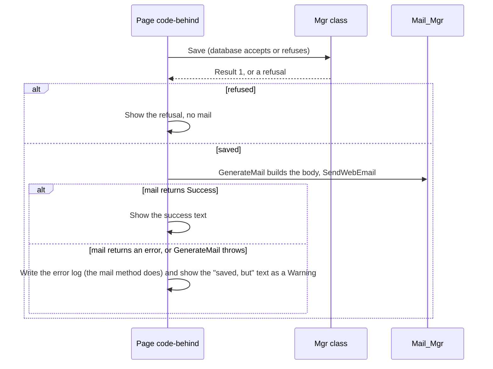
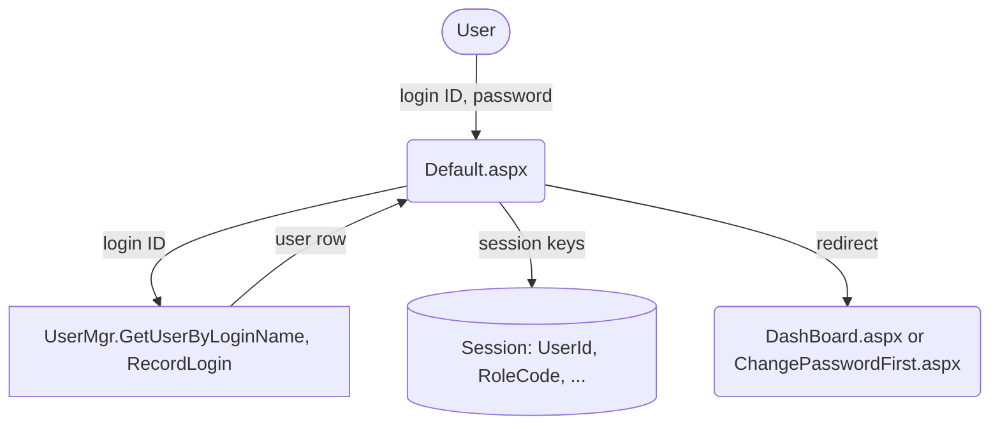
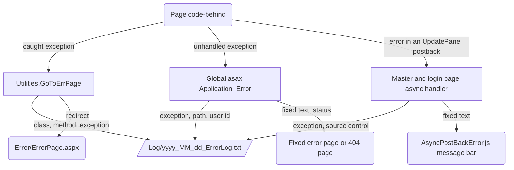

# Application Code

- Title: Application Code
- Audience: Developers and installers (internal)
- Shipped: No
- Applies to: UN6b (the Dashboard rows, the user control row, "The Dashboard Meetings card (step UN6b)" and the code with no caller); the rest RA1c2
- Last updated by: UN6b, based on 0736c7f
- Status: Draft
- Verified against: for step UN6b: BMMS/UserControl/MeetingSummary.ascx and .ascx.cs, BMMS/DashBoard/DashBoard.aspx
  (headings and column headers by Grep), DashBoard.aspx.cs (diff), BMMSBAL/MeetingMgr.cs and DepartmentMgr.cs (diff),
  BMMSDAL/MeetingDB.cs and DepartmentDB.cs (diff), Grep of .cs files for GetScheduleMeet, Database/README.md (section
  Step UN6b); and: BMMS/**/*.aspx, BMMS/MasterPage/*.Master(.cs), BMMS/UserControl/*.ascx(.cs),
  BMMS/XML/PageAccess.xml, PageSettings.xml, AppSettings.xml, ReportSettings.xml,
  BMMS/PageAccessModule.cs, BMMS/Global.asax.cs, BMMS/Default.aspx.cs, BMMS/Logout.aspx.cs,
  BMMS/Error/ErrorPage.aspx(.cs), BMMS/Report/ViewReport.aspx.cs,
  BMMS/RichTextEditor.cs, BMMS/JScript/AsyncPostBackError.js,
  BMMS/Web.config, BMMSBAL/*.cs (Common, Utilities, Mail_Mgr, AgendaMail, WordUtilities,
  Sql_Backup_Mgr, PDFUtilities, PdfFonts, HtmlCleaner, RichTextPost, RichTextLimits, SafeFileName,
  OrganisationDetails and the class lists of the other files), BMMSDAL/CommonDB.cs, ConnectDB.cs,
  UtilitiesDB.cs, MinutesDB.cs, AgendaDB.cs, Grep results over BMMS, BMMSBAL and BMMSDAL (Session
  keys, GetAppSetting, GoToErrPage, WriteErrorLog, mail messages), chapters 01 and 04 of this
  manual, and, as leads only, Documentation/Architecture/BMMS-Architecture.md section 9 and the
  "Known items for later steps" list of Database/README.md; for step RA1a: BMMS/PageAccessModule.cs
  (RequireRole), BMMS/UserControl/MenuUserControl.ascx, BMMS/XML/PageAccess.xml and the Page_Load
  of the nine pages (git diff against ea268e5); for step RA1c1: git diff against 4946500 (BMMS/Report/ViewReport.aspx.cs,
  BMMS/XML/PageAccess.xml, BMMS/BMMS.csproj, BMMS/PageAccessModule.cs), the file list of BMMS/Report
  and the Grep count of MasterPageFile in BMMS/**/*.aspx; for step RA1c2: git diff against 1db6ac6
  (BMMS/Report/FollowupActionTaken.aspx(.cs, .designer.cs), BMMS/UserControl/MenuUserControl.ascx,
  BMMS/XML/PageAccess.xml, PageSettings.xml, BMMS/BMMS.csproj, the deleted BMMS/Error/TestPage.aspx(.cs)), the Grep
  results for PDFUtilities.GenerateHTMLPdf and btnSendMail_Click in BMMS/Report and BMMSBAL
- To confirm: whether the installed site runs PageAccess.xml in Enforce mode;
  the reason Export to Pdf cannot print Tamil or Hindi text for the Followup by Department report (from the
  step requirement, not shown by the code read); what an old address of Error/TestPage.aspx now answers;
  whether building needs Microsoft Word itself or only the Interop DLL in BMMS/dll (no running code
  uses it, and Word is not needed on the server); the size limit for uploads (no maxRequestLength is set in Web.config)

This chapter describes the code of the three projects. The layers and the request flow are in
chapter 01 and are not repeated; every procedure, its data-layer class and the Reason codes with their
messages are in chapter 04. The pages are in BMMS, the business layer in BMMSBAL and the data layer in
BMMSDAL. A Grep count is given where a number is stated, so that it can be checked again.

## Pages and master pages

BMMS holds 44 `.aspx` pages (47 before step RA1c1 removed Event Calendar and Report Print, 45 before step RA1c2 removed Error/TestPage), two master pages and two user controls. Two master pages are in
BMMS/MasterPage:

| Master page | Used by | Contents |
|---|---|---|
| Main.Master | 40 pages (every page that names a master except ChangePasswordFirst) | Header with the logo, the menu (MenuUserControl), "Alerts ([n])" link to the Dashboard, the user's name and role (the login ID as tooltip), Change Password and Logout; the ScriptManager; the message bar for a failed UpdatePanel postback; the footer with the product line and, for Admin and Controller, "Database: [name]" |
| MainNoMenu.Master | ChangePasswordFirst.aspx | The same header without the menu and without the Alerts link |

Both masters set the page title from `Session["PageTitle"]` or, when it is not set, from the
`PageTitle` setting of AppSettings.xml, build the footer with `Common.ProductFooter`, and handle
`OnAsyncPostBackError` (see "Error handling"). Main.Master also computes the number in "Alerts ([n])":
the unread alerts of the list the Dashboard shows (`AlertMgr.GetAlertByUserId`, rows with
`ReadStatus = 0`); it asks nothing during an UpdatePanel postback. Three pages have no master page
(Default, Logout, ViewReport). The login page has its own footer and its own
ScriptManager.

Most pages carry `Title="Untitled Page"` in the markup. The title the user sees is set at run time
by `Common.InitSetup` from XML/PageSettings.xml (title) and the `PageTitle` setting of AppSettings.xml
(prefix). `InitSetup` replaces `Session["PageTitle"]` only when it finds an entry for the page's class name, so a page
without an entry (for example Attendance Details) shows the title that the last page with an entry left in the
session.

How the tables are read:

- Roles are the `roles` attribute of the page in BMMS/XML/PageAccess.xml (`*` is every logged-in user;
  the file in the repository has mode `Enforce`). The Admin, Controller, Manager, User, MD Secretariat and
  Management roles are the codes admin, controller, manager, user, md_sect and mgmt.
- Purpose is taken from the menu entry in MenuUserControl.ascx, the heading of the page or its code.
- "No call" under InitSetup means that the code-behind does not call `Common.InitSetup`; such a page is still
  protected by PageAccessModule (see "Session and role handling").

### Root folder, Error and DashBoard

| Page | Purpose | Roles | Notes |
|---|---|---|---|
| Default.aspx | Login. Checks the login ID and password, opens the session, sends the user to the Dashboard, or to ChangePasswordFirst after a first sign-in with the default password | Public | No master page; `?status=inactive` shows "Your account is inactive. Contact the administrator." |
| Logout.aspx | Records the end of the login in the access log, clears the session and returns to Default.aspx | Public | No master page; reached by the Logout button of the masters (PostBackUrl) |
| ChangePasswordFirst.aspx | "Change Password" for the first sign-in (MainNoMenu.Master) | `*` | Reached from Default.aspx only |
| DashBoard/DashBoard.aspx | Alerts, action items, committee, meeting and agenda alerts, approval of agenda items; the landing page of every role; menu entry "Home" for every role except Admin and MD Secretariat | `*` | Hosts the MeetingSummary user control; the code-behind has more than 1,000 lines. Since step UN6b the layout is cards in the grid `.wb-dash` (Meetings about two thirds beside Alerts, Action Items below; one column under 1100 px); the Alerts card has two columns, "Alert" (the Source link with the alert type, committee and department below it, separated by a vertical bar with a space on each side) and "Created on" (dd-MMM-yyyy with HH:mm below it); the list behaviour, the links and the control IDs are unchanged. After a successful Approve or Reject the page calls `MeetingSummary1.Reload()` |
| Error/ErrorPage.aspx | The error page shown after `Utilities.GoToErrPage`: a fixed text and an Exit button | Public | OnPreInit sends a visitor with no session to Default.aspx |

### Master folder (BMMS/Master, 24 pages)

| Page | Purpose (menu entry) | Roles | InitSetup |
|---|---|---|---|
| Agenda.aspx | Agenda Entry: Controller under "Agenda", User and Manager as top-level "Agenda Entry" | controller, manager, user | Yes |
| AgendaFinalization.aspx | Agenda Finalize (menu "Agenda") | controller | Yes |
| Attendance.aspx | Attendance (menu "Master") | admin, controller | Yes |
| BackupDatabase.aspx | Backup Database (menu "Admin") | admin (since RA1a; page check RequireRole) | No call |
| ChangePassword.aspx | Change Password (link in the header, not in the menu) | `*` | Yes |
| Committee.aspx | Committee Master | admin, controller | Yes |
| CommitteeMember.aspx | Committee Member Tag / UnTag | admin, controller | Yes |
| DecisionType.aspx | Decision Type | admin (since RA1a; page check RequireRole) | Yes |
| Department.aspx | Department Master | admin (since RA1a; page check RequireRole) | Yes |
| Designation.aspx | Designation Master | admin (since RA1a; page check RequireRole) | Yes |
| Followup.aspx | Followup (menu "Minutes") | controller, md_sect | Yes |
| Meeting.aspx | Meeting Master | admin, controller | Yes |
| MeetingMember.aspx | Meeting - Member Tag / UnTag | admin, controller | Yes |
| Member.aspx | Member Master | admin, controller | Yes |
| MemberType.aspx | Member Type | admin (since RA1a; page check RequireRole) | Yes |
| MinutesConfirmation.aspx | Minutes Confirmation (menu "Minutes") | controller | Yes |
| MinutesFinalization.aspx | Finalize Minutes (menu "Minutes") | controller | Yes |
| MinutesUpdate.aspx | Update Minutes (menu "Minutes") | controller | Yes |
| ResetDatabase.aspx | Reset Database (menu "Admin", Admin only) | admin | Yes |
| ResetPassword.aspx | Reset Password (menu "Admin") | admin (since RA1a; page check RequireRole, also in the Reset Password button) | No call |
| SMTPServerConfig.aspx | SMTP Configuration (menu "Admin", Admin only) | admin | No call |
| SubjectType.aspx | Subject Type | admin (since RA1a; page check RequireRole) | Yes |
| SystemSettings.aspx | System Settings (menu "Admin", Admin only) | admin | No call |
| User.aspx | User Master | admin (since RA1a; page check RequireRole) | Yes |

### Report folder (BMMS/Report, 15 pages)

All entries except Reports.aspx, Followup.aspx, AuditTrail.aspx and ViewReport.aspx are in the "Reports" menu of the Controller (FollowupActionTaken.aspx, "Followup by Department", since RA1c2).
Since RA1a, Audit Trail is in the "Admin" menu (Admin only), after System Settings and before Reset Database,
and the Controller's "Reports" menu no longer has it. The Manager's "Reports" menu holds the four Reports.aspx
entries only.

| Page | Purpose (menu entry) | Roles | InitSetup |
|---|---|---|---|
| AgendaApproval.aspx | Agenda Approval (PDF of approved agenda items of a meeting) | controller | Yes |
| AttendanceDetails.aspx | Attendance Details | controller | Yes |
| AuditTrail.aspx | Audit Trail (menu "Admin" since RA1a) | admin (since RA1a; page check RequireRole) | Yes |
| CommitteeMaster.aspx | Committee Master report | controller | Yes |
| CommitteeMember.aspx | Committee Member report | controller | Yes |
| Followup.aspx | Followup (`?fc=followup`) and Followup Summary (`?fc=summary`) | controller | Yes (name `followup_report`) |
| FollowupActionTaken.aspx | Followup by Department (menu "Reports" of the Controller, after Followup Summary; the heading and the page title are "Followup by Department"): the follow-up items of one committee, one meeting or a range of meetings, all departments or one, all subjects or a range; View shows the grid, Generate Report opens the report in ViewReport.aspx | controller (since RA1c2; `RequireRole("controller")` first in Page_Load and again first in the Generate Report handler); the Manager gets "Access denied" | Yes |
| MeetingCalendar.aspx | Meeting Calendar | controller | Yes |
| MeetingMaster.aspx | Meeting Master report | controller | Yes |
| Notice.aspx | Notice (report and Send Mail of the notice) | controller | Yes |
| Reports.aspx | One page for four reports chosen by `?rc=`: `agenda_summary` (Agenda Summary), `agenda_details` (Agenda Details), `minutes` (Minutes), `minutes_extract` (Minutes Extract) | controller, manager | Yes (name is the report code) |
| SendMail.aspx | Send Mail (free-form mail with an attachment) | controller | Yes |
| SittingFees.aspx | Sitting Fees (reports and PDF certificates) | controller | Yes |
| SittingFeesApplicable.aspx | Sitting Fees Applicable | controller | Yes |
| ViewReport.aspx | The report window: shows `Session["ViewReport"]`, sends a stored PDF (`?pdf=1`), Export to PDF, Export to Word. With no stored report it shows "The report is no longer available. Close this window and click Generate again." (see "Pages in no menu and the unlisted page") | controller, manager, mgmt (Management for its own report kinds only) | No call |

### User controls and master pages

| File | Purpose | Notes |
|---|---|---|
| UserControl/MenuUserControl.ascx | The top menu and its drop-down lists; the links shown depend on `Session["RoleCode"]` | Hides links only; PageAccessModule is the server-side check. Since RA1a the Master menu shows Department Master, Designation Master, Member Type, Subject Type, Decision Type and User Master to Admin only (the Controller keeps Member Master, Committee Master, Committee Member Tag / UnTag, Meeting Master, Meeting - Member Tag / UnTag and Attendance), and the "Admin" heading and menu are for Admin only (Reset Password, Backup Database, SMTP Configuration, System Settings, Audit Trail, Reset Database, in that order). The code-behind is empty. The markup calls `Session["RoleCode"].ToString()`, so it needs a logged-in session; only Main.Master uses it (MainNoMenu.Master has it commented out) |
| UserControl/MeetingSummary.ascx | Since step UN6b (rewritten): the Dashboard heading "Dashboard" with the Committee and Department drop-downs and the subtitle, an empty container for the summary cards planned for UN6c, and the Meetings card with the Scheduled and Completed (last 10) lists (columns Meeting, Meeting date, Submit agenda by, Status, Items, Approved, Rejected and the last column). It reads `MeetingMgr.GetDashboardMeetings` and `DepartmentMgr.GetDashboardDepartments` (see "The Dashboard Meetings card (step UN6b)" below) | Used by DashBoard.aspx only. It renders no wrapper: its blocks are cells of the Dashboard grid (`.wb-dash`) |
| MasterPage/Main.Master, MainNoMenu.Master | See above | |

### The Dashboard Meetings card (step UN6b)

UserControl/MeetingSummary.ascx(.cs) was rewritten in step UN6b. What it does, from the code:

- Page_Load (first load only), `Filter_Changed` (both drop-downs post back on every change) and the public
  `Reload()` (called by DashBoard.aspx.cs after a successful Approve or Reject) all call `LoadMeetings`.
- `LoadMeetings` reads the acting user id from `Session["UserId"]` (none or not a number: the "not active"
  message and no filters). It calls `DepartmentMgr.GetDashboardDepartments` on every load, then
  `MeetingMgr.GetDashboardMeetings(actingUserId, committeeId, departmentId, out reason, out statisticsShown, out
  roleCode)`. The two filter values come from the drop-downs; a chosen department that is no longer in the
  department list falls back to 0 ("All my departments"). The role and the departments are read by the
  procedures from the acting user id; nothing comes from ViewState, the query string or the session role. The
  procedures check both filter values again (Reason 4).
- The role table `RoleViews` (one place in MeetingSummary.ascx.cs) holds, per role code returned by the
  procedure: whether the Committee drop-down is shown, whether the Department drop-down may be shown (only for a
  Manager with two or more departments), whether the titles carry the department, and the header of the last
  statistics column ("In progress" for the User, "Pending" for the others). controller, manager, mgmt, md_sect
  and admin show the Committee drop-down; user does not. controller, mgmt, md_sect and admin have the plain
  title "Meetings"; the last three are provisional until their mock-up screens are decided (Database/README.md).
  A role code the table does not know gets no filter and no title change.
- `ShowTitles`: Manager with two or more departments: subtitle "Departments: [a, b]", title "Meetings, items of
  my departments", or "Meetings, [department] items" when one is chosen; one department (Manager or User):
  subtitle "Department: [name]" and title "Meetings, [department] items". The department names come from the
  database and are encoded on output (`InnerText`, a Literal in encode mode).
- The statistics columns (Items, Approved, Rejected and the last one) are shown or hidden by the value of
  `StatisticsShown` returned by the procedure, not by the role table. The table is split into the Scheduled and
  Completed grids by `ListCode` (S or C), in the procedure's order.
- `StateCssClass` turns the colour name of the procedure (grey, red, green, orange, blue) into the chip classes
  `wb-chip wb-chip-[colour]`; an unknown name gives the plain `wb-chip`. The label text is always shown.
- Dates are formatted dd-MMM-yyyy (`FormatDate`, the same format as DashBoard.aspx.cs); the meeting time is shown
  under the date as "[time] Hrs.".
- Failure handling: any exception is written to the error log (`Utilities.WriteErrorLog`, class MeetingSummary,
  method LoadMeetings) and `ShowFailure` hides the filters and the subtitle, sets the title to "Meetings" and
  shows "The meeting list could not be loaded. Reload the page to try again." A SqlException with number -2, 8645
  or 701, an InvalidOperationException whose message starts with "Timeout expired" (no free connection in the
  pool in time) or an OutOfMemoryException (`IsServerBusy`) gives "The server is busy and the meeting list could
  not be loaded. Wait a moment, then reload the page." instead. The filters are also hidden in the markup until a
  load succeeds. The Alerts and Action Items lists load on their own.
- Messages for a refusal: Reason 8 "The meeting list is not available: your account is not active. Sign in
  again."; Reason 4 "The meeting list is not shown for this choice." plus "Choose All committees or All my
  departments." (both filters shown), "Choose All committees." or "Choose All my departments.", or, with no
  filter shown, "The meeting list is not shown for your role." Empty lists: "No scheduled meetings." and "No
  completed meetings."
- Markup and styles: the heading with the filters, an empty container `divSummaryCards` for the summary cards of
  step UN6c (not built), and the Meetings card in the Workbench card style. DashBoard.aspx puts the control and
  the Alerts and Action Items cards in the grid `.wb-dash` (CSS/bmms-workbench.css, Dashboard section: grid, heading
  and filters, chips with the palette's tints, number columns, the panel widths, the 1100 px and 720 px rules).
  The Agenda Alert and Action Item Details panels have a 165 px label column and fields up to 550 px, with the
  labels above the fields at 720 px and below.
- DashBoard.aspx.cs (Alerts card): `FormatDate` is now protected, and `FormatTimeOfDay` (HH:mm) and `AlertDetails`
  (alert type, committee and department, empty ones left out, joined by a vertical bar with a space on each side)
  are new. The unused hidden Read column of the Alerts grid is gone; the read and unread rows, paging, hidden values
  and every control ID that `lnkSource_Click` reads are unchanged.
- BAL and DAL: `MeetingMgr.GetDashboardMeetings` and `MeetingDB.GetDashboardMeetings` (seven parameters, four of
  them OUTPUT; `StatisticsShown` is true only when the Reason is 0 and the procedure returned 1);
  `DepartmentMgr.GetDashboardDepartments` and `DepartmentDB.GetDashboardDepartments` (the Reason turned into one
  number by `MinutesDB.RefusalReason`).

Drawn from: BMMS/UserControl/MeetingSummary.ascx and .ascx.cs, BMMS/DashBoard/DashBoard.aspx (headings) and
DashBoard.aspx.cs (diff), BMMSBAL/MeetingMgr.cs and DepartmentMgr.cs (diff), BMMSDAL/MeetingDB.cs and
DepartmentDB.cs (diff), Database/README.md (section Step UN6b). The CSS file and DashBoard.aspx were not read in
full for this section: the CSS and layout statements are from Database/README.md.

### Pages in no menu and the unlisted page

- Report/FollowupActionTaken.aspx was in no menu until step RA1c2. It is now the last entry of the Controller's
  "Reports" menu, "Followup by Department" (after Followup Summary), with its own entry in PageSettings.xml
  (title "Followup by Department"), and PageAccess.xml gives it `roles="controller"` (before: controller and
  manager, with a comment that managers reach it from the dashboard action items; the code has no such link).
  The page calls `PageAccessModule.RequireRole("controller")` first in `Page_Load` and again first in the
  Generate Report handler, so a Manager who opens the address gets "Access denied". The Send Mail code of the
  page (`btnSendMail_Click`, `CreateBodyText`, `CreatePDF`, the download panel), whose button was commented out,
  was removed. Two fixes of the report:
  - Committee filter: `spr_GetActionItemByMeetingIdDeptId` selects by meeting number and department and
    ignores `@CommitteeId`, and meeting numbers start again in every committee, so the page filters the rows by
    `CommitteeId` itself (`GetCommitteeFollowupRows`; the grid, the report, the Subject No lists and the check
    "no record" use it). No database step.
  - PDF border: the report table was written with `border='1px'`, which the PDF converter rejects (it reads the
    border as a number), so Export to Pdf in the report window printed its fallback sentence; it is now
    `border='1'`, and the stray `<style>@media print` block of the report HTML was removed. Export to Pdf cannot
    print Tamil or Hindi text (the converter has no font for it); Export to Word and Print can.
    [[CONFIRM: the reason Export to Pdf cannot print Tamil or Hindi text for this report; the note is taken from the step requirement, and the code read here does not show it]]
- Report/EventCalendar.aspx and Report/ReportPrint.aspx were removed in step RA1c1 (files, project entries
  and PageAccess.xml lines). An old bookmark to either gets "Page not found" (HTTP 404), because the pages
  are no longer in PageAccess.xml or on disk (the owner's test of 2026-11-11 saw this for both addresses).
- ChangePasswordFirst.aspx, Logout.aspx and Report/ViewReport.aspx are reached by redirects, buttons and
  report pop-ups, not by the menu. Change Password is a link of the header.
- Error/TestPage.aspx (a development page that wrote a PDF under ~/Files/PDF and was not listed in
  PageAccess.xml) was removed in step RA1c2 (files, project entries and the PageAccess.xml comment). PageAccessModule
  treats a page that is not in the file as not allowed (reason "page is not in PageAccess.xml"): in `Enforce`
  mode a logged-in user gets the "Access denied" page (HTTP 403) and the request is written to
  `App_Data\PageAccessLog.txt` as DENIED; in `LogOnly` mode the request would run and is written as WOULD-DENY.
  A visitor who is not logged in is sent to the login page first, in both modes. [[CONFIRM: what an old address of Error/TestPage.aspx now answers; the page is gone from disk and from PageAccess.xml, so it should be "Page not found" like the two pages of RA1c1, but the step test does not show it]]
- Pages that make their own choices from the query string: Reports.aspx (`rc`), Followup.aspx (`fc`) and
  ViewReport.aspx (`pdf=1`).

How the report pop-ups work: a report page builds the report as HTML and keeps it in the session
(`Session["ViewReport"]`, `Session["ViewReportName"]`), or builds a PDF in memory and keeps the bytes
(`Session["ReportPdf"]`, `Session["ReportPdfName"]`), then opens ViewReport.aspx in a window with the
JavaScript `popup(...)`. ViewReport shows the HTML or streams the stored PDF once (`?pdf=1`, and then clears
it); its Export to PDF builds the PDF in memory from the HTML (`PDFUtilities.HtmlReportToPdf`) and its Export to
Word sends the HTML as a `.doc` with the content type `application/msword` (`ViewReport.WordDocument`); no file
is written on the server and Word is not started.

No stored report (step RA1c1): when `Session["ViewReport"]` is null or empty (the window was opened by address,
or the session ended), `ViewReport.Page_Load` answers with a small HTML page that says "The report is no longer
available. Close this window and click Generate again.", with HTTP 200 and no entry in the error log
(`NoStoredReport`, `SendNoReportMessage`; the request ends with `Response.End`). The same text is used for
`?pdf=1` when no PDF is stored. The Export to PDF and Export to Word handlers (`btnExportToPdf_Click`,
`btnExportToWord_Click`) check again and send the same message; Page_Load answers first, so the second check
is a safeguard. The Management check of step RA1b stays first in Page_Load: a Management user with no report
kind is refused with "Access denied", before the message is considered.

Drawn from: BMMS/MasterPage/Main.Master(.cs), MainNoMenu.Master(.cs), BMMS/UserControl/*.ascx(.cs),
BMMS/XML/PageAccess.xml, PageSettings.xml, MenuUserControl.ascx, the `MasterPageFile` and `Common.InitSetup`
Grep results, Report/ViewReport.aspx.cs (diff of step RA1c1), Report/FollowupActionTaken.aspx(.cs) (diff of
step RA1c2), PageAccessModule.cs.

## Business layer (BAL)

BMMSBAL has 37 source files (not counting Properties). An area has a data class (`*BAL`), a list class (`*BALList`) and a `*Mgr`
class with static methods that call the data layer (see chapter 01, "Layers"). The pages do not call BMMSDAL
(chapter 01). The DB class of each area and the procedures behind each method are in chapter 04 ("How the
data layer calls them" and the tables of "Stored procedures and functions").

### Area classes

| BAL class (file) | Area | DB class it uses |
|---|---|---|
| ActionItemMgr | Action items and follow-up | ActionItemDB |
| AgendaMgr | Agenda entry, routing, approval, finalisation, minutes finalise and confirm, the agenda lock | AgendaDB |
| AlertMgr | Alerts of the Dashboard and the addresses of alert mails | AlertDB |
| AttendanceMgr | Attendance and sitting-fee amounts | AttendanceDB |
| AuditTrail_Mgr | Audit Trail and the backup log | AuditTrail_DB |
| CommitteeMemberMgr | Committee members, sitting fees applicable | CommitteeMemberDB |
| CommitteeMgr | Committees | CommitteeDB |
| DecisionTypeMgr | Decision types | DecisionTypeDB |
| DepartmentMgr | Departments; `DeleteDepartment` turns Reason 5 and 25 into the message | DepartmentDB |
| DesignationMgr | Designations | DesignationDB |
| MeetingMemberMgr | Meeting members | MeetingMemberDB |
| MeetingMgr | Meetings; also holds `MeetingChangeResult` and `MeetingChangeReason` (the result row of every procedure with a Reason, except the user ones) | MeetingDB, and MinutesDB for the list of meetings of the minutes reports |
| MemberMgr | Members | MemberDB |
| MemberTypeMgr | Member types, with its own `RefusalMessage` | MemberTypeDB |
| MinutesMgr | Minutes | MinutesDB |
| ReportsMgr | Report queries | ActionItemDB, MinutesDB, and `CommonDB.GetDataTableFromQuery` (3 direct text queries; chapter 04, "Report queries built in the code") |
| RoleMgr | Roles | RoleDB |
| SubjectTypeMgr | Subject types | SubjectTypeDB |
| SysCodeMgr | Code lists (`SysCode`) | SysCodeDB |
| UserMgr | Users, login, status, password reset; also holds `UserChangeResult` and `UserChangeReason` | UserDB |
| Utilities | Error log, error page helpers, settings, SMTP master, reset database, login audit, grid sorting (see below) | UtilitiesDB |

### Shared helpers, mail, PDF, Word and files

| Class (file) | Purpose | Notes |
|---|---|---|
| Common | Settings from XML, the logged-in check, password hashing, secrets, message styles, drop-down loading, footer text, the mail audit write (see below) | Uses ConnectDB and CommonDB; `SaveSendMail` calls `spr_SaveSendMail` itself |
| Mail_Mgr | Sends every mail through the SMTP settings of the database (`SendWebEmail`, `FindInvalidMailAddress`) | When, to whom and what is sent is in chapter 07. The code sets no `EnableSsl` |
| AgendaMail | The parts shared by the agenda mails: detail rows, the comment row, the item read after the save (`ReadItemAfterSave`) | No database access of its own; it calls AgendaMgr |
| PDF_Reports | The three sitting-fee certificates and reports as PDF bytes, and the Tamil/Hindi test for them | Fixed wording in the code (see "Known limitations in the code") |
| PDFUtilities | PDF building blocks: cells, HTML text, logo, page numbers, uploaded agenda text, and `HtmlReportToPdf` | iTextSharp 4.0.2.0 (chapter 01, "Third-party components") |
| HtmlToPdfBuilder (with `HtmlPdfPage`) | Builds a PDF from HTML pages and style sheets | Used by `PDFUtilities.GenerateHTMLPdf`, which no page calls since RA1c2 removed TestPage (Grep) |
| PdfFonts | The Noto Serif fonts of the PDF output, the test for Tamil or Hindi text and the message for it | Constant `IndicTextMessage` |
| WordUtilities | Word conversion with Microsoft.Office.Interop.Word (`CreateWord`) and old HTML helpers (`ExportToWord`, `ExportToPdf`, `ReadWordDocument`) | No page or class calls any of its methods (Grep); the Word export of a report is `ViewReport.WordDocument` and needs no Word |
| DocToString | Reads a Word file as text through Word Interop | The only call is commented out (Master/Agenda.aspx.cs) |
| HTML_Report | `ReplaceRichTextFont` (changes typed font and colour text) and `HTML_PageBreak` | Used by the Agenda, Followup, Reports and PDF code |
| HtmlCleaner | Cleans rich text to a fixed allow-list of tags and attributes, using HtmlAgilityPack | Called before rich text is saved or shown |
| RichTextPost | Encodes and decodes the rich-text value as Base64 of its UTF-8 bytes in the hidden field | Result `Text`, `Empty`, `TooLong` or `Invalid` |
| RichTextLimits | The two size limits (`RichTextMaxChars` 200000 and `RichTextMaxTotalChars` 600000 by default) read from Web.config appSettings | `TooLongMessage` is "The text is too long. Shorten it or attach the document as a file." |
| SafeFileName | Makes an uploaded file name safe and unique | |
| OrganisationDetails | The organisation settings and the logo printed on notices, minutes, reports and certificates | Uses UtilitiesDB; the logo file is under Files/Branding |
| Sql_Backup_Mgr | Backup Database: a `BACKUP DATABASE` command built on a connection from ConnectDB, with a 600-second timeout | The destination must be writable by the SQL Server service account |

The project's own rich-text control, `BMMS.Controls.RichTextEditor` (BMMS/RichTextEditor.cs), is in the web
project, not in BMMSBAL. It is a WebControl with a toolbar over a contenteditable box, driven by
JScript/RichTextEditor.js. The text travels in one hidden field through `RichTextPost`; the server cleans every
posted value with `HtmlCleaner.Clean`; a read-only editor ignores posted values. A page's save, attach and
upload handlers call `RichTextEditor.IsTooLong(Page)` first and refuse with `RichTextLimits.TooLongMessage`.
It is registered in Web.config with the tag prefix `bmms`.

### Common.cs

- Settings from the XML files. `Common.GetAppSetting(key)` loads XML/AppSettings.xml, `GetReportSettings(key)`
  loads XML/ReportSettings.xml and `InitSetup` loads XML/PageSettings.xml, each time they are called (no
  caching), and returns an empty string for a key that is not found. The keys of AppSettings.xml read by the
  code are `PageTitle`, `NoRecord`, `LoginIdMaxLength`, `PasswordMaxLength`, `PasswordMinLength`,
  `delete_reference`, `data.notDelete` and `delete_msg`; a search finds no reader of `CommonErrMsg`.
  ReportSettings.xml holds the pop-up widths `MinutesReport_Width`, `MinutesExtractReport_Width` and
  `FollowupReport_Width`. The settings that an Admin changes on System Settings are rows of the database
  (chapter 04, "Settings rows"; chapter 06), not these files. `MondifyAppSettings` can write AppSettings.xml
  but nothing calls it.
- Password hashing. `HashPassword` uses PBKDF2 (`Rfc2898DeriveBytes`) with 100,000 iterations and a random
  16-byte salt, and stores `iterations.salt.hash` as Base64 text. `VerifyPassword` compares in constant time
  and returns false for a stored value that is not in that format (`IsLegacyFormat`).
  The branch of Default.aspx.cs that upgrades an old-format password runs only after `VerifyPassword` has
  accepted the password, so it does not run for a value in the old format.
  `HashPassword` is called by Change Password, Change Password First, Reset Password and User Master (Save).
- The default password. `Common.DefaultPassword` is a constant of the code. Reset Password sets a user's
  password to it (`ResetPassword.aspx.cs`), Reset Database seeds the default accounts with it (chapter 04,
  "Reset Database and backup"), and the login page opens ChangePasswordFirst.aspx instead of the Dashboard when
  the password typed equals it. The value is not written in this manual.
- Secrets. `ProtectSecret` and `UnprotectSecret` keep the SMTP password with Windows DPAPI at machine scope
  and a fixed entropy text, with the prefix `dpapi:` in front. A value without the prefix is read with
  `DecryptVal` (a Triple DES routine kept for a value saved before DPAPI); `EncryptVal` has no caller.
  After the database is restored on another server the SMTP password must be entered again.
- Logged-in check. `IsLoggedIn` is true when the session holds a numeric `UserId` above 0 (step UN2).
  `IsSystemAccountSession` reads `Session["IsSystem"]`.
- Display and messages. `MessageKind` and `MessageCss` (see "Messages shown to users"); `UserDisplayName`
  ("Name (login)", with " (inactive)") and `UserCaptionName` (the name alone) are the two formats of a person;
  `LoadDropdownlist`, `LoadDDLwithAll` and `LoadDDLwithAllNew` fill a drop-down list with "- Select -" or
  "- All -"; `ProductFooter` and `FooterDatabaseName` build the footer (the database name is read once per
  application from the open connection, only for a logged-in Admin or Controller, and is HTML-encoded).
- Mail audit. `SaveSendMail` writes one row per sent mail (`spr_SaveSendMail`; chapter 04, "Settings and mail").

### Utilities.cs

`Utilities` holds the error helpers (`WriteErrorLog`, `GoToErrPage`, `LogUnhandledError`,
`LogAsyncPostBackError`, `IsReturnablePage`; see "Error handling"), `GridViewDataTableSorting` for the sort
headers, and thin methods over UtilitiesDB: `ResetDatabase`, `GetDatabaseName`, `GetSMTPMaster`,
`UpdateSMTPMaster`, `GetStateMaster`, `AddEditAuditTrialLogin`, `GetAppSetting` and `SetAppSetting`
(the database settings; constants `AgendaControllerBypass` and `DeptNoManagerAction`) and
`SetDepartmentManagerRule`. `GetLocalIPAddress` returns an address of the machine that runs the site.

### Mail_Mgr.cs

`Mail_Mgr.SendWebEmail(To, Subject, Body, AttachFile, [AttachName,] Bcc, [ToRequired])` reads the SMTP settings
through `Utilities.GetSMTPMaster`, adds the configured Bcc to the caller's Bcc, builds an HTML mail in UTF-8
with a fixed closing note, sends it with `SmtpClient` on the stored port (25 when the port is not a number) and
then writes the audit row. It returns the text "Success", or "Error: [message]" after writing the exception to
the error log; the pages test for "Success" and show their own text. The rules for recipients, the Bcc, the
skipped bad addresses and when each mail is sent are in chapter 07.

Drawn from: BMMSBAL/*.cs (class lists, `*DB.` calls by file), Common.cs, Utilities.cs, Mail_Mgr.cs,
AgendaMail.cs, WordUtilities.cs, DocToString.cs, Sql_Backup_Mgr.cs, PDFUtilities.cs, PdfFonts.cs,
HtmlCleaner.cs, RichTextPost.cs, RichTextLimits.cs, SafeFileName.cs, OrganisationDetails.cs,
BMMS/RichTextEditor.cs, BMMS/Report/ViewReport.aspx.cs, the Grep for callers of the Word and PDF methods.

## Data layer (DAL)

BMMSDAL is 22 files: `CommonDB`, `ConnectDB` and 20 `*DB` classes. A `*DB` method builds a `SqlParameter` array
and calls `CommonDB` with the procedure name as a string; it does not read the result.

### CommonDB and ConnectDB

| Method | What it does |
|---|---|
| `CommonDB.GetDataTable(name, parameters)` | Opens a new connection, runs the stored procedure (`CommandType.StoredProcedure`), fills a `DataTable` with `SqlDataAdapter` and closes the connection |
| `CommonDB.ExecuteProcedure(name, parameters)` | The same with `ExecuteNonQuery`; returns the affected-row count and no result set |
| `CommonDB.GetDataTableFromQuery(sql)` | Runs a text query (`CommandType.Text`) with no parameters; the callers are `ReportsMgr` (3), `ActionItemDB` (the follow-up query), `UtilitiesDB.GetDatabaseName`, `UserDB` (`HasUserHistory`), `MinutesDB.HasDueDateParameter` and `AgendaDB` (the last three check the parameters of a procedure) |
| `ConnectDB.GetConnectionString()` | Returns the connection string named `ConnectionString` of the application's configuration; the connection strings are read from a separate file that Web.config names (chapter 01, 06). The value is never written in a document |
| `ConnectDB.GetConnectedDatabaseName()` | Opens a connection and returns `SqlConnection.Database` (used for the footer) |

Parameters, timeouts and errors:

- Parameters are `SqlParameter` objects made by the `*DB` method; most carry only a name and a value, so the
  type follows the value. A few set the type and size: `@DepartmentIds` (varchar max) in `UserDB`, `@DueDate`
  (datetime) in `MinutesDB.UpdateMinutes`, the organisation settings (nvarchar 400) and
  `@ConfirmDatabaseName` (nvarchar 128) in `UtilitiesDB`. `CommonDB` clears the parameter list after the call.
- Timeouts. `CommonDB` sets no `CommandTimeout`, so the ADO.NET default applies. Two other places set their own:
  `UtilitiesDB.ResetDatabase` builds its own command with 300 seconds, and `Sql_Backup_Mgr.BackupDatabase`
  uses 600 seconds.
- Errors. The three methods catch the exception, close the connection in `finally` and throw the exception again
  with `throw ex;`, which restarts the stack trace at that line. The data layer never turns an error into a
  result (chapter 04, "A refusal is not a database error"). A connection is made for every call; no
  transaction is opened in the code (a procedure that needs one opens it itself).
- Optional parameters. Two methods ask the database whether a procedure has a newer parameter before calling
  it: `MinutesDB.HasDueDateParameter` (`@DueDate` of `spr_UpdateMinutes`, step 38) and
  `AgendaDB.SaveAgendaRow` with an output parameter `@ChangedFields` (step 37). A build that is ahead of its
  database then still works, and the page says so in its message (see "Messages shown to users"). Both read
  `sys.parameters` with a text query; the procedure names in it are fixed in the code.

### The *DB classes

The count is the number of lines in the class with a call of `CommonDB.GetDataTable` or `ExecuteProcedure`
that names the procedure as a literal (Grep). The procedures themselves and the methods that call them are in
chapter 04.

| DB class | Area | Literal calls |
|---|---|---|
| ActionItemDB | Action items, follow-up | 7 |
| AgendaDB | Agenda | 25 |
| AlertDB | Alerts | 5 |
| AttendanceDB | Attendance | 6 |
| AuditTrail_DB | Audit trail | 3 |
| CommitteeDB | Committees | 5 |
| CommitteeMemberDB | Committee members | 9 |
| DecisionTypeDB | Decision types | 5 |
| DepartmentDB | Departments | 6 |
| DesignationDB | Designations | 5 |
| MeetingDB | Meetings | 18 |
| MeetingMemberDB | Meeting members | 6 |
| MemberDB | Members | 9 |
| MemberTypeDB | Member types | 6 |
| MinutesDB | Minutes and the minutes reports | 7 |
| RoleDB | Roles | 5 |
| SubjectTypeDB | Subject types | 5 |
| SysCodeDB | Code lists | 1 |
| UserDB | Users and login | 17 |
| UtilitiesDB | Settings, SMTP master, login audit, organisation settings, Reset Database | 10 |

`UtilitiesDB.ResetDatabase`, `GetDatabaseName` and the optional-parameter checks are the methods that do not
go through the two procedure methods of `CommonDB` with a literal name.

Drawn from: BMMSDAL/CommonDB.cs, ConnectDB.cs, UtilitiesDB.cs (ResetDatabase), MinutesDB.cs (UpdateMinutes,
HasDueDateParameter), AgendaDB.cs (SaveAgendaRow), BMMSBAL/Sql_Backup_Mgr.cs, the Grep count of
`CommonDB.` calls with a literal name per file, chapter 04 ("How the data layer calls them").

## Messages shown to users

Where the texts come from:

| Source | What it holds | Examples |
|---|---|---|
| The page code | Most messages: constants and literals of the code-behind, built with the name or number the screen fills in | "Successfully Saved"; "Invalid User Id / Password" (Default.aspx.cs); "Your account is inactive. Contact the administrator." |
| XML/AppSettings.xml | Common texts: `delete_reference` ("You cannot delete this record, because it has references."), `delete_msg` ("Record deleted successfully."), `data.notDelete`, `NoRecord` ("No such records found", kept in `Session["NoRecord"]` for the grids' empty rows) | Read by `Common.GetAppSetting`; the other keys are limits and the page title (see "Common.cs") |
| The result classes of the BAL | The message for a Reason code: `RefusalMessage()` of `MeetingChangeResult` and `UserChangeResult`, `MemberTypeMgr.RefusalMessage`, `DepartmentMgr.DeleteDepartment` | The mapping, the fallbacks and the pages that choose their own wording are in chapter 04, "How the data layer and the pages read the row" and "Reason codes" |
| Fixed texts of the error paths | `Utilities.AsyncPostBackErrorMessage`, the safe error page of Global.asax.cs, the text of ErrorPage.aspx, the texts of AsyncPostBackError.js, the "Access denied" page of PageAccessModule | See "Error handling" |
| Constants of helper classes | `RichTextLimits.TooLongMessage`, `PdfFonts.IndicTextMessage` and `PdfFonts.IndicTextMessageFor(...)` | Shown by the pages that use them |

How a page shows a message:

- The message box. Most pages have a `divErrLogin` with a `spanErrLogin` and a private `MsgDisplay(text, kind)`
  and `MsgHide()` of their own (32 code-behind files define `MsgDisplay` and most of them `MsgHide`; they are copies, not one shared method).
  `MsgDisplay` sets the class of the box with `Common.MessageCss(kind)` and puts the text into the box
  (`InnerHtml`). The kind is `MessageKind.Warning` (the default: refusals, "please select", checks; the class
  `divError`), `Success` (class `divError msg-success`) or `Error` (class `divError msg-error`); the styles are in
  CSS/bmms-workbench.css. Because the text goes into the box as HTML, a text that contains typed or database
  text is encoded by the page first (for example Notice.aspx.cs line 54 uses `HttpUtility.HtmlEncode`).
- Alert windows. The Dashboard refusal and the report pages (Agenda Approval, Followup, Followup by Department,
  Notice, Sitting Fees) use `ScriptManager.RegisterStartupScript` with a JavaScript `alert(...)`; the text is
  encoded for JavaScript (`HttpUtility.JavaScriptStringEncode`) where it can hold typed text. ChangePasswordFirst
  shows an alert and then goes to the login page.
- A failed UpdatePanel request. The masters and the login page show the fixed text in the bar `wbAsyncError`
  (see "Error handling").

A text that a screen fills in is written in square brackets in the documents ("Saved. Not restored:
[departments]"), because the code builds it with the name or list at run time.

### "Saved, but the mail could not be sent"

Several pages save first and send the mail second, and a failed mail never undoes the save. The code of each
page follows the same steps (steps M1, M2, M3, ML1 and ML2c in Database/README.md describe how it came about):

| From | To | Data | Notes |
|---|---|---|---|
| Page | Mgr class | The item and the acting user | The mail is built only when the result is 1 |
| Page | Mail_Mgr | To, Subject, Body, Bcc | `GenerateMail` catches its own exception, writes the error log and returns "Error" |
| Mail_Mgr | Page | "Success" or "Error: [message]" | The page tests for "Success" and does not show the error text |
| Page | User | One message | Warning kind; the text says the item is saved and that the error is in the error log |

| Page (code-behind) | Message when the mail fails | Where in the code |
|---|---|---|
| Master/Agenda.aspx.cs, Save | "The agenda item was saved, but the mail could not be sent. The error is in the error log." (followed by the submission-date notice when there is one) | `MailNotSentMessage`, line 33; used line 814 |
| Master/Agenda.aspx.cs, Update | "The agenda item was updated, but the mail could not be sent. The error is in the error log." (also shown when the database does not have step 37) | `UpdateMailNotSentMessage`, line 36; used line 820 |
| Master/Meeting.aspx.cs | "The meeting was saved, but the mail could not be sent. The error is in the error log." | `MailNotSentMessage`, line 21; used line 351 |
| DashBoard/DashBoard.aspx.cs, Approve | "The item was approved, but the mail could not be sent. The error is in the error log." | line 21; used line 721 |
| DashBoard/DashBoard.aspx.cs, Reject | "The item was rejected, but the mail could not be sent. The error is in the error log." | line 22; used line 810 |
| Master/AgendaFinalization.aspx.cs | The count of rejection mails that failed is added to the message: "[n] rejection mail(s) could not be sent. The error is in the error log." | line 229 |
| Master/ResetPassword.aspx.cs | "The password was reset to the default password, but the mail could not be sent. The error is in the error log." | line 129 |
| Report/Notice.aspx.cs | "[n] mail(s) could not be sent; see the error log." added to the result | line 208 |
| Report/SendMail.aspx.cs | "The mail could not be sent. The error is in the error log." (Error kind; nothing was saved, and the attachment is kept for a new try) | line 102 |

The reading of the item after a saved decision is part of the same pattern: `AgendaMail.ReadItemAfterSave`
returns `null` when the item cannot be read, writes the error log, and the mail is sent without the comment
row. A bad address in To or Bcc is skipped and logged by `Mail_Mgr.AddRecipients`; the mail fails only when
no valid address is left (Reset Password and Notice need a valid To). Both rules are described in chapter 07.

Drawn from: BMMSBAL/Common.cs (MessageKind, MessageCss), Mail_Mgr.cs, AgendaMail.cs, BMMS/XML/AppSettings.xml,
the pages named in the table, the Grep results for `MsgDisplay`, `RegisterStartupScript` and `GetAppSetting`,
chapter 04 ("Result, Reason and ReasonDetail", "Reason codes").

## Session and role handling

Session state is in process with a timeout of 10 minutes (Web.config, chapter 01). Nothing in the code
keeps a user logged in after the session ends.

### Session keys

| Key | Set by | Used by | Notes |
|---|---|---|---|
| `UserId` | Default.aspx.cs (after the password is verified and the account is active) | `Common.IsLoggedIn`, PageAccessModule, Main.Master, almost every save | The identity of the logged-in user; a number as text |
| `UserName` | Default.aspx.cs | Header of the masters, the access-log line of PageAccessModule | The person's name |
| `LoginName` | Default.aspx.cs | Header tooltip, the access-log line | The login ID |
| `RoleCode` | Default.aspx.cs | MenuUserControl, PageAccessModule, `Common.FooterDatabaseName`, the pages that choose by role | admin, controller, manager, user, mgmt or md_sect |
| `RoleName` | Default.aspx.cs | Header of the masters | |
| `DesignName` | Default.aspx.cs | A search finds no reader | |
| `IsSystem` | Default.aspx.cs | `Common.IsSystemAccountSession` | "1" for the protected system account, otherwise "0" |
| `NoRecord` | Default.aspx.cs (text of the AppSettings key `NoRecord`) | The empty row of the grids (aspx files) | |
| `LoginCount` | Default.aspx.cs | Nothing | Counts failed passwords in the session; the call that would lock the user is commented out |
| `PageTitle`, `PageURL` | `Common.InitSetup` (`PageURL` also by Default.aspx.cs) | The masters (`PageTitle`) | `PageURL` is no longer used by the error page's Exit |
| `ErrorReturnPage` | `Utilities.GoToErrPage` | ErrorPage.aspx Exit | The page that failed, with its query string |
| `ViewReport`, `ViewReportName`, `ReportPdf`, `ReportPdfName`, `FollowupHTML` | The report pages | ViewReport.aspx | The report HTML or PDF bytes handed to the pop-up |

Set at login (Default.aspx.cs, `btnLogin_Click`): the login page reads the user by login ID
(`UserMgr.GetUserByLoginName`), then checks in this order: a user who does not exist or a wrong password gives
"Invalid User Id / Password" (the same text for both); a password that is right for an inactive account gives
"Your account is inactive. Contact the administrator." (checked after the password so the text does not reveal
that the login exists); otherwise `UserMgr.RecordLogin` writes the access-log row, the session keys are set and the
user goes to ChangePasswordFirst.aspx (password equals the default) or to the Dashboard. A database error
gives "Database not connected" and an error log entry.

Cleared at logout: Logout.aspx.cs writes the end of the login (`Utilities.AddEditAuditTrialLogin`), then calls
`Session.Clear()` and `Session.Abandon()` and redirects to Default.aspx. PageAccessModule does the same for an
account that was deactivated. When the session ends by timeout, `Session_End` in Global.asax.cs writes the same
audit row for the user in the session.

| From | To | Data | Notes |
|---|---|---|---|
| User | Default.aspx | Login ID and password | Maximum lengths come from `LoginIdMaxLength` and `PasswordMaxLength` |
| Default.aspx | UserMgr | Login ID, the address of the machine running the site, the URL | The password is not sent to the database; it is verified in the code against the stored hash |
| UserMgr | Default.aspx | User row | Includes the hash, the account status, the role |
| Default.aspx | Session | The keys of the table above | |
| Default.aspx | Dashboard or Change Password First | Redirect | `Response.Redirect(..., false)` |

Drawn from: BMMS/Default.aspx.cs, Logout.aspx.cs, Global.asax.cs, BMMSBAL/Common.cs (`IsLoggedIn`), the Grep of
`Session["..."]` over BMMS and BMMSBAL.

### PageAccessModule

The request flow is in chapter 01 ("Request life cycle"). The points a developer needs:

- It is an `IHttpModule` (`BMMS.Security.PageAccessModule`) registered in Web.config in `httpModules` and in
  `system.webServer/modules`; it runs on `PostAcquireRequestState` for `.aspx` requests only. A request for any
  other file type (images, scripts, files under Files/) is not checked by it.
- Public pages (`<public>`): Default.aspx, Logout.aspx and Error/ErrorPage.aspx. Every other page needs a
  logged-in user in both modes (`Common.IsLoggedIn`: a `UserId` in the session); if there is none the request is
  redirected to Default.aspx, or answered in the AJAX "pageRedirect" format for an UpdatePanel postback.
- Active-user check. On every request for a page that is not public, `UserMgr.GetUserStatusByUserId` reads the
  account status from the database; a status other than 1 clears the session and redirects to
  `Default.aspx?status=inactive`. If the read fails the request is let through and the error is written to the
  error log, so a database outage does not log everyone out.
- Role check. The role in `Session["RoleCode"]` must be in the page's `roles` (case-insensitive; `*` is every
  logged-in user). A page that is not in PageAccess.xml is not allowed.
- Modes. In `Enforce` the module writes a DENIED line and answers with the "Access denied" page and HTTP 403
  ("Your role does not have access to this page." and a link back to the Dashboard). In `LogOnly` (any
  `mode` value other than `Enforce`) nothing is blocked for a role reason and a WOULD-DENY line is written.
  When the policy file cannot be read, only the login and active-user checks apply and a POLICY-NOT-LOADED line is
  written. The policy is cached and reloaded when the file changes; a failed load is cached for 30 seconds.
- The log. Lines are appended to `App_Data\PageAccessLog.txt` (tab-separated: time, action, user as
  "Name (login)", role, page, reason). App_Data is not served by IIS. A write failure never breaks the request.
  No code removes or rotates the file (a Grep for file deletion finds only the logo, the Send Mail attachment and
  the unused Word code).
- The page check `RequireRole` (step RA1a). `PageAccessModule.RequireRole(params string[] roles)` is a second check
  inside a page, for pages that only some roles may use. It reads the user's role and account status from the
  database by the session's `UserId` (`UserMgr.GetUserDataTableByUserId`), not from `Session["RoleCode"]`, so it
  also holds in `LogOnly` mode, for a session opened before a deployment and for a role changed during the
  session. When the user is not an active user with one of the roles it writes a DENIED-PAGE line to the page
  access log (reason "role not allowed by the page (allowed: [roles])"), answers the same "Access denied" page
  (HTTP 403) and ends the request with `Response.End()`, so no event handler of the page runs. A database error
  denies (fail closed) and is written to the error log. It is called outside any try/catch, as the first line of
  `Page_Load` of nine pages: Master/User, Department, Designation, MemberType, SubjectType, DecisionType,
  ResetPassword, BackupDatabase and Report/AuditTrail, each with `RequireRole("admin")`; and again first in the
  Reset Password and Backup Database button handlers. Every other page follows `Session["RoleCode"]` until
  sign-out (see chapter 08, "Page access").
- The logged-in check by user id (step UN2) replaced a test of the person's name: before it, pages tested
  `Session["UserName"]`, which is display text and not an identity.
- The menu and the module are two lists to keep in step: MenuUserControl.ascx shows links by role, and
  PageAccess.xml allows pages by role. A role that is listed in one and not in the other either sees a link that
  ends in "Access denied" or can open a page it has no link to. Chapter 08 describes the security rules.

Drawn from: BMMS/PageAccessModule.cs, BMMS/XML/PageAccess.xml, BMMS/Web.config, BMMS/UserControl/MenuUserControl.ascx,
BMMSBAL/Common.cs, Database/README.md (step UN2 as a lead).

## Error handling

Three paths lead to an error message. None of them shows an exception text to the user.

| From | To | Data | Notes |
|---|---|---|---|
| Page | `Utilities.GoToErrPage` | Class name, method name, exception | 164 call sites in 36 files (Grep); the pages catch the exception around their calls |
| `GoToErrPage` | Error log | The exception | `Utilities.WriteErrorLog` through `DescribeForLog` |
| `GoToErrPage` | ErrorPage.aspx | Redirect | `Session["ErrorReturnPage"]` keeps the failed page for Exit |
| Page | Global.asax `Application_Error` | An unhandled exception | Also request-validation errors and a dangerous URL path (HTTP 400) |
| `Application_Error` | Error log | Exception, request path, user id | One entry; none for HTTP 404; none when the async handler already logged it |
| `Application_Error` | Browser | A fixed page with the status | No exception text, no redirect |
| Page | Master async handler | The error of an UpdatePanel postback | `OnAsyncPostBackError` of Main.Master, MainNoMenu.Master and Default.aspx |
| Async handler | Browser | `AsyncPostBackErrorMessage` | JScript/AsyncPostBackError.js shows it in the bar `wbAsyncError` |

### Utilities.WriteErrorLog and the log file

`Utilities.WriteErrorLog(class, method, message)` appends to the file `yyyy_MM_dd_ErrorLog.txt` (one file per day)
in the folder `Log` under the application's base directory, creating the folder when it is missing. One entry is a
line of dashes, the date and time, "Class  Name", "Method Name", "Description" and a closing line. One writer at
a time (a lock); the method never throws, so that a logging failure does not hide the caller's error. Web.config
hides the segment `Log` (and `PDF` and `SqlBackup`) from browsers with `requestFiltering`, so the files are not
served. The text written for an exception is `Exception.ToString()`, except for a request-validation error: the
value the user typed is replaced by "(value not logged)". Form values are never written.

### The paths

- Caught in a page (`GoToErrPage`). It writes the log, remembers the failed page (only a normal `.aspx` path
  of the application; `IsReturnablePage` refuses anything that could point to another site) and redirects to
  Error/ErrorPage.aspx. The page shows a fixed text ("This action could not be completed because of an error on
  the server. The error is in the error log. Use Exit to return to the page, and check what was saved before you
  try again.") and the Exit button, which returns to the failed page when the file exists, otherwise to the
  Dashboard. With no session the page sends the visitor to the login page.
- Not caught (`Application_Error`, Global.asax.cs). It logs once through `Utilities.LogUnhandledError`, clears the
  error and writes a short fixed page: "This action could not be completed because of an error on the server. The
  error is in the error log. Open the page again and check what was saved before you try again.", with the status
  of the error (HTTP 500 when there is none) and links "Open the page again" and "Back to home". The link is left
  out for a 400, for the error page itself and for a path that could point elsewhere, and the text then leaves
  out that sentence. For an UpdatePanel request the answer is the fixed text only. HTTP 404 gets a "Page not
  found." page, is not logged and shows no path. If the page cannot be written the answer is status 500 with no
  body. The "Access denied" page of PageAccessModule does not pass through this handler.
- Error in an UpdatePanel postback. The handler of the master sets `AsyncPostBackErrorMessage` ("The action could
  not be completed. The error is in the error log.") and logs the exception, the page, the control that posted and
  the user id (`Utilities.LogAsyncPostBackError`); it marks the request as logged, so `Application_Error` does
  not write a second entry. The script shows a bar with its own text: "This action could not be completed because
  of an error on the server. The error is in the error log. Reload the page and check what was saved before you
  try again.", or "The server did not answer in time. Reload the page and check what was saved before you try
  again." for a timeout. The bar is hidden at the start of the next request. A page that adds its own end-request
  handler first can mark the error as handled (Reset Database does).
- Refusals are not errors. A refusal is a result row with a Reason code, and the page shows the message of its
  Reason (chapter 04, "A refusal is not a database error"). A database error is the other path and ends in one of
  the three above.

Web.config has no `customErrors` and no `httpErrors` element: errors reach `Application_Error`, and the pages
and modules answer for themselves. Request validation is on (`requestValidationMode="2.0"`) with
`ValidateRequest="false"` on 11 pages (a Grep of the aspx files; Database/README.md names them in the step A2a
item of its known-items list). The version headers are off (`enableVersionHeader="false"`, no `X-Powered-By`).

Drawn from: BMMS/Global.asax.cs, BMMSBAL/Utilities.cs, BMMS/Error/ErrorPage.aspx(.cs), BMMS/MasterPage/Main.Master(.cs),
BMMS/JScript/AsyncPostBackError.js, BMMS/Web.config, Database/README.md (steps E1, E2, E2b, E2c as leads).

## Known limitations in the code

The list is from Documentation/Architecture/BMMS-Architecture.md section 9 (a lead) and from the "Known items for
later steps" list of Database/README.md, each checked against the code. The limits that sit in the database are in
chapter 04 ("Known database limitations"). The full backlog stays in Database/README.md.

| Limitation | Evidence in the code |
|---|---|
| Some report and certificate texts are fixed in the code. The old note says that making them company-specific is planned. The organisation name, address and logo are settings (`OrganisationDetails`), but the wording is not | PDF_Reports.cs line 182 ("This is to certify that we have paid to Shri. ..."); Report/Reports.aspx.cs line 626 ("Minutes of the ... meeting of the ...") |
| Old mail and login audit rows can show the wrong user (the old note says ids of users deleted long ago were reused) | A data matter, not a code fault; see chapter 04. The audit writes are `Common.SaveSendMail` and `Utilities.AddEditAuditTrialLogin` |
| Mail has no TLS: the code never sets `EnableSsl`, so only a server that accepts plain SMTP works | Mail_Mgr.cs, `SendWebEmail` (the `SmtpClient` is made with a host and port only) |
| The mail audit row keeps the full server path of the attachment, and a mail that was sent but whose audit row could not be written is reported as a failure | Mail_Mgr.cs line 109 (`Common.SaveSendMail` with the attachment path, after `smtp.Send`, inside the same `try`) |
| The IP address recorded at login is an address of the machine that runs the site, not of the user's computer | Default.aspx.cs line 71 (`Utilities.GetLocalIPAddress`, which uses the server's own host name) |
| User ids are read with `Convert.ToInt16` in several places, so an id above 32767 fails there | Global.asax.cs `Session_End` (no handler around it), Logout.aspx.cs, Master/ResetPassword.aspx.cs |
| Code with no caller: `WordUtilities` (all methods), `DocToString`, `Common.EncryptVal`, `Common.CreateRandomPassword`, `Common.MondifyAppSettings`; the Send Mail handler `btnSendMail_Click` of Report/Followup has no button (the same code of Report/FollowupActionTaken was removed in RA1c2); `PDFUtilities.GenerateHTMLPdf` and `HtmlToPdfBuilder` have no caller since RA1c2 removed TestPage; `MeetingMgr.GetScheduleMeet` and `MeetingDB.GetScheduleMeet` have no caller since UN6b (the Dashboard reads `GetDashboardMeetings`) | Grep for callers |
| Files under ~/Files (uploads, attachments) are plain files served by IIS: PageAccessModule checks `.aspx` requests only, and Web.config hides only the segments `PDF`, `SqlBackup` and `Log`. Database/README.md lists a login-checked download page as an open step (step 27) | PageAccessModule.cs lines 62 to 68; Web.config `hiddenSegments` |
| Web.config sets no `maxRequestLength`, so the ASP.NET default applies to uploads; the old list says a larger upload is refused before the page runs and shows the safe error page | Web.config (`httpRuntime`); [[CONFIRM: the effective upload limit on the installed site; check the installed Web.config and the IIS request-filtering limit]] |
| `CommonDB` rethrows with `throw ex;`, so the stack trace of an error starts at `CommonDB` and not at the procedure call | CommonDB.cs lines 36 to 39 and 78 to 81 |
| `Common.GetAppSetting` reads and parses the XML file on every call | Common.cs `GetAppSetting` |
| `DecryptVal` (Triple DES) is kept only for an SMTP password saved before DPAPI; the code marks the line as transitional | Common.cs `UnprotectSecret` |

Other items of the Database/README.md list that concern single pages (for example the Agenda Approval PDF and
the Agenda Details report) were not rechecked in this chapter and stay in that list.

Drawn from: Documentation/Architecture/BMMS-Architecture.md section 9 (lead), Database/README.md "Known items for
later steps" (lead), BMMSBAL/PDF_Reports.cs, Mail_Mgr.cs, Common.cs, Utilities.cs, BMMS/Default.aspx.cs,
Global.asax.cs, Logout.aspx.cs, Master/ResetPassword.aspx.cs, Report/Reports.aspx.cs,
PageAccessModule.cs, Web.config, BMMSDAL/CommonDB.cs.
