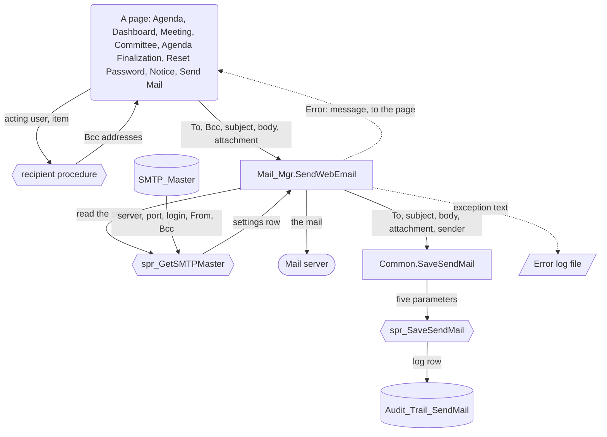

# Mail

- Title: Mail
- Audience: Developers and installers (internal)
- Shipped: No
- Applies to: WF2c (the five parts written: "Mail server settings", "When mail is sent", the rest of "Recipients and addresses", "Mail failure after a save", "Mail log"; the check of the alert-writing sentence of step UN6c1); IU1 (step 55: section "Recipients and addresses", the table and list on the Meeting, Committee and Reset Password mails); UD1c (step 54: section "Recipients and addresses", one paragraph: no recipient change, the department in the Created mail of a Manager); UD1b (step 53: section "Recipients and addresses", the table of recipients); UN6c2a (section "Recipients and addresses", one paragraph: no mail change, who may decide); UN6c1 (section "Recipients and addresses", the Admin role left out); the rest user-ud1a
- Commit: 3172059
- Last updated by: WF2c, based on 3172059
- Status: Draft
- Verified against: WF2c Low fixes: BMMSBAL/Common.cs (ProtectSecret, UnprotectSecret, DecryptVal: that the older routine uses a key held in the source code; the key itself is not described here); for WF2c: BMMSBAL/Mail_Mgr.cs (read in full), BMMSBAL/Common.cs (SaveSendMail, ProtectSecret, UnprotectSecret), BMMSBAL/Utilities.cs (WriteErrorLog), BMMSBAL/AlertMgr.cs, BMMSDAL/CommonDB.cs (ExecuteProcedure), BMMSDAL/UtilitiesDB.cs (GetSMTPMaster, UpdateSMTPMaster), BMMS/Master/SMTPServerConfig.aspx and .aspx.cs, BMMS/JScript/Validation.js (SMTPServerConfigValidation), BMMS/XML/PageAccess.xml (the SMTP page), BMMS/UserControl/MenuUserControl.ascx (the menu entry), BMMS/DashBoard/DashBoard.aspx.cs (btnApprove_Click, btnReject_Click, GenerateMail), BMMS/Master/Agenda.aspx.cs (btnSave_Click, GenerateMail, GenerateUpdateMail), AgendaFinalization.aspx.cs (btnFinalize_Click, RejectAgenda, GenerateMail), Committee.aspx.cs, Meeting.aspx.cs (btnSave_Click, GenerateMail, MailToActingUser), ResetPassword.aspx.cs (btnResetPassword_Click), BMMS/Report/Followup.aspx.cs (btnSendMail_Click, CreateBodyText; BMMS/Report/*.aspx searched for a button), Report/Notice.aspx.cs (CreateBodyText), Report/SendMail.aspx.cs (btnSendMail_Click); Database/BMMS-Fix-SmtpDefault-Step30.sql (read in full), Database/BMMS-Fix-DepartmentApprovers-Step53.sql (header), Database/README.md (the known items of steps UN6c1 and ML1; step ML1), Database/BMMS-Check-InstalledSteps.sql and BMMS-Fix-UpdateMail-Step37.sql (MailSenderUserId); the catalog export of BMMS_Test at step 57 (catalog-20261128-3172059: spr_GetSMTPMaster, spr_SaveSendMail, spr_GetAlertMailId, spr_GetAgendaUpdateMailId, spr_GetAgendaCreationMailId, spr_GetMeetingCommitteeMailId, spr_GetResetPasswordMail, fn_FunctionalUsers, spr_CheckAgendaApprovedByMeetingId, spr_AddEditAgenda, spr_AddEditAgendaByManager, spr_AddEditAgendaByController, spr_AddEditMeeting, spr_AddEditCommittee, spr_UpdateAgendaByAgendaId, spr_SetManagerAlertRows, columns.txt for Audit_Trail_SendMail and SMTP_Master); for IU1: BMMS/Master/Meeting.aspx.cs, Committee.aspx.cs and ResetPassword.aspx.cs (diff), BMMSBAL/AlertMgr.cs and UserMgr.cs (diff), Database/BMMS-Fix-InactiveUsers-Step55.sql (spr_GetMeetingCommitteeMailId, spr_GetResetPasswordMail, fn_FunctionalUsers read in full), Database/README.md (section Step IU1); for UD1c: BMMS/Master/Agenda.aspx.cs (diff: the department text in GenerateMail), Database/README.md (section Step UD1c); the mail procedures were not changed by step 54 (not in the Fix script's list of objects); for UD1b: Database/BMMS-Fix-DepartmentApprovers-Step53.sql (spr_GetAlertMailId, spr_GetAgendaUpdateMailId, spr_GetAgendaCreationMailId, read in full), BMMS/Master/Agenda.aspx.cs (diff: GenerateMail, the Controller line, the Admin Bcc rule); for UN6c2a: BMMS/DashBoard/DashBoard.aspx.cs (btnApprove_Click and btnReject_Click read in full: the mail after Result 1 only), Database/BMMS-Fix-AgendaWaitingFor-Step44.sql (spr_UpdateAgendaByAgendaId: nothing written or mailed changes); for UN6c1: Database/BMMS-Fix-DashboardAlerts-Step43.sql (the two mail procedures, comment and text), BMMS-Rollback-DashboardAlerts-Step43.sql (messages), Database/README.md (section Step UN6c1: callers checked)
- To confirm: (1) the text of "Mail log", the cut of Mail_To at 250 characters (silent or an error); (2) the text of "Mail server settings", a mail with no recipient at all (the framework's refusal)

## Mail server settings

### Where the settings live and who edits them

The mail server settings are one row of table SMTP_Master: SMTPServer, SMTPServerPort, UserName, Password, FromMailId
and Bcc (columns of 50 characters, except Password, which is varchar(max); Bcc may be empty). The table has no primary
key (chapter 04). Only the Admin role may open the page that edits them: BMMS/XML/PageAccess.xml lists
Master/SMTPServerConfig.aspx for the role admin only. The menu entry is "SMTP Configuration"
(BMMS/UserControl/MenuUserControl.ascx); the page header reads ":: SMTP Server Configuration".

| Field on the page | Column | Rule on Update (BMMS/Master/SMTPServerConfig.aspx.cs, checked again in the browser by SMTPServerConfigValidation in BMMS/JScript/Validation.js) |
|---|---|---|
| SMTP Server | SMTPServer | Required: "SMTP Server is required field" |
| SMTP Server Port | SMTPServerPort | Required: "SMTP Server Port is required field". Stored as text; the number is read when a mail is sent |
| User Name | UserName | With Password: both filled, or both empty (a mail server without login): "User Name and Password go together: fill both, or leave both empty for a mail server without login" |
| Password | Password | Shown as sixteen stars when a password is stored, empty when none. The box is empty in Edit mode, so a save with a User Name needs the password typed again. Saved protected (see below); an empty password is saved as empty |
| From Mail Id | FromMailId | Required: "From Mail Id is required field"; one plain address, not a name followed by an address in angle brackets and not a list: "Invalid E-Mail Id" |
| Bcc | Bcc | Optional. Several addresses may be given, separated by comma or semicolon (Mail_Mgr splits on both); the column holds 50 characters |

The buttons are Edit, Update and Cancel. A save shows "Successfully updated." in green. The procedures are
`spr_GetSMTPMaster` (SELECT of the whole table) and `spr_UpdateSMTPMaster` (step 30: updates every row; inserts the row
when the table is empty, under a table lock until commit; the parameters keep the sizes of the columns, so a From Mail
Id or Bcc longer than 50 characters is cut, a known item in Database/README.md). The page and Mail_Mgr call them
through Utilities.GetSMTPMaster and Utilities.UpdateSMTPMaster (BMMSBAL) and UtilitiesDB (BMMSDAL).

The password is protected with Windows DPAPI at machine scope (Common.ProtectSecret in BMMSBAL/Common.cs: the stored
text starts with "dpapi:"). No key is held in code or in configuration for a value with that prefix. A value stored
before that change has no prefix and is still read by the older routine (Common.DecryptVal, marked transitional in the
code). The older routine derives its key from fixed text in the source code and uses a fixed IV, so a value without the
prefix is not protected against anyone who has the source. After an upgrade the Admin types and saves the SMTP password once on
SMTP Configuration, so that the stored value gets the prefix. After the database is restored on
another server the password cannot be read there: enter it once again on this page. Mail_Mgr decrypts it for each mail
with Common.UnprotectSecret.

### The safe default (step 30)

A new or reset database has one row that cannot send real mail: server localhost, port 25, User Name and Password
empty, From Mail Id a placeholder address in the reserved example domain, Bcc empty. `spr_sys_SetSmtpDefault`
(@ConfirmDatabaseName, @ReturnRow, OUTPUT @Result and @Reason) replaces every row of SMTP_Master by this row in one
transaction (or the caller's); it refuses with Result 0, Reason 3, ReasonDetail "DatabaseName" unless the name given
is the current database. `spr_sys_ResetDatabase` calls it inside its own transaction, so a reset database always has
the default. No .cs file calls it: it is called by the reset procedure and run by hand on a new database, never on
the live one (Database/README.md, step 30). With nothing listening on localhost port 25 every mail fails until real
settings are entered here or a local mail catcher runs (the page's help text says the same, and suggests a local mail
catcher on port 25 for testing).

Known difference: the help text on the SMTP Configuration page also says that with the default "a new agenda item is
not saved because its mail fails". The code saves first and sends the mail afterwards (BMMS/Master/Agenda.aspx.cs,
btnSave_Click, step M2), so the item stays saved and the page shows the "not sent" warning (see "Mail failure after a
save"). The help text is older than step M2 and has not been changed.

### How Mail_Mgr connects and sends

BMMSBAL/Mail_Mgr.cs, SendWebEmail, is the only place that sends a mail. Every page below calls it.

- It reads the first row of SMTP_Master (spr_GetSMTPMaster). With no row the read fails, the mail fails and the
  error is logged.
- Server and port: SmtpClient(server, port). A port that is not a number gives 25.
- Login: network credentials are set only when User Name is not empty. With an empty User Name no credentials are
  sent.
- TLS: not used. EnableSsl is not set anywhere in the code, so only a server that accepts plain SMTP works (a local
  relay). A provider that needs TLS (for example on port 587) would need a code change (a known item in
  Database/README.md, step ML1).
- Sender: the From address is FromMailId of SMTP_Master. A From that is not a valid address fails the mail.
  App_Setting row MailSenderUserId (step 37, step ML1) only records which account should be the sender (pre-set to the
  active Controller-role user with Login ID Controller, else empty). No .cs file and no procedure of the catalog reads
  it; BMMS-Check-InstalledSteps.sql reads it and reports whether it names an active Controller-role user and whether
  the From Mail Id is that user's address (the address itself is never shown). Reset Database does not clear it.
- Encoding: subject, body and headers are UTF-8 (step U1b); the body is HTML; an attachment name is UTF-8.
- Footer: every body gets the note "This alert is generated by Board Minutes and Meeting Software for your
  information. Please do not reply." added at the end.
- Bcc of the settings: the Bcc of SMTP_Master is always kept; the caller's Bcc is added after it (step ML2a).
- Addresses (AddRecipients, AddMailAddresses; step ML2c): a list is split at comma or semicolon, blanks are skipped.
  An address that is not valid is skipped and written once to the error log ("To address skipped, not a valid
  address: [address]" or "Bcc address skipped, not a valid address: [address]"), so one bad stored address does not
  stop the mail. A Bcc address already in the Bcc or in To is dropped (compared without regard to case).
- When the mail fails: with ToRequired (Reset Password and Notice) when no valid To address is left, even with a Bcc;
  otherwise when no valid address is left in To and Bcc together. With a To that is empty and no ToRequired nothing
  is thrown by the address step; the header comment of SendWebEmail says the mail then fails only when To and Bcc are
  both empty. [[CONFIRM: that the mail server library itself refuses a mail with no recipient at all is its behaviour, not shown in the code; verify with a Test script on BMMS_Test with the SMTP default]]
- Result: "Success", or "Error: " and the message of the exception; the exception is written to the error log (the
  settings are not written to it: those lines are commented out in the code).

| From | To | Data | Notes |
|---|---|---|---|
| Page | Recipient procedure | Acting user, item | Only where the mail has a Bcc rule (see "Recipients and addresses") |
| Recipient procedure | Page | Bcc addresses | One column of addresses; the page joins them with a comma |
| Page | Mail_Mgr.SendWebEmail | To, Bcc, subject, body, attachment, ToRequired | Reset Password and Notice pass ToRequired |
| Mail_Mgr | spr_GetSMTPMaster | none | Read for every mail |
| Mail_Mgr | Mail server | The mail | Plain SMTP, login only when User Name is filled |
| Mail_Mgr | Common.SaveSendMail | To, subject, body, attachment path, sending user | Only after the server accepted the mail |
| Common.SaveSendMail | spr_SaveSendMail | Five parameters | One insert |
| spr_SaveSendMail | Audit_Trail_SendMail | The log row | See "Mail log" |
| Mail_Mgr | Page | "Error: [message]" | The page then shows its own fixed "not sent" text |
| Mail_Mgr | Error log file | Exception text | BMMSBAL/Utilities.cs, WriteErrorLog |

Drawn from: BMMSBAL/Mail_Mgr.cs (SendWebEmail, AddRecipients, AddMailAddresses), BMMSBAL/Common.cs (SaveSendMail,
ProtectSecret, UnprotectSecret), BMMSBAL/Utilities.cs (WriteErrorLog), BMMS/Master/SMTPServerConfig.aspx.cs,
Database/BMMS-Fix-SmtpDefault-Step30.sql.

## When mail is sent

Every mail goes out after the database has accepted the change (the save, the decision, the reset), never before; a
refusal (a Reason code) sends no mail. The pages and the events:

| Event | Page and method | Subject | Sent only when |
|---|---|---|---|
| A new agenda item is saved (User, Manager or Controller) | BMMS/Master/Agenda.aspx.cs, btnSave_Click, GenerateMail | "Agenda ([agenda no]) has been Created" | The save returned Result 1 and the button read Save |
| An agenda item is updated | Agenda.aspx.cs, btnSave_Click, GenerateUpdateMail | "Agenda ([agenda no]) has been Updated" | The save returned Result 1, the button read Update, the procedure reported at least one changed field, and at least one address is in the Bcc. Nothing changed or nobody in the Bcc: no mail and no message |
| A Manager or the Controller approves an item on the Dashboard | BMMS/DashBoard/DashBoard.aspx.cs, btnApprove_Click, GenerateMail | "Agenda ([agenda no]) has been approved by Manager" or "approved by Controller" | The approval returned Result 1 (the subject number is generated before the mail) |
| A Manager or the Controller rejects an item on the Dashboard | DashBoard.aspx.cs, btnReject_Click, GenerateMail | "Agenda ([agenda no]) has been rejected by Manager" or "rejected by Controller" | The rejection returned Result 1 |
| The Controller finalizes the agenda of a meeting | BMMS/Master/AgendaFinalization.aspx.cs, btnFinalize_Click, RejectAgenda, GenerateMail | "Agenda ([agenda no]) has been rejected by Controller on agenda finalized" | One mail for each item of the meeting still at status AC or AMA that the page rejects, after its own rejection returned Result 1. A meeting without items sends none |
| A meeting is created or updated | BMMS/Master/Meeting.aspx.cs, btnSave_Click, GenerateMail | "Meeting ([meeting no]) has been Created" or "Updated" | The save returned Result 1, and the Bcc has at least one address |
| A committee is created or updated | BMMS/Master/Committee.aspx.cs, btnSave_Click, GenerateMail | "Committee ([committee code]) has been Created" or "Updated" | After the save call, when the Bcc has at least one address |
| An Admin resets a password | BMMS/Master/ResetPassword.aspx.cs, btnResetPassword_Click | "Your password has been reset to default password" | The rule of the reset allowed it, the reset was done, and the chosen user is active |
| Notice of the next meeting | BMMS/Report/Notice.aspx.cs, btnSendMail_Click, CreateBodyText | "Notice of Next Meeting of the [committee name]" | The user clicks Send Mail; one mail for each member of the meeting who has an address |
| A free mail | BMMS/Report/SendMail.aspx.cs, btnSendMail_Click | The Subject the user typed | The user clicks Send Mail with at least one valid address in To |

The Followup report page has a method that would mail the Followup report PDF to the committee members
(BMMS/Report/Followup.aspx.cs, btnSendMail_Click, CreateBodyText: To the acting user, Bcc the members, with the PDF
attached). No page of BMMS/Report has a button for it (a search of the .aspx files finds btnSendMail only on Notice and
Send Mail), so today no mail is sent from it. Were it ever wired in, it would show "Mail was sent to all members."
whatever the result of the send, because it does not look at the result.

No mail is sent on login, on logout, on a minutes step, on a user, department or member change, or by a timer: the
rows above are the only callers of Mail_Mgr.SendWebEmail (a search of every .cs file of the solution finds these ten
and no other). Alerts shown on the Dashboard are not mails.

## Recipients and addresses

Every mail below also carries the Bcc of SMTP Configuration (see "Mail server settings"). The tables in this section
name the rest.

No functional mail goes to the Admin role (step 43, owner decision UN6c: the Admin role gets no functional
alerts). Both recipient procedures leave it out:

- `spr_GetAlertMailId` (called from BMMS/DashBoard/DashBoard.aspx.cs for the approve and reject mail and from
  BMMS/Master/AgendaFinalization.aspx.cs) leaves the Admin role out in every branch: AMR the creator, AMA the
  Controllers and the creator, ACA and ACR the users of the item's alert.
- `spr_GetAgendaUpdateMailId` (called from BMMS/Master/Agenda.aspx.cs for the update mail) leaves it out too.

The Controller, the Manager and the creator get their mails as before; the other conditions (active users, not
the protected system account, with an address) are unchanged. No other procedure calls either of the two. The
five procedures that write alerts (spr_AddEditAgenda, spr_AddEditAgendaByManager, spr_AddEditAgendaByController,
spr_AddEditMeeting, spr_AddEditCommittee) added alert rows for Admins until step UD1b (step 53 stopped that; older rows stay); those rows are not listed and
get no mail. To undo, BMMS-Rollback-DashboardAlerts-Step43.sql puts both procedures back as the texts of steps 18
and 37.

Check of that sentence (WF2c, against the catalog of BMMS_Test at step 57 and Database/): it holds. The Fix script of
step 53 (header, R3 and R8) says no procedure adds Admin rows any more, and that existing rows are left as they are;
Database/README.md (the known item of step UN6c1, closed by step UD1b) names the same five procedures. In the
catalog none of the five adds a row for the Admin role today: the agenda procedures give rows to the Managers of the
department (spr_SetManagerAlertRows) or to the Controllers, and the meeting and committee procedures read
fn_FunctionalUsers, which leaves out the Admin role. spr_UpdateAgendaByAgendaId (approve and reject) adds none either
(its text says "No new row goes to a user of the Admin role"). That the older Admin rows were written before step 53
is taken from the two documents named; the catalog shows only today's texts, not the history.

Step 44 (UN6c2a) changes no recipient and no mail text. It changes who is offered Approve and Reject and who is
refused: the page asks the server (`spr_GetAgendaApprovalState`, from `fn_AgendaWaitingFor`) before it shows the
buttons, and again before a decision, and the approval procedure refuses an acting user the rule does not allow
(Reason 14). In BMMS/DashBoard/DashBoard.aspx.cs the mail for "approved by Manager", "approved by Controller" and
the two rejections is generated only after the procedure returns Result 1, as before; so a refusal (Reason 14, a
meeting date that has passed, or a state that cannot be read) sends no mail. A mail that fails after the decision
leaves the decision saved and shows the existing "not sent" warning.

Step 53 (UD1b, any Manager of the item's department approves) changes the recipient lists below. The Admin role is in none of
them, and no mail text changes except the one added line of the Created mail.

| Mail | Recipients since step 53 | Where it lives |
|---|---|---|
| "Agenda created" of a User's new item (BMMS/Master/Agenda.aspx.cs, GenerateMail) | Route M (waits at AC): every active Manager of the item's department other than the creator, in Bcc. Route C (straight to the Controllers): the active Controllers. When the item was sent to the Controller because the department had no active Manager (setting "Sent to the Controller"), the body adds "Sent to the Controller: the department had no active Manager." | spr_GetAgendaCreationMailId (@DepartmentId); fn_AgendaRoute; fn_DepartmentManagers |
| "Agenda created" of a Manager's or the Controller's own item | The Reporting Person gets a Bcc as before, except when the Reporting Person has the Admin role (no Bcc) | BMMS/Master/Agenda.aspx.cs (GenerateMail) |
| Approved or rejected by a Manager (AMA, AMR) | As before (the Controllers and the creator for AMA; the creator for AMR), and also every other active Manager of the item's department (the Manager who decided is left out) | spr_GetAlertMailId |
| Approved or rejected by the Controller (ACA, ACR) | The users of the item's alert as before, but not a row marked as handled: a Manager who was handled ('H', 'N' or 'M') gets no later mail of the item | spr_GetAlertMailId |
| "Agenda updated" | The users the refreshed alert is shown to, as before, but not a row marked as handled | spr_GetAgendaUpdateMailId |

Step 54 (UD1c, lists for Managers with several departments) changes no recipient list. In the Created mail of a Manager's new item the
Department row names the department he chose in the form (BMMS/Master/Agenda.aspx.cs, GenerateMail: the name without the "(home)"
mark); a new item of a Manager now also gives an alert (not a mail) to the other active Managers of its department (chapter 04,
"Step 54 (UD1c)"). A refusal of Reason 30 sends no mail.

Step 55 (IU1, inactive users and the Admin role) changes the Meeting and Committee mails and the Reset Password mail. The mail
texts do not change.

| Mail | Recipients since step 55 | Where it lives |
|---|---|---|
| Meeting "Created" and "Updated" (MC, MU) and Committee "Created" and "Updated" (CC, CU) | To: the person who saved, as before. Bcc: exactly the users who get the alert row of the same event: active, not the protected system account, not the Admin role, not the person who saved, and with an address. A user without an address keeps the alert and gets no mail | fn_FunctionalUsers (read by spr_AddEditMeeting, spr_AddEditCommittee and spr_GetMeetingCommitteeMailId); BMMS/Master/Meeting.aspx.cs and Committee.aspx.cs (GenerateMail) |
| Reset Password | The chosen user, when active. The address and the active status are read by spr_GetResetPasswordMail under the acting-user check of the reset, never from the page (the hidden field hdnEmailId is removed). An inactive user gets no mail | BMMS/Master/ResetPassword.aspx.cs (btnResetPassword_Click); spr_GetResetPasswordMail |

- The Bcc is read again after a successful save (spr_GetMeetingCommitteeMailId, acting user as the only parameter; Reason 8 for an
  acting user who is missing, 0 or inactive, Reason 4 for a role other than Admin and Controller; then no rows). A refusal is logged
  and the page shows the "could not be sent" warning; the item stays saved.
- With no address in the Bcc, no mail is sent at all, and the page shows in green: "The meeting was saved. No mail was sent because
  there were no recipients." (Committee: "The committee was saved. No mail was sent because there were no recipients.").
- The Committee Created and Updated mail, commented out in Committee.aspx.cs since the baseline, is sent again after a successful
  save, by the path of the Meeting page: the ML2c address checks are unchanged and the failure message is "The committee was saved,
  but the mail could not be sent. The error is in the error log." (Meeting: "The meeting was saved, but the mail could not be sent. The
  error is in the error log."). A mail failure never undoes the save.
- Reset Password of an inactive user: no mail; green "The password was reset to the default password. No mail was sent because the user
  is inactive." If spr_GetResetPasswordMail refuses after the reset the page shows "The password was reset to the default password,
  but the mail could not be sent. The error is in the error log."
- The Meeting and Committee pages are open to the Admin and the Controller, so the To can be an Admin; he then gets his own mail
  (a known item in Database/README.md).

The Created mail is sent after the database accepted the item, so a refusal (Reason 29, 11 or 15) sends none. If the mail fails,
the item stays saved and the "not sent" message carries the Controller line too ("Sent to the Controller: the department had no
active Manager."). Alerts for the Admin role are no longer written by the procedures of the agenda, the meeting and the committee
(chapter 04, "Step 53 (UD1b)"); the older rows stay and are not listed.

### Who gets which mail: To and Bcc for every mail type (WF2c)

The To of the agenda, Meeting and Committee mails is the person who acted (the address of the saved user; for the
Meeting and Committee mails only an active user other than the protected system account, empty otherwise). The Bcc is
the list of the procedure named. The address of the SMTP Configuration Bcc is added to every row.

| Mail | To | Bcc | Where it lives |
|---|---|---|---|
| Agenda Created, item of a User | The creator | Route M: the active Managers of the item's department other than the creator; route C: the active Controllers other than the creator. The Reporting Person is not added on top: the route list replaces the Bcc. Active, not the system account, not the Admin role, with an address | Agenda.aspx.cs GenerateMail; spr_GetAgendaCreationMailId |
| Agenda Created, item of a Manager or the Controller | The creator | The Reporting Person (the user's manager), when active and not of the Admin role; nothing else | Agenda.aspx.cs GenerateMail (UserMgr.GetActiveUserList) |
| Agenda Updated | The user who saved | The users the item's alert is shown to, other than the user who saved, not marked handled, active, not the system account, with an address, not Admin; a Controller is left out when the alert is ACA or ACR, a Manager when it is AMA or AMR (they decided it). One mail line per changed field, never the text of a field | Agenda.aspx.cs GenerateUpdateMail; spr_GetAgendaUpdateMailId |
| Approved by Manager (AMA) | The Manager who approved | The Controllers (role id 2, the Controller role as Reset Database seeds it), the creator, and every other active Manager of the item's department; active, not the system account, not Admin | DashBoard.aspx.cs GenerateMail; spr_GetAlertMailId |
| Rejected by Manager (AMR) | The Manager who rejected | The creator and every other active Manager of the item's department; same filters | spr_GetAlertMailId |
| Approved or rejected by the Controller (ACA, ACR), on the Dashboard | The Controller | The users of the item's alert (Alert_User_Map) whose row is not marked handled; active, not the system account, not Admin | DashBoard.aspx.cs GenerateMail; spr_GetAlertMailId |
| Rejected by Controller on agenda finalized (ACR), one per item | The Controller who finalized | As the line above | AgendaFinalization.aspx.cs GenerateMail; spr_GetAlertMailId |
| Meeting Created or Updated; Committee Created or Updated | The person who saved | Active users, not the system account, not Admin, not the person who saved, with an address | Meeting.aspx.cs, Committee.aspx.cs GenerateMail; spr_GetMeetingCommitteeMailId; fn_FunctionalUsers |
| Reset Password | The chosen user (address read from the database; ToRequired) | None | ResetPassword.aspx.cs; spr_GetResetPasswordMail |
| Notice of Next Meeting | Each member of the meeting who has an address, one mail each (ToRequired); members without an address are named on the page | None | Notice.aspx.cs CreateBodyText; CommitteeMemberMgr.GetCommitteeMemberByMeetingId |
| Send Mail | The addresses typed in To (comma or semicolon); the page refuses an address that is not valid and a To with none | None | SendMail.aspx.cs; Mail_Mgr.FindInvalidMailAddress |
| Followup report (not reachable, see "When mail is sent") | The acting user | The committee members' addresses; the PDF attached | Followup.aspx.cs CreateBodyText |

Notes on the Bcc of the decision mails. The Bcc of ACA and ACR, and of the update mail, is read from the alert rows as
they are after the decision (the procedure is called after the save). The recipient procedures return the addresses
without the person's name; the pages join them with a comma. A Bcc address that is also the To address is dropped by
Mail_Mgr, so the person who acted is not mailed twice.

## Mail failure after a save

A mail is sent after the save, so a failed mail never undoes it. Mail_Mgr returns "Error: [message]" and writes the
exception to the error log (the "Log" folder under the application folder, one file for each day,
yyyy_MM_dd_ErrorLog.txt: date and time, class, method, description); a failure inside a page's own GenerateMail is
written there as well. The page then shows a fixed text and no technical text. What stays saved and what the user
sees:

| Page | What stays saved | What the user sees (kind) |
|---|---|---|
| Agenda Entry, new item | The item, with its alert rows | Warning: "The agenda item was saved, but the mail could not be sent. The error is in the error log." followed by the notice about the submission date when there is one, and by the Controller line when the item was sent to the Controller |
| Agenda Entry, Update | The changes | Warning: "The agenda item was updated, but the mail could not be sent. The error is in the error log." A procedure that returns no list of changed fields (step 37 not installed) gives the same warning and a log entry |
| Dashboard, Approve | The decision and the subject number | Warning: "The item was approved, but the mail could not be sent. The error is in the error log." On success nothing is shown. The panel closes either way |
| Dashboard, Reject | The decision | Warning: "The item was rejected, but the mail could not be sent. The error is in the error log." |
| Agenda Finalization | Each rejection and the finalization | Warning: "Agenda Finalized." followed by " [n] rejection mail(s) could not be sent. The error is in the error log." and, when some were refused, " [n] item(s) could not be rejected." |
| Meeting | The meeting | Warning: "The meeting was saved, but the mail could not be sent. The error is in the error log." With no address in the Bcc: green "The meeting was saved. No mail was sent because there were no recipients." |
| Committee | The committee | Warning: "The committee was saved, but the mail could not be sent. The error is in the error log." With no address in the Bcc: green "The committee was saved. No mail was sent because there were no recipients." |
| Reset Password | The reset to the default password | Warning: "The password was reset to the default password, but the mail could not be sent. The error is in the error log." Success (green): "New passward was sent through mail." (the spelling is the page's). Inactive user: green "The password was reset to the default password. No mail was sent because the user is inactive." |
| Notice | Nothing is saved | "Notice sent to [sent] of [members] members." with " [n] member(s) have no e-mail address: [names]." and " [n] mail(s) could not be sent; see the error log." added as they apply. Green when all were sent, warning when some failed or have no address, red when none was sent |
| Send Mail | Nothing is saved; the typed text and the attachment stay for a new try | Red: "The mail could not be sent. The error is in the error log." Success (green): "The mail was sent." and the form is cleared |

With the safe default of step 30 in SMTP_Master every row of this table that sends a mail shows its warning, but the
item, the decision or the reset stays saved (Agenda Entry included: see the "Known difference" under "Mail server
settings").

An installer can tell the three causes apart in the error log: the settings (no row, a From or server that is not
valid, a refused login, no connection), the addresses ("To address skipped" and "Bcc address skipped" lines, or "The
mail has no To address." for Reset Password and Notice), and a refusal of a recipient procedure ("spr_GetMeetingCommitteeMailId
refused the acting user: Reason [n]" and the like).

## Mail log

Every mail the mail server accepted is recorded in table Audit_Trail_SendMail, by BMMSBAL/Common.cs SaveSendMail,
which calls `spr_SaveSendMail`. The call is made inside SendWebEmail right after the server accepted the mail
(smtp.Send returned) and before it returns "Success". The row has:

| Column | Content |
|---|---|
| Audit_Trail_SendMail_Id | Identity, primary key (BMMS-Add-PrimaryKeys.sql) |
| Mail_To | The To argument of the call only (varchar(250)): the person who acted, the chosen user, the member or the typed addresses. Not the Bcc, and not the Bcc of SMTP Configuration |
| Mail_Subject | The subject |
| Mail_Body_Text | The body as the page built it, without the footer note the mail adds |
| Mail_Attachment_Path | The full name of the attached file on the server (Send Mail: the stored copy under the Files folder; the Followup report), or "-" when there is none |
| Mail_Send_On | The database server's date and time (GETDATE) |
| Mail_Send_By | The UserId of the signed-in user (the session), an integer without a foreign key |

What is not written: a mail that failed (the server refused it, no valid recipient, the settings could not be read)
leaves no row; it is only in the error log. Addresses skipped as not valid are in the error log, not in the log table.
A mail that went to the Bcc only (a To that is empty) is logged with an empty Mail_To. Mail_To is cut to the
250 characters of the parameter and the column when the To of a Send Mail is longer. [[CONFIRM: that the cut is silent (no error) when a To longer than 250 characters is passed to spr_SaveSendMail; verify with a Test script on BMMS_Test]]
If writing the row itself fails after the server accepted the mail (the database is not reachable), SendWebEmail is
still inside its try block: the error is written to the error log and "Error: [message]" is returned, so the page shows
its "not sent" text although the mail has gone out.

No page and no procedure shows or reads the log. The only code that touches the table besides the insert is
`spr_DeleteUserByUserId` (it looks for rows by the user dated on or after the user's creation and, finding one, adds "mail sent"
to the history that stops a user delete) and `spr_sys_ResetDatabase` (step 29 clears the table and sets its identity back to 0). Reading
the log is done in SQL Server by an installer (chapter 04, table list).
